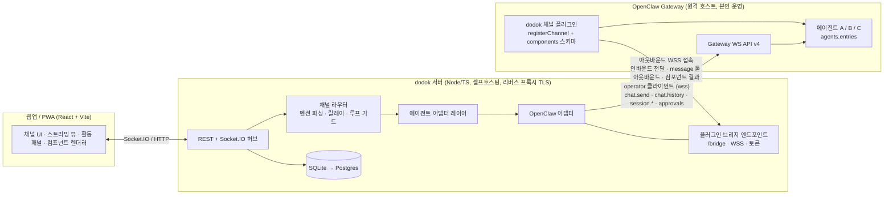

# dodok.chat — 에이전트 네이티브 메신저 개발 계획서 (v0.30)

작성일: 2026-09-14 · 상태: v0.31 (2026-10-26) — 실사용 순서(8장 「다음 순서 — 실사용」)에서 쓰면서 나온 기능으로 채널 세션을 끝냈다(8장 Phase 4 「채널 세션」). 남은 것은 8장 「이월」.

### 변경 이력

| 버전 | 내용 |
| --- | --- |
| v0.3 | 결정 사항 6건 확정, 세션·내부 위임 설계(5.8) 추가 |
| v0.4 | (1) 프로젝트·플러그인 id를 `dodok`으로 통일 (2) 기본 배포 형태를 "본인 운영 원격 Gateway + 플러그인의 아웃바운드 브리지 접속"으로 변경 (3) OpenClaw 패키지 기준을 2026.8.1 → 2026.9.4로 갱신, "Gateway와 동일 버전 핀" 규칙 명문화 (4) 실시간 전송을 Socket.IO로 확정 (5) 최신 `protocol.schema.json`·`gateway-client` README·공식 문서 대조로 3.1절 사실 보강 (6) 채널 봇 루프 보호 설정과 `relayPolicy`의 이중 동작 검증을 Phase 0에 추가 (7) 결정 사항 7~10 추가, 내보내기 아티팩트 링크·HTML 엔티티 정리 |
| v0.5 | 스파이크 1(`docs/adr/0001-gateway-client-spike.md`) 실측 반영 — (1) `hello-ok.features`는 참고 목록, 가용성은 호출해 `FORBIDDEN`/`MISSING_SCOPE`로 판정 (2) caps 정본은 `GATEWAY_CLIENT_CAPS`, `features.capabilities`는 서버 플래그 (3) `chat.send`는 `idempotencyKey` 필수이고 `runId`가 그 값 (4) `final`에 `usage`·`stopReason` 없음 → `session.message` (5) 툴 진행은 `session.tool`이 아니라 `agent` `stream:"tool"` (6) `sessions.subscribe` 응답은 `{subscribed:true}`뿐 (7) `chat.abort`는 `sessionKey` (8) 디바이스 토큰은 단수 (9) 페어링은 공유 토큰이면 자동 승인 (10) `seq`는 순서용, 연속 아님 |
| v0.6 | Phase 0 종료 — ADR 0002 12절(6건)·ADR 0003 10절(7건)의 결정을 10장에 확정: #1 채널 프롬프트 주입 재판정, #11 Node 24 전환, #12 components 노출, #13 봇 루프 보호, #14 브리지 계약 `admission`, #15 「새 대화」= `sessions.reset` + `operator.admin`, #16 재접속 복구, #17 대체 경로 미사용, #18 `inboundChannelPrompt` 제거, #19 `:g<N>` 제거, #20 업스트림 보고 보류, #21 로컬 첫 에이전트 `dev`. 7장 백엔드 Node 24, 8장 Phase 1 첫 작업 두 건 추가 |
| v0.7 | Phase 1 종료 — 8장 Phase 1 의 웹 항목(마크다운 렌더, 스트리밍 버블·중지, 에이전트 등록 UI·채널 추가·프롬프트 편집)에 완료 표시와 실물 요약, 완료 기준에 확인 방법(통합 시나리오 1~8 · dev Gateway 실연 6런 · `dev:fake` 브라우저 검증 시나리오 5), Phase 2 에 마크다운 렌더 보강 한 줄, 8장 끝에 「이월 — 남은 문제」(웹 렌더·서버·웹·실물 확인) 추가 |
| v0.8 | Phase 2 ① 종료(활동 패널·승인) — 8장 Phase 2 의 「활동 패널(툴 타임라인, 런 목록), 승인 카드」에 완료 표시와 실물 요약, 「이월」에서 Phase 2 ① 이 정리한 아홉(서버 넷·웹 넷·`wire-cli` typecheck) 제거와 「한국어 강조·구두점 경계」 해결 표시, 브라우저 검증이 남긴 셋(D4 카드 점프·D6 카운트다운 어긋남·D11 로그아웃 401)과 서버 둘(다른 채널 미해결 승인의 새로고침 복구, `providerApprovalId` 가 어댑터 상한 처리 밖)을 이월에 추가, Phase 1 「실물 확인」 줄을 실연 완료(2026-09-20)로 정정 |
| v0.9 | Phase 2 ① **종료 확정** — 8장 Phase 2 「활동 패널·승인 카드」 완료 줄에 브라우저 재검증 결과(시나리오 9/9, 고친 7건 수치 확인, 새 결함 D12·D13·D14 도 수정), 「이월」 웹에 재검증 수정 라운드가 남긴 여섯(타임라인 행이 낡은 채 남음 · 자리값 소요가 계속 흐름 · `ended`·`vanished` 상한 없음 · 로그아웃 때 `/runs` 한 번 더 · 넓은 화면 「설정 닫기」 초점 · `PanelSlot` 하네스), 「실물 확인」의 사람 몫 줄에 재검증도 못 쟀다는 사실과 흉내 낸 방법 |
| v0.10 | Phase 2 ② **components v1 종료**(2026-09-22) — 8장 Phase 2 「`components` v1 렌더러」에 완료 표시와 실물 요약(블록 5종·셀렉트·모달·결과 줄, 확인 방법), 「이월」에서 Phase 2 ② 가 끼워 정리한 셋(D6 카운트다운 어긋남 · 자리값 소요가 계속 흐름 · 넓은 화면 「설정 닫기」 초점) 제거, Phase 2 ② 가 남긴 것 추가(계약·서버 프로토타입 계열 한 묶음과 권고 · `required` checkbox · 모순 셀렉트 refine · ack 타입 · 결과 문구의 빈 값 · 날짜 키 롤오버 · `lastSeq` 재구독 · 가상화 목록 초점 · 오류 문구 「버튼」 · 이미지 크게 보기 · 긴 라벨 버튼 넘침 · `media`·`file` 문구 비대칭 · 초점·타이머 낮은 셋 · `App.test` 셔플 · `a11y.test` 셀렉트 · `infra/` 부재), 「끝난 런 기억」에 `stopped` 보탬. 같은 날 브라우저 **재검증 24/24·결함 0** 을 완료 줄에 반영(실제 앱에서 다섯 사유·섞인 줄 24px 간격·셀렉트 스크롤 상자), 「이월」의 `lastSeq` 재구독·날짜 키 롤오버·긴 라벨 버튼에 재검증이 본 것과 못 잰 것 |
| v0.11 | Phase 2 ③ **첨부·이미지 종료**(2026-09-23, 실연은 남음) — 8장 Phase 2 「이미지 첨부」에 완료 표시와 확인 방법(통합 11a~11i · 브라우저 17/17 · 결함 1 고친 뒤 실제 앱 재측정), Phase 2 ② 「`components` v1」 줄의 `artifact://` 자리표시 문장을 지금 동작으로, 「이월」에서 Phase 2 ③ 이 닫은 둘(「`media` 이미지를 크게 볼 수 없다」·「`media`·`file` 문구 비대칭」) 제거, Phase 2 ③ 이 남긴 것 추가(스펙 10장 열린 문제 넷 · 판정 Ruling 1·2 가 틀렸을 때 남는 것 · `artifact://` 이름의 본질적 모호 · 잘린 VP8L · dev:fake 키워드 손 목록·진입점 · 채널 전환 초점 · 플러그인 배선 우회 · 종료를 붙잡는 keep-alive · 사람이 볼 것) |
| v0.12 | Phase 2 ④ **PWA·푸시 종료**(2026-09-24, 실연은 예정) — 8장 Phase 2 「PWA」에 완료 표시와 확인 방법(통합 12a~12h + 종료 · 브라우저 16/16·결함 0 — 실제 `web-push` → FCM 왕복 포함), 「이월」에 Phase 2 ④ 가 남긴 것 추가(스펙 10장 열린 문제 넷 · 구독 행이 세션과 묶이지 않음 · 가려졌지만 `visible` 인 창 · presence 잔류·상한 · 승인 기억 상한 테스트(p4-t3 리뷰 m2) · 동기화 경로 `userVisibleOnly`(Nit R14b) · 권한 `default` 문구(Nit F1c) · 서버만 죽었을 때 토스트 · 알려진 경고 셋(DEP0169·#912·#928) · 사람이 볼 것), 웹 「`lastSeq` 재구독」 줄에 사본 복원 경로는 닫혔다는 것(R5)과 남은 5분 창 |
| v0.13 | Phase 2 ④ **실연 완료**(2026-09-24, dev Gateway 2026.9.5) — 8장 「PWA」 완료 줄의 「실연은 아직」을 결과로(런 0회 하네스 7/7 · 모델 런 1회 — 멘션·`finalSource=plugin`·본문 없음 통과, 그 런의 알림 표시는 미확인), 실연이 의심한 「탭을 닫은 뒤 45초 동안 거름」은 p4-c1 측정(17조합)에서 재현되지 않음 — 웹 `pagehide` 에서도 「안 보임」을 보내고 서버는 `LOG_LEVEL=debug` 에서 거름·발송을 한 줄씩 남긴다(`a81e850`·`9fa919b`), 테스트 2185. 「이월」 presence 줄 정정, 새 이월 셋(모델 런 알림 미표시·새 프로필 첫 몇 분의 FCM 누락 · dev:fake 로그 레벨 고정 · bfcache 복귀 `pageshow`) |
| v0.14 | Phase 3 ① **배포 패키징 종료**(2026-09-24) — 8장 Phase 3 「Docker Compose 패키징」에 완료 표시와 확인 방법(로컬 Compose 검증 12/12 · 번들 스모크 · 테스트 2226), 운영 절차 `docs/guides/docker-deploy.md`. 1.3·2.2·4.5·7장 기술 표·10장 #6 의 「Compose 프로필로 로컬 Gateway 동반 기동(`--profile gateway`)」을 뺐다(배포 패키징 스펙 결정 5), 4.5 에 Caddy 가 여는 `/bridge/*`(플러그인의 첨부 HTTP). 「이월」에서 「`infra/` 가 없는데 두 문서가 있다고 말한다」 제거, Phase 3 ① 이 남긴 것 추가(첨부 상한 초과 문구 F1 · 실제 배포를 사람이 아직 안 따라 함 · 볼륨째 옮기기 미검증 · 백업 이월 셋 · 소스 실행 chdir 검사 · 요청 경로 런타임 해석 · 빌드가 레지스트리에 닿아야 함 · 스펙 11장 열린 문제 · `compose.yml` 머리 주석의 웹 빌드 ID 경로 · neo CDP 와 `.mcp.json` 포트 · PWA 스펙이 가리키는 없는 절), 「실기기 푸시」 줄의 미룬 까닭을 지금 상태로 |
| v0.15 | Phase 3 ② **설정 마법사 종료**(2026-09-25) — 8장 Phase 3 「설정 마법사」에 완료 표시와 확인 방법(서버 통합 `setup` · 웹 단위 · `dev:fake` 위 브라우저 시나리오 1~10 — 결함 1(390px 발급 대화상자 원문 잘림)은 고침, 확인 불가 2 는 사람이 볼 것 · 실연 13/13·모델 런 0 은 `docs/superpowers/reports/2026-09-25-setup-wizard-live-smoke-report.md` · 테스트 2400). 브리지 토큰의 정본이 DB 로 옮겨 `.env` 의 `BRIDGE_TOKEN` 은 선택(부팅 때 토큰 행이 하나도 없으면 — 폐기된 행 포함 — 이어받기)이 됐다 — 운영 절차 `docs/guides/docker-deploy.md` 「[웹 → B] 플러그인 설치·브리지 토큰」·「[웹] 브리지 접속 확인」·「브리지 토큰 교체」 절. 「이월」에 Phase 3 ② 가 남긴 것 추가(루트 병렬 실행의 backup SIGINT 테스트 흔들림 · 폐기 알림 `system.notice` · 플러그인 빌드 가드 한계 · dev:fake 훅 테스트·415 · JSON 상자 오버레이 스크롤바 · 비슷한 글자 라벨 `env` · 막힌 이동 중 401 의 `next` · 사람이 볼 것) |
| v0.16 | Phase 3 ③ **운영 보강 종료**(2026-09-25) — 8장 Phase 3 「에러/재시도·레이트리밋·비용 상한, 로그·메트릭」에 완료 표시와 확인 방법(서버 통합 `ops-*` · 웹 단위 · 태스크마다 독립 리뷰 · `dev:fake` 위 브라우저 11/12 — 결함 D1·D2 와 재검증이 찾은 N1 고침 · 로컬 Compose · usage 진단 모델 런 1회(ADR 0005) · 실연 `docs/superpowers/reports/2026-09-25-ops-hardening-live-smoke-report.md` · 테스트 2762). 운영 절차 `docs/guides/docker-deploy.md` 「운영 화면」 절과 `.env` 표의 `TZ`. 「이월」의 usage 줄을 ADR 0005 결론으로 바꾸고, 「dev:fake 훅 테스트 보강과 `text/plain` 단순 요청」(닫힘)을 지우고, 배포 패키징 열린 문제에서 Gateway 버전 드리프트 감지(구현됨)를 뺐다. Phase 3 ③ 이 남긴 것 추가(테스트 공백 · 묶인 `disk_low` 줄의 심각도 · 채널 전환 info 사건 · 재접속 뒤 `setupStatus` · 다시 실행 버튼 24시간 · 운영 알림·금액 상한 등 스펙 「열린 문제」 · 사람이 볼 member 화면) |
| v0.17 | Phase 3 ④ **문서화 종료**(2026-09-25) — 8장 Phase 3 「문서화」에 완료 표시와 확인 방법(루트 `README.md` — 소개·구성·빠른 시작 두 갈래·문서 지도, `docs/guides/agent-guide.md` — 에이전트가 받는 것·채널 프롬프트·릴레이·components v1·파일·승인·붙여 넣을 블록·흔한 실수, 예시 검사 `packages/shared/test/agent-guide-examples.test.ts`), 제목의 판 번호를 상태 줄과 맞춤(v0.15 에 머물러 있었다). 「이월」 머리를 Phase 3 ④ 종료 시점으로 바꾸고 문서화가 남긴 것 추가(「기본 프롬프트」가 에이전트에게 닿지 않는다는 화면 안내 없음 · 붙여 넣을 블록의 모델 효과 미측정 · 블록 산문의 제약 숫자는 테스트 밖 · `AGENTS.md` 반영 시점 미실측) |
| v0.18 | Phase 4 ① **스레드·검색 종료**(2026-09-26) — 8장 Phase 4 「스레드·검색」에 완료 표시와 확인 방법(서버 통합 `threads` 11건 · 검색 단위(트리거·rowid 재사용·백필 가드) · 태스크마다 독립 리뷰(변이)·수정·범위 재리뷰 · `dev:fake` 위 브라우저 11항목 중 9 통과와 재접속 결함(Phase 4 이전부터 있던 20초 멈춤) 수정 · 실연 `docs/superpowers/reports/2026-09-26-threads-live-smoke-report.md` · 테스트 3193). 5.8·10장 #3·#19 에 스레드 하위 세션 키 `agent:<agentId>:dodok:channel:<channelId>:thread:<rootId 소문자>`, 2.1 F-2·7.1 검색 줄을 지금 상태로. 「이월」 머리를 Phase 4 ① 종료 시점으로 바꾸고 스레드·검색이 남긴 것 추가(한글 NFD · `messages` 재생성 마이그레이션 · T2 Minor 넷 · 대기 중 옛 플러그인 · run_limit 채널 단위 · 정본 거절 ack 코드 · Dev·dev 공존 · 200 초과 이어 받기의 옛 루트 요약 · 끝난 스레드 런 · 결과로 가기 경합 · 사람이 볼 것), 「문서」의 neo CDP 줄에 원인(창 없음) |
| v0.19 | Phase 4 ② **팀(초대·멤버·역할) 종료**(2026-09-27) — 8장 Phase 4 「팀」에 이번 사이클 완료 표시와 확인 방법(서버 단위·통합 — 역할 매트릭스 테스트 · 태스크마다 독립 리뷰(변이)·수정·범위 재리뷰 · `dev:fake` 위 브라우저 11항목 중 9 통과와 결함 D1·D2 수정·재검증 · 실연 `docs/superpowers/reports/2026-09-27-team-live-smoke-report.md` · 테스트 3538), 남은 것(OIDC·채널 권한·멀티 Gateway·owner 넘기기·메일). 10장 #22(역할 매트릭스)·#23(초대 링크 + 비밀번호, 메일 없음), 2.1 F-12·2.2 인증·5.1 User/Membership·7.1 인증 줄을 지금 상태로, Phase 3 「운영 화면」의 권한을 admin 이상으로. 「이월」 머리를 Phase 4 ② 종료 시점으로 바꾸고, member 화면 확인 둘(설정 마법사·운영 보강의 「사람이 볼 것」)을 브라우저 검증이 닫아 지웠고, 팀이 남긴 것 추가(고아 Better Auth 사용자 · 만료 세션 소켓 · 내보내기 예외 경로 둘 · 무효 화면의 죽은 토큰 · 별칭·공개 범위 UI · 역할 셀렉트 즉시 적용 · 재설정 링크 경계 · 병렬 부하 타이밍 테스트 · 낮은 관찰 · 스펙 「열린 문제」 · 사람이 볼 것) |
| v0.20 | Phase 4 ③ **Claude 러너 종료**(2026-09-29, 런 0회 하네스까지) — 8장 Phase 4 「어댑터」에 Claude Agent SDK 러너 완료 표시·구성 요약·확인 방법(패키지 테스트 · 서버 통합 러너 시나리오 · dev:fake 브라우저 11/11 · 런 0회 하네스 12/12 · 전체 브랜치 최종 리뷰), 「이월」 머리를 Phase 4 ③ 종료 시점으로, 러너가 남긴 것(SIGKILL 고아 CLI · SIGTERM 중지 모양 · `PROVIDER_AUTH` 카드 · 에이전트↔토큰 묶기 · 러너 프레임 속도 제한 · 첨부 claim 토큰 대조 · `runner_down` 재시작 · 경로 가림 빈틈 · 승인 요약 가운데 생략 등)을 새 묶음으로, 「실물 확인」에 하네스·실연 줄 |
| v0.21 | 이월 정리(2026-09-30) — 결정 없이 고칠 수 있던 12건을 닫고 8장 「이월」에서 지웠다: components 칸 id `constructor`·`__proto__`(쓰기 계약만 거절, 저장된 옛 행은 읽기 계약이 받는다) · 승격 때 비-owner 재설정 링크 폐기 · 만료 세션 1분 청소와 소켓 끊기 · 검색 색인 가드(이미 있음 확인) · `approval.requested` 둘째는 의도된 갱신(주석) · 러너 `PROVIDER_AUTH` run_error 카드 · 러너 종료 런은 `ADAPTER_UNAVAILABLE`+「다시 실행」 · 채널 지시·릴레이 정책 저장 안내 · 상호작용 오류 문구 「항목」 · 긴 라벨 버튼 줄바꿈 · 로그인 실패 뒤 초점 · 확정 승인은 `decidedAt` 자리. 러너 규칙 변경 뒤 자동 「새 대화」(ADR 0007 「규칙이 바뀐 뒤 이어 간 세션」)도 이 판에 든다 |
| v0.22 | 결정이 필요했던 이월 정리(2026-09-30) — 사용자 결정대로 닫고 8장 「이월」에서 지웠다: Caddy 가 CSP 를 강제(`script-src 'self'`, 스타일만 `'unsafe-inline'`, zod jitless) · 코드 강조 `shiki` 지연 로딩 · 푸시 구독 행을 등록한 세션에 묶음(세션이 지워지면 cascade) · 요청·핸드셰이크 거절 로그의 IP 를 IPv4 /24·IPv6 /48 로 · 초대 수락 때 고아 Better Auth 사용자 교체 · Claude 에이전트를 러너 토큰에 묶기(`agents.runner_token_id`, 연결 페이지 「이 러너로 묶기」) · 러너 소켓마다 프레임 버킷 둘(열린 런·승인을 닫는 프레임 가운데 처리기가 받아들일 것은 버킷 밖, 승인 요청은 런마다 누계 32). 하나(8)는 두기로 정해 그 줄에 적었다. 미정 둘(6·9)은 그대로 남았다. 이번 정리가 남긴 것(업그레이드 직후 러너 묶임이 재시작 순서로 굳음 · Better Auth 세션 행의 로그인 IP 등)을 「이월」에 |
| v0.23 | Phase 4 **멀티 Gateway 종료**(2026-10-05, 실연까지) — 8장 Phase 4 에 「멀티 Gateway」 완료 표시·구성 요약·확인 방법(통합 multi-gateway 시나리오 · dev:fake 가짜 Gateway 둘 위 브라우저 7항목 · 실물 dev Gateway 둘 실연 12/12, 모델 런 0), 팀 「남은 것」에서 멀티 Gateway 를 뺌, 「이월」 머리를 이 시점으로, 새 묶음 「멀티 Gateway」, 러너 묶음의 「`claimBridgeAttachments` 가 올린 토큰을 대조하지 않는다」를 지움(러너 claim 은 그 토큰이 올린 것만), 「실물 확인」에 실연 줄 |
| v0.24 | **설정 통합·에이전트 보관·`llms.txt` 종료**(2026-10-06, 실연까지) — 8장 Phase 4 에 완료 표시·구성 요약·확인 방법, 화면이 옮겨 간 줄(Phase 2 ④ 「알림」·Phase 3 ② 「연결」 진입점·이월 「권한 물음」 줄의 파일)을 지금 자리로, 「이월」 머리를 이 시점으로, 새 묶음 「설정·에이전트 보관·llms.txt」 |
| v0.25 | **채널 보관·멤버 비활성화 종료**(2026-10-06) — 8장 Phase 4 에 완료 표시·구성 요약·확인 방법, 「팀」 절의 내보내기 문장을 비활성화로, 「이월」 머리를 이 시점으로, 「팀」 묶음의 내보내기 예외 경로 줄을 비활성화의 예외 경로로, 새 묶음 「채널 보관·멤버 비활성화」 |
| v0.26 | **읽지 않음 종료**(2026-10-06) — 8장 Phase 4 에 완료 표시·구성 요약·확인 방법, 「이월」 머리를 이 시점으로, 새 묶음 「읽지 않음」 |
| v0.27 | **리액션 종료**(2026-10-07, 실연까지) — 8장 Phase 4 에 완료 표시·구성 요약·확인 방법, 「이월」 머리를 이 시점으로, 새 묶음 「리액션」, 「실물 확인」에 실연 줄, 7.1 (B) 「이모지/리액션」 줄을 지금 상태로 |
| v0.28 | **자동화 종료**(2026-10-07, 모델 런 0회) — 8장 Phase 4 에 「자동화(예약·웹훅)」 완료 표시·구성 요약·확인 방법, 「이월」 머리를 이 시점으로, 새 묶음 「자동화」 |
| v0.29 | **서버 네이티브 푸시 종료**(2026-10-12, 실기기 발송은 사람 몫) — 8장 Phase 4 「앱」 줄에 서버 하위 프로젝트 완료 표시·구성 요약·확인 방법, 「이월」 머리를 이 시점으로, 새 묶음 「네이티브 푸시(서버)」, 「실물 확인」에 실기기 줄 |
| v0.30 | **실사용 순서 결정**(2026-10-19) — 8장 Phase 4 뒤에 「다음 순서 — 실사용」(① Komodo 로 서버 배포·웹 확인 ② 쓰면서 나온 수정·기능 ③ 데스크톱·모바일 앱), 배포는 기존 리버스 프록시 뒤 Komodo Git Repo Stack |
| v0.31 | **채널 세션 종료**(2026-10-26, 실연까지 — 모델 런 0회) — 8장 Phase 4 에 「채널 세션」 완료 표시·구성 요약·확인 방법, 5.8 세션 키 단위·10장 #3·#15·#19·#22 를 대화 단위·「새 대화」 없음으로, 「이월」 머리를 이 시점으로, 새 묶음 「채널 세션」, 「실물 확인」에 실연 줄 |
| v0.32 | **러너 일반화 종료**(2026-10-30, 실연까지 — 모델 런 0회) — 8장 Phase 4 에 「러너 일반화」 완료 표시·구성 요약·확인 방법, 5.1 Agent 의 제공자를 openclaw·runner 와 `program` 으로, 「이월」 머리를 이 시점으로, 새 묶음 「러너 일반화」, 「Claude 러너」 묶음에서 걷은 묶기(`claimUnbound`) 줄을 지움, 「실물 확인」에 실연 줄 |

---

## 1. 개요

### 1.1 한 줄 정의

사람과 AI 에이전트가 **같은 채널에서 동등한 참여자로 대화하는 메신저**. Slack/Discord처럼 채널로 주제를 나누되, 에이전트의 스트리밍 응답·작업 로그·버튼/선택 같은 인터랙티브 UI를 1급 기능으로 지원한다. 1차 연동 대상은 OpenClaw이며, 이후 Claude Code, Codex, Hermes 등을 같은 어댑터 인터페이스로 붙인다. 프로젝트 이름은 **dodok.chat**, 코드·설정·플러그인 id는 **`dodok`**이다.

### 1.2 목표

- **MVP (개인용)**: 웹앱 + PWA에서 OpenClaw 에이전트 여러 개를 채널별로 배치하고, 멘션 기반으로 대화·협업시킨다.
- **확장 (팀용)**: 워크스페이스/멤버/권한 개념을 처음부터 데이터 모델에 두어, 팀 단위 플랫폼으로 전환할 때 스키마 재설계를 피한다.
- **후속**: 데스크톱(Tauri)·모바일(Capacitor 또는 네이티브) 앱, Claude/Codex/Hermes 직접 연동.

### 1.3 확정된 방향 (v0.3 + v0.4)

| 항목 | 결정 |
| --- | --- |
| OpenClaw 연동 방식 | **하이브리드** — 전용 채널 플러그인(라우팅·UI 컴포넌트·채널 프롬프트) + Gateway WS 클라이언트(토큰 스트리밍·툴 이벤트·승인) |
| 멀티에이전트 발언 규칙 | **멘션 + 자동 릴레이** — @멘션된 에이전트가 응답, 에이전트가 다른 에이전트를 @멘션하면 앱이 릴레이 (턴 제한·루프 가드) |
| 기술 스택 / 실행 형태 | **TypeScript 풀스택 + 셀프호스팅** — React(Vite) PWA, Node 백엔드(Fastify + Socket.IO), SQLite→Postgres, Docker Compose |
| Gateway 배치 | **본인 운영 원격 Gateway에 연결이 기본**. 플러그인은 Gateway 호스트에 설치되어 우리 서버의 브리지로 아웃바운드 WSS 접속. 로컬 개발은 `openclaw --dev`(Compose 동반 기동 프로필은 뺐다 — 배포 패키징 스펙 결정 5) |
| 버전 정책 | `@openclaw/gateway-client`·`@openclaw/gateway-protocol`·`openclaw`(플러그인 SDK)를 **Gateway와 같은 버전으로 정확히 핀**. 시작 버전 2026.9.4, 프로토콜 v4 |
| 산출물 | 마크다운 계획서 (본 문서) + 구성 가이드(`docs/guides/project-structure.md`), 저장소에 저장 |

---

## 2. 요구사항 정리

### 2.1 기능 요구사항

| ID | 요구사항 | MVP | 비고 |
| --- | --- | --- | --- |
| F-1 | OpenClaw 에이전트 연동 (메시지 송수신, 세션 유지) | ✅ | 하이브리드 구조 |
| F-2 | 채널 생성/관리로 대화 주제 분리 | ✅ | 워크스페이스 > 채널 > 스레드(스레드는 Phase 4 ①) |
| F-3 | 한 채널에 여러 에이전트 배치, 에이전트 간 소통 | ✅ | 멘션 + 릴레이 |
| F-4 | 채널별 프롬프트 (시스템 지시) | ✅ | 채널 프롬프트 + 에이전트별 채널 오버라이드 |
| F-5 | OpenClaw UI 입력 네이티브 지원 (텍스트·버튼·선택·모달) | ✅ | Discord 플러그인의 components 규약 대응 |
| F-6 | 스트리밍 채팅 (토큰 단위 델타) | ✅ | Gateway `chat`/`agent` 이벤트 |
| F-7 | 에이전트 작업 기록(툴 호출·실행 상태) 확인 | ✅ | `agent`(`stream:"tool"`)/`session.operation` 이벤트 → 활동 패널 |
| F-8 | 실행 승인(exec approval) 응답 | ✅(기본) | 버튼으로 승인/거부 |
| F-9 | 첨부파일·이미지 | △ | MVP는 이미지 업로드/표시까지 |
| F-10 | Claude Code / Codex / Hermes 연동 | 후속 | 어댑터 인터페이스만 MVP에서 정의 |
| F-11 | 데스크톱/모바일 앱 | 후속 | PWA로 대체 |
| F-12 | 팀 워크스페이스 (멤버 초대·권한) | 후속 | 초대·멤버·역할(owner·admin·member)은 Phase 4 ② — OIDC·채널별 권한은 후속 |

### 2.2 비기능 요구사항

- **셀프호스팅 우선**: 메신저 서버(API + 웹 — 앱 컨테이너 하나)는 Docker Compose로 기동하고, HTTPS 는 각 서버의 리버스 프록시가 맡는다. OpenClaw Gateway는 기본적으로 **별도 호스트에서 본인이 운영하는 원격 Gateway**에 `wss://`로 연결하고, 우리 채널 플러그인은 그 Gateway 호스트에 설치되어 우리 서버의 브리지 엔드포인트로 **아웃바운드 WSS** 접속한다. 따라서 서버의 브리지·웹·API는 리버스 프록시(TLS)로 외부에 노출되어야 한다. Gateway 를 Compose 로 동반 기동하는 옵션은 두지 않는다(배포 패키징 스펙 결정 5 — 개발은 `openclaw --dev`).
- **오프라인 내성**: PWA로 최근 채널 캐시, 재접속 시 `chat.history` 델타 커서로 복구.
- **확장 가능한 인증**: MVP는 단일 사용자(로컬 토큰), 이후 OIDC/이메일 로그인 추가 가능하도록 `users`/`memberships` 테이블 선반영. Phase 4 ② 가 멤버의 이메일·비밀번호 로그인(초대로 가입)을 더했다 — owner 는 로컬 토큰 그대로, OIDC 는 후속.
- **관측성**: 에이전트 런(run) 단위로 이벤트를 저장해 사후 재생(replay) 가능.
- **비용 통제**: 에이전트 간 릴레이 턴 수 상한, 채널별 일일 런 상한(옵션).

### 2.3 범위 밖 (MVP)

음성/영상, E2E 암호화, 외부 메신저(Slack/Discord) 브리지, 플러그인 마켓, 과금.

---

## 3. 조사 결과: OpenClaw 연동 지점

OpenClaw는 단일 장기 실행 **Gateway 데몬**(기본 포트 18789)이 모든 채널·에이전트·세션을 관리하고, 타입이 있는 WebSocket API(요청/응답 + 서버 푸시 이벤트)를 제공한다. 우리 앱과 맞닿는 지점은 두 가지다.

### 3.1 Gateway 클라이언트 (WS API) — 스트리밍·작업 로그·승인용

기준 버전: `@openclaw/gateway-client` / `@openclaw/gateway-protocol` **2026.9.4** (2026-09-14 npm latest). 아래 사실은 해당 버전의 `protocol.schema.json`, 패키지 README/CHANGELOG, 공식 문서(`rpc-bootstrap-and-events`)를 대조해 확인했다.

- **프로토콜 v4** (`PROTOCOL_VERSION = 4`, `MIN_CLIENT_PROTOCOL_VERSION = 4`). 일반 클라이언트는 `minProtocol: 4, maxProtocol: 4`로 고정 협상. v5 후보 변경(`SessionsPatchMutation`의 `execSecurity/execAsk` 제거 등)은 CHANGELOG의 "Deferred to the next wire version"에 보류 중이므로, 와이어 버전 상승은 명시적 파손 이벤트로 취급한다. 패키지 버전(`YYYY.M.PATCH`)과 와이어 버전은 별개다.
- **버전 핀**: 정확 핀(`--save-exact`)하고 **배포하는 Gateway와 같은 버전**으로 맞춘다. 현재 Gateway는 2026.9.2, npm 최신은 2026.9.4 → Phase 0 첫 단계에서 Gateway를 2026.9.4로 올린 뒤 핀한다. Node `>=22.19.0` 필요.
- **핸드셰이크**: 클라이언트는 Gateway의 `connect.challenge` 이벤트를 기다린 뒤 `connect` 요청을 보낸다(`GatewayClient`가 처리, 챌린지 없는 폴백 없음). `ConnectParams`에는 `minProtocol/maxProtocol`, `client`, `caps`, `role`, `scopes`, `device`(서명된 디바이스 아이덴티티), `auth`(token / bootstrapToken / deviceToken / password 등)가 들어간다. 응답 `hello-ok`는 협상된 `protocol`, `server`, **`features` 맵(`methods`, `events`, `capabilities`)**, 초기 `snapshot`, `auth`(발급된 디바이스 토큰 — 실측은 단수 `deviceToken`이며 스키마의 복수 `deviceTokens`는 오지 않았다), `policy`(`maxPayload`, `maxBufferedBytes`, `tickIntervalMs`)를 돌려준다. **`features`는 참고 목록이지 지원의 진실이 아니다**(ADR 0001: `features`에 없는 메서드도 호출되고, 없는 메서드와 스코프 부족이 똑같이 `FORBIDDEN`/`MISSING_SCOPE`로 온다). 가용성은 호출해서 판정하고, 그 응답에는 기능만 끄고 연결은 유지한다.
- **인증·페어링**: `role: "operator"` + 스코프 `operator.read`(히스토리·세션·이벤트), `operator.write`(전송·세션 변경), `operator.approvals`(승인). **`operator.admin` 도 함께 요청한다**(그 까닭이던 「새 대화」의 `sessions.reset` 은 채널 세션이 걷었다 — 지금 admin 이 필요한 호출이 있는지는 8장 「이월」 「채널 세션」 묶음, 10장 #15). Ed25519 디바이스 아이덴티티로 챌린지에 서명 → `connect` → 원격에서는 첫 `connect`가 `NOT_PAIRED`(`details.code: "PAIRING_REQUIRED"`, `details.requestId`)로 거절되지만 **공유 토큰이 있으면 수 초 뒤 자동 승인된다**(dev 루프백 + 공유 토큰은 거절 없이 붙고 요청한 `operator.admin`까지 부여, 디바이스 토큰 미발급 — ADR 0003 2절; 원격에서 admin이 부여되는지는 미확인)(ADR 0001, `retryable:false`를 보고 포기하면 놓친다) → 2~5초 간격으로 재시도하고, 지속될 때만 사람에게 `openclaw devices approve <requestId>`를 안내 → 발급된 디바이스 토큰 저장. **디바이스 키·토큰 저장은 호스트(우리 서버)의 책임**이다 — `GatewayClient`는 `hostDeps`(`loadOrCreateDeviceIdentity`, `signDevicePayload`, `publicKeyRawBase64UrlFromPem`)를 통해서만 접근하며 OpenClaw의 로컬 자격 증명을 자동으로 읽지 않는다.
- **전송 보안**: 원격 연결은 `wss://` 필수. Node 클라이언트는 루프백·사설망·`.local`/`.ts.net`에 한해 평문 `ws://`를 허용하지만 암호화는 아니다.
- 클라이언트 capability 선언: 문서상 `tool-events`(툴 실행 실시간 이벤트), `approvals`, `session-scoped-events`. 정본은 `@openclaw/gateway-protocol/client-info`의 `GATEWAY_CLIENT_CAPS` 상수다(세 이름 모두 있음). `hello-ok.features.capabilities`는 서버 기능 플래그라 선언한 caps를 에코하지 않으며, 선언 효과는 행동으로만 드러난다(`tool-events`를 선언하면 `session.tool` 대신 `agent`로 받는다). **선언한 것은 반드시 구현**한다.
- 핵심 메서드 (스키마 존재 확인)
  - `chat.send` — 세션에 메시지 전송. 파라미터: `sessionKey`, `agentId`, `message`, **`idempotencyKey`(필수 — 응답 `runId`가 이 값과 같다)**, `mentions`, `queueMode`(`steer`/`followup`/`collect`/`interrupt`), `fastMode`, `deliver`, **`originatingChannel`/`originatingTo`/`originatingAccountId`/`originatingThreadId`**, `replyToId`, `attachments`, `timeoutMs` 등. 배달의 열쇠는 `originating*`가 아니라 **`deliver:true`**다 — `originating*`는 `operator.admin`이 필요하고 `deliver` 없이는 배달 경로가 아니며, channel-scoped 세션은 `deliver:true`만으로 세션 `deliveryContext`를 상속한다. 배달은 `sendText`(agentId·runId 없음)로 오고 턴은 owner 권한으로 돈다 → MVP에서 대체 경로로 쓰지 않는다(ADR 0003 6·7.3). 응답은 `{ runId, status: "started" }` — `messageSeq`는 여기 없고 `session.message`의 필드다. `sessions.create` 없이 `chat.send`만으로 세션이 생성된다(`sessionKey`와 `sessionId`는 다른 값).
  - `chat.history` — 표시용 정규화된 트랜스크립트. `sessionKey`, `agentId`, `cursor`, `limit`, `maxBytes` 등. 요청 파라미터는 `cursor`, 응답 필드가 `deltaCursor`이며 커서 호출은 `{kind:"delta"}` 또는 `{kind:"reset"}`. **claude-cli 세션은 `deltaCursor`가 오지 않고 커서 호출은 늘 `reset`**(CLI 바인딩 없는 세션에서만 delta). 커서 호출에서 `limit`은 무시된다. 일반 응답 메시지는 전사 메시지(`__openclaw.seq`), delta 항목은 `session.message` 봉투(`messageSeq`)로 모양이 다르다(ADR 0003 5절).
  - `chat.abort` — 필수는 `sessionKey`(+`agentId`/`runId`/`preserveSideRuns`), `clearQueued` 옵션.
  - `sessions.subscribe` — 응답은 `{subscribed: true}`뿐이다(로스터 스냅샷·`inFlightRun` 없음). 로스터는 `sessions.list`, 재접속 복구는 `sessions.list` + `chat.history`(`deltaCursor` 증분은 claude-cli 세션에서 성립하지 않으므로 전체 치환이 기본, 커서는 최적화 — ADR 0003 5·7.2). `sessions.messages.subscribe({includeApprovals:true})` 응답의 `approvalReplay`가 승인 카드 복구원이다.
  - `sessions.create/patch/reset/delete`, `sessions.messages.subscribe({ includeApprovals: true })`, `sessions.title.prepare`.
  - `approval.get/resolve/history`, `exec.approval.request/get/list/resolve/waitDecision`, `exec.approvals.get/set`, `plugin.approval.list/request/waitDecision/resolve`(`get`은 없다). 승인 이력은 30일 보관, first-answer-wins.
- 핵심 이벤트
  - `chat` — 페이로드는 항상 `runId`, `sessionKey`, `agentId`, `seq`를 담고 `state`로 구분: **`delta`**(`deltaText` 증분, `message` 누적 스냅샷, `replace` 플래그), **`final`**(`message`만 — `usage`·`stopReason`·`model`·비용은 같은 시점의 `session.message`에 있다), **`status`**(`phase`, `retry`), **`error`**(`errorMessage`, `errorKind`, `errorDetail` — provider/model/httpStatus 등), **`aborted`**. 서브에이전트가 만든 런은 `spawnedBy`로 부모를 가리킨다. `seq`는 순서용이며 연속이 아니다(빠른 델타가 병합되며 건너뛴다) — 빈 칸을 유실로 보지 않는다.
  - `agent` — 런 단위 스트림(`runId`, `seq`, `stream`, `ts`, `data`, `isHeartbeat`). 재접속 후 `runId`+`seq`로 순서 복원.
  - `session.message`, `session.operation`, `session.tool`, `session.approval`, `session.observer` — 공식 문서(`rpc-bootstrap-and-events`)에 명시. `session.operation`은 현재 스키마에서 `operation: "compact"`(컨텍스트 압축)만 정의되어 있다. **툴 진행은 `agent`의 `stream: "tool"`(phase `start`/`result`)로 받는다** — `tool-events`를 선언한 연결(= `chat.send`를 보낸 우리 연결)은 `session.tool` 수신 대상에서 제외된다(ADR 0001 5.3). `features.events`에는 `mentions.changed`도 있다(멘션 릴레이 설계에서 확인). 이벤트명 목록은 `hello-ok.features.events`(60개)로 보되 참고 목록으로 다룬다.
  - 시스템: `presence`, `tick`, `health`, `heartbeat`, `shutdown`. 이벤트 프레임은 `seq`·`stateVersion`을 실을 수 있다.

### 3.2 채널 플러그인 — 라우팅·UI 컴포넌트·채널 프롬프트용

- 진입점: 권장은 `defineChannelPluginEntry({ plugin, setRuntime })`(`openclaw/plugin-sdk/plugin-entry`; `definePluginEntry` + `registerChannel` 도 동작하지만 감싼 형태가 표준, ADR 0002 3.1). 매니페스트(`openclaw.plugin.json`)에 `channels`·`channelConfigs`, `package.json` 에 `openclaw.channel` 을 두고 **런타임 dependencies 없이 단일 번들**로 배포한다. 플러그인 SDK는 `openclaw` 패키지의 `./plugin-sdk/*` 서브패스로 제공되며, 관련 진입점으로 `channel-message`(`ChannelMessageActionAdapter`), `channel-contract`, `channel-config-schema`(채널 설정 스키마 빌더), `channel-mention-gating`, `channel-inbound`/`channel-outbound`, `channel-reply-pipeline`, `channel-streaming-config`, `discord`(컴포넌트 빌더 `buildDiscordComponentMessage`, `DiscordComponentMessageSpec` 참조용)가 있다. `openclaw` 패키지는 unpacked 200MB급이므로 플러그인 패키지의 devDependency로만 두고 Gateway와 같은 버전으로 핀한다.
- 코어가 공용 `message` 툴·프롬프트 배선·세션 관리를 소유하고, 채널 플러그인은 **액션 디스커버리·capability·채널 고유 스키마 조각**만 담당(`ChannelMessageActionAdapter.describeMessageTool`). 즉 Discord의 `components`처럼 **우리 채널만의 UI 스키마를 message 툴에 끼워 넣을 수 있다** — 실측으로 동작한다(ADR 0002 6절: 모델이 첫 시도에 `components` 를 채워 호출). **단 SDK 방침은 provider-native 스키마 조각을 막고 `presentation` capability 를 권하므로 향후 차단 리스크가 있다**(ADR 0002 12절 결정 2).
- `accountId`, `currentChannelId`, `chatType`, `currentThreadTs`, `currentMessageId`, `sessionKey`, `sessionId`, `agentId` 는 **message 툴 디스커버리·실행 컨텍스트**에서 코어가 주는 스코프다. 인바운드는 반대로 플러그인이 `buildContext`·`dispatch` 에 `route`·`reply`·`sender` 를 **넘기는** 쪽이다(ADR 0002 4.1·5.2).
- 채널 설정 스키마에는 `ReplyToModeSchema`, `ChannelBotLoopProtectionSchema`(채널 단위 봇 루프 보호) 등이 포함된다. 봇 루프 보호는 **플러그인이 인바운드에 `botLoopProtection` 사실을 넘길 때만** 코어가 동작한다(5.3, ADR 0002 7절).
- 추가 확장점: `registerTool`(에이전트 툴), Gateway 메서드 등록, HTTP 라우트, 백그라운드 서비스, 설정 쓰기(`runtime.config.mutateConfigFile`; `channel-config-writes` 는 쓰기 **권한 판정** 모듈이지 쓰기가 아니다 — ADR 0002 8절).
- **원격 배치**: 플러그인은 Gateway 프로세스 안에서 실행되므로 Gateway 호스트에 설치한다(호스트에서 `openclaw plugins install <tarball> --force --accept-capabilities`; tarball 은 `pnpm pack` — `openclaw plugins pack` 은 채널 플러그인을 거부한다. Gateway RPC `plugins.install` 은 clawhub/official 소스만 받으므로 원격 설치는 호스트 작업이다. 안정화 후 npm `@dodok/openclaw-plugin` 퍼블리시. ADR 0002 3.3·9절). 플러그인 계정 설정에 우리 서버의 브리지 URL·토큰을 넣고, 플러그인이 **아웃바운드**로 접속한다. Gateway 호스트에서 우리 서버로의 egress만 있으면 되고, Gateway 쪽 인바운드 포트를 추가로 열 필요는 없다.

### 3.3 Discord 플러그인의 인터랙티브 UI 규약 (우리가 미러링할 대상)

- 에이전트는 `message` 툴에 `components` 페이로드를 붙여 전송: `{ channel: "discord", action: "send", to, message: "fallback", components: { reusable, text, blocks: [...], modal: {...} } }`.
- 블록 종류: 텍스트 섹션, 구분선, **액션 로우(버튼 최대 5개 또는 셀렉트 1개)**, 미디어 갤러리, 파일, **모달(필드 최대 5개)**.
- 버튼: 이모지·링크 변형, 스타일 `success`/`danger`/기본, `allowedUsers`로 사용자 제한.
- 셀렉트: `string`/`user`/`role`/`mentionable`/`channel`, 옵션 최대 25개.
- 모달 필드: `text`/`checkbox`/`radio`/`select`/`role-select`/`user-select`. 트리거 버튼 자동 생성.
- 사용자의 상호작용 결과는 **일반 인바운드 메시지로 에이전트에게 되돌아감**(replyToMode 준수). 기본 1회용, `reusable: true`면 만료까지 반복. 콜백 TTL 기본 30분, 최대 24시간.
- 실행 승인: `channels.discord.execApprovals.{enabled, approvers, target}` — 버튼 기반 승인, 승인자만 상호작용 가능.
- 채널 단위 설정: `guilds.<id>.requireMention`, `channels.<id>.requireMention`, `channels.<id>.systemPrompt`, `channels.<id>.skills`, `channels.<id>.users`, `replyToMode`(`off|first|all|batched`). → 우리 플러그인도 같은 형태의 채널별 설정을 갖추면 "채널별 프롬프트"(F-4)와 "멘션 게이트"(F-3)를 OpenClaw 관례대로 구현할 수 있다.

### 3.4 멀티에이전트

- `agents.entries[]`에 `agentId`별로 워크스페이스(SOUL.md, AGENTS.md)·상태 디렉터리·세션 스토어(SQLite) 분리. `openclaw agents add <id>`.
- 바인딩: `{ agentId, match: { channel, accountId, peer } }`, **가장 구체적인 매치 우선**(exact peer → parent peer → wildcard → guild+roles → guild → team → account → channel → default).
- 세션 키: DM은 `agent:<agentId>:main`, 그룹은 채널/피어 기반 키.
- 에이전트 간 소통: `tools.agentToAgent.allow`로 허용 쌍 제한, `sessions_send/list/history` 툴, 서브에이전트 위임(코디네이터→스페셜리스트 프리셋).
- Gateway 요청에서 `agentId`를 지정하면 바인딩을 우회해 특정 에이전트에 직접 전달 가능.

### 3.5 후속 연동 대상 요약

| 대상 | 연동 경로 (예상) | 비고 |
| --- | --- | --- |
| Claude Code | Claude Agent SDK (TS/Python) — 스트리밍 메시지·툴 이벤트·권한 콜백 | 로컬 프로세스 실행 필요 |
| Codex | `codex app-server`(JSON-RPC, 공개 프로토콜; TS 클라이언트 존재) 또는 Codex SDK | 로컬 프로세스 |
| Hermes Agent | 자체 메시징 게이트웨이(30+ 플랫폼) + OpenAI 호환 API 서버 | 커스텀 어댑터 문서 부재, 조사 필요 |

---

## 4. 아키텍처

### 4.1 구성도



### 4.2 두 경로의 역할 분담

| 관심사 | 채널 플러그인 경로 | Gateway 클라이언트 경로 |
| --- | --- | --- |
| 사용자 메시지 → 에이전트 | ✅ 인바운드 (바인딩·멘션 게이트 활용) | 대체 경로는 MVP 미사용 — `deliver:true`로 배달은 되지만 agentId·runId 없는 `sendText`이고 owner 권한 턴이 된다(ADR 0003 6·7.3) |
| 에이전트 최종 응답 | ✅ 아웃바운드 (`message` 툴) | `chat` 이벤트 `state: final`의 `message` 스냅샷으로도 수신 |
| 버튼/셀렉트/모달 | ✅ 우리 채널의 `components` 스키마 | — |
| 토큰 스트리밍 | 편집 기반(제한적) | ✅ `chat` `state: delta`의 `deltaText` / `agent` 이벤트 |
| 툴 실행 로그 | — | ✅ `agent`(`stream:"tool"`), `session.operation`(압축) |
| 실행 승인 | 플러그인 approval 버튼 가능 | ✅ `approval.*`, `exec.approval.*`, `session.approval` |
| 세션 히스토리 복구 | — | ✅ `chat.history` 전체 치환(claude-cli), `deltaCursor`는 CLI 바인딩 없는 세션에서만 최적화(ADR 0003 5절) |

플러그인이 "정식 채널"이 되면 OpenClaw 입장에서 우리 앱은 Discord와 같은 위치가 되어, 바인딩·그룹 정책·컴포넌트·승인 설정을 기존 문서 그대로 재사용할 수 있다. Gateway 클라이언트는 여기에 실시간성과 관측성을 더한다.

### 4.3 메시지 흐름 (예: 사용자가 `@researcher` 멘션)

1. 클라이언트가 Socket.IO로 메시지 전송 → 서버가 저장(`messages`) → 채널 룸 구독자에게 브로드캐스트.
2. 채널 라우터가 멘션을 파싱해 대상 에이전트(`researcher`)를 결정. 채널 프롬프트 + 에이전트별 오버라이드를 컨텍스트로 합성.
3. OpenClaw 어댑터가 브리지(플러그인이 열어 둔 WSS 연결)로 인바운드 전달(`peer = channel:<id>`, `agentId = researcher`).
4. 동시에 Gateway 클라이언트가 해당 세션 키의 `chat`/`agent`(`stream:"tool"`) 이벤트를 구독 → 델타·툴 이벤트를 `runs`/`run_events`에 저장하며 클라이언트에 실시간 릴레이.
5. 에이전트가 `message` 툴로 최종 응답(선택적으로 `components`) 전송 → 플러그인 → 브리지 → 서버 → 메시지 확정, 스트리밍 버퍼를 최종 본문으로 교체.
6. 응답에 `@planner` 멘션이 있으면 라우터가 릴레이 규칙 검사 후 2단계부터 반복. 턴 카운터가 상한에 도달하면 "사람 개입 필요" 시스템 메시지로 종료.
7. 사용자가 버튼 클릭 → 서버가 `component_interactions` 저장 → 브리지로 플러그인에 전달 → 인바운드 메시지로 변환해 원래 에이전트에게 전달(Discord 규약과 동일).

### 4.4 재접속·복구

- 클라이언트: 마지막 `messageSeq`를 보관, 재접속 시 서버에 이후 메시지 요청.
- 서버 ↔ Gateway: 재접속을 "새 프로젝션"으로 취급 — `sessions.subscribe` 재수립 → 선택 세션 `chat.history` 치환(커서는 최적화, `reset`이면 전체 치환) → `inFlightRun` 채택(응답 필드는 스키마에 있으나 미관찰, ADR 0003 5.1) → 이후 `agent` 이벤트를 `runId`+`seq`로 정합.
- 플러그인 ↔ 서버 브리지: 플러그인이 지수 백오프로 재접속. 끊긴 동안의 아웃바운드(에이전트 응답·컴포넌트 결과)는 플러그인 쪽 큐에 보관 후 재전송, 서버는 `runId`/메시지 id로 중복 제거.

### 4.5 배포 토폴로지

| 구성 요소 | 위치 | 노출 |
| --- | --- | --- |
| dodok 서버(API·Socket.IO·브리지·웹) | 본인 서버 A (Docker Compose — 루트 `compose.yaml`, 앱 컨테이너 하나) | 서버가 `/`(웹), `/api`, `/socket.io`, `/bridge/*`, `/runner/*`, `/hooks/*`, `/mcp` 를 한 포트로 낸다. 브리지 WebSocket 은 Socket.IO 네임스페이스 `/bridge` 라 `/socket.io` 로 지나고(ADR 0002), `/bridge/*` 는 플러그인의 첨부 HTTP(`/bridge/attachments`)다. 호스트에는 루프백 포트 하나만 열고, TLS 는 서버 A 의 리버스 프록시가 끝내 모든 경로를 그 포트로 넘긴다(`TRUST_PROXY` 는 그 프록시 주소) |
| OpenClaw Gateway + dodok 플러그인 + 에이전트 | 본인 서버 B (원격, 이미 운영 중) | 우리 서버가 `wss://`로 접속. 플러그인은 `/bridge`로 아웃바운드 접속. 추가 인바운드 포트 불필요 |
| 로컬 개발 | 개발 PC | 서버는 `pnpm -F @dodok/server dev`. Gateway는 원격에 붙거나 `openclaw --dev`로 로컬 기동(Compose 동반 기동 `--profile gateway` 는 뺐다 — 배포 패키징 스펙 결정 5). 원격 플러그인이 개발 PC의 브리지에 붙어야 할 때는 터널(cloudflared/tailscale 등)로 `BRIDGE_PUBLIC_URL`을 만든다 |

A와 B가 같은 호스트여도 된다 — Gateway 는 Compose 밖에서 따로 돈다. 배포 절차는 `docs/guides/docker-deploy.md`.

---

## 5. 핵심 설계

### 5.1 도메인 모델

- **Workspace**: 최상위 컨테이너. MVP는 1개 자동 생성. 팀 전환 시 다수.
- **User / Membership**: owner 1명(로컬 토큰 계정) + 초대로 들인 admin·member(Phase 4 ②). `role` 에는 guest 도 있지만 쓰지 않는다 — 역할과 권한은 팀 스펙 `docs/superpowers/specs/2026-09-26-team-members-design.md` 「역할과 권한」 절, 10장 #22.
- **Agent**: 워크스페이스에 등록된 에이전트 프로필. `provider`(openclaw/runner — 러너면 러너 안에서 돌릴 `program` claude/codex/opencode 와 프로젝트·모델·권한·도구, 러너 일반화 스펙), `providerAgentId`(OpenClaw `agentId`), 표시 이름, 아바타, 기본 프롬프트, 활성 여부.
- **Channel**: 주제 단위. `prompt`(채널 프롬프트), `relayPolicy`(최대 릴레이 턴, 허용 에이전트 쌍), `visibility`.
- **ChannelMember**: 사람 또는 에이전트의 채널 참여. 에이전트인 경우 `promptOverride`, `mentionAliases`, `autoRespond`(멘션 없이도 응답할지, 기본 false).
- **Message**: `author`(user|agent|system), 본문(마크다운), 첨부, `components`(렌더용 JSON), `replyTo`, `runId`(에이전트 메시지일 때), `seq`.
- **Run**: 에이전트 1회 실행. `sessionKey`, `providerRunId`, 상태(queued/streaming/tool/awaiting_approval/done/error/aborted), 토큰·비용 메타.
- **RunEvent**: 런의 이벤트 로그(델타·툴 시작/종료·승인 요청/결정·에러). 활동 패널과 재생의 원천.
- **ComponentInteraction**: 버튼/셀렉트/모달 제출 기록. `componentId`, `userId`, `payload`, `deliveredToAgentAt`.
- **Approval**: OpenClaw approval id 미러. 상태·결정자·만료.

### 5.2 채널 프롬프트 합성 규칙

에이전트가 채널에서 메시지를 받을 때 컨텍스트 = `[채널 프롬프트] + [해당 에이전트의 채널 오버라이드] + [채널 참여자 목록(사람/에이전트, 멘션 방법)] + [릴레이 규칙 요약]`. OpenClaw 에이전트 자체의 SOUL.md/AGENTS.md는 건드리지 않는다.

주입 경로는 두 가지 후보가 있다. (a) Discord 플러그인이 지원하는 채널별 설정(`channels.<id>.systemPrompt`, `channels.<id>.requireMention`, `channels.<id>.skills`)과 같은 형태로 우리 플러그인 설정에 채널 프롬프트를 두고, 앱에서 프롬프트가 바뀌면 Gateway 설정을 갱신하는 방식. (b) 플러그인 인바운드 메시지에 **채널 컨텍스트 프리픽스**로 붙이는 방식. (a)가 OpenClaw 관례와 맞아 기본안으로 하되 — 단 **claude-cli 백엔드에서는 CLI 세션 시작 시점에만 들어가고 드리프트·Gateway 재시작으로 갱신되지 않는다**(ADR 0003 3절; 기존 세션 반영은 리셋·키 회전 또는 인바운드 (b)/(c) `ChannelPromptContext`) — 에이전트별 오버라이드처럼 동적인 부분은 (b)로 보완한다.

Gateway가 원격이므로 (a)의 "설정 갱신"은 우리 서버가 직접 파일을 만질 수 없다. 후보는 두 가지: (a-1) 서버가 브리지로 플러그인에 "채널 설정 변경"을 보내고 **플러그인이 `runtime.config.mutateConfigFile` 로 Gateway 설정을 갱신**(`channel-config-writes` 는 권한 판정 모듈), (a-2) Gateway WS의 설정 메서드를 operator 클라이언트로 호출. (a-1)이 플러그인 하나로 닫혀 단순하므로 기본안이다. 스파이크 2 미리보기(ADR 0002 8절): 반영은 `applied: "live"`(재시작 불필요)이고 **새 세션에는 들어가지만 claude-cli 의 기존 세션에는 두 턴 연속 반영되지 않았다** — 기존 세션 갱신은 스파이크 3에서 쟀다: `sessions.reset` = 반영, Gateway 재시작 = 미반영, 다른 백엔드 = 미측정. 원인은 Claude CLI가 `--resume` 시 세션 생성 때의 `prompt_snapshot`으로 재개하는 것(추정, ADR 0003 3.2). 권고는 (a) 기준선 + 서버가 세션 시작 리비전을 기억해 현재와 다르면 `ChannelPromptContext`로 동봉(ADR 0003 7.1, 결정 대기).

### 5.3 멀티에이전트 발언 규칙 (멘션 + 자동 릴레이)

- 사람 메시지: `@에이전트` 멘션된 대상만 응답. 멘션이 없으면 `autoRespond=true`인 에이전트(채널당 최대 1개 권장)만 응답.
- 에이전트 메시지 안의 `@다른에이전트`: 라우터가 릴레이. 조건 — `relayPolicy.allowPairs`에 포함, 현재 대화 스레드의 릴레이 턴 수 < `maxRelayTurns`(기본 4), 동일 (from,to,본문 해시) 반복 감지 시 차단.
- 상한 도달 시: 시스템 메시지 "릴레이 한도 도달 — 계속하려면 사람이 멘션하세요" + 이어가기 버튼.
- **OpenClaw 내부 에이전트 간 통신(`sessions_send`)은 MVP에서 차단 (결정됨)**. 이유와 설정은 5.8 참고. 같은 에이전트가 자기 작업을 쪼개는 서브에이전트(`sessions_spawn`)는 허용하되, 자식 세션은 활동 패널에서 "하위 작업"으로 표시(`chat` 이벤트의 `spawnedBy`로 식별).
- **OpenClaw 채널 봇 루프 보호와의 관계**(ADR 0002 7절 실측): 코어 보호는 **플러그인이 에이전트 작성 인바운드에 `botLoopProtection` 사실을 넘길 때만** 동작한다 — 넘기지 않으면 기본값은 릴레이를 막지 않는다. 넘기면 기본 예산 20회/60초·쿨다운 60초이고, 초과 시 인바운드는 런 없이 `admission: drop, reason: bot-loop-protection` 으로 떨어지며(브리지 ack 는 `{}`), `enabled: false` 로 즉시 해제된다. 권고안은 (2) 사실을 넘기되 코어 예산을 우리 `maxRelayTurns` 보다 느슨하게 두어 안전망으로만 쓰는 것이며, drop 사유를 브리지 계약에 싣는 것까지 함께 정한다(ADR 0002 12절 결정 3·4).

### 5.4 네이티브 UI 컴포넌트 규약 (`components` v1)

Discord 플러그인 규약을 상위 집합으로 미러링하되, Discord 전용 타입(role/channel/mentionable select)은 제외하고 웹에 맞는 타입을 추가한다.

```jsonc
{
  "components": {
    "reusable": false,
    "ttlMs": 1800000,          // 기본 30분, 최대 24h
    "text": "어떤 방식으로 진행할까요?",
    "blocks": [
      { "type": "section", "text": "**옵션을 선택하세요**" },
      { "type": "separator" },
      { "type": "actions", "items": [
        { "type": "button", "id": "go_fast", "label": "빠르게", "style": "primary", "emoji": "⚡" },
        { "type": "button", "id": "go_safe", "label": "안전하게", "style": "success" },
        { "type": "button", "id": "cancel",  "label": "취소",    "style": "danger",
          "allowedUsers": ["user_123"] }
      ]},
      { "type": "actions", "items": [
        { "type": "select", "id": "target", "placeholder": "대상 선택", "multi": false,
          "options": [ { "value": "web", "label": "웹" }, { "value": "api", "label": "API" } ] }
      ]},
      { "type": "media", "items": [ { "url": "artifact://img_1", "alt": "미리보기" } ] },
      { "type": "file", "url": "artifact://report.pdf", "name": "report.pdf" }
    ],
    "modal": {
      "id": "details", "title": "세부 정보", "triggerLabel": "입력하기",
      "fields": [
        { "type": "text", "id": "title", "label": "제목", "required": true },
        { "type": "textarea", "id": "desc", "label": "설명" },
        { "type": "select", "id": "priority", "label": "우선순위",
          "options": [ { "value": "p1", "label": "높음" }, { "value": "p2", "label": "보통" } ] },
        { "type": "checkbox", "id": "notify", "label": "완료 시 알림" }
      ]
    }
  }
}
```

제약: 액션 로우당 버튼 ≤ 5 또는 셀렉트 1, 셀렉트 옵션 ≤ 25, 모달 필드 ≤ 5 (Discord와 동일하게 두어 에이전트 프롬프트 호환성 유지). 웹 추가 타입: `textarea`, `date`, `number`, `multi select`. 상호작용 결과는 `{ componentId, blockId, values, userId }`를 사람이 읽을 수 있는 텍스트로 변환해 인바운드 메시지로 에이전트에게 전달하고, 원본 JSON은 `component_interactions`에 저장.

### 5.5 스트리밍

- 서버는 Gateway `chat` 이벤트(`state: delta`)의 `deltaText`를 런별 버퍼에 누적하며 클라이언트에 `run.delta` 이벤트로 중계. `replace` 플래그가 오면 버퍼를 `message` 스냅샷으로 치환. 클라이언트는 임시 "스트리밍 메시지 버블"에 렌더.
- 에이전트 최종 응답이 플러그인 경로로 도착하면 버블을 확정 메시지로 교체(본문은 플러그인 경로 기준, 중복 방지 키 = `runId` — `replyOptions.runId` 로 Gateway runId 가 우리 runId 와 같아진다, ADR 0002 4.3). `message` 툴로 답한 런은 최종 텍스트가 `terminalReply.disposition: "silent"` 로 억제되는데 그 전에 `chat` delta 가 한두 조각 샐 수 있으므로, `final`/lifecycle 로 silent 가 확정되면 미리보기 버블을 지운다(ADR 0002 5.2). 플러그인 경로가 일정 시간 내 도착하지 않으면 `state: final`의 `message` 스냅샷으로 확정하고 "미리보기 기준" 표시.
- `state: error`/`aborted`는 런 상태를 갱신하고 버블에 오류/중단 표시.
- 백프레셔: 델타를 50ms 단위로 코얼레싱, 클라이언트당 미전송 큐 상한. Gateway `hello-ok.policy.maxBufferedBytes`를 존중.
- 중단: 사용자의 "중지" → `chat.abort({ key, runId })`.

### 5.6 작업 기록(활동 패널)

- `agent` `stream:"tool"`(툴 호출 start/result·인자·결과 요약), `agent` 이벤트의 `stream`별 데이터, `session.operation`(현재는 컨텍스트 압축 `compact`), `exec.*` 노드 이벤트(명령·exitCode·bounded output)를 `run_events`로 저장.
- UI: 메시지 옆 "작업 보기" 토글 → 타임라인(툴명·소요시간·상태·접힌 상세). 런 목록 뷰에서 채널 전체 활동을 시간순으로 확인.
- 승인 요청은 활동 패널과 채널 본문 양쪽에 버튼 카드로 노출, `approval.resolve`로 응답. Gateway 쪽 30일 보관과 별도로 우리 DB에 미러.
- 주의: 노드 exec 이벤트는 best-effort(내구성 있는 원장이 아님) — 누락 가능성을 UI에 표기.

### 5.7 에이전트 어댑터 인터페이스 (후속 연동 대비)

```ts
interface AgentAdapter {
  id: "openclaw" | "claude" | "codex" | "hermes";
  connect(config): Promise<void>;
  listAgents(): Promise<AgentProfile[]>;
  send(input: { agentId; channelId; sessionKey; text; context; attachments? }): Promise<{ runId }>;
  abort(runId): Promise<void>;
  onEvent(handler: (e: RunEvent) => void): Unsubscribe;   // delta | tool | approval | final | error
  resolveApproval?(approvalId, decision): Promise<void>;
  deliverInteraction(runIdOrSession, interaction): Promise<void>;  // 버튼/모달 결과
}
```

OpenClaw 어댑터가 첫 구현. Claude Agent SDK/Codex app-server는 로컬 프로세스 관리(spawn, 워크스페이스 경로, 권한 콜백)가 추가로 필요하므로 별도 "로컬 러너" 서비스로 분리한다.

### 5.8 OpenClaw 세션·내부 위임 설계 (결정 사항)

**세션 키 단위 — 대화(채널의 세션)마다 에이전트별 1세션.** 키 형식은 OpenClaw 그룹 관례를 따른다: `agent:<agentId>:dodok:channel:<conversationId>` — 두 번째 값은 채널 id 가 아니라 대화 id 다(채널 세션 스펙 `docs/superpowers/specs/2026-10-25-channel-sessions-design.md` 결정 3, 세션 기능 전 채널의 「이전 대화」만 id 가 채널 id 와 같다) (DM은 `agent:<agentId>:dodok:direct:<userId>`). OpenClaw에서 세션은 "에이전트별 대화 컨텍스트(트랜스크립트·컨텍스트 윈도우·압축)"이므로, 에이전트 3개가 있는 채널의 대화 하나에는 세션도 3개다. 각 에이전트는 자기 세션에 전달된 메시지만 기억하므로, 우리 플러그인은 멘션으로 트리거된 인바운드에 **그 대화의 최근 메시지 N개(다른 에이전트 발언 포함)를 컨텍스트 창으로 동봉**해 "같은 방에 있다"는 감각을 준다. 같은 세션에서는 런이 직렬이라 동일 에이전트를 연속 멘션하면 두 번째는 큐잉(`queueMode: followup` 기본)되고, 서로 다른 에이전트는 세션이 다르므로 병렬 실행된다. `groupScope: "main"`(에이전트 메인 세션 공유)은 채널 간 컨텍스트가 섞이므로 쓰지 않는다. 세션을 리셋하는 명령은 없다 — 새로 시작하려면 사람이 새 대화(세션)를 연다. 스레드는 스레드마다 에이전트 하위 세션 `agent:<agentId>:dodok:channel:<conversationId>:thread:<rootId 소문자>`(10장 #19) — 그 대화의 세션과 병렬로 돌고, 대화를 문맥에 싣지 않는다(스레드·검색 스펙 `docs/superpowers/specs/2026-09-25-threads-search-design.md`).

**내부 위임(`sessions_send`) — MVP 차단.** OpenClaw 기본값은 `tools.agentToAgent.enabled: true`, `tools.sessions.visibility: "all"`이라 아무 설정 없이 두면 에이전트가 다른 에이전트·다른 채널의 세션에 직접 메시지를 보낼 수 있다. 우리가 관리하는 OpenClaw 설정에서 `tools.agentToAgent.enabled: false`, `tools.sessions.visibility: "tree"`(자기 세션 + 자기가 스폰한 자식만; 루트 `sessions` 키는 설정 스키마가 거부한다 — ADR 0002)로 명시한다. 차단 근거: (1) 교환 내용이 채널 기록 밖에서 일어나 F-3/F-7의 "소통·작업 기록 확인"이 깨진다. (2) 응답 후 자동 실행되는 "announce step"이 요청자/대상 전달 컨텍스트에 답을 다시 게시하는데, 이를 끌 수 있는 설정이 없고(#7463 미해결, #105503 요청 중) 멀티에이전트 구성에서 엉뚱한 채팅에 게시되는 버그(#55981)가 보고되어 있다. (3) 루프 제한이 OpenClaw 내장 상한으로 걸려 우리 `relayPolicy`와 이중으로 동작한다. (4) 채널 A의 에이전트가 채널 B 세션을 읽을 수 있어 채널 분리 원칙과 충돌한다. 후속 단계에서 announce 비활성화 옵션이 생기면, 허용 쌍(`allow`)을 채널 `relayPolicy`와 동기화하고 `sessions_send` 툴 이벤트를 "위임 카드"로 채널에 표시하는 방식으로 재검토한다.

---

## 6. 데이터 모델 (초안)

```
workspaces(id, name, created_at)
users(id, workspace_id, email, display_name, auth_provider)
memberships(id, workspace_id, user_id, role)
agents(id, workspace_id, provider, provider_agent_id, name, avatar, base_prompt, enabled)
channels(id, workspace_id, name, topic, prompt, relay_policy_json, visibility, created_by)
channel_members(id, channel_id, member_type[user|agent], member_id, prompt_override, auto_respond, aliases_json)
messages(id, channel_id, seq, author_type, author_id, body_md, attachments_json, components_json, reply_to, run_id, created_at)
runs(id, channel_id, agent_id, trigger_message_id, session_key, provider_run_id, status, started_at, ended_at, usage_json, relay_depth)
run_events(id, run_id, seq, type, payload_json, created_at)
component_interactions(id, message_id, component_id, user_id, payload_json, delivered_at)
approvals(id, run_id, provider_approval_id, kind, status, decided_by, decided_at, expires_at)
push_subscriptions(id, user_id, session_id, endpoint, keys_json, user_agent, created_at)
```

SQLite(WAL)로 시작, Drizzle ORM으로 스키마 정의해 Postgres 전환 시 마이그레이션만 교체.

---

## 7. 기술 스택

| 레이어 | 선택 | 이유 |
| --- | --- | --- |
| 프런트 | React 19 + Vite + TypeScript, TanStack Query/Router, Zustand, Tailwind, `vite-plugin-pwa` | PWA 설치·오프라인 캐시, 이후 Tauri/Capacitor 래핑 용이 |
| 렌더링 | Streamdown(스트리밍 마크다운) + shiki(코드), 자체 컴포넌트 렌더러 | 에이전트 출력·UI 블록 |
| 백엔드 | Node 24(openclaw 2026.9.4 의 engines 에 맞춰 `mise.toml` 핀) + Fastify(REST) + **Socket.IO**(실시간; 채널 = 룸, 자동 재연결·ack), Zod 스키마 공유 | 장기 WS 연결·스트리밍에 적합, Open WebUI·OpenClaw 플러그인 사례와 동일 |
| DB | SQLite(better-sqlite3) → Postgres, Drizzle ORM | 개인→팀 전환 경로 |
| OpenClaw | `@openclaw/gateway-client`, `@openclaw/gateway-protocol`, `openclaw`(plugin-sdk) — **2026.9.4 정확 핀, Gateway와 동일 버전** | 공식 경로 |
| 모노레포 | pnpm workspaces + Turborepo: `apps/web`, `apps/server`, `packages/shared`(타입·컴포넌트 스키마·이벤트·wire 계약), `packages/openclaw-plugin`, `packages/openclaw-adapter`. npm 스코프 `@dodok/*` | 스키마 단일 소스 |
| 배포 | Docker Compose(앱 컨테이너 하나 — 서버 번들이 웹까지 낸다, 루트 `compose.yaml`, 배포 호스트에서 소스로 빌드. HTTPS 는 각 서버의 리버스 프록시, 서버별 값은 `compose.override.yaml`), 기본은 원격 Gateway 연결. 로컬 Gateway 동반 기동(`--profile gateway`)은 뺐다(배포 패키징 스펙 결정 5) | 셀프호스팅 |
| 테스트 | Vitest, Playwright(E2E), `protocol.schema.json` 기반 계약 테스트 | |

### 7.1 오픈소스 활용 맵 — 직접 만들지 않을 것

원칙: **채널·멀티에이전트 라우팅·OpenClaw 어댑터·컴포넌트 규약만 우리가 만들고**, 나머지는 검증된 오픈소스를 가져다 쓴다. 후보는 라이선스가 허용적(MIT/Apache/BSD)이고 TS 스택과 맞는 것을 우선했다.

#### (A) 베이스 앱을 포크할 것인가 → 아니오, 단 Open WebUI Channels는 벤치마크

| 후보 | 평가 | 결론 |
| --- | --- | --- |
| **Open WebUI "Channels"** | 사람+모델이 같은 채널에서 대화, `@모델` 멘션, 스레드/리액션, 스트리밍, 툴 호출·추론 블록 표시까지 이미 구현. **OpenClaw↔Open WebUI Channels 플러그인**(Skyzi000, MIT)도 존재 — OpenClaw가 봇 유저로 채널에 참여(REST+Socket.IO, 멘션 트리거, 스레드, 업로드, 타이핑 표시). | 스택이 Svelte+Python이라 우리 TS 스택과 불일치. v0.6.6부터 **브랜딩 유지 조항**(30일 내 사용자 50명 초과 시 브랜딩 제거 불가) → 팀 플랫폼 확장 시 걸림. 채널 프롬프트·에이전트 간 릴레이·버튼/모달 없음. **포크 대신 Phase 0에서 "이미 되는 것"의 기준선으로 써보고, 플러그인의 봇-인-채널 패턴(멘션·스레드·타이핑)을 우리 플러그인에 그대로 차용.** |
| Rocket.Chat / Mattermost / Zulip | 성숙한 팀 메신저지만 Meteor/Go/Python 스택, 에이전트 스트리밍·툴 로그 개념 없음, 규모가 커서 개조 비용 > 신규 구현 비용. | 베이스로 부적합. 후속 단계에 "브리지 대상"으로만 고려. |
| Revolt / Spacebar | Discord 클론(Rust/TS). UI 참고는 가능하나 에이전트 기능 전무. | UI/UX 참고용. |
| OpenClaw 커뮤니티 웹 UI (openclaw-web-ui, clawUI, openClaw-web-interface 등) | 단일 에이전트 채팅 클라이언트. Gateway 클라이언트 연결·페어링·히스토리 코드는 참고 가치 있음. | Gateway 연결 코드 참고. 채널 개념이 없어 베이스 부적합. |

#### (B) 레이어별 재사용 후보

| 레이어 | 1순위 | 대안 | 비고 |
| --- | --- | --- | --- |
| **스트리밍 마크다운 렌더** | **Streamdown**(Vercel) — react-markdown 드롭인, 미완성 마크다운 처리, Shiki 코드, KaTeX, Mermaid, `rehype-harden` 보안 | react-markdown + remark-gfm + shiki 직접 조합 | AI SDK 없이 단독 사용 가능. 스트리밍 버블·최종 메시지 모두 이걸로 |
| **AI 메시지 UI 조각** | **AI Elements**(Vercel, shadcn 레지스트리) — Message, Tool(툴 호출 카드), Reasoning, CodeBlock, PromptInput, Actions | assistant-ui(MIT, 헤드리스 프리미티브) | AI Elements는 복사-소유 방식이라 AI SDK 타입에 묶이지 않게 우리 `RunEvent`로 매핑해 사용. assistant-ui는 "단일 어시스턴트 스레드" 모델이라 멀티유저 채널과 충돌 소지 → 툴 호출 UI만 참고 |
| **기본 UI 킷** | **shadcn/ui + Radix + Tailwind**, lucide 아이콘 | Mantine | 버튼/셀렉트/모달/시트 등 `components` v1 렌더러의 재료 |
| **메시지 목록 가상화** | **TanStack Virtual**(MIT) | react-virtuoso(기본 MIT; "Message List" 제품은 상용) | 역방향 스크롤·하단 고정 처리만 직접 |
| **메시지 작성기(@멘션)** | **Tiptap**(MIT 코어) + Mention 확장 + 마크다운 직렬화 | Lexical(Meta, MIT) | 사람/에이전트 멘션 자동완성, 슬래시 커맨드, 이미지 붙여넣기 |
| **JSON → 폼/모달 렌더** | 우리 `components` 스키마를 **Zod**로 정의하고 shadcn 프리미티브로 직접 렌더(규모가 작음) | react-jsonschema-form(Apache-2.0) | 모달 필드 ≤5 제약이라 자체 렌더러가 더 가벼움 |
| **이모지/리액션** | emoji-mart | — | 쓰지 않는다 — 리액션은 고정 8종이라 피커가 Radix 메뉴 하나다(리액션 스펙 결정 2) |
| **에이전트 이벤트 표준** | **AG-UI**(MIT) 이벤트 모델을 내부 `RunEvent` 형식으로 채택 — TEXT_MESSAGE_*, TOOL_CALL_START/ARGS/END, STATE_*, CUSTOM | 자체 정의 | OpenClaw `chat`/`agent`(`stream:"tool"`) 이벤트를 AG-UI로 정규화하면 후속 Claude/Codex/Hermes 어댑터가 같은 형식으로 합류. CopilotKit·Pydantic AI·Mastra 등 1st-party 커넥터 존재 |
| **선언적 UI 규약(후속)** | A2UI(Google, Apache-2.0) — OpenClaw도 `/__openclaw__/a2ui/` 호스팅 | — | v1은 Discord 미러링 규약으로 가고, 이후 A2UI 호환 레이어 검토 |
| **실시간 전송** | **Socket.IO**(MIT) — 룸, 자동 재연결, ack, 바이너리 (확정) | `ws` + 자체 프로토콜 | Open WebUI·OpenClaw 플러그인 사례와 동일. 채널 = 룸 |
| **HTTP/검증** | Fastify + Zod(스키마 공유) | Hono | |
| **DB/ORM** | Drizzle + better-sqlite3 → Postgres | Prisma | |
| **인증** | **Better Auth**(MIT) — 이메일/패스키/OIDC·SSO, **조직·팀·멀티테넌트 플러그인**, Drizzle 어댑터 | Auth.js | MVP는 단일 사용자로 두되 팀 확장 시 재작업 없이 켤 수 있음. 팀(Phase 4 ②)은 organization 플러그인을 쓰지 않고 우리 `memberships` + Better Auth 내부 어댑터로 가입시킨다(10장 #23) |
| **PWA·푸시** | **vite-plugin-pwa + Workbox**(서비스워커·오프라인 캐시), **web-push**(Node, VAPID) | — | iOS는 홈 화면 설치 PWA에서만 푸시 가능(16.4+) → 설치 안내 UI 필요 |
| **파일 업로드** | Uppy(MIT) 또는 단순 multipart + sharp 썸네일 | tus 재개 가능 업로드 | MVP는 단순 multipart |
| **검색** | SQLite FTS5 → Postgres tsvector | Meilisearch | Phase 4 ① 이 SQLite FTS5 `trigram` 으로 넣었다 |
| **로깅/관측** | pino, OpenTelemetry | — | |
| **OpenClaw 연동** | `@openclaw/gateway-client`, `@openclaw/gateway-protocol`, `openclaw/plugin-sdk/*`; **Discord 플러그인 소스**(components 구현 참조), **openclaw-open-webui-channels**(봇-인-채널 패턴 참조) | — | 2026.9.4 핀 |
| **데스크톱/모바일(후속)** | Tauri(데스크톱), Capacitor(모바일) | Electron / React Native | 같은 웹 번들 재사용 |

#### (C) 직접 만드는 것 (차별점)

채널·멤버십·에이전트 도메인 모델, 멘션 라우터와 릴레이 루프 가드, OpenClaw 채널 플러그인(+ `components` 스키마 조각, 브리지 클라이언트), OpenClaw 어댑터(브리지 서버 + Gateway 클라이언트 이벤트 정규화), `components` v1 렌더러, 활동 패널(런 타임라인), 승인 카드.

---

## 8. 로드맵

### Phase 0 — 검증 스파이크 (1주)

목표: 하이브리드 구조가 **원격 Gateway** 배치에서 실제로 동작하는지 최소 코드로 확인.

- **준비**: 원격 Gateway를 2026.9.4로 업그레이드하고 세 패키지를 같은 버전으로 핀. 에이전트 2개(`agents.entries`) 구성. `tools.agentToAgent.enabled: false`, `tools.sessions.visibility: "tree"` 적용.
- **스파이크 1 (Gateway 클라이언트)**: `@openclaw/gateway-client`로 `wss://` 접속 → 디바이스 페어링(`openclaw devices approve`) → `hello-ok.features`(methods/events/capabilities) 덤프 → `chat.send` → `chat` 델타(`state: delta`) 수신 → `session.tool` 이벤트 수신 콘솔 출력. 산출: 프로토콜 매핑 표(문서상 이름 vs 실제 features). → **완료** (`docs/adr/0001-gateway-client-spike.md`): 페어링은 자동 승인이라 `devices approve` 불필요, 툴 이벤트는 `session.tool` 대신 `agent` `stream:"tool"`, `runId = idempotencyKey`.
- **스파이크 2 (채널 플러그인)**: 스켈레톤 플러그인(`registerChannel`)을 원격 Gateway 호스트에 설치(tarball), 개발 PC의 브리지에 터널로 아웃바운드 접속. 인바운드를 받고 `message` 툴로 아웃바운드하는지, `components` 스키마 조각을 message 툴에 노출할 수 있는지 확인. 릴레이 시나리오로 `ChannelBotLoopProtection` 기본값이 우리 릴레이를 막는지 확인(5.3). **막히면 대안**: `registerTool("ui_render")`. → **완료** (`docs/adr/0002-channel-plugin-spike.md`, 로컬 dev Gateway 2026.9.4 로 실측 — 원격 설치 경로가 없어 호스트 배포는 9절의 사람 절차로 남김): 인바운드·`message` 툴 아웃바운드·`components` 조각 모두 동작, 봇 루프 보호는 플러그인이 사실을 넘길 때만 동작, `systemPrompt` 설정 쓰기는 live 이나 기존 claude-cli 세션엔 미반영.
- **스파이크 3 (채널 프롬프트)**: 5.2의 (a-1) 플러그인 내부 설정 쓰기 경로로 `channels.dodok.channels.<id>.systemPrompt` 갱신 → 반영 지연·재시작 필요 여부 확인. 실패 시 (a-2) 또는 (b). → **완료** (`docs/adr/0003-channel-prompt-spike.md`): 설정 쓰기는 live 이지만 claude-cli 기존 세션은 리셋·새 키에서만 반영, 인바운드 프리픽스·`ChannelPromptContext`는 매 턴 반영. (a-2)도 같은 GroupSystemPrompt라 기존 세션 문제를 풀지 못한다.
- **대체 경로 확인**: `chat.send` + `originatingChannel: "dodok"`으로 보낸 메시지의 응답이 플러그인 아웃바운드로 도착하는지. → **완료** (ADR 0003 6절): `deliver:true`면 도착하지만 agentId·runId 없는 `sendText` — MVP 미사용 권고.
- 벤치마크: Open WebUI Channels + openclaw-open-webui-channels 플러그인을 띄워 "이미 되는 것/안 되는 것"을 체험하고 UX 기준선으로 기록.
- 산출: 스파이크 리포트(`docs/adr/` 한 장씩) + 확정된 프로토콜 매핑 표.

### Phase 1 — MVP 코어 (3~4주)

- **시작 전 정리**(10장 #14·#18·#19): 플러그인의 스파이크용 `:g<N>` 세대 회전·`inboundChannelPrompt` 설정 키 제거, `context.channelPrompt`·`promptOverride` 는 `ChannelPromptContext` 로, 브리지 계약 `InboundDeliverResult` 에 `admission`·`reason` 추가. → **완료**(서버, 2026-09-15).
- **첫 작업**(10장 #15): Gateway 클라이언트가 `operator.admin` 을 포함해 접속했을 때 원격이 부여하는지 확인. 거부되면 「새 대화」는 키 세대 회전으로 폴백(ADR 0003 7.1 대안). → **완료**(서버, 2026-09-15).
- 모노레포·DB 스키마·인증(로컬 토큰). → **완료**(서버, 2026-09-15).
- 채널 CRUD, 메시지 저장/브로드캐스트, 마크다운 렌더. → 채널 CRUD·메시지 저장/브로드캐스트 **완료**(서버, 2026-09-15). 마크다운 렌더 → **완료**(웹, 2026-09-20) — Streamdown(원시 HTML 끔), 멘션 칩, 단일 개행은 줄바꿈, 마크다운 이미지는 불러오지 않고 링크로. 코드 하이라이트·CJK 강조 경계는 Phase 2(아래 「이월」).
- OpenClaw 어댑터: 브리지 서버 + Gateway 클라이언트, 재접속 복구(서버↔Gateway, 플러그인↔브리지 양쪽). → **완료**(서버, 2026-09-15) — dev Gateway 실연 `docs/superpowers/reports/2026-09-15-server-core-live-smoke-report.md`.
- 스트리밍 버블, 중지 버튼. → **완료**(웹, 2026-09-20) — 런 상태별 버블(대기·스트리밍·종료 문구), 버블 안 중지 버튼과 작성기 `/stop`.
- 에이전트 등록 UI(OpenClaw `agentId` 매핑), 채널에 에이전트 추가, 채널 프롬프트/오버라이드 편집. → **완료**(웹, 2026-09-20) — 「Gateway 에서 가져오기」·직접 입력, 채널 설정 패널(기본·프롬프트·멤버·에이전트별 오버라이드·자동 응답·릴레이 정책)·「새 대화」.
- 멘션 파싱 + 자동 릴레이 + 루프 가드. → **완료**(서버, 2026-09-15).
- **완료 기준**: 채널 하나에서 사람 1명 + 에이전트 2개가 멘션으로 3턴 이상 협업하는 시나리오가 E2E 테스트로 통과. → **확인**(2026-09-20): 서버는 통합 시나리오 1~8(실제 어댑터 + 가짜 Gateway·플러그인, `apps/server/test/integration/`)과 dev Gateway 실연 6런(`docs/superpowers/reports/2026-09-15-server-core-live-smoke-report.md`), 웹은 `pnpm -F @dodok/server dev:fake` 위 브라우저 검증 시나리오 5(사람 → `@dev` → dev 답의 `@fin` 릴레이 → 턴 상한 → 「이어가기」로 이어짐)가 **결함 0** 으로 통과했다. 웹은 E2E 테스트 파일을 남기지 않는 것이 설계 결정이라(스펙 10.2) 근거는 워커 검증 보고서다(`.superpowers/sdd/2026-09-19-web-mvp/web-t13*.md`, git 제외). 실물 dev Gateway·실제 플러그인·실제 모델로 같은 흐름을 도는 것도 **마쳤다**(2026-09-20, 런 4 — 멘션·릴레이·「이어가기」 카드 통과, 앱 결함 0. 중지만 계측 문제로 미확인: `docs/superpowers/reports/2026-09-20-web-mvp-live-smoke-report.md`).

### Phase 2 — 인터랙티브 UI·작업 기록 (2~3주)

- `components` v1 렌더러(버튼·셀렉트·모달·미디어·파일), 상호작용 → 인바운드 변환, TTL·reusable·allowedUsers. (Phase 1 은 `actions` 블록의 버튼만 그린다 — 나머지는 자리표시 한 줄.) → **완료**(2026-09-22, dev Gateway 실연 2026-09-23 — `docs/superpowers/reports/2026-09-23-components-v1-live-smoke-report.md`) — 스펙 `docs/superpowers/specs/2026-09-21-components-v1-design.md`(설계와 달라진 것은 11장), 계획 `docs/superpowers/plans/2026-09-21-components-v1.md`.
  웹 `features/components/` 가 블록 5종(`section`·`separator`·`actions`·`media`·`file`)과 셀렉트(단일=라디오·다중=체크박스, 「보내기」로 확정)·모달(필드 7종, 화면 검사, ack 오류는 대화상자 안)을 그린다. 자리표시 한 줄은 없어졌다.
  누가 무엇을 보냈는지는 카드 안 **결과 줄**로 남는다 — 서버가 `Message.interactions`(최신 20건)를 wire 팬아웃과 `listMessages` 에서 하이드레이션하므로 새로고침·새 탭에서도 보이고, 상호작용마다 `message.updated` 가 나가 reusable 카드도 실시간으로 는다.
  `media` 는 `https://` 이미지를 `no-referrer`·`lazy` 로 불러오고(드러나는 것은 스펙 결정 8), `artifact://` 는 그때 media·file·링크 버튼 모두 「첨부는 곧 지원합니다」 자리표시였고, 아래 「이미지 첨부」(Phase 2 ③)가 같은 메시지의 첨부로 풀었다. 비활성 사유는 컨트롤 옆 보이는 글로 말한다. 「이어가기」 시스템 카드도 같은 렌더러를 탄다.
  「이월」의 초점·타이머 셋(D6 카운트다운 · 자리값 소요 · 넓은 화면 「설정 닫기」 초점)도 이때 정리했다. 의존성 추가 0(새 UI 래퍼는 `ui/radio-group.tsx` 하나), `packages/shared/src/components/` 는 한 줄도 안 바꿨다.
  **확인 방법**: 통합 시나리오 10a~10g(`apps/server/test/integration/components.test.ts` — 셀렉트·모달 → 그 에이전트의 다음 런, 결과 줄 세 경로, reusable, 상한 20, 동시 두 번, 스키마 위반 거절 · 실제 어댑터 + 가짜 Gateway·플러그인) · `pnpm -F @dodok/server dev:fake` 위 브라우저 검증 1차(시나리오 12 + 보탬 12 중 22 통과, 결함 1 — 비활성 사유가 `title`·`sr-only` 로만 있어 눈에 안 보임 → 고침 `aa0d4d8`·`4864ecb`)와 **수정 뒤 재검증 24/24·결함 0**(2026-09-22).
  재검증은 **실제 앱에서** 다섯 사유(consumed·expired·forbidden·busy·disconnected)를 버튼·셀렉트·모달 셋 모두 1280·390px 에서 눈으로 읽히는 글로 확인했고, 사유 셋이 한 줄에 섞인 경우(consumed·forbidden·`artifact://`)도 `basis-full` 로 줄마다 **24px 간격**으로 갈리는 것을 쟀다(수정 라운드는 정적 페이지로만 쟀었다). 셀렉트 스크롤 상자도 옵션 10개(재검증이 임시로 늘린 대본)에서 `scrollHeight` 250 > `clientHeight` 224 로 **실제로 스크롤되는 것**을 처음 봤다 — c2-t3 리뷰가 남긴 「대본에 7옵션 이상 셀렉트가 없어 못 잰다」가 닫혔다(정식 대본은 12개다).
  dev Gateway 실연(2026-09-23, 모델 런 3회 — `docs/superpowers/reports/2026-09-23-components-v1-live-smoke-report.md`)에서 모델은 v1 스키마에 맞는 셀렉트·모달을 냈고, 그 카드의 제출이 다음 런으로 이어졌다(Phase 2 완료 기준 — 카드는 모델이 만든 components 를 운영자 `tools.invoke` 로 대신 보냈다). 그때 모델 런 안 `message` 툴이 「bridge is not running」으로 실패한 결함 1 은 고치고 실물로 확인했다(ADR 0004, `docs/superpowers/reports/2026-09-23-plugin-registry-fix-live-smoke-report.md`). 남은 것은 아래 「이월」.
- 마크다운 렌더 보강: 코드 하이라이트(`@streamdown/code`), 한국어 강조·구두점 경계(`@streamdown/cjk`) — 아래 「이월」의 웹 렌더. → **한국어 강조는 완료**(2026-09-20, Phase 2 ① 태스크 1). **코드 하이라이트도 완료** — `@streamdown/code` 대신 `shiki` 를 직접 지연 로딩한다(언어 13개만, 확정 본문만, 초기 조각 크기는 그대로 — `docs/guides/project-structure.md` 「`apps/web`」 절).
- 활동 패널(툴 타임라인, 런 목록), 승인 카드(`approval.resolve`). → **완료**(2026-09-21) — 스펙 `docs/superpowers/specs/2026-09-20-activity-approvals-design.md`, 계획 `docs/superpowers/plans/2026-09-20-activity-approvals.md`.
  오른쪽 패널의 「활동」 탭(런 목록 + 툴 타임라인, 인자·결과 펼치기), 승인 카드 두 자리(메시지 흐름·활동 탭 맨 위)와 카운트다운·허용·거절·만료, 승인 브라우저 알림.
  근거는 승인 스파이크(`.superpowers/sdd/2026-09-20-phase2-approval-spike/`) — 실물 Gateway 승인 프레임을 한 번 받아 보고 계약을 맞췄다. 아래 「이월」의 서버 넷·웹 넷·`wire-cli` 도 이때 함께 정리했다.
  **확인 방법**: 통합 시나리오 9a~9g(`apps/server/test/integration/approvals.test.ts`, 9c′ 포함 8건 — 실제 어댑터 + 가짜 Gateway·플러그인) · `pnpm -F @dodok/server dev:fake` 위 브라우저 검증(시나리오 1~9)과 **수정 뒤 재검증 9/9**(2026-09-21).
  재검증은 1차가 찾은 결함 11 중 고친 7건을 수치로 확인했고(알림 0→1건 · 옛 런 노출 420→0ms · 탭 전환 뒤 Tab 5→2회 · 짧은 창 타임라인 54→128px), 새로 찾은 셋(재접속 뒤 끝난 런이 목록에서 사라짐 · 결정 뒤 초점이 `body` · 좁은 화면 시트 초점)도 고쳐 넣었다. 남은 것은 아래 「이월」.
- 이미지 첨부(업로드 → 첨부 정책 검증 `hello-ok.policy`) 및 에이전트 생성 이미지(`artifacts.download` 단기 URL) 표시. → **완료**(2026-09-23, 실연 2026-09-23 — `docs/superpowers/reports/2026-09-23-attachments-live-smoke-report.md`) — 스펙 `docs/superpowers/specs/2026-09-23-attachments-design.md`(구현과 달라진 것은 11장), 계획 `docs/superpowers/plans/2026-09-23-attachments.md`, 근거 스파이크 `.superpowers/sdd/2026-09-23-phase2-attachments-spike/report.md`.
  원래 적은 길과 다르게 갔다 — 첨부의 정본은 **서버**다(로컬 디스크 블롭 + `attachments` 테이블, 경계를 넘는 꼴은 `artifact://<id>`). 에이전트 파일은 `artifacts.download` 가 아니라 Gateway 호스트 경로로 오므로(스파이크) 플러그인이 `loadWebMediaRaw` 로 읽어 브리지 HTTP(`POST /bridge/attachments`, 브리지 토큰)로 올린다. 서버는 외부 URL 을 가져오지 않는다. `hello-ok.policy.attachments` 는 WS `chat.send` 의 첨부 정책이라(스파이크 5-2) 쓰지 않고, 상한은 shared `ATTACHMENT_LIMITS` 하나를 세 패키지가 읽는다.
  사람은 이미지(PNG·JPEG·GIF·WebP, 5 MB, 메시지당 10장)를 버튼·붙여넣기·끌어다 놓기로 올리고 글 없이도 보낸다. 에이전트는 이미지·파일(20 MiB)을 `message` 툴 `media` 나 최종 응답 `MEDIA:` 줄로 보낸다. MIME 은 매직 바이트로 정하고 SVG 는 늘 파일이다.
  웹은 본문 아래 이미지 격자·파일 카드와 크게 보기(←/→·원본 내려받기·초점 복귀)를 그리고, components `media`·`file`·링크 버튼의 `artifact://<파일 이름>` 을 같은 메시지 첨부로 푼다. 미디어만 있는 최종 응답이 호스트 경로(`MEDIA:/Users/…`)를 채널에 드러내던 결함은 코드로 닫았다(플러그인 1차, 서버 폴백 2차). 실연에서 메시지에 경로가 없는 것은 확인했다(`docs/superpowers/reports/2026-09-23-attachments-live-smoke-report.md` 「13.2 합격 기준」 4·5). 같은 줄이 스트리밍 델타로 새던 결함 A 는 서버에서 고치고 실물로 확인했다(같은 리포트 「13.7 결함 A 고침의 실물 확인」, 스펙 11장 Ruling 6).
  의존성 추가는 서버 `image-size` 2.0.4 하나, 웹 0.
  **확인 방법**: 통합 시나리오 11a~11i(`apps/server/test/integration/attachments.test.ts`, 11a′·11g 둘 포함 11건 — 실제 어댑터 + 가짜 Gateway·플러그인) · 플러그인·웹 단위(테스트 1973: shared 101·plugin 108·adapter 206·server 562·web 996) · `pnpm -F @dodok/server dev:fake` 위 브라우저 검증 **17/17**(계획 시나리오 10 + 리뷰가 넘긴 7, 1280·390px) — 결함 1(칩을 키보드로 빼면 초점이 `body`)을 고치고(`f3379b8`) 실제 앱(Chromium)에서 초점 이동을 다시 쟀다(가운데·마지막·전부·오류 칩·올리는 중 칩).
  **실연**(2026-09-23, 스펙 8.5 — `docs/superpowers/reports/2026-09-23-attachments-live-smoke-report.md`): 런 0회 하네스 합격 기준 9/9, 모델 런 2회(이미지 단어 맞히기·파일 만들어 첨부) 통과. 남은 것은 아래 「이월」의 「첨부·이미지(Phase 2 ③)」(느린 링크·9.4 런타임·원격 Gateway 포함).
- PWA: 설치, 오프라인 최근 채널 캐시, **푸시 알림(확정)** — 구독 저장(`push_subscriptions`), 멘션/승인 요청/릴레이 한도 이벤트에 발송, iOS 설치 안내. → **완료**(2026-09-24, 실연은 예정 — `docs/guides/live-smoke.md` 「PWA·푸시(Phase 2 ④)」 절) — 스펙 `docs/superpowers/specs/2026-09-23-pwa-push-design.md`(구현과 달라진 것은 11장), 계획 `docs/superpowers/plans/2026-09-23-pwa-push.md`.
  웹은 `vite-plugin-pwa`(`injectManifest`)로 서비스 워커 하나(`src/sw.ts`)를 만든다 — 빌드 산출물 미리 저장과 SPA 탐색 폴백(`/api/`·`/socket.io/` 는 네트워크만), 푸시 → 알림, 알림 누르기 → 열린 창을 앞으로 가져와 라우터로 그 채널(전체 새로고침 없이). 새 버전은 토스트 「새 버전이 있습니다」 + 「새로고침」으로만 넘어간다(작성 중 초안 보존). 개발 모드 SW 는 기본으로 끈다(`VITE_PWA_DEV=1` 일 때만 — 스펙 11장 R4).
  오프라인 사본은 TanStack Query 를 골라 IndexedDB 에 저장한다 — `me`·채널 목록·에이전트 + 최근 본 채널 5개의 채널·멤버·타임라인(최근 50개, 보내는 중 제외), 7일·빌드가 바뀌면 버림, 로그아웃·401 이면 지움. 오프라인이면 배너 「오프라인 — 저장된 내용을 보여 줍니다」, 보내기는 막힌다.
  서버 `modules/push/` 가 VAPID 키(환경변수 둘 또는 `data/vapid.json`)·구독 저장(`endpoint` upsert — 다른 사용자 것이면 옮긴다)·트리거 셋(멘션·승인 요청·릴레이 한도)·「그 채널을 보이는 탭으로 보고 있으면 거르기」(wire `presence.update`)·`web-push` 발송(404·410 정리)을 맡는다. 알림에는 누가·어디·무엇만 싣는다 — 본문·툴 인자·승인 설명은 없다.
  「설정」 → 「알림」 탭(`/settings/notifications`)이 기기별 푸시 상태 다섯(미지원·설치 필요(iOS)·거절됨·꺼짐·켜짐)·켜기·끄기·「앱 설치」를 보인다. 이 기기에 푸시가 켜져 있으면 탭 안 승인 알림은 쉰다. 로그아웃은 서버 해지 → 기기 해지 → 사본 지우기 순이고, 세션이 없어진 채 연 앱도 기기 구독을 해지한다(401 에서만).
  의존성 추가: 웹 `vite-plugin-pwa` 1.3.0(dev)·`workbox-precaching`·`workbox-routing`·`workbox-window` 7.4.1·`@tanstack/query-persist-client-core`·`@tanstack/query-async-storage-persister` 5.103.1·`idb-keyval` 6.3.0, 서버 `web-push` 3.6.7(+`@types/web-push` 3.6.4). 스키마·마이그레이션 변경 없음(`push_subscriptions` 는 0000 부터 있었다).
  **확인 방법**: 통합 시나리오 12a~12h + 종료(`apps/server/test/integration/push.test.ts` — 멘션·보고 있으면 거름·승인(두 번 실려도 1건)·릴레이 한도·410 정리·자기 멘션·**페이로드에 본문 없음**·한 사람의 소켓 둘, 실제 앱 + 가짜 Gateway·플러그인 + 가짜 발송기) · 테스트 2182(shared 113·plugin 108·adapter 206·server 656·web 1099, main `330f5e8`) · 빌드본 `vite preview`(5180) + `pnpm -F @dodok/server dev:fake`(3100) 위 브라우저 검증 **16/16·결함 0**(계획 시나리오 10 + 넘겨받은 6, headed 오프스크린 Chromium, 1280·390px).
  브라우저 검증은 **실제 `web-push` → FCM 왕복**으로 멘션·승인·릴레이 한도 알림이 도착하는 것과 같은 채널을 보고 있으면 오지 않는 것, CDP `ServiceWorker.deliverPushMessage` 로 넣은 옳은·잘못된·바깥 url 페이로드, 알림 누르기(서비스 워커 안 합성 클릭 — 라우터 이동·창이 없으면 `openWindow`), 오프라인 새로고침·처음부터 오프라인(요청 0·토스트 0), 복원 채널의 카드 결과 줄, 로그아웃·세션 만료 뒤 구독·플래그·사본 없음, 새 버전 토스트(초안 보존), 설치 버튼을 봤다. 절차는 `docs/guides/live-smoke.md` 「PWA·푸시(Phase 2 ④)」 절.
  **실연**(스펙 8.4, 계획 태스크 9, 2026-09-24 — `docs/superpowers/reports/2026-09-24-pwa-push-live-smoke-report.md`): 실제 dev Gateway(2026.9.5)·플러그인(shared 변경으로 재설치)·실제 FCM 으로 런 0회 하네스 합격 기준 **7/7**(에이전트 답의 `mentions.users` → 보고 있으면 거름 → 다른 채널·탭을 모두 닫은 상태에서 실제 알림 도착 → 본문 없음 → 로그 위생). 모델 런 **1회**(사용자 승인 상한 1, $0.60): 모델 답의 멘션이 `mentions.users` 로 풀리고 `finalSource=plugin` — 그 푸시는 브라우저의 GCM 계층까지 받았지만 관찰 창(15초) 안에 알림으로 뜨지 않아 도착은 미확인(직후 하네스 재현은 2초 도착, 아래 이월). 실연 뒤 곁가지 p4-c1 이 「탭을 닫은 뒤 45초 동안 거름」을 측정해 재현되지 않음을 보였고(웹 `pagehide` 방어·서버 debug 로그를 더함), 테스트 2185(shared 113·plugin 108·adapter 206·server 657·web 1101). 남은 것은 아래 「이월」의 「PWA·푸시(Phase 2 ④)」와 「실물 확인」.
- **완료 기준**: 에이전트가 버튼/모달로 사용자 입력을 받아 작업을 이어가고, 툴 실행 로그가 UI에 실시간 표시.

### Phase 3 — 안정화·개인용 릴리스 (1~2주)

- Docker Compose 패키징 → **완료**(2026-09-24, 로컬 Compose 검증까지 — 실제 서버·도메인·폰은 사람 절차) — 스펙 `docs/superpowers/specs/2026-09-24-deploy-packaging-design.md`(구현과 달라진 것은 12장), 계획 `docs/superpowers/plans/2026-09-24-deploy-packaging.md`(태스크 1~5), 운영 절차 `docs/guides/docker-deploy.md`.
  `infra/` 에 이미지 둘(서버 esbuild 번들 + 번들이 런타임에 찾는 의존성의 닫힘만 든 `node_modules` / 웹 정적을 구운 Caddy 2.11.4)·`compose.yml`(서비스 `app`·`caddy`, 호스트에 여는 포트는 Caddy 80·443 뿐)·`Caddyfile`(자동 HTTPS·SPA 폴백·캐시·보안 헤더·본문 상한 32 MB)·로컬 검증 겹침 `compose.local.yml`(`127.0.0.1:8443`, devfake 프로필)·`check-caddy.sh` 가 있다. 설정은 루트 `.env` 하나(`infra/.env` 링크로 compose 치환까지), 데이터는 볼륨 `dodok-data` 하나, 백업은 `docker compose -f infra/compose.yml exec app node dist/backup.js [--keep N]`(온라인 — 서버를 멈추지 않는다). 로컬 Gateway 동반 기동(`--profile gateway`)은 뺐다(스펙 결정 5).
  **확인 방법**: 로컬 Compose 검증(계획 태스크 4 — 이 Mac) 합격 기준 **12/12**·Review Focus 1~5 통과 — 이미지 안 `.env`·TS 0, `app` 포트 미노출, `check-caddy.sh` 전부 PASS, devfake 로 스트리밍·카드·승인이 Caddy 를 지나고 첨부 업로드·다운로드 sha256 일치, 서비스 워커·매니페스트·실제 FCM 구독, `down`/`up` 뒤 데이터·`vapid.json` 유지, 쓰는 중 백업 → 복원(WAL·SHM 을 안 지우면 조용히 무효 — 66→70 재현), `X-Forwarded-For` 위조로 레이트리밋 우회 불가, 볼륨 권한 오류 한 줄, 로그·이미지 시크릿 0. 결함 1(F1 — 첨부 상한 초과 문구, 아래 「이월」). 번들은 `pnpm -F @dodok/server bundle:smoke`(prod 격리 배치에서 부팅·설정 오류·백업). 테스트 2226(shared 113·plugin 108·adapter 206·server 698·web 1101). 남은 것은 아래 「이월」의 「배포 패키징(Phase 3 ①)」.
- 설정 마법사(Gateway URL·토큰·페어링·**플러그인 설치 안내와 브리지 URL/토큰 발급**) → **완료**(2026-09-25) — 스펙 `docs/superpowers/specs/2026-09-24-setup-wizard-design.md`(구현과 달라진 것은 스펙 「구현과 맞춘 것」 장), 계획 `docs/superpowers/plans/2026-09-24-setup-wizard.md`(태스크 1~8), 운영 절차 `docs/guides/docker-deploy.md` 「[웹 → B] 플러그인 설치·브리지 토큰」·「[웹] 브리지 접속 확인」·「브리지 토큰 교체」 절.
  웹 「연결」 페이지(`/settings/connection`, owner 만 — 「설정」 → 「연결」 탭·OpenClaw 배너의 「연결 설정 보기」)가 서버·Gateway(상태·호스트·버전, 페어링 대기면 승인 명령)·플러그인(접속·버전·「서버와 같은 빌드」·받기·설치 명령)·브리지 토큰(발급·목록·폐기)을 보이고, `setup.status` wire 로 실시간으로 바뀐다. 브리지 토큰은 DB `bridge_tokens`(해시만)가 정본이고 겹쳐서 교체한다 — 원문은 발급 응답에 한 번만(`Cache-Control: no-store`, 캐시·오프라인 사본·목록·로그·wire 어디에도 없음). `.env` 의 `BRIDGE_TOKEN` 은 선택이고, 토큰 행이 없을 때 라벨 `env` 로 한 번 이어받는다. 서버 이미지가 같은 커밋의 플러그인 tgz 를 `/app/plugin/` 에 품고 내려주며, 「같은 빌드」는 플러그인이 hello 로 보내는 번들 파일 sha256 으로 가른다. Gateway URL·토큰은 `.env` 그대로다(스펙 결정 1).
  **확인 방법**: 서버 통합 `apps/server/test/integration/setup.test.ts`(가짜 Gateway·플러그인 — 겹침 교체 → 폐기 → 그 세션 즉시 끊김·핸드셰이크·첨부 HTTP 거절, `setup.status` 는 owner 소켓에만, 원문이 로그·목록·wire 에 없음, BRIDGE_TOKEN 없는 부팅, 검증 함수가 던지면 거절, 거절 로그 주소) · 서버·어댑터·플러그인·웹 단위(웹 `apps/web/src/features/setup/*.test.tsx` — 설치 명령이 `docs/guides/docker-deploy.md` [B] 블록과 글자 그대로 같은지 포함) · 태스크마다 독립 리뷰(변이)·수정·재리뷰 · `dev:fake` 위 브라우저 검증 시나리오 1~10(가짜 플러그인 토큰 바꾸기 훅 `POST /__devfake/plugin-token`) — 결함 1(390px 발급 대화상자에서 원문이 화면 밖으로 잘림, 1280px 에서도 JSON)은 `CopyBlock` 을 고쳐 390·1280px 실측으로 닫았고, 확인 불가 2(탭 닫기 `beforeunload`, member 화면)는 아래 「이월」의 사람이 볼 것 · 로컬 Compose 이미지 검증(`GET /api/v1/setup/plugin.tgz` 로 받은 파일 sha256 = 이미지 안 `/app/plugin/*.tgz` = 화면 값, tgz 안 번들 sha256 = `bundleSha256`, 실행 이미지는 tgz 만큼만 커짐) · 실연(로컬 dev Gateway 2026.9.5 — 스크래치에 설치한 CLI, 모델 런 0 — 가짜 claude CLI)은 합격 기준 13/13 통과: 서버가 내려준 tgz 설치 → 「같은 빌드」 → 새 토큰 발급 → 플러그인 설정 교체(9.5 는 설정 패치를 dodok 채널 핫 리로드로 받아 브리지가 14ms 끊겼다) → 옛 토큰 폐기(연결 유지·옛 토큰 거절) → 교체 전후 `finalSource=plugin` → 서버 재기동 뒤 env 토큰 부활 없음 · 로그·DB 원문 0 · Compose 이미지 tgz 세 곳 일치(`docs/superpowers/reports/2026-09-25-setup-wizard-live-smoke-report.md`). 테스트 2400(shared 131·plugin 112·adapter 240·server 759·web 1158). 남은 것은 아래 「이월」의 「설정 마법사(Phase 3 ②)」.
- 에러/재시도·레이트리밋·비용 상한, 로그·메트릭 → **완료**(2026-09-25) — 스펙 `docs/superpowers/specs/2026-09-25-ops-hardening-design.md`(구현과 달라진 것은 스펙 「구현과 맞춘 것」 장), 계획 `docs/superpowers/plans/2026-09-25-ops-hardening.md`(태스크 1~9), usage 판정 `docs/adr/0005-usage-values.md`, 운영 절차 `docs/guides/docker-deploy.md` 「운영 화면」 절.
  **비용 상한은 런 수다** — 워크스페이스 일일 런 상한(기본 300, 비우면 무제한)과 채널 `dailyRunLimit` 이 사람 멘션·자동 응답·릴레이·컴포넌트 상호작용·다시 실행이 만든 모든 런을 한 관문(`modules/ops/budget.ts`)에서 센다. 막히면 채널에 「오늘 런 한도(N)에 도달했습니다 — 내일 0시에 풀립니다」(범위마다 하루 한 번)와 사건. 「하루」는 `TZ` 의 자정. 금액 상한은 usage 값이 틀려 두지 않았다 — 출력 토큰·비용이 OpenClaw claude-cli 파서 층에서 틀린다(ADR 0005, 운영 화면은 「측정 불가」).
  **레이트리밋** — 로그인·Better Auth(IP), 로그인 뒤 REST·업로드(사용자), wire 이벤트(소켓마다 토큰 버킷 넷), 사용자당 동시 소켓, 브리지 핸드셰이크·첨부 HTTP 의 인증 **실패** 카운터. 숫자는 `apps/server/src/modules/ops/limits.ts` 한곳. compose 가 `TRUST_PROXY=true` 를 고정한다.
  **안정성** — 처리 안 된 예외(`unhandledRejection` 은 기록하고 계속, `uncaughtException` 은 기록 뒤 종료), 종료 표지(`run-state.json` — 다음 부팅의 「직전 종료」), Gateway 버전 드리프트(핀·기억한 값과 비교), 디스크 여유(256 MiB 미만이면 첨부 업로드 507), 60초 넘는 Gateway·플러그인 끊김 사건, compose 로그 로테이션(10 MB × 5)·`stop_grace_period 15s`, 로그 가림 보강·사건 줄 `event: "ops.<kind>"`, 실패한 런 「다시 실행」(run_error 카드의 1회용 컴포넌트 버튼). `/healthz` 는 `{ok, db}` 로 줄고 상세는 admin 이상의 `GET /api/v1/ops/status`(팀 스펙 「역할과 권한」).
  **운영 화면** — `/settings/operations`(admin 이상 — 팀 스펙 「역할과 권한」): 상태 카드(연결 두 줄은 wire 실시간)·런 표(오늘 / 7일)·한도·최근 사건(`ops_events` — 1시간 묶기, 30일 보존, 「모두 확인」)·사이드바 배지(좁은 화면은 메뉴 버튼의 점). 알림은 화면에만 — 푸시·웹훅 없음(스펙 결정 2).
  **확인 방법**: 서버 통합 `apps/server/test/integration/ops-events.test.ts`·`ops-limits.test.ts`·`ops-ratelimit.test.ts`·`ops-health.test.ts`(가짜 Gateway·플러그인 — 워크스페이스 상한 도달 → 사람 멘션도 막힘 → 시스템 메시지 1회 → 사건 1줄, 다시 실행 → `parentRunId`·두 소켓 동시·한도 거절 미소비, `/bridge` 무차별 대입 → 막힘 → 풀린 뒤 정상 토큰 통과·`TRUST_PROXY` XFF 에서 핸드셰이크·첨부가 한 카운터, wire 폭주 → `RATE_LIMITED`, 끊김 사건 열림·닫힘(`downMs`), 디스크 507, `ops.event` 는 owner·admin 소켓에만, `/healthz` 에 id 없음) · 서버 단위(가짜 타이머로 60초 깜빡임 0줄·61초 1줄, 주입한 `now` 로 자정 경계) · 웹 단위(`apps/web/src/features/ops/*.test.*` — 권한·상태 강조·390px 카드·한도 폼·사건 문구·배지 99+·실시간, 작성기 `RATE_LIMITED` 문구, 「다시 실행」, owner 링크) · 태스크마다 독립 리뷰(변이)·수정·범위 재리뷰 · `dev:fake` 위 브라우저 검증(운영 훅 셋 — 사건 주입·가짜 Gateway 끊기·디스크 흉내, 390·1280px) **11/12**(확인 불가 1 — member 화면) — 결함 D1(상태 카드가 실시간이 아님)·D2(한도 거절 토스트가 영어)와 관찰 다섯 중 넷을 고쳐 재검증했고, 재검증이 찾은 N1(wire 재접속 뒤 낡은 「연결됨」)도 고쳤다 · 로컬 Compose(로그 로테이션·`StopTimeout 15`·`TRUST_PROXY` 가 컨테이너에 먹음, XFF 를 바꿔도 여섯째 로그인 429, `/healthz` 키 둘, `stop` → `start` 뒤 직전 종료 깨끗) · usage 진단(dev Gateway 2026.9.5, 모델 런 1회 + 층별 값 하네스 — ADR 0005) · 실연(dev Gateway, 모델 런 0 — 가짜 claude CLI)은 `docs/superpowers/reports/2026-09-25-ops-hardening-live-smoke-report.md`. 테스트 2762(shared 151·plugin 112·adapter 252·server 992·web 1255). 남은 것은 아래 「이월」의 「운영 보강(Phase 3 ③)」.
- 문서화(설치, 에이전트 프롬프트 가이드 — components 사용법 포함) → **완료**(2026-09-25) — 루트 `README.md`, `docs/guides/agent-guide.md`.
  `README.md` 는 소개·구성 그림·빠른 시작 두 갈래(개발은 `dev:fake` + 웹 5173 — 모델 런 없음, 운영은 `docs/guides/docker-deploy.md` 「체크리스트 — 처음 배포」 절로 보낸다 — 설치 단계는 옮겨 적지 않는다)·문서 지도다. `docs/guides/agent-guide.md` 는 에이전트를 채널에 넣는 사람용이다 — 에이전트가 매 턴 받는 헤더와 채널 프롬프트·채널 지시의 반영 시점, 채널 프롬프트 예 셋, 릴레이(멈추는 네 사유·이어가기·일일 한도·다시 실행), components v1(제약·1회용과 재사용·누른 결과가 다음 턴에 오는 글·`artifact://`·예시와 틀린 예), 파일·이미지(`MEDIA:` 줄·한도·호스트 경로 금지), 승인 카드, **에이전트 지시 파일(`AGENTS.md`)과 채널 프롬프트에 붙여 넣을 블록**, 흔한 실수. 플러그인이 이 사용법을 자동으로 주입하지는 않는다(사람이 붙여 넣는다).
  **확인 방법**: `pnpm -F @dodok/shared test` 의 `agent-guide-examples.test.ts` — 가이드의 `json dodok-components` 예시(6)와 `json dodok-message` 예시(2)의 `components` 는 `ComponentsV1` 을 통과하고 모르는 키가 없으며(오타 키는 스키마가 오류 없이 버린다), `json dodok-components-invalid` 예시(7)는 정보 문자열에 적은 경로·Zod issue 코드의 위반 하나로만 실패한다, 종류마다 최소 개수(6·7·2)를 걸어 0개 실행이 통과로 보이지 않는다(테스트 16). 가이드의 동작 서술은 절마다 적은 정본 코드와 대조했다(보고서 `.superpowers/sdd/2026-09-25-docs/p3d-t1-report.md`, git 제외). 붙여 넣을 블록이 모델 행동을 바꾸는지는 재지 않았다(모델 런 0 — 아래 「이월」).

### Phase 4 — 확장 (후속, 순서는 재검토)

- 팀: 워크스페이스 멤버 초대, OIDC 로그인, 채널 권한, 멀티 Gateway 연결. → **초대·멤버·역할 완료**(2026-09-27) — 스펙 `docs/superpowers/specs/2026-09-26-team-members-design.md`(구현과 달라진 것은 스펙 「구현과 맞춘 것」 장), 계획 `docs/superpowers/plans/2026-09-26-team-members.md`(태스크 1~8), 운영 절차 `docs/guides/docker-deploy.md` 「멤버 초대·비밀번호 재설정·비활성화」 절, 에이전트 쪽 설명 `docs/guides/agent-guide.md` 「매 턴의 인바운드」 절(「참여자」).
  **초대·가입** — owner·admin 이 1회용 초대 링크(`/join/<token>`, 7일 — 원문은 발급 응답 한 번뿐, DB 는 sha256 만)를 만들어 메신저로 건네고, 받은 사람이 핸들·표시 이름·이메일·비밀번호로 가입하면 곧바로 로그인된다. 메일 서버는 없다 — 비밀번호 재설정도 관리자가 발급하는 1회용 링크(`/reset/<token>`, 24시간)다. 멤버는 이메일·비밀번호, owner 는 지금의 로컬 토큰으로 로그인한다. 초대·재설정 조회·수락은 로그인과 다른 IP 버킷(분당 20)을 쓴다.
  **역할** — owner(한 명)·admin·member. 대화(채널 읽기·쓰기·만들기, 이름·설명, 에이전트 넣기·빼기, 멘션·카드·첨부·검색·런 중지)는 누구나, 에이전트 동작·비용 설정(채널 프롬프트·릴레이 정책·자동 응답·일일 한도·에이전트별 프롬프트)·도구 승인·에이전트 등록·멤버 관리·운영 화면은 admin 이상, admin 초대·역할 바꾸기·admin 비활성화·연결 페이지는 owner. **서버가 요청마다 membership 을 읽어 막는다**(웹이 숨기는 것은 편의) — 매트릭스는 스펙 「역할과 권한」 절 표, 10장 #22. 승인 알림(푸시·탭 안)과 운영 사건 실시간은 owner·admin 에게만.
  **멤버 관리** — `/settings/members`(admin 이상): 멤버 표·역할 바꾸기(owner)·재설정 링크·비활성화·「비활성 멤버 N」의 다시 활성화·초대·대기 중인 초대 폐기. 비활성화하면 곧바로 REST 401·wire 끊김·푸시 구독 삭제, 쓴 메시지는 「비활성」 표시와 함께 남고, 다시 활성화하면 같은 계정·역할·채널 참여로 돌아온다(같은 이메일의 초대 수락은 409 `MEMBER_DEACTIVATED`). 비활성화하거나 admin 을 member 로 내리면 그 사람이 발급한 쓰이지 않은 링크도 폐기된다. 「설정 → 내 계정」은 표시 이름·비밀번호·로그아웃. 비밀번호를 재설정·변경하거나 로그아웃하면 지운 세션의 열린 wire 소켓도 서버가 끊는다.
  **채널 참여** — 채널은 지금처럼 워크스페이스 전원이 본다. 사람은 그 채널에 처음 쓰거나 멘션받으면 저절로 참여하고, 에이전트 헤더 「참여자:」에는 참여한 사람만 실린다(비활성 멤버는 빠진다). 핸들은 사람과 에이전트를 통틀어 유일하고, 비활성 멤버·보관한 에이전트의 핸들도 그 몫으로 남는다.
  **확인 방법**: 서버 단위·통합(`apps/server/test/roles.matrix.test.ts` — 스펙 「역할과 권한」 표의 경로 × 역할 허용·거부 전부, `PATCH`·`POST /channels` 필드별, 채널 멤버 필드별, `approval.resolve`, 승인 푸시 수신자, membership 없는 세션 401 · `members.invites`·`members.accept`·`members.manage`·`people`·`auth.login`·`auth.test` — 두 번 제출·핸들 충돌 양쪽·재가입·링크 폐기·세션 소켓 끊기·핸드셰이크 틈·버킷 분리·Better Auth 폐기 경로 404 · `integration/ops-events`·`setup` — 역할별 방) · 웹 단위 · 태스크마다 독립 리뷰(변이)·수정·범위 재리뷰 · `dev:fake`(고정 member 계정 `mia`) 위 브라우저 검증(Playwright 브라우저 컨텍스트 7개, 390·1280px) 11항목 중 **9 통과**, Review Focus 1~5(동시 가입 · 에이전트와 같은 핸들 · 내보낸 사람의 열린 탭 · member 의 `{ name, prompt }` · 강등 직후 누른 관리 버튼) 실제 화면 통과 — 결함 D2(재설정·비밀번호 변경 뒤 옛 세션의 열린 소켓이 계속 말함 — 보안)·D1(390px 멤버 화면 가로 스크롤)과 관찰 o1~o5(서버 문구가 화면에 그대로 · 409 뒤 초점 · owner 역할 이름 · member 에게 보이는 등록 링크 · 초대 경로가 로그인 버킷을 같이 씀)는 곁가지 p4m-c1·c2 가 고쳤고 고친 뒤 브라우저 재검증 7/7 통과·새 결함 0(p4m-c3 — 옛 세션 소켓이 비밀번호 변경·재설정·로그아웃 응답과 같은 시점에 끊기고 직후 전송 저장 0, 390px 멤버 화면 scrollWidth 566→390, 로그인 429 뒤에도 초대 조회·가입 200) · 실연(dev Gateway, 모델 런 0회)은 `docs/superpowers/reports/2026-09-27-team-live-smoke-report.md`. 테스트 3538(shared 260·plugin 146·adapter 264·server 1382·web 1486). 이 사이클의 보고서·리뷰·원장은 `.superpowers/sdd/2026-09-26-team-members/`(git 제외).
  **남은 것(팀의 다음 사이클)** — OIDC(Google·Okta 등)·패스키, 비공개 채널·채널별 권한과 채널 참여·나가기 UI, 사람마다 자기 Gateway(멀티 Gateway 스펙 「열린 문제」 장), owner 넘기기·owner 둘, 초대·재설정 메일 발송, 멤버 아바타·접속 상태. 알고 넘긴 것은 아래 「이월」의 「팀(Phase 4 ②)」.
- 멀티 Gateway → **완료(실연까지, 2026-10-05 — 모델 런 0회)** — 스펙 `docs/superpowers/specs/2026-10-04-multi-gateway-design.md`(구현과 달라진 것은 스펙 「구현과 맞춘 것」 장), 계획 `docs/superpowers/plans/2026-10-04-multi-gateway.md`(태스크 1~10), 운영 절차 `docs/guides/docker-deploy.md` 「[웹] Gateway 추가·페어링 확인」·「Gateway 수정·끄기·삭제」 절, 사용법 `docs/manual/user-guide.md`.
  **구성** — OpenClaw 연결은 `.env` 가 아니라 owner 연결 페이지의 Gateway 카드에서 만든다(이름·주소·공유 토큰, 켜기/끄기, 삭제). Gateway 마다 WS·디바이스 아이덴티티(`DATA_DIR/gateways/<id>/`)·브리지 토큰이 따로고, 모든 플러그인은 같은 `/bridge` 주소로 붙어 토큰으로 갈린다. 어댑터 계약은 연결 id 를 싣고(OpenClaw 는 에이전트의 Gateway, 러너는 러너 토큰) 서버는 런·정본·승인·대기열을 「연결 id + 세션 키」로 가른다 — 세션 키 꼴은 그대로다.
  **에이전트** — 정체는 「Gateway + Gateway 안 id」라 Gateway 마다 `main` 이 있어도 되고, 채널에서 부르는 핸들은 워크스페이스에서 유일하다. 가져오기는 Gateway 를 고르고, Gateway 를 지우면 그 에이전트는 남아 owner 가 「Gateway 옮기기」로 다른 Gateway 에 묶는다. 닫힌 연결의 열린 런은 `ADAPTER_UNAVAILABLE` 카드와 「다시 실행」으로 끝난다. 연결 점·배너·멘션 후보·운영 화면이 Gateway 이름을 단다.
  **확인 방법**: 서버 통합 `apps/server/test/multi-gateway.integration.test.ts`(가짜 Gateway·플러그인 둘 — 같은 id 두 에이전트·같은 승인 id·대기열 독립·두 Gateway 사이 릴레이·삭제 → 옮기기 → 다시 실행·첨부 범위·프롬프트 동기화·끄기/켜기) · 어댑터 연결 관리자 단위 · 웹 단위 · 태스크마다 독립 리뷰(변이)·수정·범위 재리뷰 · `dev:fake`(가짜 Gateway 둘) 위 브라우저 7항목 — 결함 넷은 고쳐 다시 봤다 · 실연 `docs/superpowers/reports/2026-10-05-multi-gateway-live-smoke-report.md`(실물 dev Gateway 둘을 `OPENCLAW_HOME` 으로 갈라 띄움, 런 0회 하네스 12/12).
- 어댑터: Claude Agent SDK 러너 → **완료(실연까지, 2026-09-29 — 모델 런 3회)** — 스펙 `docs/superpowers/specs/2026-09-27-claude-runner-design.md`(구현과 달라진 것은 스펙 「구현과 맞춘 것」 장), 계획 `docs/superpowers/plans/2026-09-27-claude-runner.md`(태스크 1~9), 실측 `docs/adr/0007-claude-agent-sdk-spike.md`, 설치 `docs/guides/docker-deploy.md` 「러너 설치」 절, 에이전트 쪽 `docs/guides/agent-guide.md` 「Claude 러너 에이전트」 절. → Codex app-server 러너 → Hermes(API 서버 경로).
  **러너** — 사람의 머신에서 `dodok-runner`(`packages/claude-runner`)가 Claude Agent SDK 로 Claude Code 를 그 머신의 작업 디렉터리에서 돌리고, 서버 `/runner`(Socket.IO 네임스페이스, 러너 토큰 `drn_`)로 나가는 연결 하나로 붙는다. 서버는 에이전트의 `provider`(`openclaw`·`claude`)로 어댑터를 고르고(`AdapterRegistry`), 한 채널에서 두 종류 에이전트가 서로 @멘션 릴레이한다. 런 하나 = `query()` 하나, 채널 규칙은 틀을 입힌 `systemPrompt.append`(`snapshot: false` — 매 런), 턴 사실은 `UserPromptSubmit` 훅, 카드·파일은 `mcp__dodok__post`(작업 디렉터리 안만, 파일은 macOS·Linux), 쓰기 도구는 도구 승인 카드(10분 기한). 운영 화면은 러너 런의 토큰·금액을 보인다(구독이면 「환산 포함」).
  **확인 방법**: 패키지 테스트(가짜 `query`), 서버 통합 러너 시나리오(가짜 러너 WS), dev:fake 가짜 러너 위 브라우저 11/11, 런 0회 하네스 12/12(`docs/superpowers/reports/2026-09-29-claude-runner-harness-live-smoke-report.md` — 실제 서버·러너 설치본·번들 CLI + 로컬 가짜 Messages API), 전체 브랜치 최종 리뷰, 실연(같은 문서 「Claude 러너(Phase 4 ③) 실연」 절 — 모델 런 3회: 멘션·도구·스트리밍·운영 비용 통과, 채널 규칙을 바꾼 뒤 이어 간 세션은 옛 형식으로 답함 — 아래 이월 첫 줄).
- 앱: Tauri 데스크톱(트레이·알림), Capacitor 모바일 또는 네이티브. 로드맵 `docs/superpowers/specs/2026-10-06-native-apps-roadmap.md` — 하위 프로젝트 넷 가운데 **서버: 네이티브 푸시와 기기 등록**은 아래대로 끝났고, 스파이크·데스크톱·모바일은 아직 스펙 전이다.
- 서버 네이티브 푸시(앱 하위 프로젝트 2) → **완료**(2026-10-12 — 실제 APNs·FCM 발송은 한 번도 안 했다) — 스펙 `docs/superpowers/specs/2026-10-06-native-push-design.md`(구현과 달라진 것은 스펙 「구현과 맞춘 것」 장 — 계획 판정 PN1~PN5 포함), 계획 `docs/superpowers/plans/2026-10-06-native-push.md`(태스크 1~6), 운영 `docs/guides/docker-deploy.md` 「네이티브 푸시 자격 증명」 절, 실기기 손 확인 `docs/guides/live-smoke.md` 「네이티브 푸시 손 확인」 절.
  **통로** — 푸시 발송이 통로(`webpush`·`apns`·`fcm`, `relay` 는 설정 자리 `PUSH_RELAY_URL` 뿐)로 나뉜다. 디스패처는 받는 사람의 웹 구독과 기기마다 그 통로로 보내고 「보고 있으면 건너뜀」·tag 묶기·결과 처리(`gone` 은 행 삭제, `credentials` 는 행 유지 + 운영 사건 `push_credentials_invalid`, `retry` 는 버림)를 한곳에서 한다. 알림은 웹 푸시와 같은 「누가·어디」뿐이다 — 메시지 본문은 실리지 않는다. APNs(`http2`, ES256 JWT)·FCM(`fetch`, RS256 → OAuth)은 Node 내장만 쓰고 의존성을 늘리지 않는다.
  **기기 등록** — 새 표 `push_devices`(마이그레이션 0021, 세션 cascade·세션당 한 행). `GET /api/v1/push/capabilities` 가 켜진 통로를, `POST`·`DELETE /api/v1/push/devices` 가 등록·해제를(꺼진 플랫폼은 503 `PUSH_UNAVAILABLE`) 맡는다. 자격 증명은 환경 변수가 `data/apns/`·`data/fcm/` 파일보다 먼저고, 없으면 그 통로만 꺼지며 서버는 뜬다(부팅 로그 `push transport …`).
  **출처 정리** — wire 쿠키 인증·Better Auth `trustedOrigins`·Socket.IO CORS 가 `http/origins.ts` 의 `allowedOrigins` 하나를 쓴다(값은 그대로 `APP_ORIGIN`, 불투명 출처는 걸러낸다).
  **확인 방법**: shared·서버 단위(`push.devices`·`push.credentials`·`push.apns`·`push.fcm`·`push.routes`·`push.service`·`http.origins`·역할 매트릭스) · 서버 통합 `apps/server/test/integration/push-native.test.ts`·`push-native-android.test.ts`(로컬 가짜 APNs·FCM — 셋 통로로 멘션, 보고 있으면 건너뜀, 410 → 기기 삭제, 401 → 사건 하나·기기 유지, 통로 꺼짐 → 503) · 태스크마다 독립 리뷰(변이)·수정·범위 재리뷰. 루트 테스트 5474(web 1912·server 2351·shared 431·openclaw-adapter 315·claude-runner 235·plugin 149·runner-adapter 81 — `pnpm test --force`). 앱 쪽(토큰 받기·등록 흐름·알림 누르기)은 모바일 하위 프로젝트다.
- 스레드·검색 → **완료**(2026-09-26) — 스펙 `docs/superpowers/specs/2026-09-25-threads-search-design.md`(구현과 달라진 것은 스펙 「구현과 맞춘 것」 장), 계획 `docs/superpowers/plans/2026-09-25-threads-search.md`(태스크 1~9), 스레드 하위 세션 실측 `docs/adr/0006-thread-sessions-spike.md`, 에이전트 쪽 설명 `docs/guides/agent-guide.md` 「스레드」 절.
  **스레드** — 사람이 아무 채널 메시지에서 스레드를 연다(스레드 안의 스레드는 없다). 스레드 안의 에이전트는 **스레드마다 하위 세션**(10장 #19)이라 채널 세션·다른 스레드와 섞이지 않고 채널 런과 병렬로 돈다. 스레드 런의 문맥은 루트(4,000자)와 그 스레드 답글 최근 20개뿐이고, 채널 런의 문맥에서도 스레드 답글을 뺀다. 멘션·자동 응답(멘션이 없으면 루트를 쓴 에이전트)·릴레이·카드·다시 실행·「새 대화」(이후 채널 세션이 걷었다)·run_error·릴레이 한도 알림이 그 스레드 안에서 돌고, 스레드 세션의 에이전트는 채널 최상위로 보내지 못한다(플러그인이 고정 사유로 거절). 옛 플러그인(hello 에 `threads` 없음)이 붙어 있으면 스레드 런은 `PLUGIN_OUTDATED` run_error 카드(재설치 안내 + 「다시 실행」), 채널 런은 그대로다. 웹은 루트 아래 칩(답글 수·마지막 시각·에이전트)·「스레드에서 답하기」·스레드 패널(넓은 화면 오른쪽 탭, 좁은 화면 전체 시트, URL `/c/$channelId/t/$rootId`)·스레드 멘션 푸시(누르면 그 스레드)·오프라인 사본(최근 채널마다 마지막으로 연 스레드 하나).
  **검색** — `GET /api/v1/search`(FTS5 `trigram` — 3글자 이상은 구절 하나로 MATCH·bm25, 2글자는 `LIKE` 최근 90일·50개, 사용자당 분당 60). 웹은 사이드바 검색 칸·`⌘K`/`Ctrl+K` 대화상자(필터 채널·사람/에이전트·기간)와 결과로 가기(`?around=<seq>` — 떨어진 창에서 위·아래로 이어 받고 「최신 메시지로」, 답글 결과는 스레드 패널을 그 답글로, 2초 강조).
  **확인 방법**: 서버 통합 `apps/server/test/integration/threads.test.ts` 11건(가짜 Gateway·플러그인 — 스레드 키·`context.thread`(채널 대화 없음)·정본이 스레드에·루트 요약, activeRuns 의 `threadRootId`, 멘션 없는 답글, 채널·스레드 병렬과 같은 스레드 직렬, 스레드 릴레이·relay_limit, 한도가 스레드 런도 셈, 스레드 「새 대화」, `PLUGIN_OUTDATED` → 재설치 → 다시 실행, `threadId` 불일치 거절, 카드 버튼, 스레드 멘션 푸시) · 검색 단위(`apps/server/test/search.service.test.ts`·`search.routes.test.ts`·`db.fts.test.ts` — 트리거 셋·rowid 재사용·백필 가드·FTS 연산자 주입·2글자·NUL 400·레이트리밋) · 플러그인·어댑터·웹 단위 · 태스크마다 독립 리뷰(변이)·수정·범위 재리뷰 · `dev:fake` 위 브라우저 검증(BrowserOS neo + Playwright — 스레드 대본·「오래」·훅 `plugin-capabilities`) 11항목 중 **9 통과**, 항목 8(재접속)이 찾은 결함 — wire 가 핸드셰이크 전에 깨끗이 닫히면 socket.io Manager 가 연결 제한시간 20초까지 다시 붙지 않는다(Phase 4 이전부터 있던 것) — 은 곁가지 p4t-c1 이 원인을 확정하고 `WireManager` 로 고쳤다(같은 재현에서 다시 붙기 22~24초 → 약 3초), 항목 9(푸시 링크)는 합성 클릭이라 부분 확인, 칩 닫기 초점(m5)·알림 클릭의 focus 실패도 p4t-c1 이 고쳤다 · 실연(dev Gateway)은 `docs/superpowers/reports/2026-09-26-threads-live-smoke-report.md`. 테스트 3193(shared 247·plugin 146·adapter 264·server 1151·web 1385). 남은 것은 아래 「이월」의 「스레드·검색(Phase 4 ①)」.
- 설정 통합·에이전트 보관·노드 설치 안내서 → **완료(실연까지, 2026-10-06 — 모델 런 0회)** — 스펙 `docs/superpowers/specs/2026-10-05-settings-agents-llms-design.md`(구현과 달라진 것은 스펙 「구현과 맞춘 것」 장), 계획 `docs/superpowers/plans/2026-10-05-settings-agents-llms.md`(태스크 1~6), 사용법 `docs/manual/user-guide.md`, 운영 절차 `docs/guides/docker-deploy.md` 「AI 에게 맡기는 길」.
  **설정** — 사이드바 하단은 연결 점과 「설정」(admin 이상이면 운영 배지) 하나다. `/settings/<탭>` 이 내 계정(로그아웃 포함)·알림·에이전트·멤버·연결·운영을 역할대로 보이고, 좁은 화면에서는 탭 목록 → 탭(「← 설정」 머리 고정)으로 들어간다. 옛 `/agents` 는 `/settings/agents` 로 넘긴다. 셸은 페이지 영역만 스크롤하고, 공용 대화상자는 화면 높이 안에서 스크롤한다.
  **에이전트 보관** — 「삭제」는 `agents.archived_at` 을 쓰는 보관이다. 목록·멘션 후보·채널 멤버·런 대상에서 빠지고(열린 런은 중지, 걸린 승인은 `cancelled`), 채팅 기록에는 「삭제됨」으로 남는다. 「되살리기」는 채널 참여·세션·핸들을 그대로 돌려준다(같은 채널에 다른 자동 응답이 켜져 있으면 되살린 쪽의 자동 응답만 끈다). 같은 Gateway·id 를 다시 가져오면 되살리기로 안내한다(409 `AGENT_ARCHIVED`). 에이전트 변화는 wire `agents.changed` 로 다른 탭에 닿는다.
  **`llms.txt`** — 서버가 로그인 없이 내주는 노드 설치 안내서(공개 오리진·파일 sha 를 채우고 토큰은 싣지 않는다). 노드의 AI 는 발급 대화상자의 「AI 에게 맡기기」 한 줄(안내서 주소 + 토큰)로 플러그인·러너를 설치한다 — 설치 파일은 owner 세션 또는 발급 토큰으로 받는다.
  **확인 방법**: 서버 통합 `apps/server/test/agents.archive.test.ts`·`setup.llms.test.ts`·역할 매트릭스 · 웹 단위(설정 탭·보관 표시·발급 대화상자) · 태스크마다 독립 리뷰(변이)·수정·범위 재리뷰 · `dev:fake` 브라우저 6항목(결함 1 — 발급 대화상자 높이 — 고침) · 실연 `docs/superpowers/reports/2026-10-05-llms-txt-live-smoke-report.md`(실물 dev Gateway 스크래치·러너 설치본, 안내서 명령 그대로 두 절 통과).
- 채널 보관·멤버 비활성화 → **완료**(2026-10-06) — 스펙 `docs/superpowers/specs/2026-10-06-channel-archive-member-deactivate-design.md`(구현과 달라진 것은 스펙 「구현과 맞춘 것」 장), 계획 `docs/superpowers/plans/2026-10-06-channel-archive-member-deactivate.md`(태스크 1~6 — 5 는 리뷰의 브라우저 확인이 대신), 사용법 `docs/manual/user-guide.md` 「채널 보관」 절, 운영 절차 `docs/guides/docker-deploy.md` 「멤버 초대·비밀번호 재설정·비활성화」 절.
  **채널 보관** — admin 이상이 채널을 보관·보관 해제한다(`channels.archived_at`). 보관한 채널은 사이드바에서 빠지고 누구나 읽기만 한다 — 보내기·카드·설정·멤버·세션 만들기·첨부는 409 `CHANNEL_ARCHIVED`(서버 `assertChannelWritable` 한 함수), 열린 런은 멈추고 그 뒤로 런을 만들지 않는다, 다른 채널 세션의 에이전트가 그 채널로 보내면 거절된다. 「설정 → 채널」 탭이 보관한 채널을 보이고, 검색 결과에 「보관됨」.
  **멤버 비활성화** — 「내보내기」 대신 비활성화·다시 활성화(`memberships.deactivated_at`). 계정·핸들·이메일·역할·비밀번호·채널 참여를 남기고 세션·소켓·푸시·쓰이지 않은 링크만 지운다. 비활성은 요청마다 역할을 읽는 자리(`roleOf`)가 막고, 로그인은 비밀번호가 맞을 때만 「비활성화된 계정입니다…」, 같은 이메일의 초대 수락은 409 `MEMBER_DEACTIVATED`. 기록에는 「비활성」, 다시 활성화하면 같은 계정·역할·채널로 돌아온다.
  **확인 방법**: 서버 통합 `apps/server/test/channels.archive.test.ts`·`members.deactivate.test.ts`·역할 매트릭스 · 웹 단위 · 태스크마다 독립 리뷰(변이)·수정·범위 재리뷰 — 웹 리뷰 둘이 `dev:fake` 실제 화면에서 보관(45항목, 탭 7개로 보관 순간의 경합까지)과 비활성화(17항목)를 확인했다.
- 읽지 않음 → **완료**(2026-10-06) — 스펙 `docs/superpowers/specs/2026-10-05-unread-design.md`(구현과 달라진 것은 스펙 「구현과 맞춘 것」 장), 계획 `docs/superpowers/plans/2026-10-05-unread.md`(태스크 1~5), 사용법 `docs/manual/user-guide.md` 「읽지 않음」 절.
  **읽음 위치** — 사용자 × 대화(세션) 하나(`conversation_reads`, 0028 — 채널 세션이 단위를 채널에서 대화로 옮겼다. 처음 표는 0018 의 `channel_reads`), 커지기만 하고 그 대화의 마지막 seq 로 깎는다. 웹은 세션 끝이 화면에 들어와 있고 탭이 보이면 세션마다 1초 모아 `conversation.read` 로 보내고, 서버는 그 사람의 다른 기기·탭에 돌려 맞춘다. 내가 최상위 메시지를 보내면 서버가 올린다(스레드 답글은 아니다). 떨어진 창(결과로 가기)·좁은 화면에서 오른쪽 패널 시트가 덮은 동안·스레드 패널만 보는 것은 읽음이 아니다.
  **사이드바** — 남이 쓴 최상위 보통 메시지가 있으면 굵게, 나를 멘션한 메시지 수(스레드 답글 포함)를 배지로(「99+」). 처음·재연결 때 `GET /api/v1/me/unread` 스냅숏을 받고 그 뒤는 워크스페이스 룸의 본문 없는 신호 `channel.activity` 로 더해 간다. 스냅숏을 못 받았거나 끊기면 굵게·배지를 끈다(틀린 배지보다 없는 배지). 보관한 채널은 빠지고, 보관 해제하면 읽음 위치 그대로 돌아온다.
  **타임라인** — 들어갈 때의 읽음 위치 뒤 첫 남의 최상위 글 앞에 「새 메시지」 구분선(떠날 때까지 그대로), 그 자리가 불러온 목록 밖이면 「안 읽은 메시지가 더 있어요 · 처음 안 읽은 곳으로」 배너 — 누르면 읽음 위치 뒤 첫 루트를 가운데 둔 창으로 간다.
  **확인 방법**: 서버 단위·통합(`apps/server/test/reads.store.test.ts`·`reads.routes.test.ts`·`integration/reads.test.ts`·`db.test.ts` 시드·`members.deactivate.test.ts`·역할 매트릭스·`wire.ratelimit.test.ts`) · 웹 단위(`features/reads/*.test.ts`·`realtime/handlers.unread.test.ts`·`channels.test.tsx`·`MessageList.test.tsx`·`groupRows.test.ts`·`threads.test.tsx`) · 태스크마다 독립 리뷰(변이)·수정·범위 재리뷰 · `dev:fake` 위 브라우저 검증(독립 Chromium 에 owner·mia 두 계정, owner 둘째 탭, 1280·390px) 11항목 모두 통과·결함 0 — 두 탭 동기, 멘션·스레드 멘션 배지, 에이전트 답, 구분선, 250개 채널의 배너(옛 스레드 답글이 읽음 위치 바로 뒤인 경우 포함)와 과거 페이지를 붙일 때 화면이 튀지 않음(0px), 결과로 가기, 서버 재시작(`--keep`)·보관·보관 해제, 390px 사이드바 시트, 390px 스레드 시트.
- 리액션 → **완료(실연까지, 2026-10-07 — 모델 런 0회)** — 스펙 `docs/superpowers/specs/2026-10-05-reactions-design.md`(구현과 달라진 것은 스펙 「구현과 맞춘 것」 장), 계획 `docs/superpowers/plans/2026-10-05-reactions.md`(태스크 1~5), 사용법 `docs/manual/user-guide.md` 「반응」 절, 에이전트 쪽 `docs/guides/agent-guide.md` 「반응 — 지난 턴 뒤 내 메시지에 달린 것」 절, 업데이트 `docs/guides/docker-deploy.md` 「업데이트」(플러그인 재설치).
  **반응** — 사람(owner·admin·member)이 보통 메시지(사람·에이전트, 최상위·스레드 답글)에 고정 8종 👍 👎 ❤️ 😂 🎉 👀 ✅ ❓ 를 단다(`message_reactions`, 마이그레이션 0019). wire `reaction.set {messageId, emoji, on}` 은 토글이 아니라 켜기/끄기(버킷 `chatter`)이고 상태가 바뀔 때만 `message.updated` — 모든 클라이언트 경로가 하이드레이션으로 집계(`Message.reactions`)를 받는다. 보관한 채널은 409 `CHANNEL_ARCHIVED`, 시스템 메시지는 달 수 없다. 반응은 런을 만들지 않고 읽지 않음·푸시에 들지 않는다.
  **에이전트에게** — 그 에이전트가 쓴 메시지의 반응을 세션 커서(`agent_sessions.reactions_seen_at`)로 기억했다가 그 세션의 다음 런 인바운드(`InboundContext.reactions`, 최근 20개 + `reactionsOmitted`)에 싣는다. 범위는 세션이 아는 메시지(채널 = 최상위·루트, 스레드 = 루트 + 그 답글), 커서는 `send` 가 받아들여졌을 때만 오르고(실패·ack 전 중지면 다시 실린다) 리셋·러너 세션 새로 열기 때는 그 시각으로. 문구는 shared `formatReactionFacts` 하나를 플러그인 헤더(`---` 바로 위)와 러너 턴 사실이 같이 쓴다. 플러그인은 다시 설치해야 하고(옛 플러그인은 반응 줄만 없다), `dodok-runner` 는 그대로다.
  **웹** — 메시지 행의 「반응 추가」(마우스 올림·초점, 터치 화면은 늘 보임)와 8개 한 줄 메뉴(←·→ 포함 키보드), 칩 `👍 3`(내 것 강조·툴팁 「@mia, @owner」·비활성 「(비활성)」·보관 채널은 읽기만), 낙관적 갱신 — 실패하면 이 탭이 서버에게서 마지막으로 들은 상태로.
  **확인 방법**: shared 단위(`reactions.test.ts` — 문구·옛 스키마 호환) · 서버 단위·통합(`reactions.service.test.ts`·`db.test.ts` 채우기·`integration/reactions.test.ts`(두 소켓·다음 런·ack 전 중지·끊김·스레드 범위·리셋·25개·러너·오류) · `runs.orchestrator`·`sessions`·`roles.matrix`·`wire.ratelimit`·`integration/reads`(하이드레이션이 던져도 activity)) · 플러그인·러너 어댑터·웹 단위(`features/reactions/reactions.test.tsx`) · 태스크마다 독립 리뷰(변이)·수정·범위 재리뷰 · `dev:fake` 위 브라우저 검증(독립 Chromium 에 owner·mia·셋째 member, 1280·390px) — 실시간 칩·내 칩·툴팁·다음 멘션 인바운드(`dev:fake inbound reactions` 줄)와 그다음엔 없음·스레드·러너·시스템 카드·연타·보관·비활성·읽지 않음과의 충돌(끝 붙음·구분선 128px 고정)·키보드 통과, 결함 1(390px 버튼이 이어진 메시지 본문을 덮음)은 고쳤다 — 마우스 없는 기기에서 `MessageItem` 이 머리 줄 없는 메시지의 본문 칸 오른쪽을 버튼 폭만큼 비운다 · 실연 `docs/superpowers/reports/2026-10-07-reactions-live-smoke-report.md`(실물 dev Gateway 2026.9.5 를 `OPENCLAW_HOME` 스크래치로, 가짜 claude CLI·Claude 러너 하네스, 합격 기준 6/6). 테스트 5047(web 1871·server 2000·shared 396·openclaw-adapter 315·claude-runner 235·plugin 149·runner-adapter 81).
- 자동화(예약·웹훅) → **완료**(2026-10-07 — 모델 런 0회) — 스펙 `docs/superpowers/specs/2026-10-05-automations-design.md`(구현과 달라진 것은 스펙 「구현과 맞춘 것」 장 — 계획 판정 PA1~PA6 포함), 계획 `docs/superpowers/plans/2026-10-05-automations.md`(태스크 1~5), 사용법 `docs/manual/user-guide.md` 「자동화 (admin 이상)」 절, 에이전트 쪽 `docs/guides/agent-guide.md` 「자동화가 게시한 글」 절, 운영 `docs/guides/docker-deploy.md` 「자동화 웹훅」 절.
  **자동화** — admin 이상이 `/settings/automations` 에서 만든다(`automations`, 마이그레이션 0020). 트리거는 예약(매일·평일·매주·매시간 + 시각, 워크스페이스 시간대 — 운영 화면에서 고르고 IANA 이름만·정규형 저장) 또는 웹훅, 동작은 정한 채널 최상위에 문구를 게시하는 것 하나다. 작성자는 `authorType "automation"`(authorId = 자동화 id), 문구는 평문 `@핸들` 로 저장해 게시할 때 토큰화하고 그 멘션만 라우터가 멘션 런으로 만든다 — 자동 응답·스레드 응답자로 넘어가지 않고, 런 관문을 지나며 한도에 막혀도 글은 남는다. 에이전트에게 보낸 사람은 `system:automation`(이름 「자동화 <이름>」)이라 플러그인·러너는 그대로다. 스케줄러는 서버 안 60초 틱(조건부 UPDATE 로 한 회차 한 번, 놓친 회차는 10분 안이면 한 번·넘으면 건너뜀 + 사건)이다.
  **웹훅** — `POST /hooks/whk_<토큰>`(로그인 없음 — 토큰은 sha256 만 저장, 원문은 만들기·재발급 응답 한 번). 문구 아래에 본문을 코드 블록으로 붙이되(JSON 은 다시 들여 쓰기 — 깊이·크기 상한, 8,000자) 원문은 멘션을 만들지 않는다(토큰 꼴은 U+2060 으로 무력화). 모르는 토큰·꺼짐·예약 종류·옛 토큰은 같은 404, 64 KiB·토큰마다 분당 30, 웹훅 전용 실패 카운터(켜진 웹훅의 토큰은 막힌 주소도 통과), 본문을 받은 뒤 게시 직전에 다시 확인. 서버 요청 로그·Fastify 404 줄·Caddy 오류 로그는 토큰을 앞 10자로 가린다. Caddy 가 `/hooks/*` 를 서버로 넘긴다.
  **웹** — 목록(다음 실행·웹훅 주소 앞부분·마지막 결과·경고 줄 — 채널에 없는·꺼진·모르는 핸들, 보관 채널)·켜기·「지금 실행」(요청 하나에 게시 하나 — 연타는 버튼이 막는다)·수정·삭제, 만들기·수정 대화상자(작성기의 @ 후보, 웹훅 주소는 한 번만 보이고 떠나려 하면 묻는다), 작성자 「⚙ 자동화 · <이름>」(member 는 「⚙ 자동화」, 지운 자동화는 「⚙ 지운 자동화」), 운영 화면 「시간대」. 자동화 글도 읽지 않음·반응에 든다.
  **확인 방법**: shared 단위(`automations.test.ts`·`mention.test.ts`) · 서버 단위·통합(`automations.schedule`·`store`·`scheduler`(PA3 겹침·10분 경계·실제 라우터와 런 관문)·`routes`·`webhook`(404 통일·실패 카운터·게시 직전 다시 확인·로그의 토큰 원문 0)·`body`·`logger`·`integration/automations.test.ts`·`ops.routes`·`roles.matrix` 여섯 경로) · 웹 단위(`features/automations/automations.test.tsx`·`authors.test.tsx`·`opsPage`·`search`·`useUnread`) · 태스크마다 독립 리뷰(변이)·수정·범위 재리뷰(태스크 3 은 보안 수정 두 번 — 로그의 토큰·깊은 JSON·공용 발신 주소·Caddy 오류 로그) · `dev:fake` 위 브라우저 검증(독립 Chromium, owner·mia·390px) — 결함 셋(D1 개발 모드 웹훅 주소가 Vite 404 · D2 「지금 실행」 키보드 초점 · D3 낮은 화면의 @ 후보 잘림)은 아래 「이월」 · 로컬 Compose `infra/check-caddy.sh` 전부 PASS(웹훅 토큰 가림 탐침 셋, Caddyfile 변이 셋을 잡음). 테스트 5326(web 1911·server 2214·shared 421·openclaw-adapter 315·claude-runner 235·plugin 149·runner-adapter 81).
- 제어 MCP → **완료(실연까지, 2026-10-13 — 모델 런 0회)** — 스펙 `docs/superpowers/specs/2026-10-06-control-mcp-design.md`(구현과 달라진 것은 스펙 「구현과 맞춘 것」 장 — 계획 판정 PC1~PC5·Review Focus 4 포함), 계획 `docs/superpowers/plans/2026-10-06-control-mcp.md`(태스크 1~7), 사용법 `docs/manual/user-guide.md` 「내 계정」·「확인 카드 — 에이전트가 채널·에이전트 설정을 바꾸려 할 때」 절, 에이전트 쪽 `docs/guides/agent-guide.md` 「제어 도구 — 채널·에이전트 설정 읽고 바꾸기」 절, 운영 `docs/guides/docker-deploy.md` 「제어 MCP — 바깥 클라이언트의 `/mcp`」 절, 실연 `docs/superpowers/reports/2026-10-13-control-mcp-live-smoke-report.md`.
  **도구** — shared `CONTROL_TOOLS` 한 목록(읽기 10·쓰기 14 — 채널·에이전트 관리, 읽기의 `list_conversations` 는 채널 세션이 더했다, 메시지 게시·멤버·연결·자동화 도구는 없다)을 바깥 MCP 클라이언트(`POST /mcp` + 개인 토큰 `dpt_`)와 채널 안 에이전트(러너 `mcp__dodok__<tool>`, OpenClaw 플러그인 `dodok_<tool>` — 기존 `/runner`·`/bridge` 연결의 `control.call`)가 함께 쓴다. 서버 `modules/control/` 이 주체(개인 토큰의 주인, 또는 그 런을 시킨 사람 `runs.requested_by` — 자동화 글이 시작한 런은 null 이라 읽기만)를 그 사람의 지금 역할로 판정한다 — REST 와 같은 정책 함수(`auth/policies.ts`)와 같은 액션 함수.
  **확인 카드** — 채널 안 에이전트의 쓰기는 `ApprovalKind "dodok_control"` 카드를 지난다: 시킨 사람 본인만 「허용」「거절」(역할 무관, 남에게는 「@mia 의 확인을 기다립니다」, 알림·푸시도 본인만), 10분(OpenClaw 플러그인 경로는 5분), 런이 끝나면 `cancelled`, 허용 때 역할을 다시 본다. 역할이 모자라면 카드 없이 `FORBIDDEN`. 출처 줄(시킨 사람·시작한 글·릴레이 사슬·늦게 온 글 주의)을 카드에 싣는다. 쓰기는 운영 사건 `control_change`(값 없음)와 채널 시스템 메시지를 남기고, 모든 제어 호출은 서버 info 로그 한 줄(`control call` — 도구·via·사람·에이전트·런·결과·ms, 인자 없음)을 남긴다. OpenClaw 경로의 카드는 5분이다.
  **개인 토큰** — 「내 계정」 「MCP 토큰」(사람마다 10개, 원문은 발급 응답 한 번, sha256 만), 비활성화하면 모두 폐기. `/mcp` 는 상태 없는 Streamable HTTP(JSON 응답), 전용 실패 카운터, 쿼리에 잘못 실린 `dpt_` 도 서버·Caddy 로그가 가린다. 늦은 호출이 다음 런의 권한을 빌리지 않게 플러그인은 상관관계 런 id 와 `hookContext.runId` 를 견주고 서버는 열린 런·세션 키·Gateway 를 맞춘다.
  **확인 방법**: shared 단위(`control.test.ts`) · 서버 단위·통합(`auth.policies`·`roles.matrix`(PAT 경로)·`runs.requested-by`·`tokens`·`members.deactivate`·`control.service`·`control.confirm`·`control.principal`·`control.mcp`(공식 SDK 클라이언트 포함)·`integration/control.test.ts`·`dev-fake`) · 어댑터·러너·플러그인 단위(`runner-adapter`·`bridge-server.socket`·`claude-runner control-tools`·`openclaw-plugin control-tools`) · 웹 단위(`McpTokensSection`·`ApprovalCard`·`decider`·`handlers`) · 태스크마다 독립 리뷰(변이)·수정 · `dev:fake` 브라우저(독립 Chromium, owner·mia, 1280·390px — 「제어」 대본 키워드) · 실연(스크래치 실물 dev Gateway 2026.9.5·가짜 claude CLI·진짜 번들 CLI + 가짜 Messages API·Claude 러너 하네스, 모델 런 0) · 바깥 손 확인(`claude mcp add`·`list`·SDK 클라이언트) · 로컬 Compose `check-caddy.sh`.
- 채널 세션 → **완료(실연까지, 2026-10-26 — 모델 런 0회)** — 스펙 `docs/superpowers/specs/2026-10-25-channel-sessions-design.md`(구현과 달라진 것은 스펙 「구현과 맞춘 것」 장 — 계획 판정 PS1~PS12 포함), 계획 `docs/superpowers/plans/2026-10-25-channel-sessions.md`(태스크 1~9), 로드맵 `docs/superpowers/specs/2026-10-25-sessions-dm-runner-roadmap.md`(하위 프로젝트 A), 사용법 `docs/manual/user-guide.md` 「세션」 절, 에이전트 쪽 `docs/guides/agent-guide.md` 「세션」·「보내는 곳 — 지금 세션에만」 절.
  **세션** — 한 채널 안의 대화를 주제마다 세션(`conversations`, 마이그레이션 0025~0028)으로 나눈다. 채널의 메시지는 모두 세션 하나에 속하고 스레드는 그 안에 있다, seq 는 채널 하나의 번호를 세션이 같이 쓴다. 세션 메타(에이전트·채널 프롬프트·릴레이 정책·자동 응답·일일 한도)는 채널 것이다. 빈 세션은 만들지 않는다(첫 메시지가 만든다 — wire `message.send` 의 `newConversation`), 지우지 않고 닫는다(읽기 전용, 다시 열기). 채널마다 세션 정책(`members`·`managers`)과 세션 관리자(`channel_members.role = manager`). 「새 대화」(에이전트 세션 리셋)는 없앴다.
  **에이전트** — 세션 키 `agent:<agentId>:dodok:channel:<conversationId>`(모양 그대로 — 기존 채널의 「이전 대화」는 id = 채널 id 라 저장된 키·OpenClaw 이력이 이어진다), 헤더 `세션: <제목>` 줄, 최근 대화는 그 세션 것만. 에이전트의 글은 세션 키의 세션에만 저장된다(서버·플러그인 두 겹, 「이 대화에만 보낼 수 있습니다」). 이 판부터 플러그인·`dodok-runner` 를 다시 설치한다.
  **웹** — `/c/<채널>/s/<세션>`, 세션 목록 칸·시트(열림/닫힘·제목 검색·읽지 않음 점·배지), 머리의 제목·「새 세션」·「세션 닫기」, 채널 설정 「세션」 칸. 읽지 않음·검색·푸시 링크·오프라인 사본이 세션 단위.
  **확인 방법**: shared·서버 단위·통합(`apps/server/test/integration/conversations.test.ts` — 두 세션의 키·맥락·병렬·닫기·대화 밖 정본·완료 기준 1~4, `db.test.ts` 「conversations 마이그레이션」, 역할 매트릭스의 세션 경로) · 태스크마다 독립 리뷰(변이)·수정·범위 재리뷰 · `dev:fake` 브라우저(독립 Chromium, owner·mia, 1280·390px — 결함 D1~D4 고침) · 실연 `docs/superpowers/reports/2026-10-26-channel-sessions-live-smoke-report.md`(실물 dev Gateway 2026.9.5·가짜 claude CLI·Claude 러너 하네스, 5/5, 모델 런 0 — 세션 기능 전 커밋의 서버로 만든 DB·Gateway 세션이 올린 뒤 「이전 대화」로 같은 키·같은 OpenClaw 세션에 이어졌다).
- 에이전트 DM → **완료(실연까지, 2026-10-27 — 모델 런 0회)** — 스펙 `docs/superpowers/specs/2026-10-25-agent-dm-design.md`(구현과 달라진 것은 스펙 「구현과 맞춘 것」 장 — 계획 판정 PD1~PD13 포함), 계획 `docs/superpowers/plans/2026-10-26-agent-dm.md`(태스크 1~7), 로드맵 `docs/superpowers/specs/2026-10-25-sessions-dm-runner-roadmap.md`(하위 프로젝트 B), 사용법 `docs/manual/user-guide.md` 「다이렉트 메시지」 절, 에이전트 쪽 `docs/guides/agent-guide.md` 「DM — 주인과 1:1」 절.
  **DM** — 등록된 에이전트와 채널 없이 1:1 로 대화한다. DM 은 `channels.kind = 'dm'` 인 채널(주인 사람 + 에이전트, (주인, 에이전트)마다 하나 — 마이그레이션 0029)이고 그 안에 세션이 쌓인다 — 메시지·세션·첨부·카드·런·검색·읽지 않음·푸시는 채널 세션의 것을 그대로 쓴다. 에이전트마다 `dmAccess`(`off`·`admins` 기본·`everyone`, admin 이상이 REST 로만), DM 의 승인은 주인이 결정한다(역할 무관). DM 에서는 그 에이전트만 답하고(멘션 없이 모든 글), 멘션은 평문(토큰 꼴도 중화)·릴레이·스레드·채널 한도가 없다. 에이전트 보관·꺼짐·허용 밖이면 읽기 전용(409 `DM_READ_ONLY`, 줄 선 런은 닫는다).
  **접근** — 주인 말고는 owner·admin 도 화면·API·검색·알림·운영 표·제어 도구 어디에서도 볼 수 없다 — 남의 DM 은 404, 판정은 서버 `auth/channel-access.ts` 한 파일이 역할 판정보다 먼저(당겨 가는 진입점은 WHERE 거름, 밀어 내는 팬아웃은 `realtime/events.ts channelAudience` — 주인의 user 룸). 채널 안 에이전트의 제어 도구는 일반 채널 + 그 런의 DM 하나만 읽는다. 서버 운영자는 DB 로 볼 수 있고, 에이전트 자신의 기억은 막지 못한다(매뉴얼·첫 안내).
  **에이전트** — 헤더 `다이렉트 메시지: @<주인> 님과 1:1`(shared `formatDmLine`)·참여자 주인 + 나·「DM 에는 릴레이가 없습니다 — @핸들은 글로만 남습니다.」, 「이 DM 의 지시」는 채널 프롬프트 자리, 러너는 DM 틀·턴 사실 `자리: DM`. 이 판은 플러그인 재설치(DM 줄), `dodok-runner` 는 그대로.
  **웹** — 사이드바 「다이렉트 메시지」 절·「DM 할 에이전트」 고르기·「DM 보내기」, `/dm/<에이전트 id>` → DM 채널 주소, DM 머리(「이 DM 의 지시」·「활동」), 세션 목록 날짜 묶음(브라우저 시간대), @ 후보 없음, 읽기 전용 사유 셋, 에이전트 설정 「DM 허용」.
  **확인 방법**: 서버 단위·통합(`apps/server/test/roles.matrix.test.ts` 의 남의 DM 사례 — 경로마다 404, `apps/server/test/integration/dms.test.ts` — 완료 기준 1~4, `conversations.test.ts` 의 DM ↔ 일반 채널 정본) · 태스크마다 독립 리뷰(변이)·수정·범위 재리뷰 · `dev:fake` 브라우저(독립 Chromium, owner·mia, 1280·390px — 결함 D1 고침) · 실연 `docs/superpowers/reports/2026-10-27-agent-dm-live-smoke-report.md`(실물 dev Gateway 2026.9.5·가짜 claude CLI·Claude 러너 하네스, 4/4, 모델 런 0).
- 러너 일반화 → **완료(실연까지, 2026-10-30 — 모델 런 0회)** — 스펙 `docs/superpowers/specs/2026-10-25-runner-generalization-design.md`(구현과 달라진 것은 스펙 「구현과 맞춘 것」 장 — 계획 판정 PR1~PR11 포함), 계획 `docs/superpowers/plans/2026-10-29-runner-generalization.md`(태스크 1~7), 로드맵 `docs/superpowers/specs/2026-10-25-sessions-dm-runner-roadmap.md`(하위 프로젝트 C), 설치 `docs/guides/docker-deploy.md` 「러너 설치」 절, 사용법 `docs/manual/user-guide.md` 「러너 (admin 이상)」 절, 에이전트 쪽 `docs/guides/agent-guide.md` 「러너 에이전트」 절.
  **천장과 앱** — 사람 머신의 `dodok-runner` 는 로컬 설정에 천장만 쥔다(허용 루트 `roots`·켜 둘 프로그램 `programs`·권한 상한 `maxPermissionMode`·허용 도구 상한·늘 막는 도구, 옛 `agents` 키는 「에이전트는 이제 앱에서 만듭니다 …」로 거절). 그 루트 안의 프로젝트(`runner_projects` — 루트 id·상대 경로만, 0031)와 러너 에이전트(프로그램·모델·권한 모드·허용 도구·지시)는 admin 이상이 설정 → 「러너」 탭·「에이전트」 탭에서 만든다. 러너는 무상태 — 서버가 `run.start` 에 에이전트 정의를 통째로 싣고 러너가 런마다 천장과 견준다, 어긋나면 `RUNNER_CEILING` 카드(`root`·`path`·`program`·`permissionMode`·`allowedTools`) + 「다시 실행」. 호스트 절대 경로는 서버로 가는 어떤 프레임·DB·로그·화면에도 없다(hello 의 루트는 `{ id, label }` 뿐).
  **서버** — 제공자는 `openclaw`·`runner` 둘, 러너 안 프로그램은 `agents.program`(0030, 지금 드라이버는 `claude` — Claude Code 하나). 러너 프로토콜 2(옛 러너 `PROTOCOL_MISMATCH`), 둘러보기 `fs.list`·`project.check`(사용자당 분당 60), 에이전트 지시는 채널 규칙 앞 `<agent-instructions>` 틀로 매 런, 지시가 바뀌면(`instructions_revision`) 러너 세션을 새로 연다, 토큰 「다시 발급」(owner — 같은 러너의 원문만 바꾼다), 프로젝트 「옮기기」(다른 러너로 — 같은 루트 id·경로, 대상 천장 안). 「이 러너로 묶기」·러너 discover 는 걷었다 — 러너 에이전트는 만들 때부터 그 러너에 묶인다. 제어 도구는 러너 구성을 바꾸지 못한다(`update_agent` 는 러너 에이전트의 이름·아바타만). 0031 은 프로젝트 없는 옛 러너 에이전트를 보관한다 — 이 판은 `dodok-runner` 재설치·설정 바꾸기·에이전트 새로 만들기(`docs/guides/docker-deploy.md` 「업데이트」).
  **웹** — 설정 「러너」 탭(러너 카드·프로젝트 줄·「프로젝트 추가」 둘러보기/직접 입력·옮기기·보관), 「에이전트 가져오기」의 「러너」 갈래(새로 만들기 — 상한까지의 권한 모드·상한 안의 허용 도구), 에이전트 줄의 「러너 설정 고치기」(admin 이상), DM 머리 「러너 · <프로그램> · <러너 라벨>」, 연결 페이지 러너 블록은 토큰(발급·다시 발급·폐기)·드러나는 것 넷·설치 안내만.
  **확인 방법**: 서버 단위·통합(`apps/server/test/integration/runner-projects.test.ts` — 완료 기준 1~4 의 서버 쪽, `roles.matrix.test.ts` 의 러너 경로) · 러너 단위(천장·둘러보기·hello 에 경로 없음) · 태스크마다 독립 리뷰(변이)·수정·범위 재리뷰 · `dev:fake` 브라우저(독립 Chromium, owner·mia, 1280·390px — 결함 D1·D2 고침) · 실연 `docs/superpowers/reports/2026-10-30-runner-generalization-live-smoke-report.md`(실제 러너 설치본·번들 CLI·가짜 Messages API, 6/6, 모델 런 0 — 그 절의 CLI `cwd`·절대 경로 기준이 완료 기준 1·4 의 유일한 실물 근거). 테스트 6765(web 2158·server 3176·shared 540·openclaw-adapter 317·claude-runner 299·plugin 178·runner-adapter 97).
- 에이전트 내부 위임 결과 요약 게시, 채널 템플릿.

### 다음 순서 — 실사용 (2026-10-19 결정)

Phase 4 의 남은 확장(Codex·Hermes 어댑터 등)보다 실제로 써 보는 것을 먼저 한다.

1. **서버에 배포하고 웹으로 쓸 수 있는지 확인한다.** 사용자의 서버는 Komodo Git Repo Stack 으로 올리고, 80·443 은 이미 다른 리버스 프록시(Caddy 컨테이너)가 잡고 있다. 그래서 배포 구성은 앱 컨테이너 하나(루트 `compose.yaml`)만 올리고, 프록시와 잇는 구성은 서버마다 덮어쓰기 파일(`compose.override.yaml`)로 맞춘다. 절차는 `docs/guides/docker-deploy.md` 체크리스트, 결과는 그 문서 「사람이 한 번 따라 한 결과」 표에 적는다.
2. **쓰면서 나온 수정·기능을 구현한다.** 원인이 분명한 결함은 바로 고치고, 설계가 필요한 기능은 브레인스토밍·스펙을 거친다. 미루는 것은 아래 「이월」에 적는다.
3. **데스크톱·모바일 앱을 만들고 배포한다.** 로드맵 `docs/superpowers/specs/2026-10-06-native-apps-roadmap.md` 의 스파이크·데스크톱·모바일 하위 프로젝트다. 앱은 배포된 웹을 감싸므로 1·2 로 웹이 안정된 뒤에 시작한다. Xcode·실기기·스토어 계정처럼 사람이 가진 도구가 필요하다.

### 이월 — 남은 문제(러너 일반화 뒤 시점, 2026-10-30)

Phase 1 ①·②, Phase 2 ①·②·③·④, Phase 3 ①·②·③·④, Phase 4 ①·②·③·멀티 Gateway·설정 통합·채널 보관·읽지 않음·리액션·자동화·서버 네이티브 푸시·제어 MCP·채널 세션·에이전트 DM·러너 일반화를 돌면서 「고치지 않고 알고 넘긴 것」을 한곳에 모았다. 상세 근거는 각 줄에 적은 문서에 있다. 위 Phase 2·3 항목과 겹치면 그쪽을 가리킨다.
Phase 1 이 남긴 아홉(서버 넷·웹 넷·`wire-cli` typecheck)은 Phase 2 ① 태스크 0·1 에서, Phase 2 ① 이 남긴 초점·타이머 셋(D6 카운트다운 어긋남 · 자리값 소요가 계속 흐름 · 넓은 화면 「설정 닫기」 초점)은 Phase 2 ② 태스크 8 에서 정리해 지웠다.
Phase 2 ② 가 남긴 「`media` 이미지를 크게 볼 수 없다」·「`media`·`file` 문구 비대칭」은 Phase 2 ③ 이 닫아 지웠다(크게 보기 `ImageViewer`, 세 블록이 해석기 하나로 「첨부를 찾을 수 없습니다」·「열 수 없는 링크입니다」를 같이 쓴다).
Phase 2 ② 가 남긴 「`infra/` 가 없는데 두 문서가 있다고 말한다」는 Phase 3 ① 이 `infra/` 를 만들고 `docs/guides/project-structure.md` 를 고쳐 지웠다(`CLAUDE.md` 「명령」 줄은 조율자가 고친다).
Phase 3 ②·③ 이 사람 몫으로 남긴 「member 역할 화면 — 사이드바에 「연결」·「운영」이 없고 직접 주소가 「권한이 없습니다」인가」는 Phase 4 ② 의 브라우저 검증(p4m-t7b 항목 5 — `dev:fake` 의 고정 member 계정)이 실제 화면에서 보아 지웠다.
Phase 2 ② 의 출처(c2-t*)는 실행 원장 `.superpowers/sdd/2026-09-21-components-v1/`, Phase 2 ③ 의 출처(a3-t*·a3-c*)는 `.superpowers/sdd/2026-09-23-attachments/`, Phase 2 ④ 의 출처(p4-t*·판정 R1~R8)는 `.superpowers/sdd/2026-09-23-pwa-push/`, Phase 3 ① 의 출처(d1-t*·판정 R1~R7)는 `.superpowers/sdd/2026-09-24-deploy-packaging/`, Phase 3 ② 의 출처(s2-t*·s2-c1·판정 R1)는 `.superpowers/sdd/2026-09-24-setup-wizard/`, Phase 3 ③ 의 출처(o3-t*·o3-c1·판정 R1~R6)는 `.superpowers/sdd/2026-09-25-ops-hardening/`, Phase 4 ① 의 출처(p4t-t*·p4t-c1·판정 R1~R5·R3′)는 `.superpowers/sdd/2026-09-25-threads-search/`, Phase 4 ② 의 출처(p4m-t*·p4m-c*·판정 R1~R4)는 `.superpowers/sdd/2026-09-26-team-members/`(여덟 다 git 제외)의 리뷰·보고서·원장이다.

**components 계약·서버(Phase 2 ②)**

- **`required: true` 인 checkbox 가 아무것도 강제하지 않는다** — 서버 `fieldSchema` 가 checkbox 를 `z.boolean()` 으로 두고 `required` 는 `.optional()` 을 붙이느냐만 가른다(`interact.ts:63-65`·`:70`). 체크박스는 늘 `true|false` 를 보내므로 「동의 필수」를 이걸로 걸어도 안 눌러도 통과한다. 웹은 서버를 따른다. 출처: c2-t4 리뷰(원장 Ruling 5). 미룬 까닭: 「checkbox 의 `required` 는 켜져야 한다」로 **뜻을 정하고** 서버·플러그인 스키마 설명·웹을 함께 고쳐야 하는 계약 결정이다. 권고: 「켜져야 한다」로 정한다 — 안 그러면 `required` 가 checkbox 에서만 죽은 필드다.
- **shared 스키마에 모순 셀렉트를 막는 `refine` 이 없다** — `minValues > maxValues`·`minValues > options.length`·단일인데 `minValues > 1` 인 카드는 「보내기」가 영영 안 켜지고(서버도 같은 경계로 거절하니 정합은 맞다) 화면은 채울 수 없는 안내(「5개 이상 고르세요」)를 낸다. `refine` 을 두면 플러그인이 에이전트에게 곧바로 오류를 돌려준다. 출처: c2-t3 리뷰. 미룬 까닭: `packages/shared` 계약 변경이라 Phase 2 ② 범위 밖. 웹이 따로 할 일은 없다(서버와 다르게 굴면 그것이 결함이다).
- **서버 wire 핸들러의 ack 모양이 타입으로 안 걸린다** — `realtime/socket.ts` 의 `reply(ack: unknown, …)` 라 wire 계약(`Ack<{ interactionId: Id }>`)을 서버 쪽에서 타입으로 확인하지 않는다. 핸들러 안에서 모양을 바꾸면 tsc 는 조용하고 테스트만 잡는다. 출처: c2-t1 재리뷰. 미룬 까닭: Phase 1 부터의 기존 성질이고, 지금은 테스트가 그물이다.
- **결과 문구의 빈 값이 어색하다(서버·웹 같은 규칙)** — 계약이 셀렉트 `placeholder: ""` 를 받아(`max(150)`, `min` 없음) 웹 결과 줄은 `@owner — : PDF`, 서버 인바운드 글은 `""에서 PDF을 골랐습니다.` 가 된다. 서버는 고른 것이 0개일 때도 `"…"에서 을 골랐습니다.` 를 낸다. 출처: c2-t6 리뷰 A.1·보고서. 미룬 까닭: 둘 다 `??` 로 규칙이 같아 갈림은 아니고, 고치려면 계약(`min(1)`)이나 서버 문구를 건드린다.

**웹 렌더(Phase 2 의존성 — 의존성을 더해야 한다)** — 「한국어 강조·구두점 경계」는 Phase 2 ① 태스크 1 에서 `@streamdown/cjk` 1.0.3 으로 해결했다.

- 마크다운 이미지(``)는 지금도 **불러오지 않고 새 탭 링크로** 보인다(추적 픽셀 차단). 첨부 이미지는 Phase 2 ③ 이 본문 아래 격자로 그린다(위 「이미지 첨부」).

**서버**

- usage 의 출력 토큰·비용은 OpenClaw claude-cli 파서가 `result` 값을 전사에 싣지 않아 틀린다(입력·캐시 토큰은 맞다). 운영 화면은 「측정 불가」, 후속(캐시 토큰 계약·upstream 요청)은 `docs/adr/0005-usage-values.md` 「후속」 절. 활동 패널의 비용·토큰 표시도 같은 까닭으로 쓸 수 없다. 금액 상한은 이것이 풀린 뒤에 정한다(아래 「운영 보강(Phase 3 ③)」의 열린 문제).
- 정본이 먼저 오고 Gateway 이벤트가 없는 퇴화 경로에서 늦은 답이 다음 런에 붙을 수 있다 — `docs/superpowers/reports/2026-09-15-server-core-live-smoke-report.md` 「5.4 틀린 것·고칠 것」 4번(남음).
- 재접속 구독 ack 의 `pendingApprovals` 는 **채널 단위**라, 다른 채널의 미해결 승인은 새로고침하면 돌아오지 않는다(요구·확정 실시간 팬아웃만 워크스페이스 룸이다 — 스펙 4.6). 출처: Phase 2 ① p2-t12s 리뷰. 미룬 까닭: 복구 경로를 워크스페이스 단위로 넓히면 ack 페이로드 상한·정렬을 다시 정해야 해서 범위가 커진다.
- **`providerApprovalId` 만 어댑터의 상한 처리 밖이라 그 필드는 fail-open 이 아니다** — shared `Approval` 은 `.max(200)` 을 걸지만(`packages/shared/src/domain/index.ts:222`) 어댑터 `MAX` 에 이 필드가 없고 정규화가 Gateway id 를 그대로 싣는다(`packages/openclaw-adapter/src/gateway/approvals.ts:48-56`·`:348`, 프레임 스키마도 `:108`·`:122` 가 `min(1)` 뿐이라 상한이 없다). 200자를 넘는 id 가 오면 잘리거나 버려지는 대신 `rowToApproval` → `parseStored` 가 `INTERNAL` 로 터진다(`apps/server/src/modules/approvals/store.ts:61`·`apps/server/src/http/validate.ts:28-39`). 출처: Phase 2 ① p2-t11 재리뷰. 미룬 까닭: 실물 id 는 `plugin:<uuid>` 라 지금 닿지 않는 자리이고, 고치려면 이 필드도 상한 처리에 넣을지(버릴 수 없는 키라 자를 수도 버릴 수도 없다 — 승인을 떨구는 수밖에) 를 먼저 정해야 해서 fail-open 판정 자체를 다시 연다.

**웹**

- **D11 로그아웃 전이에서 401 이 5건 더 난다** — 로그아웃 직후 마운트돼 있던 쿼리(`/channels`·`/channels/:id`·`/members`·`/agents`·`/adapter/status`)가 재조회된다. 출처: Phase 2 ① 브라우저 검증(재검증에서도 그대로 5건). 미룬 까닭: **Phase 1 유래**이고 Phase 2 ① 범위 밖이다 — 기능에는 영향이 없고 콘솔 오류로만 보인다.
- **끊긴 사이 끝난 런의 「타임라인 행」이 재접속 뒤에도 낡은 채 남는다** — 목록 줄은 「완료 · 21초」로 맞는데 그 아래 타임라인의 승인 행은 「대기 중」이고 「결과 보기」가 없다. **D12 고침이 만든 것이 아니다**: `runReplay` 가 구독 ack 의 `activeRuns` 에 있는 런만 처음부터 재생하고 `qk.runEvents` 는 앱 어디에서도 무효화되지 않는 **원래 빈틈**인데, 전에는 줄 자체가 사라져 그 런을 고를 수 없어 가려져 있었다. 다른 런을 눌렀다 돌아오거나 새로고침하면 맞는다. 출처: Phase 2 ① p2-t14 보고서 8장 1·리뷰 §A.5(코드로 확인). 미룬 까닭: 수정 브리프가 「타임라인이 **바뀌지** 않는다」를 요구했고 범위 밖이었다 — 고침은 한 줄이 아니라 대여섯 줄(`useQueryClient` 를 들여와 **새로 빠진 id 만** `qk.runEvents` 무효화; 전부 무효화하면 옛 런 타임라인까지 다시 받는다).
- **끝난 런 기억(`ended`·`vanished`·`stopped`)에 개수 상한이 없다** — 한 채널에 머무는 동안 런 종료·재접속마다 자란다(채널을 옮기면 통째로 버린다). `stopped`(빠진 런을 안 시각 — 그 줄의 소요를 멈추는 데 쓴다)는 Phase 2 ② 태스크 8 이 더한 셋째 Map 으로(`apps/web/src/features/activity/ActivityPanel.tsx` 의 `stopped`), 그 런이 다시 실시간으로 올 때만 지워진다. 출처: Phase 2 ① p2-t12w 리뷰 A.1 와 p2-t14 리뷰 §A.3, `stopped` 는 c2-t8 리뷰. 미룬 까닭: 한 항목이 런 하나라 작고, **셋을 한 훅으로 묶으면서 함께** 상한을 넣어야 규칙이 여러 군데로 갈리지 않는다.
- **로그아웃(=런 스토어 리셋) 때 `/channels/:id/runs` 가 한 번 더 나간다** — 진행 중이던 런이 전부 「빠진 런」으로 기록돼 재조회가 한 번 더 걸린다(실측 1→2회). 패널은 곧 언마운트되므로 화면에는 안 보이고, 남는 자국은 위 D11 의 401 이 하나 느는 것뿐이다. 출처: Phase 2 ① p2-t14 리뷰 §A.3. 미룬 까닭: D11 과 같은 자리라 그때 함께 본다.
- **`PanelSlot` 테스트 하네스가 실물에 안 묶여 있다** — D13 의 「카드가 다음 승인으로 갈아탄다」를 재는 하네스가 `ActivityPanel` 의 카드 자리 규칙을 **베낀** 것이고, 실물 쪽에는 그 규칙을 잠그는 테스트가 없다. 규칙이 바뀌면 그 테스트가 조용히 무의미해진다(버그를 **가리지는** 않는다). 출처: Phase 2 ① p2-t14 재리뷰 정리 a. 미룬 까닭: 막는 결함이 아니고, 고침은 활동 테스트 끝에 「승인 둘이면 A 확정 뒤 `data-approval-id` 가 B 로 바뀐다」 한 줄이다.
- **`lastSeq` 재구독이 옛 카드의 결과 줄을 갱신하지 않는다** — 웹은 채널을 떠날 때 구독을 풀고 캐시는 남기며, 돌아오거나 재접속하면 `lastSeq` 로 구독한다(`apps/web/src/realtime/subscriptions.ts`). 서버는 `afterSeq` 초과 메시지만 돌려주므로(`listMessages`) 떠나 있는 사이 다른 탭·다른 사람이 누른 카드(seq ≤ lastSeq)는 **결과 줄·`consumed` 가 낡은 채** 남는다(새로고침·새 탭은 맞다). `consumed` 쪽은 Phase 1 부터 있던 빈틈이다. 출처: c2-t7 리뷰. **브라우저 검증 두 번 모두 「갱신 안 됨」을 못 쟀다** — 1차(c2-t9)는 오프라인 → 온라인 복구 자체는 정상임을 봤으나 「갱신 안 됨」은 두 번째 행위자가 필요해 재현하지 못했고, 재검증(c2-t13)은 같은 까닭(다른 행위자가 필요)으로 시도하지 않았다. 다음에 잴 때는 이 줄의 조건대로 같은 사람의 **두 번째 탭**이 누르면 된다(떠난 탭은 구독을 푼다 — `subscriptions.ts` 의 `leave`). 미룬 까닭: c2-t7(하네스·통합 테스트) 범위 밖이었고, `consumed` 까지 같은 빈틈이라 결과 줄만의 일이 아니다 — 재구독이 옛 메시지의 변경을 받게 하려면 「`lastSeq` 이후 **새** 메시지만」 돌려주는 구독 계약(`realtime/socket.ts` 의 subscribe)을 넓혀야 한다.
  Phase 2 ④ 에서 한 길이 더 생겼다가 닫혔다. 오프라인 사본에서 복원한 타임라인이 `lastSeq` 로 이어지면 앱이 닫혀 있던 동안의 결과 줄이 영영 안 보였다(p4-t4 리뷰 결함 1, 실물 재현) — 사본은 `lastSeq` 를 0 으로 저장해 복원한 채널의 첫 구독을 `fresh` 로 돌린다(원장 R5, 스펙 11장). 브라우저 검증(p4-t7 시나리오 L)이 두 번째 행위자로 실물에서 확인했다. 첫 구현의 `gcTime` 7일은 이 틈을 세션 전체로 넓혔으나 걷었다(R6). **남은 것은 이 줄 그대로다** — 메모리 캐시가 살아 있는 5분(기본 `gcTime`) 안에 채널을 떠났다 돌아오거나 재접속하면 결과 줄이 빠질 수 있다.
- **가상화 목록이 초점 가진 행을 지우면 초점이 `body` 로 떨어진다** — 결과 줄·승인 카드의 결과 줄·링크 등 행 안에서 초점을 가진 무엇이든, 새 메시지가 몰려 그 행이 가상화 범위 밖으로 나가면 DOM 에서 빠지고 `activeElement` 가 `body` 가 된다. 다음 Tab 은 메시지 영역 뒤 첫 정거장(「새 메시지 N개」 칩이 떠 있으면 칩)으로 간다. components 가 초점을 옮기는 것은 아니지만 결정 뒤 초점(D13 규칙)으로 초점이 그 행에 **있을 일**이 늘었다. 출처: c2-t9 관찰, c2-t12 가 두 탭으로 재현하고 코드로 확인(칩에 `focus()` 하는 코드는 없다). 미룬 까닭: `MessageList`(Phase 1 ②)의 가상화 성질이라 components 범위 밖이다. 고칠 자리는 `rangeExtractor` 로 초점 행을 늘 그려 두는 것 등(`MessageList` 몫).
- **날짜 칸의 키 롤오버에서 제출 오류가 조용히 지워진다** — 부분 날짜(또는 빈 필수 칸)에서 한 글자 키·Backspace 를 **떼기 전에** Enter 를 누르면, Enter 의 암묵 제출이 띄운 오류를 늦게 온 그 키의 keyup 이 곧바로 지운다(전송 0·문구 0, 값 손실은 없고 다시 Enter 하면 뜬다). jsdom 으로도 재현된다(`userEvent.keyboard("202{6>}{Enter}{/6}")`). 출처: c2-t4 재리뷰 2(B10·B11). 더 나은 길이 확인돼 있다 — keydown 에서 `value`·`validity.badInput` 을 적고 keyup 에서 **달라졌을 때만** 고친 것으로 본다(실브라우저 32단계 모두 기대대로). 미룬 까닭: 기존 date 키 테스트 5건(`modal.test.tsx`)을 전이 흉내로 다시 써야 해 막는 결함 대비 비용이 컸다. 브라우저 검증(c2-t9)은 자동화의 세그먼트 입력이 사람 타이핑과 달라 재현하지 못했다. 재검증(c2-t13)은 이 줄을 「확인됨」(결함으로 세지 않음)으로 적었지만, 본 것은 슬래시를 섞어 친 입력에서 세그먼트가 뒤섞인 것(`10/15/2026` → `101520-02-06`)이라 이 줄의 증상(keyup 이 Enter 의 오류를 지움)을 실브라우저에서 잰 것은 아니다.
- **초점·타이머 낮은 셋(Phase 2 ② 태스크 8 곁가지)** — 모두 낮음. 출처: c2-t8 리뷰 「이월」 ①·④·⑤(같은 절의 ②·③ 은 c2-t8 수정 라운드 1·2 가 테스트와 `resetNowTick` 으로 닫았다). 미룬 까닭: 태스크 8 수정 브리프가 범위 밖으로 뒀고, 셋 다 값을 잃거나 초점을 잃지 않는다.
  - **켜짐 전이 첫 프레임이 옛 시각이다** — `useNowTick` 은 마운트 때만 `readNow` 로 읽고(`apps/web/src/hooks/useNowTick.ts` 의 `useState(readNow)`), `active` 가 거짓 → 참으로 **바뀌는** 렌더는 효과가 구독해 새 값을 넣기 전 한 프레임 동안 옛 `now` 를 그린다(기존 동작).
  - **넓은 화면 「닫기」의 수정자 클릭·뒤로 가기** — 닫기 링크의 `onClick` 이 수정자를 가리지 않아 Cmd/Ctrl/Shift 클릭은 패널이 열린 채 초점만 헤더 「채널 설정」으로 옮긴다(라우터는 수정자 클릭이면 이동하지 않는다, `app/layout/PanelTabs.tsx`). 브라우저 뒤로 가기로 패널이 내려가면 초점은 여전히 `body` 로 떨어진다 — 고침은 닫기 링크에만 걸려 있다.
  - **멈춘 자리값 줄에 시각 표식이 없다** — `frozenAt` 으로 소요는 멈추지만(`features/activity/timeline.ts`) 줄 모양은 흐르는 줄과 같고, 멈춘 값은 실제보다 길 수 있다(빠진 것을 **안** 시각에서 멈춘다).

**테스트**

- **`App.test` 가 셔플 순서에 기대 있다** — 「Query 밖 REST 401(notifyUnauthorized)도 같은 곳…」(`apps/web/src/app/App.test.tsx:93`)이 파일 안에서 맨 처음 돌면 늘 실패한다(시드 8123·1789969248075 에서 재현, 기본 순서에서는 네 번째라 통과). 뿌리: 이 테스트의 fetch 가짜는 `notifyUnauthorized` 뒤에도 `me` 에 200 을 주고, 라우트 분할된 `LoginPage` 청크가 차가우면 그 200 이 먼저 와 로그인 폼 제목이 한 번도 그려지지 않는다. **Phase 2 ② 와 무관** — 기준 커밋에서도 재현되고 라우트 분할(`f70813b`)부터 있던 것이다. 출처: c2-t2·c2-t8 리뷰, c2-t6 재리뷰(원인 분석). 고칠 자리: 형제 테스트(`:66`)처럼 `notifyUnauthorized` 뒤에 `me` 를 401 로 바꾼다 — 「401 뒤에도 세션 살아 있음」 흉내 자체가 비현실적이다. 미룬 까닭: 범위 밖 파일이다.
- **`a11y.test` 에 셀렉트가 없다** — 이 스윕(`apps/web/src/a11y.test.tsx`)의 대상 카드에 셀렉트가 없고 `ROLES` 에 `radio`·`group` 도 없어, 이름 없는 라디오·이름 없는 무리를 못 잡는다. 옵션 목록의 이름(legend)은 `OptionList.test.tsx` 가 따로 잰다. 출처: c2-t3 리뷰. 미룬 까닭: 모달·블록 태스크도 같은 파일을 만질 수 있어 병합 뒤 한 번에 하려고 이월했다.

**문서**

- **neo 의 CDP 에 Playwright 가 안 붙고, `.mcp.json` 의 포트가 neo 설정과 다르다** — `.mcp.json` 의 `playwright-neo` 는 9110 을 가리키는데 이 머신 neo 설정의 `ports.cdp` 는 9111 이고(9110 닫힘), 9111 은 `connectOverCDP` 를 `Browser.setDownloadBehavior: Browser context management is not supported` 로 거절했다. `docs/guideline/browseros-neo/02-playwright.md` 「Playwright 를 neo 에 붙일 때」 의 예가 이 neo 에서는 안 된다. **그 거절은 neo 에 창이 하나도 없을 때 나온다** — 그때 `curl …/json/list` 가 빈 배열이고 neo MCP 의 `tabs new` 는 `No browser window available` 로 실패한다. `open -g -a "BrowserOS neo"` 로 창을 하나 만들면 9111 로 붙는다(그 창은 끝나도 닫지 않는다 — 닫으면 다시 창 없음). 출처: d1-t3 보고서 걱정, 원인은 p4t-c1 보고서 「지침 보고」 2. 미룬 까닭: 지침 문서는 문서 저장소 사본이고 `.mcp.json` 은 설정이라 이 배치 범위 밖 — 문서 저장소에 올릴 문장은 p4t-c1 보고서 「지침 보고」 2, 포트는 이 머신의 사정이다(설정 파일 `ports.cdp` 에서 읽는다).
- **PWA 스펙이 없는 절을 가리킨다** — `docs/superpowers/specs/2026-09-23-pwa-push-design.md` 11장 R4 줄의 「`docs/guides/browser-verification.md`「PWA·서비스 워커를 볼 때」」는 그 문서에 없는 절이다(개발 SW·preview 절차는 `docs/guides/live-smoke.md` 「푸시 확인 절차 (`dev:fake`, 모델 런 0회)」에 있다). 출처: d1-t5 가 인용을 대조하다 찾음. 미룬 까닭: 이력 문서(스펙)라 가리키는 곳만 바꾸면 된다 — 낮음.

**플러그인·OpenClaw 버전(2026-09-23, components 실연 결함 1 뒤)** — 결함 1(모델 런의 `message` 툴 「bridge is not running」)은 2026.9.5 의 번들 이중 평가가 원인이었고 전역 레지스트리로 고쳤고 **실물에서 확인했다**(c2-t16, 모델 런 0회 — `docs/guides/live-smoke.md` 「가짜 claude CLI — 결함 1·2 재현·합격 확인(정본)」·`docs/superpowers/reports/2026-09-23-plugin-registry-fix-live-smoke-report.md`, `docs/adr/0004-plugin-global-registry.md`). 출처는 c2-t14 원인 가르기(모델 런 0회)·c2-t15 구현, 실물 확인 절차는 `docs/guides/live-smoke.md` 「런 0회 하네스 — 모델 없이 모델 런의 툴 경로를 두드리기」 절.

- **결함 2(`ask_user`)의 뒷 두 층이 남았다.** 첫 층(`sendText` 도 두 번째 인스턴스에서 돌아 「bridge is not running」)은 ADR 0004 로 같이 닫혔다(실물 확인됨 — c2-t16 에서 `ask_user` 가 다음 층까지 갔다). 남은 것: ① 브리지를 찾아도 `sendText`(`packages/openclaw-plugin/src/channel.ts` 의 `outbound.attachedResults.sendText`)는 `agentId:"unknown"`·`sessionKey:"agent:unknown:dodok:channel:…"` 로 아웃바운드를 만들어 **서버가 `agent not found` 로 거절한다**(c2-t14 F7, `mcp serve` 의 `messages_send` 로 확인). `sendText` 가 `to`·세션 문맥에서 에이전트를 알아내거나 서버가 채널의 에이전트 멤버로 보정해야 한다. ② 전달돼도 **텍스트뿐이라 선택지 컨트롤이 없다**. 9.5 CHANGELOG 의 「Structured channel questions」(채널이 에이전트 질문의 선택지를 네이티브로 받는 새 계약)과 **겹치는지부터 본다** — `ask_user` 를 dodok 카드로 그릴지는 그 계약과 우리 `components` 를 맞대고 정한다(모델이 components 보다 `ask_user` 를 먼저 고른다는 관찰 — `docs/superpowers/reports/2026-09-23-components-v1-live-smoke-report.md` 「10.4 틀린 것·고칠 것」 3 — 과 같은 판단이다). 미룬 까닭: 에이전트를 가리는 규칙과 새 upstream 계약 조사가 필요한 설계 일이다.
- **길 C — 인스턴스 무관 전송.** `handleAction`·`sendText` 가 브리지 소켓 대신 서버 HTTP(브리지 오리진 + 토큰)로 아웃바운드를 보내고, 상관(`runId`·`replyTo`)은 **서버가** 세션 키의 활성 런으로 정한다. 플러그인의 `correlations`(지우는 자리가 없어 세션 키 수만큼 남는다 — 채널 × 에이전트라 지금은 문제없다)와 「운영자가 보낸 카드가 끝난 런에 붙는다」(`docs/superpowers/reports/2026-09-23-components-v1-live-smoke-report.md` 「10.4 틀린 것·고칠 것」 5)가 함께 사라진다. 미룬 까닭: 새 엔드포인트·인증·dedupe·스펙 변경에 브리지 단일 연결 원칙에 두 번째 통로를 둘지 결정이 필요하다(ADR 0004 3절). **올릴 신호**: OpenClaw 가 플러그인을 별도 realm·워커·프로세스로 격리한다는 신호(9.5 CHANGELOG 「worker-backed keyed and conditional state operations」가 방향) — 그러면 전역 레지스트리가 깨진다. 버전을 올릴 때 `docs/guides/live-smoke.md` 「가짜 claude CLI — 결함 1·2 재현·합격 확인(정본)」 하네스를 한 번 돌리면 먼저 안다.
- **9.5 라이브 재로드를 쓰기 전에 볼 것** — 전역 레지스트리의 삭제 가드는 **Map 만** 지킨다(c2-t15 리뷰 L2·L3). ① `finally` 의 `setStatus({running:false, connected:false})` 는 `releaseBridge` 결과와 무관하게 돈다. 핫 리로드에서 B 가 `onReady` 로 connected 를 보고한 뒤 A 의 finally 가 오면, 같은 계정을 down 으로 덮을 수 있다. 계정 상태가 인스턴스별인지 계정별인지는 확인하지 않았다(9.5 SDK). 지금은 라이브 재로드를 쓰지 않는다(`packages/openclaw-plugin/src/channel.ts:286`). ② 두 세대 브리지가 겹치면 서버가 옛 연결을 `replaced` 로 끊는다. 옛 클라이언트는 `disconnect` 핸들러에서 `scheduleReconnect` 를 걸고, `system.notice replaced` 를 받아도 재연결을 멈추지 않는다. 그래서 옛 세대가 abort 될 때까지 **두 연결이 서로 교체하는 핑퐁**이 가능하다. 이번 변경 전에도 같았다(`packages/openclaw-plugin/src/bridge-client.ts:164-167`·`packages/openclaw-adapter/src/bridge/server.ts:130-133`). 고칠 자리: `releaseBridge` 가 false 면 status 를 건드리지 않는 방안, `replaced` 공지를 받으면 재연결하지 않도록 할지 — 9.5 재로드를 쓸 때 정한다.
- **dev Gateway 가 스스로 업데이트해 정확 핀이 조용히 깨진다.** OpenClaw.app 이 2026-09-20 에 9.4 → 9.5 로 올랐고(앱 번들 `bin/openclaw` 심링크 수정 시각), 저장소 핀(`openclaw`·`@openclaw/gateway-*` `2026.9.4`)과 실연 Gateway 가 달라진 채 결함 1 을 만났다. 실연 전 `oc --version` 적기(`docs/guides/live-smoke.md` 「전제」 절)는 알아챌 뿐 막지 못한다. **사람이 할 일**: 앱의 자동 업데이트를 끌 수 있는지 확인한다. 그다음 핀 정책(9.5 로 올릴지 — 저장소 devDependency·`pluginApi`·`docs/guides/live-smoke.md` 「전제」 절)을 원격 버전과 함께 정한다(ADR 0004 3절 길 B). 앱 2026.9.6(2026-09-24 자동 업데이트)부터 번들에 CLI 가 없어, 실연 CLI 는 스크래치 npm 설치로 버전을 고정한다(`docs/guides/live-smoke.md` 「전제」 절) — 앱 업데이트가 더는 실연 Gateway 버전을 바꾸지 않는다. 다만 dev 설정을 9.6 CLI 로 한 번 쓰면 9.5 로 되돌리지 못할 수 있다(9.4↔9.5 가 그랬다, 9.6 은 재지 않음 — s2-t7 걱정 1). 원격이 9.6 으로 오르면 dev 도 한 방향으로 따라 올린다.
- **원격(배포) Gateway 버전을 아직 모른다.** 원격이 9.5 이상이면 ADR 0004 이전 번들은 배포에서도 에이전트가 카드를 못 보낸다. 서버가 이제 접속 로그에 싣는다 — `"gateway connected"` 의 `gatewayVersion`(hello-ok `server.version`)·`gatewayBuildId`(`server.buildId`, 같은 버전 문자열의 두 빌드를 가른다 — 없으면 `null`)와 `"bridge plugin hello"` 의 `gatewayVersion`(플러그인의 `runtime.version`). **원격에 한 번 붙으면 알 수 있다**(사람 몫, `docs/guides/live-smoke.md` 「원격 Gateway 에서 같은 절차를 돌릴 때 다른 점」 절) — 붙으면 운영 화면·연결 페이지가 저장소 핀과 다른 버전을 「저장소가 검증한 버전(<핀>)과 다릅니다」로 알리고 사건 `gateway_version_untested` 를 남긴다. ⚠ 같은 줄의 `pluginBuiltWithSdk`(옛 `sdkVersion`)는 빌드 때 박힌 상수라 Gateway 버전이 아니다.

**첨부·이미지(Phase 2 ③, 2026-09-23)** — 스펙 `docs/superpowers/specs/2026-09-23-attachments-design.md` 10장(열린 문제)·11장(구현과 맞춘 것). 아래 출처의 보고서·리뷰(a3-t*·a3-c*)와 원장은 `.superpowers/sdd/2026-09-23-attachments/`, 스파이크 보고서는 `.superpowers/sdd/2026-09-23-phase2-attachments-spike/report.md` 다(둘 다 git 제외).

- **사람이 채팅에 쓴 호스트 경로가 모델 문맥에 들어갈 수 있다** — Gateway 는 프롬프트 속 절대 이미지 경로를 찾아, 허용 루트 안이면 모델에 자동으로 붙인다(스파이크 1-16). 우리 쪽 텍스트(본문·문맥 줄·자리표시)에는 경로를 쓰지 않지만, 사람이 `/Users/…/x.png` 를 타이핑하면 그 호스트 이미지가 들어갈 수 있다. 출처: 스펙 10장, 스파이크 보고서 걱정 1. 미룬 까닭: 막으려면 서버가 사람 글을 고쳐 보내는 규칙(어떤 꼴을 어떻게 바꿀지)을 새로 정해야 한다. 원격 호스트에서는 Gateway 의 미디어 허용 루트가 먼저 좁힌다(스파이크 1-16 — `tools.fs.workspaceOnly` 가 이 경로에도 걸리는지는 재지 않았다, `docs/guides/live-smoke.md` 「원격 Gateway 에서 같은 절차를 돌릴 때 다른 점」 절).
- **5 MiB 가까운 이미지가 Anthropic 이미지 상한에 걸리는지 모른다** — 스파이크가 5.32 MiB PNG 가 claude CLI 까지 그대로 가는 것은 봤지만 모델 런으로 재지는 않았다. 우리 상한 5 MB(5,242,880 바이트)가 방어선이다. 단, 에이전트가 올린 이미지가 릴레이로 다음 에이전트에게 갈 때는 인바운드 상한이 20 MiB 라(스펙 11장), 5~6 MiB 이미지가 그대로 간다(6 MiB 넘는 것은 Gateway 가 재압축, 스파이크 1-12). 출처: 스펙 10장, 스파이크 걱정 4. 미룬 까닭: 모델 런이 필요하다 — 실연(a3-t11)의 모델 런은 작은 이미지(`word.png` 10,619B)만 썼다(8.68 MB 는 가짜 CLI 런의 릴레이 — `docs/superpowers/reports/2026-09-23-attachments-live-smoke-report.md` 「13.2 합격 기준」 6). 큰 이미지 한 장의 모델 런이 따로 필요하다.
- **9.4 런타임에서 인바운드 `media` fact·`@경로` 가 같은지 모른다** — 실물로 잰 것은 2026.9.5(스파이크·실연 a3-t11)뿐이다. 구현은 9.4 SDK 타입과 로더 코드를 읽어 맞췄지만(a3-t5), 실물 Gateway 에서는 돌지 않았다. 출처: 스펙 10장, 스파이크 걱정 5. 미룬 까닭: 원격 Gateway 버전을 아직 모른다(아래 「플러그인·OpenClaw 버전」). 버전을 본 뒤 `docs/guides/live-smoke.md` 「첨부 재기 (Phase 2 ③)」 로 한 번 돈다.
- **Gateway 호스트에 이미지 사본이 셋 남는다** — 플러그인이 저장한 원본(`media/inbound/`, 기본값으로 영구), claude CLI 복사본(`<ws>/.openclaw-cli-images/`, 7일 스윕), 스테이징(`<ws>/media/inbound/openclaw-staged-*`, 정리 코드를 못 찾음). 출처: 스펙 결정 6·10장, 스파이크 걱정 3. 미룬 까닭: 설계가 운영 설정(`attachments.ttlHours`)에 맡겼다 — 너무 빨리 지우면 이력 재생에서 이미지가 빠진다. 설치 안내는 `docs/guides/live-smoke.md` 「원격 Gateway 에서 같은 절차를 돌릴 때 다른 점」 절.
- **실연(a3-t11, `docs/superpowers/reports/2026-09-23-attachments-live-smoke-report.md`)이 잰 것 — 판정 둘과 `channel.ts` 배선.** 배선(단위 테스트가 못 잡는 변이 세 자리)과 Ruling 2 의 전제는 실물로 확인했다. **남은 것은 느린 링크다** — Ruling 1 의 ack 상한도, Ruling 2 의 연장 상한(정본이 final 뒤 31·45ms 에 와 연장이 쓰인 적 없음)도 루프백에서는 두드려지지 않았다. 출처: 원장 Ruling 1·2, a3-t4 보고서 걱정 1~3, a3-t5 재리뷰 3·변이 표 끝, a3-t11 보고서 「Ruling 1·2 의 전제」·합격 기준 6·7. 미룬 까닭: 느린 링크는 루프백 실연에서 재지 못했다(a3-t11) — 원격 Gateway 에서 잰다.
  - Ruling 1(인바운드 ack = 10초 + 이미지당 30초) — **루프백 정상 경로만 확인**(ack 3장 117ms·8.7 MB 175ms·새 세션 873ms, 재전송·deliveryId 중복 0). 틀리면: 한 장 받기가 30초를 넘는 느린 링크에서 ack 전에 재전송돼 같은 런이 **두 번 돌 수 있다**(플러그인에 `deliveryId` dedupe 가 없고, Gateway 가 같은 runId 를 거르는지는 재지 않았다). 상한은 이미지 수만 보고 크기는 안 본다.
  - Ruling 2(`MEDIA:` 줄당 finalizing +30초, 최대 120초)가 틀리면: 120초 넘는 업로드는 **같은 답이 두 번** 저장된다(두 번째에만 첨부). 정본이 아예 안 오는 런도 `MEDIA:` 줄이 있으면 최대 120초 「마무리 중」으로 보인다. — **전제는 맞았다**: 실제 `gateway_final` 스냅샷에 `MEDIA:` 줄이 남는다(하네스·모델 런 ② 프레임 덤프). 이번 실연에서 정본은 final 뒤 31·45ms 에 와 연장이 실제로 쓰인 적은 없다.
  - 플러그인 `channel.ts` 가 순수 함수(`shouldDeliverFinal`·`inboundSaveArgs`·`loaderOptions`)를 **우회하는** 변이 3건은 테스트가 못 잡는다(스펙 8.2 방침 — SDK 를 import 하는 파일이다). 실연 합격 기준 6 이 셋 다 실물로 확인했다(미디어 전용 응답이 보내짐 · 8.68 MB PNG 인바운드 — `maxBytes` 전달 · 워크스페이스 상대 경로 `media` 업로드 — `mediaAccess`). 앞으로는 `docs/guides/live-smoke.md` 「첨부 재기 (Phase 2 ③)」 하네스를 다시 돌려야 잡힌다(자동 테스트로는 여전히 안 잡힌다).
- **`artifact://` 이름 해석에 본질적으로 모호한 셋이 남았다** — 웹 `resolveRef`(대안 B, Ruling 5)는 ① `a%20b c.pdf`(`%20` 문자열과 공백이 함께 든 이름 — 플러그인이 `a%20b%20c.pdf` 로 보낸다)를 못 찾고(「첨부를 찾을 수 없습니다」) ② 첨부 `[a%20b.pdf, a b.pdf]` 에서 뒤를 뜻한 `a%20b.pdf` 를 앞 첨부로 푼다 ③ `[50% a b.pdf, 50% a%20b.pdf]` 에서 뒤를 뜻한 것을 앞 첨부로 푼다(전에는 missing). 테스트가 지금 결과를 단언한다. 출처: a3-c1 리뷰 2절 표, a3-c2 보고서(표·걱정). 미룬 까닭: 인코딩된 문자열만으로는 원래 이름을 가를 수 없다. ①은 그런 이름 하나만 있어도 나고, ②·③ 은 한 메시지에 이름이 이렇게 겹쳐야 난다.
- **잘린 16바이트 WebP(VP8L)가 1×1 이미지로 저장된다** — `RIFF\0\0\0\0WEBPVP8L` 은 독립 버퍼로 줘도 `image-size` 2.0.4 가 끝을 넘은 인덱스를 0 으로 읽어 1×1 을 돌려준다. 그래서 「못 읽으면 `file`」(스펙 4.2)과 조금 어긋난다. 뷰 밖 메모리를 읽는 것은 아니라 누출은 없고, 웹은 `` 가 실패하면 파일 카드로 물러난다. 출처: a3-t2 보고서 수정 라운드 1 「남은 관찰」, a3-t2 재리뷰(동의). 미룬 까닭: 해가 없고 범위 밖이다. 고치려면 WebP 가 30바이트 미만이면 `file` 로 두는 가드 한 줄.
- **dev:fake 키워드 목록의 앞 여섯이 손으로 적은 목록이다** — `DEV_FAKE_KEYWORDS` 는 `COMPONENT_CARDS`·`ATTACHMENT_REPLIES` 키를 표에서 뽑지만, 드롭·실패·느리게·오래·도구·승인 여섯은 `fakeAgentScript` 안의 `text.includes("…")` 와 따로 산다(`apps/server/scripts/dev-fake.ts`). 인라인 조건에 새 키워드를 더하면 「대본 글에 키워드가 없다」 전수 검사를 빠져나간다(변이 K5 생존). 지금 값은 맞다. 출처: a3-t8 재리뷰 N1. 미룬 까닭: 낮음. 고칠 길은 인라인 여섯도 표에서 읽거나, 소스의 `text.includes` 리터럴이 목록에 모두 드는지 보는 사례 하나.
- **dev:fake 진입점 한 줄이 잠기지 않았다** — 진입점의 `startDevFake(opts)` 를 `appOrigin` 없이 부르게 망가뜨려도 테스트가 초록이다(변이 M4c′). 출처: a3-t8 보고서 수정 라운드 2, a3-t8 재리뷰. 미룬 까닭: 진입점을 테스트에서 띄우면 저장소 `data/dev-fake.sqlite` 를 지운다. 한 줄 배선이고 시작 로그의 `web` 값으로 손 확인이 된다. 싸게 잠그려면 몸통을 `runDevFakeCli(env, argv, start = startDevFake)` 로 빼고 가짜 `start` 가 받은 옵션을 본다(10줄 안팎).
- **채널 전환으로 칩이 빌 때 「초점을 건드리지 않는다」가 잠기지 않았다** — 칩을 빼면 초점을 옆 칩·「이미지 첨부」로 옮기는데(`f3379b8`), 보낸 뒤 비우기는 테스트가 「초점이 편집기에 남는다」를 잠그고 채널 전환 경로는 초점을 보지 않는다. 출처: a3-t9f 리뷰 m1. 미룬 까닭: Minor — 그 경로는 훅 안의 `clear` 라 클릭 핸들러를 거치지 않는다. 고침은 기존 「채널을 옮기면 칩을 비우고…」 테스트에 초점 단언 한 줄.
- **격자에서 불러오지 못한 이미지도 크게 보기 목록에 남는다** — 그 칸은 파일 카드로 물러나지만 뷰어 목록은 `MessageAttachments` 가 미리 만든다. 이웃 이미지에서 ←/→ 로 넘기면 깨진 이미지를 볼 수 있다. 출처: a3-t6 보고서 걱정, a3-t6 리뷰 「못 잰 것」. 미룬 까닭: 드문 경우이고 결함으로 올리지 않았다.
- **쉬고 있는 keep-alive 연결이 서버 종료를 붙잡는다** — undici `fetch`(keep-alive)로 요청한 뒤 `app.close()` 가 10초 상한(`APP_CLOSE_TIMEOUT_MS`)까지 기다렸다(`agent: false` 면 1.2초). 첨부 경로만의 성질은 아니다. 플러그인이 keep-alive 로 첨부를 주고받으면 서버 재기동이 최대 10초 늦어질 수 있다. 원인(`io.close()` 의 순서인지 Fastify `forceCloseConnections` 인지)은 확인하지 않았다. 출처: a3-t3 보고서 걱정 1. 미룬 까닭: 태스크 3 범위 밖의 기존 성질이다.
- **마우스로 연 크게 보기를 닫은 뒤 Safari 초점은 재지 않았다** — 뷰어는 닫을 때 기본 복귀를 막고(`onCloseAutoFocus` 의 `preventDefault`) 연 버튼으로 직접 돌려준다. Safari 는 클릭해도 버튼에 초점을 주지 않아 두 길이 갈릴 수 있는데, jsdom·Chromium 에서는 같은 곳을 가리켜 잠기지 않았다. 출처: a3-t6 리뷰 n2. 미룬 까닭: 이 머신의 Playwright 에 WebKit 이 없었다 — 사람 몫(`docs/guides/live-smoke.md` 「첨부(Phase 2 ③) — 사람이 볼 것」).
- **코어가 프롬프트에 스테이징 호스트 경로를 붙인다(실연 관찰 B)** — 이미지 인바운드 때 Gateway 코어가 claude CLI 프롬프트에 장마다 `[media attached i/N: <스테이징 호스트 경로> …]` 줄을 붙인다(`<ws>/media/inbound/openclaw-staged-<uuid>/…` — 가짜 CLI 의 `hostPathLines` 로 봤다). 우리 텍스트가 아니라 코어가 넣는 것이다. 모델이 이 경로를 답에 옮겨 쓰면 채널 본문에 호스트 경로가 들어간다. 우리 쪽 방어는 없다. 스트리밍 필터(스펙 11장 Ruling 6)는 줄 머리 `MEDIA:` 만 보므로 이것을 막지 않는다. 출처: `docs/superpowers/reports/2026-09-23-attachments-live-smoke-report.md` 「13.4 틀린 것·고칠 것」 B, a3-t11 보고서 「새로 찾은 결함」 관찰 B·걱정 2, a3-t12 보고서 걱정 3. 미룬 까닭: 코어가 넣는 텍스트라 우리 코드로 프롬프트에서 뺄 수 없다(a3-t11 걱정 2). 막으려면 에이전트 본문의 호스트 경로 꼴을 고쳐 싣는 규칙을 새로 정해야 한다. 위 「사람이 채팅에 쓴 호스트 경로」(스펙 10장)와 같은 계열이라 함께 정한다.
- **활동 탭의 툴 인자·결과에 호스트 경로가 있다(실연 관찰 C)** — 모델 런 ② 의 `Write` 인자 `file_path` 와 결과 `File created successfully at: /Users/…` 가 `TOOL_CALL_ARGS`·`TOOL_CALL_RESULT` 로 `run_events` 에 저장되고 활동 탭 툴 타임라인에 보인다. Ruling 6 필터는 텍스트 델타에만 걸린다. `TOOL_CALL_ARGS` 는 일부러 그대로 두었다(테스트로 잠갔다 — a3-t12 보고서). 출처: `docs/superpowers/reports/2026-09-23-attachments-live-smoke-report.md` 「13.4 틀린 것·고칠 것」 C, a3-t11 보고서 관찰 C, a3-t12 보고서 걱정 3. 미룬 까닭: 툴 타임라인이 원문을 보여 주는 것은 Phase 2 ① 부터의 설계다. 「호스트 경로를 드러내지 않는다」(스펙 9장)를 활동 탭까지 넓힐지는 판단이 필요하다(`docs/superpowers/reports/2026-09-23-attachments-live-smoke-report.md` 「13.4 틀린 것·고칠 것」 C).
- **Gateway 가 아웃바운드 스테이징 사본을 24시간 남긴다(실연 관찰 E)** — 툴 `media` 와 최종 응답 `MEDIA:` 줄은 Gateway 코어를 지나며 `~/.openclaw-dev/media/outbound/<이름>---<uuid>.<ext>` 사본을 남긴다. a3-t11 에서 8개, a3-t13 에서 런마다 1개가 생겼다. 툴로 보낸 8.7 MB PNG 는 **JPEG 4,047,716B** 사본도 생겼다(서버에는 원본 PNG 가 갔다). 위 「사본 셋」에 더해지는 넷째 사본이다. `MEDIA:` 줄의 사본은 스파이크 2-7, 툴 `media` 의 사본은 실연(a3-t11 관찰 E)이 처음 봤다. Gateway 가 24시간 뒤 지우는 것은 스파이크 보고서 「언제 지워도 되는가」(`OUTBOUND_STAGING_TTL_MS`, 코드 읽기)다. 출처: `docs/superpowers/reports/2026-09-23-attachments-live-smoke-report.md` 「13.4 틀린 것·고칠 것」 E·`docs/guides/live-smoke.md` 「첨부 재기 (Phase 2 ③)」 「끝나면」, a3-t11 보고서 관찰 E. 미룬 까닭: 실연이 결함이 아닌 관찰로 올렸다(판단 필요). 우리 코드가 만드는 사본이 아니고 코어가 스스로 지운다 — 「사본 셋」과 함께 운영 설정·설치 안내(`docs/guides/live-smoke.md` 「원격 Gateway 에서 같은 절차를 돌릴 때 다른 점」 절)에서 다룬다.
- **스트리밍 필터·폴백이 `Media: …` 로 시작하는 보통 글 줄도 걷는다(a3-t12 재리뷰 N-1)**
  - 코어는 줄 머리가 `MEDIA:`(대소문자 무시)여도 페이로드가 `isValidMedia`(경로·URL·확장자 있는 파일 이름)일 때만 첨부로 뽑고, 아니면 줄을 그대로 둔다(9.5 `dist/parse-output-DGOcuzU4.mjs:258-320`).
  - 우리 줄 정의 `/^[ \t]*MEDIA:/i`(`apps/server/src/modules/runs/media-lines.ts:6-7`, 스트리밍 필터와 폴백 `stripMediaLines` 가 함께 쓴다)는 페이로드를 보지 않는다. 그래서 `Media: coverage was positive`·`Media: 이번 주 보도 요약입니다`·`MEDIA: 설명 문장` 을 걷는다(재리뷰가 코어 `splitMediaOutput` 를 직접 실행해 맞댔다).
  - 결과: ⓐ 정본(플러그인) 경로 — 스트리밍 버블에는 없던 줄이 정본에서 나타난다(덧붙는 튐). ⓑ 폴백(`finalizeFromSnapshot`) 경로 — 저장 메시지에서 그 줄이 **영구히 빠진다**. ⓒ `extendFinalizingForMedia` 가 그 줄을 미디어로 세어 finalizing 상한을 늘린다(무해, 대기만 길어진다).
  - 같은 종류(걷는 쪽): 코드 펜스 안 `MEDIA:` 줄도 걷는다(코어는 남긴다 — a3-t12 리뷰 「정본과 스트리밍의 일치」 1). 반대로 새는 쪽이 하나 있다: NBSP 들여쓰기 `MEDIA:` 줄은 코어 `trimStart()` 가 뽑는데 우리 `[ \t]*` 는 걷지 않는다(리뷰 Nit — 모델이 그렇게 쓸 일은 거의 없다).
  - 출처: a3-t12 재리뷰 「새 결함 N-1」, a3-t12 리뷰 「정본과 스트리밍의 일치」·「경계」.
  - 미룬 까닭: 걷는 쪽으로 틀리는 것은 호스트 경로 누출을 막는 안전한 방향이다. 대문자 `MEDIA: 설명` 은 고치기 전에도 같았다 — 범주는 기존이고, 대소문자 무시(`/i`)가 영어 산문에 흔한 `Media:` 머리글로 넓혔다. 스트리밍 중에는 줄이 끝나야 판정할 수 있어 코어의 `isValidMedia` 를 옮기는 것도 가볍지 않다.
  - 고친다면 재리뷰 권고대로 한다: 「줄이 끝났을 때 페이로드가 경로·URL·확장자 모양이 아니고 공백이 든 산문이면 내보낸다」를 필터·폴백 두 경로에 함께 넣는다. 한쪽만 고치면 스트림과 정본이 다시 어긋난다.

**PWA·푸시(Phase 2 ④, 2026-09-24)** — 스펙 `docs/superpowers/specs/2026-09-23-pwa-push-design.md` 10장(열린 문제)·11장(구현과 맞춘 것). 아래 출처의 보고서·리뷰(p4-t*)와 원장은 `.superpowers/sdd/2026-09-23-pwa-push/`(git 제외)에 있다.

- **실기기(iOS 16.4+ 홈 화면 PWA·안드로이드 Chrome) 푸시를 안 봤다** — 이번 확인은 데스크톱 Chromium(Google Chrome for Testing)이다. 출처: 스펙 결정 5·10장. 미룬 까닭: 푸시·서비스 워커는 보안 출처에서만 돌고, 실기기에는 HTTPS 배포가 필요하다 — 그 패키징(위 Phase 3 「Docker Compose 패키징」)은 끝났고, 사람이 `docs/guides/docker-deploy.md` 체크리스트 6을 한 번 따라 하고 그 문서 「사람이 한 번 따라 한 결과」에 적으면 닫힌다. 그때 `VAPID_SUBJECT` 를 실제 연락처로 둔다(Apple 은 로컬 주체를 `403 BadJwtToken` 으로 거부 — `docs/guides/live-smoke.md` 「원격 배포에서 VAPID 키 옮기기」).
- **iOS 는 오래 안 쓴 설치 PWA 의 저장소를 지울 수 있다** — 오프라인 사본이 사라질 수 있다. 출처: 스펙 10장. 미룬 까닭: 플랫폼 정책이라 앱이 막을 수 없고, 사본이 없으면 지금처럼 오류 화면이다(스펙 7장).
- **푸시 서비스로 가는 메타데이터(언제·몇 번)는 드러난다** — 페이로드는 암호화되고 누가·어디·무엇만 싣지만, 발송 시각과 횟수는 FCM·APNs 가 본다. 출처: 스펙 10장. 미룬 까닭: 웹 푸시의 구조다. 줄이려면 알림 종류를 끄는 설정(스펙 1장 「후속」)이 먼저다.
- **presence 가 틀리는 두 방향** — ① 서버 재시작 직후 presence 가 빈 몇 초 동안은 보고 있어도 푸시가 간다(스펙 10장). ② 네트워크 단절·절전처럼 연결이 닫히지 않고 끊긴 탭의 소켓은 socket.io ping 제한(25초+20초)까지 presence 에 남아, 그동안 그 채널 푸시가 과하게 걸러진다. 탭 닫기·하드 이동은 해당하지 않는다 — p4-c1 이 닫기 방식 다섯·프록시 경유/직접 17조합을 재 보니 서버 disconnect 가 9~590ms 안에 왔고 그 전에 `visible:false` 가 먼저 도착했다(실연 p4-t9 가 본 「45초 억제」는 서버 로그 없이 도착 여부로만 본 것이라 GCM 연결 지연과 섞였다 — `docs/superpowers/reports/2026-09-24-pwa-push-live-smoke-report.md` 「14.4.3 새로 찾은 것」 B 정정). p4-t7 「확인됨」 2 는 강제 종료된 스크립트의 브라우저 페이지가 떠 있던 것. 또 서버는 `presence.update` 의 `channelId` 를 검증하지 않고 사용자당 소켓 수 상한도 없다(p4-t3 보고서 걱정 — 남의 채널 id 는 자기 알림을 덜 받게 할 뿐이고, 끊김마다 지워 새지는 않는다). 미룬 까닭: 모두 몇 초~수십 초의 틈이거나 자기 자신에게만 닿는다. presence 를 저장하거나 ping 을 줄이는 것은 비용이 이득보다 크다.
- **가려졌지만 `visible` 인 창이 있으면 승인 알림이 아무 데도 안 뜰 수 있다** — 같은 채널을 연 창이 다른 창에 **부분적으로 가려졌거나 포커스가 없어도** `document.visibilityState` 는 `visible` 이다. 그러면 서버는 「보고 있음」으로 푸시를 거르고(스펙 결정 2), 이 기기에 푸시가 켜져 있으면 탭 안 승인 알림도 쉰다(결정 8). 사람이 그 창을 안 보고 있으면 승인 요청을 놓친다. 출처: 원장 「이월(판단 필요)」, p4-t7 뒤. 미룬 까닭: 판단이 필요하다 — `document.hasFocus()` 를 presence 에 더하면 반대로 옆 창에서 보고 있는 사람에게도 푸시가 간다. 실제로 놓치는지는 사람이 본다(`docs/guides/live-smoke.md` 「사람이 볼 것 (자동화가 원리상 못 잰 것)」).
- **실연 모델 런의 알림이 브라우저에 뜨지 않았다(1회 관찰) — 새 프로필 첫 몇 분의 FCM 누락과 같은 줄기로 보인다** — p4-t9 모델 런에서 서버는 발송했고 `chrome://gcm-internals` 에 `Data msg received 723 bytes` 가 찍혔지만 15초 안에 `getNotifications()` 가 비어 있었다(직후 하네스 재현은 2초 도착). p4-c1 도 새 프로필에서 서버 201 인데 20초 안에 5건 중 3건이 안 온 것을 봤다(데워진 프로필은 3/3, 1.7~1.9초). 출처: p4-t9 보고서 「새로 찾은 것」 3, p4-c1 보고서 걱정. 미룬 까닭: 발송(서버 201)·수신(GCM 기록)까지 dodok 쪽 증거는 정상이고 원인이 Chromium·FCM 쪽으로 보인다. 사람이 실제 Chrome(자동화 인자 없음)에서 한 번 본다(14.3). 이제 `LOG_LEVEL=debug` 서버 로그로 거름·발송을 가를 수 있다.
- **dev:fake 진입점은 로그 레벨이 info 로 고정이다** — p4-c1 이 더한 `push skipped — watching`·`push sent`(debug)를 dev:fake 에서 보려면 진입점을 고쳐야 한다. 출처: p4-c1 보고서 걱정. 미룬 까닭: 손 확인 편의라 낮음 — 필요할 때 `LOG_LEVEL` 을 따르게 한다.
- **bfcache 로 돌아온 탭(`pageshow` persisted)에 대칭 전송이 없다** — `pagehide` 에서 「안 보임」을 보낸 탭이 뒤로 가기 캐시로 돌아오면 재연결 강제 전송과 `visibilitychange` 가 덮는 것에 기댄다. 출처: p4-c1 리뷰 비차단 관찰. 미룬 까닭: 재연결 때 강제 전송이 있어 실제 틈은 재연결 전 잠깐이다(낮음).
- **승인 기억 상한(1000)을 재는 테스트가 없다** — 같은 승인 중복 제거(`apps/server/src/modules/push/service.ts:212`·`:236-243`)의 FIFO 삭제를 빼도 기능 테스트는 초록이다. 출처: p4-t3 리뷰 m2(변이 M11 생존). 미룬 까닭: 메모리 상한이라 운영 영향이 작다(승인 1개당 uuid 1개). m1(사용자 단위 실패 로그 필드)만 고쳤다(`0ba1ad2`).
- **동기화 경로의 `userVisibleOnly: true` 가 잠기지 않았다** — `syncPushSubscription` 이 키가 바뀌어 다시 구독하는 자리(`apps/web/src/pwa/push.ts:212`)에서 `false` 로 바꿔도 테스트가 초록이다. 출처: p4-t5 재리뷰 Nit 1(변이 R14b). 미룬 까닭: 실제 Chrome 은 `false` 구독을 거부하고 catch 가 조용히 삼키므로 실물에서는 「키가 바뀐 뒤 재구독이 안 됨」으로만 드러난다. `enablePush` 쪽(R14)은 닫았다.
- **권한 물음을 닫아 `default` 로 끝난 경우의 패널 문구가 잠기지 않았다** — `apps/web/src/features/settings-shell/NotificationsPage.tsx` 의 `if (now !== "denied")` 를 `now === "granted"` 로 바꿔도 초록이다. 이때 「알림 권한을 허용해야 켤 수 있습니다」가 패널에 보이는지를 패널 테스트가 재지 않는다(`push.test.ts` 는 이유 문자열만 잰다). 출처: p4-t5 재리뷰 Nit 2(변이 F1c). 미룬 까닭: Nit — 지금 코드는 맞다.
- **서버만 죽고 브라우저는 온라인이면 토스트가 배너와 같은 말을 한 번 더 한다** — 오프라인 배너는 me 재시도(1초·2초) 뒤 약 3초에 뜨고, 그 사이 다른 쿼리의 재요청 실패가 기존 규칙대로 「서버에 연결할 수 없습니다」 토스트 하나를 낸다. 기기가 오프라인인 경우는 R7 로 닫혔다(요청 0·토스트 0). 출처: p4-t4 보고서 걱정 3, p4-t4 리뷰 실측 2. 미룬 까닭: 기존 `queryClient` 토스트 규칙(한 id 로 하나만)이고, 서버 사망을 브라우저가 미리 알 길이 없다.
- **localStorage 를 못 쓰는 브라우저는 앱을 열 때마다 기기 구독을 해지한다** — 플래그(켠 사용자 id)가 없으면 누가 켰는지 몰라 동기화가 해지한다. 출처: p4-t5 보고서 걱정 3. 미룬 까닭: 그런 브라우저(사생활 모드 등)는 대개 푸시 자체가 안 된다.
- **부팅이 실패해 되돌릴 때는 진행 중인 푸시 발송을 기다리지 않는다** — 정상 종료는 트리거를 뗀 뒤 `push-drain`(2초)으로 기다리고 db 를 닫지만(`apps/server/src/app.ts` 의 `shutdown`), 부팅 실패 undo 경로에는 `push-triggers` 떼기만 있다(`app.ts` 의 `undo.push({ step: "push-triggers" … })`). 부팅 중(`recoverOnBoot`)에 멘션·`relay_limit`·승인 요청이 나 발송이 떠 있으면 그 발송의 구독 정리(404·410)가 닫힌 db 를 칠 수 있다. 출처: p4-t3 리뷰 「못 잰 것」 4, p4-t8 리뷰 「빠진 것」. 미룬 까닭: 재지 않았고, 부팅 중에 그런 이벤트가 나는지부터 확인하지 않았다 — 부팅 실패 자체가 드물다(낮음).
- **`pickClient` 의 순서 변이(포커스를 보임보다 앞에)가 살아남는다** — `apps/web/src/pwa/sw-logic.ts` 의 `pickClient` 에서 「포커스만」 가지를 「보이기만」 가지보다 앞에 둬도 테스트가 초록이다. 출처: p4-t5 재리뷰 끝 줄(변이 R8 — 판정 R8 과 다른 이름), p4-t8 리뷰 「빠진 것」. 미룬 까닭: 포커스가 있으면서 안 보이는 창은 실제로 드물어 사실상 동치로 넘겼다(낮음).
- **서비스 워커의 `SKIP_WAITING` 조건에 자동 테스트가 없다** — `apps/web/src/sw.ts` 의 메시지 처리(「새로고침」을 누를 때만 `skipWaiting`, 스펙 결정 7)는 브라우저로 올바른 코드의 동작만 봤다. 앱이 누르기 전에는 메시지를 보내지 않아, 조건을 지운 변이는 브라우저로도 구별되지 않는다. 출처: p4-t1b 리뷰 「못 잰 것」 3, p4-t8 리뷰 「빠진 것」. 미룬 까닭: 순수 판정을 `sw-logic.ts` 로 빼면 단위 테스트가 되지만 한 줄 조건이라 미뤘다(낮음).
- **알려진 경고 셋(결함 아님, 고치지 않는다)** — 웹 빌드 `inlineDynamicImports option is deprecated`(vite-plugin-pwa#912)·`[baseline-browser-mapping] … over two months old`(#928), 서버 `url.parse()` 폐기 경고 DEP0169(web-push 3.6.7 내부, Node 24). 출처: 계획 Global Constraints·Self-Review 「실행 전 이슈 확인」. 미룬 까닭: 동작 영향이 없고, web-push 는 upstream main 에만 고침이 있고 3년째 릴리스가 없다(web-push#978). 의존성은 정확 핀으로 둔다(vite-plugin-pwa#933 — 메인테이너가 workbox 포크를 준비 중).

**배포 패키징(Phase 3 ①, 2026-09-24)** — 스펙 `docs/superpowers/specs/2026-09-24-deploy-packaging-design.md` 11장(열린 문제)·12장(구현과 맞춘 것), 운영 절차 `docs/guides/docker-deploy.md`. 아래 출처의 보고서·리뷰(d1-t*)와 원장은 `.superpowers/sdd/2026-09-24-deploy-packaging/`(git 제외)에 있다.

- **실제 서버·도메인·폰으로 배포를 한 번도 안 했다** — 자동 검증은 이 Mac 의 로컬 Compose 까지다(스펙 결정 6) — 지금은 `scripts/check-deploy.sh` 의 두 모드(`app` 은 앱 직결, `proxy` 는 검사가 그때 만드는 임시 Caddy 앞단 `https://localhost:8443`·내부 CA). 실제 서버 프록시의 HTTPS 인증서, 원격 Gateway 페어링·`gatewayVersion`, 원격 플러그인의 `wss://<도메인>/bridge` 접속과 첨부 HTTP, iOS·안드로이드 푸시는 아직 실물로 안 봤다. 출처: 스펙 결정 6·10장. 미룬 까닭: 외부 서버·DNS·인증서는 되돌리기 어렵고 바깥에 드러나 사람 절차로 정했다 — `docs/guides/docker-deploy.md` 체크리스트를 따라 하고 「사람이 한 번 따라 한 결과」 표를 채운다.
- **「볼륨째 옮기기」 명령은 돌려 보지 않았다** — `docs/guides/docker-deploy.md` 「볼륨째 옮기기(첨부 포함)」의 `tar` 두 줄(앱 이미지의 `tar`, `-u 0`, 풀고 나서 `chown`). 출처: d1-t5(문서만 쓴 명령). 미룬 까닭: 백업·복원은 로컬 검증이 쟀고, 이것은 호스트를 옮길 때만 쓴다 — 처음 쓰는 사람이 결과 절에 적는다.
- **첨부 상한을 넘는 업로드가 첨부 서비스의 고정 문구가 아니라 Fastify 의 일반 문구로 거절된다(F1)** — 20 MiB 를 넘는 브리지 업로드(`POST /bridge/attachments`)는 413 `{"code":"VALIDATION","message":"Request body is too large"}` 이고 `maxBytes` 도 없다. 라우트 `bodyLimit`(`apps/server/src/modules/attachments/routes.ts` 의 두 `bodyLimit`)이 앱 상한과 같아 Fastify 의 body-too-large 가 핸들러보다 먼저 나고, `service.ts` 의 「크기 상한을 넘는다」 검사는 정상 HTTP 로는 닿지 않는다. 사람 경로(5 MiB)도 코드 꼴이 같아 같을 것으로 보이나 재현하지 않았다. 스펙 5장 「업로드가 Caddy 상한을 넘음」 줄이 절반만 맞다(JSON 은 맞고 문구가 다르다). 출처: d1-t4 보고서 F1(조율자 판정 낮음). 미룬 까닭: 웹(`upload.ts` — 올리기 전 검사)·플러그인(`outbound-media.ts` — 상태 413 으로 자기 문구)이 자기 문구를 내 사용자 영향이 없고 Phase 2 ③ 부터의 동작이다. 고치려면 `bodyLimit` 을 상한보다 크게 두거나 오류 처리기에서 `FST_ERR_CTP_BODY_TOO_LARGE` 를 첨부 문구로 다시 씌운다.
- **백업의 낮은 셋** — ① 원본 DB 가 잠겨(`SQLITE_BUSY`) 실패하면 사유 문구가 원인 대신 뒤따른 `chmod` 의 `ENOENT` 로 나온다(실패는 exit 1 로 드러난다 — 조용하지 않다). ② 같은 밀리초에 백업 둘이 돌면 rename 이 경쟁해 한쪽이 `ENOTEMPTY` 로 실패한다(시끄럽게 실패). ③ 오래된 `.partial-*` 정리가 한 시간 넘은 **진짜** 백업까지 고르게 바꿔도 테스트가 초록이다(변이 M13 — 지금 코드는 `.partial-` 접두어로 정확히 고른다). 출처: d1-t2 재리뷰, 원장 「Task 2」 이월. 미룬 까닭: 셋 다 조용한 데이터 손실이 아니고, 백업은 사람·cron 이 하루 한 번 돌린다.
- **소스 실행의 cwd 옮기기(`main.ts` 의 `process.chdir`)에 자동 검사가 없다** — 번들이 아닐 때만 저장소 루트로 옮기고 `.env` 를 읽는데, 이 가지를 깨도 테스트는 초록이다. 출처: d1-t1 리뷰 M5(판정 R2 에서 이월). 미룬 까닭: 낮음 — `pnpm -F @dodok/server dev` 를 띄우면 바로 보인다.
- **요청 경로 안의 런타임 모듈 해석은 번들 스모크가 못 잡는다** — `bundle:smoke` 는 가지치기한 운영 배치에서 **부팅 경로**만 돈다. 의존성을 올린 뒤 요청을 처리하다 번들 밖 `node_modules` 를 찾는 코드가 생기면 운영에서만 그 요청이 죽는다. 다시 재는 법은 `apps/server/scripts/build.mjs` 머리 주석(비내장 `require`·`import`·`createRequire`·`.resolve(` 전수). 배너의 `__filename`·`__dirname` 두 줄도 검사가 없다(방어일 뿐 — 지워도 스모크는 초록). 출처: d1-t1·d1-t3 보고서. 미룬 까닭: 실행 없이 번들 전체를 판정하는 도구가 없다 — 의존성을 올리는 작업의 확인 항목으로 둔다.
- **이미지 빌드가 npm 레지스트리에 닿아야 하고, 어느 파일이 바뀌어도 다시 빌드한다** — `pnpm deploy --prod --legacy` 는 Docker 안에서 `--offline` 을 못 쓴다(`ERR_PNPM_NO_OFFLINE_META`). 루트 `Dockerfile` 은 `COPY . .` 뒤라 문서 한 줄만 바뀌어도 서버·웹 빌드를 다시 한다(웹 산출물은 웹 빌드 ID 가 내용 해시라 같게 나온다 — 단 `Dockerfile` 자신과 루트 `.gitignore`·`.npmrc` 도 해시 입력이라 그 파일만 고쳐도 ID 가 바뀐다). 출처: d1-t3 보고서 걱정. 미룬 까닭: 개인 배포 규모에서 받아들였다. BuildKit 캐시 마운트는 buildx 없는 Docker 에서 깨진다(루트 `Dockerfile` 주석).
- **스펙 11장 열린 문제 셋** — 이미지 레지스트리·자동 빌드(CI), Postgres 전환, 백업을 다른 호스트·오브젝트 저장소로 보내기(지금 백업은 같은 볼륨 안이라 호스트와 함께 잃는다 — `docs/guides/docker-deploy.md` 「백업」의 `compose cp` 로 꺼내는 것은 사람 몫). 넷째였던 Gateway 버전 드리프트 감지는 Phase 3 ③ 이 운영 사건으로 넣었다. 출처: 스펙 11장. 미룬 까닭: 개인용 한 호스트 배포에 아직 필요 없다.

**설정 마법사(Phase 3 ②, 2026-09-25)** — 스펙 `docs/superpowers/specs/2026-09-24-setup-wizard-design.md` 「열린 문제」·「구현과 맞춘 것」 장, 운영 절차 `docs/guides/docker-deploy.md`. 아래 출처의 보고서·리뷰(s2-t*·s2-c1)와 원장은 `.superpowers/sdd/2026-09-24-setup-wizard/`(git 제외)에 있다.

- **루트 병렬 실행에서 백업 SIGINT 테스트가 흔들린다** — `apps/server/test/backup.test.ts` 「SIGINT 를 받으면 .partial-* 를 남기지 않는다 — 복사 전이면 지우고 exit 130, 복사 중이면 끝까지 복사한다」가 루트 `pnpm test`(패키지 병렬 부하)에서 가끔 실패한다. 단독으로는 통과한다(단독 3회·server 전체). 신호를 보내는 시점에 결과가 갈리는 타이밍 테스트라 부하에 민감한 것으로 보이며, 원인은 재지 않았다. 출처: s2-t2 조율자 측정(원장). 미룬 까닭: 낮음 — Phase 3 ① 에서 들어온 테스트이고 기능 결함이 아니다. 실패하면 그 파일만 다시 돌려 가른다.
- **폐기해도 플러그인은 까닭을 모른다** — 폐기는 그 토큰의 브리지 세션을 사유 `revoked` 로 끊지만(어댑터 `revokeSessions`) 플러그인에 `system.notice { reason: "revoked" }` 를 보내지 않는다. 플러그인은 끊김으로만 보고 재접속을 되풀이하다 거절된다(서버 거절 로그는 주소마다 1분에 한 줄). 출처: s2-t2 리뷰 (3). 미룬 까닭: shared 브리지 계약(`system.notice` 의 사유)을 바꿔야 한다 — 원격 플러그인 재배포가 따라온다.
- **플러그인 빌드 가드의 한계** — `packages/openclaw-plugin/scripts/build.mjs` 가 산출물 글자로 번들 해시 두 자리를 확인하는데 ① 가드가 실패해도 이미 쓴 `dist/` 가 남는다(다음 `pack:plugin` 이 망가진 번들을 쌀 수 있다 — Docker 는 단계가 멈춰 괜찮다) ② 오류 문구가 고칠 자리(`channel.ts` 의 모듈 스코프 `BUNDLE_SHA256`·hello 필드)를 말하지 않는다 ③ 글자 확인이라 거짓 음성·양성이 있다(주석·문자열 안의 같은 글자, esbuild 가 식을 바꿔 쓰는 경우). 출처: s2-t1 재리뷰(원장 「Task 1」 이월). 미룬 까닭: 낮음 — 해시가 조용히 사라지는 주 경로(define 치환·hello 줄 삭제)는 잡는다.
- **설정 JSON 상자가 스크롤된다는 게 안 보일 수 있다** — 발급 대화상자의 「플러그인 설정」과 연결 페이지의 설치·승인 명령은 줄 구조를 지키고 제 상자 안에서 가로로 스크롤한다(`CopyBlock` 기본, 토큰만 `wrap`). macOS 의 오버레이 스크롤바(스크롤할 때만 보임)에서는 넘치는 끝이 잘린 것처럼 보일 수 있다. 안: JSON 도 줄바꿈(`whitespace-pre-wrap` + `break-all` — 들여쓰기는 유지, 복사 값은 같다)으로 바꾸는 한 줄 prop 변경. 명령은 줄바꿈이 한 명령을 두 줄로 읽히게 해 그대로 둔다. 출처: s2-c1 리뷰, 원장 Ruling(s2-c1). 미룬 까닭: 복사 버튼이 정본 경로라 차단이 아니다 — 사람이 오버레이 스크롤바에서 한 번 보고 정한다(아래 사람이 볼 것).
- **눈에 `env` 로 보이는 라벨은 발급된다** — 라벨 `env` 거절은 trim(유니코드 공백 포함)·대소문자 무시까지다. 전각(`ｅｎｖ`)·키릴 `е`·제로폭 공백·결합 부호가 섞인 라벨은 그대로 저장된다. 웹은 `label === "env"` 정확 비교로 「.env 에서 이어받음」을 그리므로 이어받은 토큰으로 잘못 보이지는 않는다. 출처: s2-t3 재리뷰 N1. 미룬 까닭: 낮음 — 발급은 owner 만 하고, 기계 판별은 틀리지 않는다.
- **이동이 막혀 있는 동안 401 이 나면 로그인 뒤 `next` 가 가려던 곳이 된다** — 원문 대화상자가 사람의 이동(예: `/agents`)을 막고 있을 때 세션이 끝나면, 401 의 `/login` 이 먼저 가고(`ignoreBlocker`) 이어서 대화상자가 사라지며 막아 둔 이동이 흘러가 `/login?next=%2Fagents` 에 닿는다(히스토리 2개). 끝은 로그인 화면이고 원문은 0 이다. 출처: s2-t5 재리뷰 2 O2. 미룬 까닭: 낮음 — `next` 도 사람이 가려던 곳이다.
- **발급 조각의 `bridgeUrl` 은 서버 공개 주소에서 나온다** — 발급 대화상자의 「플러그인 설정」 조각은 `BRIDGE_PUBLIC_URL`(없으면 `APP_ORIGIN` 에서 유도)을 `bridgeUrl` 로 싣는다. Gateway 가 서버에 닿는 주소가 공개 주소와 다른 배치(내부망·터널)에서 조각을 그대로 patch 하면 플러그인 접속 주소가 바뀐다. 실연은 `BRIDGE_PUBLIC_URL` 을 dev 주소로 둬서 피했다(`docs/guides/live-smoke.md` 「브리지 토큰 교체 — 사람이 따라 할 절차」). 출처: s2-t7 걱정 3. 미룬 까닭: 기본 배치(공개 도메인 하나, 서버의 리버스 프록시가 모든 경로를 앱 포트 하나로 보낸다)에서는 두 주소가 같다 — 다르면 `BRIDGE_PUBLIC_URL` 을 Gateway 쪽 주소로 둔다.
- **교체 순간의 짧은 끊김과 진행 중인 런** — 플러그인 설정을 바꾸면 Gateway 가 dodok 채널을 다시 시작해 브리지가 잠깐 끊긴다(9.5 실측 14ms, 재시작하면 더 길다). 그 순간 진행 중이던 런의 최종 응답이 어떻게 되는지는 재지 않았다. 발급 대화상자(`apps/web/src/features/setup/IssueTokenDialog.tsx`)와 연결 페이지 머리(`ConnectionPage.tsx`)의 「에이전트는 멈추지 않습니다」도 이 끊김을 말하지 않는다 — docker-deploy.md 「브리지 토큰 교체」는 「토큰 때문에 에이전트가 멈추지는 않는다(짧은 끊김은 있다)」로 고쳤다. 고칠 문장: 「옛 토큰도 계속 통하므로 토큰 때문에 에이전트가 멈추지는 않습니다」. 출처: s2-t7 걱정 2, s2-t8 수정 보고서. 미룬 까닭: 낮음 — 교체는 드물고, 런 도중을 피하라는 안내로 충분하다.
- **`bridge plugin hello` 로그에 `tokenId` 가 없다** — 교체 중 어느 토큰으로 붙었는지 서버 로그만으로는 못 가른다(연결 페이지·`setup/status` 로만). 자리: `packages/openclaw-adapter/src/openclaw-adapter.ts` 의 `onHello` 가 남기는 `bridge plugin hello` 줄 — 세션의 `tokenId`(원문 아님)를 함께 싣는다. 출처: s2-t7 보고서 「결함」 2. 미룬 까닭: 낮음 — 관찰성이다.
- **사람이 볼 것** — 자동화가 원리상 또는 도구 한계로 못 잰 셋. ① 원문이 보이는 채 탭을 닫으면 브라우저가 떠날지 묻는가(`beforeunload` — CDP 로 제어되는 페이지는 프롬프트가 억제된다), 취소하면 탭이 남는가 ② 페어링 대기 명령 블록 — 실제 Gateway 의 페어링 대기에서 요청 id·`openclaw devices approve` 가 보이고 5분 뒤 강조되는가(dev:fake 에 페어링 대기 상태가 없다 — 통합 테스트가 상태의 `requestId` 까지 본다) ③ macOS 오버레이 스크롤바에서 설정 JSON 상자가 스크롤된다는 게 보이는가(위 줄). 출처: s2-t6b 보고서 「확인 불가」·「사람이 볼 것」, 원장. 결과는 실제 배포(`docs/guides/docker-deploy.md` 「사람이 한 번 따라 한 결과」) 때 함께 본다.

**운영 보강(Phase 3 ③, 2026-09-25)** — 스펙 `docs/superpowers/specs/2026-09-25-ops-hardening-design.md` 「열린 문제」·「구현과 맞춘 것」 장, 운영 절차 `docs/guides/docker-deploy.md` 「운영 화면」 절. 아래 출처의 보고서·리뷰(o3-t*·o3-c1)와 원장은 `.superpowers/sdd/2026-09-25-ops-hardening/`(git 제외)에 있다.

- **스펙 「열린 문제」 다섯** — 금액·토큰 상한(위 「서버」의 usage 줄이 풀린 뒤), 운영 사건의 푸시·웹훅 알림(지금은 화면 배지뿐 — 스펙 결정 2), 푸시 발송 재시도, 여러 서버 프로세스가 나눠 쓰는 레이트리밋 상태(지금은 메모리 — 재시작하면 풀린다), 레이트리밋 숫자를 화면에서 바꾸기(지금은 `modules/ops/limits.ts` 상수). 출처: 스펙 「열린 문제」. 미룬 까닭: 1인 셀프호스팅 한 프로세스에 아직 필요 없고, 금액은 값을 믿을 수 없다.
- **「다시 실행」 버튼은 24시간 산다** — components 계약의 `ttlMs` 상한이라, 한도에 막혀 버튼을 남겨 둔 사람이 24시간 넘게 지나면(09:00 에 막히면 다음 날 09:00 뒤) 만료다 — 그때는 다시 멘션한다. 출처: o3-t2 걱정 1(스펙 「구현과 맞춘 것」). 미룬 까닭: 넘기려면 shared 계약을 바꿔야 한다.
- **묶인 `disk_low` 줄은 확인 전까지 오류로 남는다** — 같은 줄이 묶일 때 심각도는 높은 쪽을 남긴다(오류가 주의로 내려가지 않게). 그래서 디스크가 오류 → 주의로 회복돼도 그 줄은 「모두 확인」 전까지 오류이고 배지의 오류 수에 남는다. 출처: o3-t8a 리뷰 관찰(원장 — 수용). 미룬 까닭: 확인 전에는 가장 나빴던 상태를 보이는 것이 의도다 — 지금 여유는 상태 카드가 보인다.
- **채널을 빠르게 오가면 정보 사건이 남는다** — 5.7초에 48번 전환하면 `ratelimit` `wire:run.events.replay`·`wire:presence.update` 가 정보(배지에 안 잡힘)로 각 ×7 남았다. 전송은 막히지 않는다(replay 는 자기 버킷 — 스펙 「구현과 맞춘 것」 R3). 출처: o3-t8b 관찰 O4(수용). 미룬 까닭: 사람 속도로는 거의 안 나고 배지를 울리지 않는다.
- **레이트리밋이 걸릴 때마다 사건 DB 쓰기가 한 번이다** — emit·로그는 1초로 모이지만 select+update 는 걸릴 때마다라, 버려야 할 `typing` 폭주가 정상 처리보다 비싸진다(로그인한 사용자만 가능). 출처: o3-t3 리뷰 M2(판정 R3b — 수용). 고칠 방향: key 별 메모리 누적 뒤 주기적으로 한 번 쓴다.
- **`ops.event` 마다 owner·admin 의 모든 탭이 `GET /api/v1/ops/status` 를 다시 부른다** — 사이드바 배지가 늘 관찰하므로 운영 화면 밖에서도. 서버가 같은 줄을 1초로 모으고 React Query 가 진행 중인 요청을 취소하므로 겹치지 않는다. 출처: o3-c1 보고 「판단 거리」(수용). 문제가 되면 kind 로 거르거나 디바운스한다.
- **wire 가 다시 붙은 뒤 연결 페이지 상태(`qk.setupStatus`)가 낡을 수 있다** — 재연결 때 adapter·ops 상태는 다시 받게 했지만(`apps/web/src/realtime/handlers.ts` 의 `onConnect`) setup 상태는 같은 자리에 없다. 출처: o3-c1 수정 2회차 보고. 고칠 자리: 같은 무효화 목록에 한 줄. 미룬 까닭: 낮음 — 브리프 범위 밖. 그 고침(재연결 무효화)도 브라우저에서 wire 만 끊어 재 보지 않았다(단위 테스트까지 — 재현법은 `docs/guides/browser-verification.md` 「Playwright 로 여러 번 나눠 돌릴 때」).
- **테스트 공백(낮음 — 동작은 맞다, 살아남은 변이)** — ① 사건 emit 병합: resolve·ack 가 **다른 줄**의 보류분을 건드리지 않는다는 단언, 창 길이가 1초라는 단언(`OPS_EMIT_COALESCE_MS` 를 60초로 바꿔도 초록)이 없다(o3-t1 재리뷰 N1·N2 — `apps/server/test/ops.service.test.ts`) ② 버전 드리프트의 접두 비교 변이, `ops/status` 밖 응답의 스키마 파싱, `main.ts` 의 `setPreviousClean` 배선(진입점 — 로컬 Compose `stop`/`start` 가 한 번 봤다)(o3-t5 리뷰 G1~G3) ③ dev:fake 훅이 쿼리 붙은 경로를 받는지·16 KB 본문 상한(o3-t8a 리뷰 권고 1·2 — `apps/server/test/dev-fake.test.ts`) ④ `statfs` 에 시간 상한이 없어 네트워크 파일 시스템에서 멈추면 부팅도 멈춘다(o3-t4 리뷰 F5 — 로컬 볼륨이 기본).
- **낮은 관찰 몇** — REST 사용자당 상한에 이미지 받기(`GET /api/v1/attachments/:id`)가 들어가 이미지 수백 장인 채널을 처음 열 때 닿을 수 있다 · 사용자당 소켓 상한은 동시에 도착한 핸드셰이크끼리 서로를 못 봐 조금 넘을 수 있다 · 어댑터 `createBridgeServer` 의 시계 기본값은 여전히 `Date.now`(서버는 늘 단조 시계를 넘긴다) · 다시 실행 런에는 `triggerInteractionId` 가 없어 누가 눌렀는지는 run_error 카드의 결과 줄에만 있다 · 런 표의 `blocked` 는 사건 줄의 `last_at` 으로 기간을 가려 1시간 창으로 묶인 줄이 기간 시작 직전에 시작했으면 통째로 들어온다 · 상태 카드의 DB 크기는 `page_count × page_size` 라 체크포인트 전 WAL 이 빠진다 · 운영 목록의 채널 한도 줄은 지금 캐시에 있는 채널 이름만 찾는다(지운 채널은 「(채널)」) · 모델 런의 wire `RUN_STARTED` 에 `providerRunId` 가 비어 찍혔다(DB 에는 있다 — 재지 않음). 출처: o3-t3·o3-t2·o3-t5·o3-c1·o3-t7 보고서.
- **Gateway 쪽 실패(`unknown`)에는 「다시 실행」 버튼이 없다** — `NOTIFY_CODES` 가 디스패치 실패·타임아웃만 알린다. 실제 CLI 가 인증 만료·한도 초과로 죽어도 `unknown` 으로 올 가능성이 크다 — 버튼을 둘지는 사람 판단(자리 `apps/server/src/modules/runs/orchestrator.ts` 의 `notifyRunError`). 출처: `docs/superpowers/reports/2026-09-25-ops-hardening-live-smoke-report.md` 「16.5 새로 찾은 것 (코드는 고치지 않았다)」(o3-t9a).
- **`downMs` 는 서버가 본 끊김이다** — Gateway 가 다시 떠도 어댑터 재접속 백오프(`packages/openclaw-adapter/src/gateway/connection-manager.ts` 의 `backoff.maxMs`, 상한 30초)만큼 더 센다. 운영자용 설명은 `docs/guides/docker-deploy.md` 「운영 화면」 절의 최근 사건 항목. 사람 판단. 출처: `docs/superpowers/reports/2026-09-25-ops-hardening-live-smoke-report.md` 「16.5 새로 찾은 것 (코드는 고치지 않았다)」(o3-t9a).
- **`run_failed` 는 에이전트별 한 줄이라 코드가 마지막 것만 남는다** — key `agent:<id>` 로 묶이며 `detail.code` 를 덮어써, 앞 실패의 코드는 목록에서 사라진다. 출처: `docs/superpowers/reports/2026-09-25-ops-hardening-live-smoke-report.md` 「16.5 새로 찾은 것 (코드는 고치지 않았다)」(o3-t9a).
- **Better Auth 세션 행에 로그인 IP 전체가 남는다** — `session.ip_address`(Better Auth 가 로그인 요청에서 채운다 — 서버가 `TRUST_PROXY` 로 판정한 클라이언트 주소 `request.ip` 만 내부 헤더 `x-dodok-client-ip` 로 넘긴다, `apps/server/src/auth/index.ts` 의 `CLIENT_IP_HEADER`). 서버 로그의 주소는 IPv4 /24·IPv6 /48 로 줄였지만 이 열은 로그가 아니라 그 밖이다. 세션이 지워지면 함께 지워진다(로그아웃·만료 청소 등). 우리 코드는 이 열을 읽지 않는다. 고칠 방향: Better Auth `advanced.ipAddress.disableIpTracking` 또는 세션 생성 훅으로 줄인 값만 넣기 — 같은 옵션이 Better Auth 자체 레이트리밋의 IP 추적도 끄므로 그 관계를 먼저 본다. 출처: cd-srv 항목 3(로그 IP 가림)의 확인. 미룬 까닭: 사용자가 고른 길은 「로그에만 영향」이었다.

**문서화(Phase 3 ④, 2026-09-25)** — `docs/guides/agent-guide.md`. 아래 출처의 보고서는 `.superpowers/sdd/2026-09-25-docs/`(git 제외)에 있다.

- **OpenClaw 에이전트의 「기본 프롬프트」는 에이전트에게 닿지 않는데 화면이 그렇게 말하지 않는다** — OpenClaw 에이전트의 `basePrompt` 는 저장·표시만 하고 인바운드에 싣지 않는다(러너 에이전트에게는 지시로 매 런 간다 — 아래 「러너 일반화」 묶음의 칸 이름 줄. 서버 코어 스펙 `docs/superpowers/specs/2026-09-15-server-core-design.md` 의 에이전트 항목 — 의도한 것). 설정 → 에이전트 화면은 「기본 프롬프트 편집」만 보여 규칙을 적는 자리로 읽힌다. 가이드 「채널 프롬프트와 채널 지시」 표와 「흔한 실수」가 적었다. 사람 판단: 화면에 「에이전트에게 전달되지 않는 메모」라고 쓸지, 인바운드에 실을지. 출처: p3d-t1 보고서.
- **붙여 넣을 블록의 효과를 재지 않았다** — 블록이 모델에게 `ask_user` 대신 `components` 카드를 고르게 하는지(components 실연에서 모델은 `ask_user` 를 먼저 골랐다 — `docs/superpowers/reports/2026-09-23-components-v1-live-smoke-report.md`)는 모델 런이 필요하다. 다음 실연 몫. 출처: p3d-t1 보고서.
- **블록 산문 속 제약 숫자는 테스트 밖이다** — 예시 JSON 은 `agent-guide-examples.test.ts` 가 계약으로 잠그지만, 붙여 넣을 블록과 표의 숫자(버튼 5·옵션 25·칸 5·20 MiB 등)와 모델용 `COMPONENTS_DESCRIPTION` 은 사람이 맞춘다. 계약 숫자를 바꾸면 세 자리(`ComponentsV1`·`COMPONENTS_DESCRIPTION`·가이드)를 함께 고친다. 출처: p3d-t1 보고서.
- **`AGENTS.md` 를 고친 뒤 새 세션이 필요하다는 것은 문서 근거다** — OpenClaw 문서 「Agent workspace」(세션 시작 때 읽는다)와 claude-cli 가 시스템 프롬프트를 세션 시작 때 고정한다는 ADR 0003 에서 끌어낸 것이고, `AGENTS.md` 로 직접 재지는 않았다. 출처: p3d-t1 보고서.
- **`message` 툴 뒤 최종 답 억제는 9.4 스파이크 실측이다 — 9.5 에서 다시 잰다.** `docs/adr/0002-channel-plugin-spike.md` 「`message` 툴 — `describeMessageTool` 과 `handleAction`」 절이 2026.9.4 모델 런(B1)에서 `terminalReply.disposition: "silent"` 를 봤다. 9.5 에서는 `message` 툴이 성공한 모델 런의 최종 답을 본 적이 없다 — components 실연의 모델 런은 툴이 결함 1 로 실패했고(`docs/superpowers/reports/2026-09-23-components-v1-live-smoke-report.md`), 런 0회 하네스는 억제를 재현하지 않는다(같은 문서 「첨부 재기」 절의 가짜 CLI 경고). 가이드는 「안 올라갈 수 있다」로 적고 할 말을 `message` 본문에 쓰라고 가르친다 — 9.5 에서 억제가 없으면 그 지시는 해가 없고, 있으면 가이드가 맞다. 출처: p3d-t1 리뷰 I1.

**스레드·검색(Phase 4 ①, 2026-09-26)** — 스펙 `docs/superpowers/specs/2026-09-25-threads-search-design.md` 「열린 문제」·「구현과 맞춘 것」 장, ADR 0006. 아래 출처의 보고서·리뷰(p4t-t*·p4t-c1)와 원장은 `.superpowers/sdd/2026-09-25-threads-search/`(git 제외)에 있다.

- **검색 — 첨부 이름·검색어의 유니코드 정규화가 없다.** macOS 에서 올린 한글 파일 이름(NFD)은 NFC 검색어로 안 찾힌다(탐침: 본문을 `"회의록".normalize("NFD")` 로 저장하면 `회의록` 으로 0건). 본문은 브라우저 입력이라 대개 NFC 지만 파일 이름은 NFD 로 오는 일이 흔하다. 고칠 자리: 첨부 저장 경계에서 이름을 NFC 로, `searchMessages` 의 검색어도 `q.normalize("NFC")`(기존 행은 백필이 필요하다). 출처: p4t-t3 리뷰 「이월 제안」. 미룬 까닭: 첨부 저장 규칙과 색인 백필을 함께 바꾸는 일이라 검색 태스크 범위 밖.
- **플러그인·계약의 낮은 셋(p4t-t2 리뷰 Minor)** — 모두 정상 모델 호출로는 거의 안 닿는다. 미룬 까닭: 태스크 2 병합을 막지 않았고 뒤 태스크 범위 밖이었다.
  - **코어의 명시적 「최상위」 표지를 거절하지 않는다** — 스레드 세션에서 `message` 툴이 `topLevel: true` 나 `threadId: null` 을 싣고 오면 플러그인은 「`threadId` 없음」으로 보고 **그 스레드로 보낸다**(모델은 최상위를 원했는데 성공으로 끝난다). `message` 툴 send 스키마는 `threadId: string` 만 드러내 `topLevel` 이 없다. 고칠 자리: `packages/openclaw-plugin/src/outbound.ts` 의 스레드 세션 검사에 `params.topLevel === true || params.threadId === null` 이면 `THREAD_ONLY_REASON`.
  - **route precedence 순서를 고정하는 테스트가 없다** — `["threadId","currentSession"]` 를 뒤집어도 초록이다(실질 동치 — 갈리는 경우인 「스레드 세션 + 다른 `threadId`」는 `handleAction` 이 먼저 거절한다). 고침: `packages/openclaw-plugin/test/channel.test.ts` 에 `route({ currentSessionKey: 스레드 키, threadId: 다른 UUID })` → 그 다른 스레드 키 한 줄.
  - **dodok 이 아닌 세션에서 `threadId` 를 주고 dodok 채널로 보내면 mirror 자리와 실제 전송 자리가 갈린다** — route 는 스레드 키가 되는데 `handleAction` 은 그 세션을 못 풀어 스레드를 싣지 않고 채널 최상위로 보낸다(서버는 런 없는 정본으로 저장) → 최상위 메시지가 스레드 전사에 mirror 된다. 다른 채널(텔레그램 등) 세션의 교차 전송에서만 닿는다. 고칠 방향: route 도 「우리 세션이 아니면 `threadId` 무시」, 또는 `handleAction` 도 그 `threadId` 를 싣기.
- **스레드 런 대기 중 옛 플러그인이 붙으면 `PLUGIN_OUTDATED` 가 아니라 `ADAPTER_ERROR:INTERNAL` 카드다** — `PLUGIN_OUTDATED` 는 보낼 때 붙은 플러그인이 있을 때만 판정한다(스펙 「구현과 맞춘 것」). 붙은 플러그인이 없어 어댑터가 기다렸다가 새로 붙은 옛 플러그인에 보내면 hello 대조를 지나지 않는다. 새지도 조용하지도 않고 「다시 실행」도 있다(옛 번들을 읽어 판단 — 재지 않음). 고칠 자리: 어댑터가 send 직전에 hello capabilities 를 다시 본다(`packages/openclaw-adapter/src/openclaw-adapter.ts` 의 `send`). 출처: p4t-t5 보고서 걱정 1·리뷰 m1. 미룬 까닭: 어댑터 범위.
- **run_limit 「하루 한 번」은 채널 단위다** — 그날 첫 한도 알림이 스레드에 남으면 같은 날 채널 최상위에는 다시 남지 않는다. 최상위만 보는 사람은 멘션이 왜 조용한지 모를 수 있다 — 루트 칩의 답글 수가 하나 늘고 운영 화면(owner)에 사건 `run_limit` 이 남을 뿐이다. 사람 판단: 「오늘 이미 남겼나」를 (채널, 스레드) 단위로 가를지(권고 — 한도 알림은 드물어 소음이 적다). 자리 `apps/server/src/modules/ops/budget.ts` 의 `createRunGate`. 출처: p4t-t5 보고서 「계획과 달라진 것」 9·리뷰 m4.
- **정본 거절의 플러그인 ack 코드가 `INTERNAL` 이다** — 서버는 `VALIDATION`(`threadId does not match`)을 던지지만 어댑터 브리지(`onOutboundMessage`)가 훅 예외를 모두 `INTERNAL: <메시지>` 로 싣는다(기존 「모르는 에이전트」 `NOT_FOUND` 도 같다). 스펙의 「플러그인 ack 오류」는 지켜지고 사유 문장은 그대로 간다. 고칠 자리: 어댑터가 `HttpError`·`ApiError` 코드를 보존한다. 출처: p4t-t5 보고서 「계획과 달라진 것」 2. 미룬 까닭: 어댑터 범위.
- **옛 데이터에 `Dev`·`dev` 가 함께 저장돼 있으면 에이전트 조회가 하나를 고른다** — 승인 `findAgentId`·런 없는 정본 `agentIdFor` 는 대소문자를 무시하고(`providerAgentIdIs`) `.get()` 이 먼저 준 행을 쓴다. 등록이 이제 소문자만 받아 새로 생길 수는 없다(판정 R4). 출처: p4t-t5 수정 보고서 m2. 미룬 까닭: 옛 데이터에만 있는 경계이고 관측되지 않았다.
- **lastSeq 재동기화가 200개를 넘겨 REST 로 이어 받으면, 그 구간 답글의 옛 루트 요약(칩)은 새로고침 전까지 낡는다** — `threadRoots` 는 구독 첫 쪽에만 있다(판정 R2). 첫 쪽 안 루트·REST 로 온 루트는 읽을 때의 요약이라 맞다. 출처: p4t-t6 리뷰 m6. 미룬 까닭: 드물고 새로고침으로 풀린다.
- **끝난 스레드 런은 그 스레드 패널을 열 때만 런 스토어에서 지워진다** — 닫힌 스레드의 끝난 런은 세션 동안 메모리에 남는다(채널 런도 그 채널을 열 때만 지워지는 같은 성질, 동작 영향 없음). 출처: p4t-t6 리뷰 m7·수정 보고서. 미룬 까닭: 지우려면 채널 쪽 훅이 스레드 런의 숨김 타이머까지 돌려야 한다.
- **이미 들른 채널의 결과로 가기와 catchUp 의 `fresh` 가 겹치면 「메시지를 찾을 수 없습니다」가 잘못 뜬다** — 캐시가 있는 채널은 around 를 곧바로 부르는데, 그 사이 catchUp 이 5쪽을 넘겨 `fresh` 로 가면 다시 얹힌 `fromLatest` 가 around 결과를 덮는다. 드물다. 출처: p4t-t7 리뷰 m9. 미룬 까닭: 알려진 한계로 둔다.
- **낮은 관찰 몇** — 스레드를 around 로 갈아 끼운 직후 `staleThreads`(REST 이어 받기가 있었을 때)가 스레드를 다시 받으면 목록이 최신 50 으로 돌아가 보던 자리가 바뀐다(강조는 끝난 뒤, p4t-t7 보고서 걱정·리뷰 m10 — 브라우저로 재지 않았다) · 200 초과 끊김 뒤 REST 이어 받기가 연 스레드를 다시 받으면 패널에서 올려 둔 과거 페이지가 버려지고 끝으로 간다(p4t-t6 보고서 걱정 2) · 새 구독(루트만)은 채널의 최대 seq 를 알려 주지 않아, 마지막 루트 뒤에 답글이 있던 채널은 첫 이벤트에서 catchUp 이 한 번 돈다(p4t-t6 보고서 「계획과 달라진 것」 4 — 계약을 바꾸지 않고는 못 없앤다) · 손으로 친 답글 id 주소(`/c/:id/t/<답글 id>`)는 루트로 옮겨 주지 않고 「스레드를 찾을 수 없습니다」다(웹이 만드는 링크는 늘 루트) · 스레드 작성기는 입력 중 표시를 보내지 않는다(wire `Typing` 이 채널 단위) · bm25 커서는 페이지 사이 새 메시지가 들어오면 조금 흔들린다 · 2글자(LIKE) 경로는 `created_at` 인덱스 없이 전 테이블을 훑는다(수십만 행이면 다시 본다) · 스니펫 위치는 JS `toLowerCase`, FTS 는 SQLite 유니코드 접기라 어긋나면 표시 없는 본문 머리로 떨어진다(p4t-t3 보고서 걱정) · 사이드바 검색 칸의 `⌘K` 표시는 플랫폼을 가리지 않는다(단축키는 둘 다 받는다, p4t-t7 보고서 걱정).
- **`message` 툴을 쓴 런의 최종 답이 9.5 에서는 런이 닫힌 뒤 같은 `runId` 의 둘째 메시지로 온다** — 9.5 는 최종 답을 억제하지 않는다(채널·스레드 모두). 툴 전송이 먼저 정본으로 와 런이 `done` 으로 닫히고, 최종 답은 그 뒤 저장·라우팅되지만 `RUN_FINISHED.messageIds` 에는 없다. 웹·푸시가 그 목록에 기대는 곳이 있는지는 보지 않았다. 출처: `docs/superpowers/reports/2026-09-26-threads-live-smoke-report.md`. 미룬 까닭: 화면에는 두 메시지가 다 보이고 결함으로 드러난 곳이 없다.
- **연결된 플러그인이 `threads` 를 아는지 밖에서 볼 길이 없다** — hello 의 `capabilities` 가 `"bridge plugin hello"` 로그 줄에도 `GET /api/v1/setup/status` 에도 없다. 번들 sha 대조나 스레드 멘션을 해 봐야 안다. 고칠 자리: `packages/openclaw-adapter/src/openclaw-adapter.ts` 의 `"bridge plugin hello"` 로그에 싣기. 출처: 같은 절. 미룬 까닭: 운영 판단에는 번들 sha(연결 페이지 「같은 빌드」)로 충분하다.
- **`wire-cli` 로 스레드에 보낼 수 없다** — 실연은 스레드 답글을 wire 를 직접 불러 보냈다. `--thread <rootId>` 한 인자면 된다. 출처: p4t-t9a 보고서. 미룬 까닭: 손 점검 도구라 급하지 않다.
- **같은 스레드 둘째 턴의 `--resume`·원격 Gateway 판의 스레드는 실물로 못 쟀다** — 가짜 CLI 는 claude 전사를 안 만들어 둘째 턴이 늘 새 세션이고, 모델 런 상한(2회)은 카드와 채널 기준값에 썼다. 출처: 같은 절·ADR 0006 「확인 못 한 것」. 미룬 까닭: 모델 런이 더 필요하다.
- **스펙 「열린 문제」** — 스레드 읽음 상태·스레드 목록 화면·스레드를 채널로 올리기, 스레드 자동 리셋(코어 `session.resetByType.thread`), 봇 루프 예산을 스레드별로 쪼갤지(지금은 채널과 공유), 원격 Gateway 판에서의 스레드 동작, 의미 검색·첨부 내용·툴 인자 검색. 출처: 스펙 「열린 문제」. 미룬 까닭: 이번 사이클 범위 밖(스펙 결정 1).
- **사람이 볼 것** — 출처: p4t-t8b 「확인 못한 것」·「사람이 볼 것」. 자동 검증이 1280px 만 쟀거나 원리상 못 잰 것이다.
  - **390px 기능 항목 대부분** — 브라우저 검증은 390px 에서 레이아웃·가로 스크롤·시트 초점(항목 3)만 봤다. 스레드 열기·답·칩, 새로고침, 동시 스트리밍, `PLUGIN_OUTDATED`, 검색(390 시트에서 사이드바 검색 칸으로 열 때 두 시트의 초점)은 1280px 만이다.
  - **떨어진 창 흐름** — 결과로 가기 뒤 「최신 메시지로」·그 사이 새 메시지 도착·떨어진 창에서 작성기로 보내기, 다음 쪽 429(m8)를 브라우저로 재지 않았다(단위 테스트까지). 결과로 가기 뒤 다른 채널로 갔다 돌아오면 떨어진 창이 남아 있는 것(의도)이 어색하지 않은지도.
  - **진짜 알림 클릭으로 스레드 열기** — 서비스 워커 안 합성 클릭은 user activation 이 없어 `focus()` 가 거절된다. 고친 서비스 워커가 그때도 이동하는 것까지는 봤다(p4t-c1). 실제 OS 알림을 눌러 창이 앞으로 오고 스레드가 열리는지는 사람이 본다(`docs/guides/live-smoke.md` 「PWA·푸시(Phase 2 ④) — 푸시 확인 절차」 절의 사람 몫과 함께).
  - **실제 한글 입력기 상태의 ⌘K/Ctrl+K** — 브라우저 검증은 `key:"ㅁ", code:"KeyK"` 합성 keydown 으로만 봤다.

**팀(Phase 4 ②, 2026-09-27)** — 스펙 `docs/superpowers/specs/2026-09-26-team-members-design.md` 「열린 문제」·「구현과 맞춘 것」 장, 운영 절차 `docs/guides/docker-deploy.md` 「멤버 초대·비밀번호 재설정·비활성화」 절. 아래 출처의 보고서·리뷰(p4m-t*·p4m-c*)와 원장은 `.superpowers/sdd/2026-09-26-team-members/`(git 제외)에 있다.

- **비활성화의 예외 경로** — `deactivateMember`(`apps/server/src/modules/members/service.ts`)가 세션을 지운 뒤 트랜잭션이 실패하면 운영 사건 `member_deactivate_failed` 를 남기고 500 이다 — membership 이 그대로라 다시 부르면 이어진다. 출처: 채널 보관·멤버 비활성화 태스크 2 보고서.
- **무효 화면의 주소에는 (죽은) 토큰이 남는다** — 스펙 7장은 수락·재설정이 「끝나면」 주소에서 걷는다. 무효(쓰임·만료·폐기·없음) 화면은 그대로 둔다. 그 토큰은 이미 무효라 해는 없다. 출처: p4m-t5 리뷰 M-d(기록만).
- **채널 에이전트의 별칭(`aliases`)·채널 공개 범위(`visibility`)는 웹에 편집 UI 가 없다** — 서버는 별칭을 member 에게도 열어 두었다(`MEMBER_EDITABLE_AGENT_MEMBER_FIELDS`). UI 를 만들면 그 목록에 맞춰 member 에게 열어야 한다. 공개 범위는 admin 몫이다. 그래서 브라우저 검증은 member 가 별칭을 바꿀 수 있는지 화면으로 못 봤다(서버 매트릭스 테스트만). 출처: p4m-t6 리뷰 m3, p4m-t7b 「사람이 볼 것」.
- **역할 셀렉트는 바꾸는 즉시 적용된다** — 확인 대화상자는 비활성화에만 있다(스펙 「웹」 절 그대로). 잘못 고르면 곧바로 되돌리면 되지만, 그 사이 admin → member 강등이 일어나면 그 사람이 발급한 링크는 폐기된다(재승격해도 살아나지 않는다). 출처: p4m-t7b 관찰 o6(스펙대로 — 기록). 사람 판단: 강등에만 확인을 둘지.
- **재설정 링크의 경계 둘** — ① 본인이 「내 계정」에서 비밀번호를 바꿔도 관리자가 앞서 발급한 재설정 링크(24시간)는 살아 있다. ② 재설정 수락에서 비밀번호 변경은 됐는데 세션 삭제가 실패하면 링크는 되돌려지고(다시 쓸 수 있다) 옛 세션도 산다 — 다시 제출하면 끝난다. 출처: p4m-t3 리뷰 m6. 사람 판단: ① 에서 대상의 쓰이지 않은 재설정 링크를 폐기할지.
- **병렬 부하에서 서버 재접속 타이밍 테스트가 흔들린다** — 「오래 끊겨 있었어도 connected 는 몇 초 안에」류 서버 테스트가 루트 `pnpm test`(패키지 병렬)에서 한 번 실패하고 단독으로는 통과했다. 위 「설정 마법사」의 백업 SIGINT 테스트와 같은 부류(부하에 따른 타이밍)이고, `backup.test.ts` 의 SIGTERM 사례도 한 번 같은 식으로 흔들렸다. 출처: p4m-t5 범위 재리뷰, p4m-c2 보고서. 미룬 까닭: 다시 돌리면 통과하고, 고치려면 테스트의 시간 여유를 부하에 맞게 재설계해야 한다.
- **낮은 관찰 몇** — Better Auth 설정의 `minPasswordLength` 가 16 이라 스펙의 12 와 숫자가 둘로 보인다(우리 경로는 이 값을 쓰지 않는다 — 스펙 「구현과 맞춘 것」, p4m-t3 리뷰 m5) · `DELETE /api/v1/invites/:id` 의 404 문구가 영문 `invite not found` 다(다른 문구는 한국어 — 웹은 대기 목록을 다시 받아 대개 닿지 않는다, p4m-t3 리뷰 m6·p4m-t6 리뷰 m1) · 운영 사건 key 가 `member_remove_failed` 는 사람마다(`member:<userId>`), `invite_accept_failed` 는 고정(`invite:accept`)이다(p4m-t4 수정 보고서 — 통일 판정 없음) · owner 부트스트랩 핸들 `OWNER_HANDLE`(`.env`)은 `left-` 예약 검사를 지나지 않는다(p4m-t4 수정 보고서) · 나간 멤버를 멘션한 옛 메시지는 에이전트 문맥에서 `@unknown` 이 된다 — 채널 참여 행을 지워 「참여자」에서 빠지므로(스펙 의도), 에이전트는 옛 대화에서 그 사람이 누구인지 잃는다(p4m-t4 보고서 「걱정」) · 테스트 주석 하나가 옛 버킷 규칙을 말한다(`apps/server/test/members.accept.test.ts` 의 `roomy` 위 주석 「수락·재설정·로그인이 같은 IP 버킷을 쓴다」 — 수락·재설정은 이제 초대 경로 버킷, p4m-c1 리뷰 m3).
- **390px 에서 이메일 칸 글자가 글자 단위로 줄바꿈된다** — 멤버 표의 긴 이메일이 폭에 맞춰 한 글자씩 끊긴다. 출처: p4m-c3 재검증 관찰 n2. 미룬 까닭: 가로 스크롤은 없고 읽을 수는 있다. 고칠 길은 `break-all` 대신 말줄임(`truncate`)과 전체 값 툴팁.
- **shared 만 바뀌어도 플러그인 번들 sha 가 달라진다** — 연결 페이지가 「다른 빌드」로 본다. 번들이 shared 를 품기 때문이라 틀린 판정은 아니고 보수적이다. 출처: 같은 절. 미룬 까닭: 재설치 안내가 한 번 더 뜰 뿐이다.
- **가입 수락의 검사와 초대 확보(claim) 사이에 await 틈이 있다** — 그 몇 ms 안에 발급자·대상의 역할이 바뀌면 옛 판단으로 수락될 수 있다. 출처: p4m-c5 재리뷰 O2. 미룬 까닭: 창이 좁고 결과는 초대 한 건이다. 닫으려면 claim 직후 한 번 더 검사.
- **스펙 「열린 문제」** — 비공개 채널·채널별 권한, 채널 참여·나가기 UI, OIDC·패스키, owner 넘기기·owner 둘, 멀티 Gateway, 초대·재설정 메일 발송, 멤버 아바타 올리기·접속 상태. 출처: 스펙 「열린 문제」. 미룬 까닭: 이번 사이클 범위 밖(스펙 결정 1·2·7 — 서로 아는 2~10명 규모).
- **사람이 볼 것** — 출처: p4m-t7b 「사람이 볼 것」.
  - **실제 멘션 푸시 알림 표시** — dev 웹은 서비스 워커가 꺼져 있어 브라우저 검증은 서버의 발송 시도(가짜 구독으로 `push send failed … ECONNREFUSED` 1건)와 「그 채널을 보고 있으면 거름」까지만 봤다. 서비스 워커가 켜진 빌드본 + 실제 FCM 으로 사람 둘 사이의 멘션 알림이 뜨는지는 `docs/guides/live-smoke.md` 「PWA·푸시(Phase 2 ④) — 푸시 확인 절차」 절의 사람 몫과 함께 본다.
  - **채널 별칭** — 위 「별칭·공개 범위」 줄. UI 가 생기면 member 로 한 번 본다.

**Claude 러너(Phase 4 ③, 2026-09-29)** — 스펙 `docs/superpowers/specs/2026-09-27-claude-runner-design.md` 「열린 문제」·「구현과 맞춘 것」 장, ADR 0007 「확인 못 한 것」, 설치 `docs/guides/docker-deploy.md` 「러너 설치」 절. 아래 출처의 보고서·리뷰(p4c-t*·p4c-final)와 원장은 `.superpowers/sdd/2026-09-27-claude-runner/`(git 제외)에 있다.

- **러너 세션은 채널 규칙이나 에이전트 지시가 바뀌면 세션 이력을 잃는다** — 서버가 리비전(채널 리비전 또는 에이전트 지시 리비전)이 바뀐 뒤 첫 런을 새 Claude 세션으로 연다(「최근 대화」 인용 밖의 앞 도구 결과·긴 작업 문맥이 사라진다). 리비전은 채널 하나라 한 에이전트의 채널 지시만 바꿔도 그 채널의 모든 러너 세션이 새로 시작한다. 이력을 살리는 길은 ADR 0007 「규칙이 바뀐 뒤 이어 간 세션」 절의 ⓑ′(규칙이 바뀐 뒤 첫 런에만 시스템 쪽 틀 안에 알림 — 세션 행에 「마지막으로 실은 리비전」 열이 필요하고, 의심 없이 따르는지 모델 런으로 재야 한다), 에이전트만 좁히려면 세션 행이 채널 지시의 리비전을 따로 기억해야 한다. 값을 되돌려 저장해도(A→B→A) 새로 시작한다. 채널 지시·릴레이 정책 변경이 새 세션으로 이어지는 통합 테스트는 없다(채널 프롬프트 변경만 있다 — 코드는 같은 리비전을 본다). 미룬 까닭: 새 세션은 새 규칙을 따른다는 것만 확실하고, ⓑ′ 는 모델 런이 드는 판단이다.
- **러너를 `SIGKILL` 로 죽이면 CLI 가 고아로 남아 그 턴을 끝까지 돈다** — 러너 프로세스만 죽고 CLI 가 API 스트림을 끝까지 받아 답을 세션 전사에 남긴다. 모델이면 아무도 못 볼 답에 비용이 들고, 「다시 실행」의 `resume` 요청에 채널에 없던 답이 이력으로 실린다. 덮개 닫기·서버 끊김은 러너가 `interrupt()` 하므로 해당하지 않는다. 출처: `docs/superpowers/reports/2026-09-29-claude-runner-harness-live-smoke-report.md` 「19.4 새로 찾은 것 (코드는 고치지 않았다)」. 미룬 까닭: 러너 프로세스가 갑자기 죽을 때만이다 — 사람이 두기로 정했다. 고칠 길은 CLI 를 러너와 함께 끝나게 묶거나, 다음 런 시작 때 그 세션의 남은 CLI 를 찾아 끝내기.
- **`runner_down` 은 이 서버 프로세스에서 붙은 적 있는 토큰만 본다** — 서버 재시작 뒤 한 번도 안 붙은 러너는 사건이 없다.
- **경로 가림이 못 알아보는 모양** — `-I/…`, `file://localhost/…`, 잘린 JSON 폴백 안 `\/`, 작업 디렉터리 밖 공백 든 경로의 꼬리, Windows 경로, 가린 키가 겹칠 때 뒤 것만 남음. 목록은 `packages/claude-runner/src/mask.ts` 머리 주석 「보지 않는 것」. 거꾸로 작업 디렉터리 밖 절대 경로는 시스템 경로도 가린다 — 활동 탭 도구 결과에서 셰뱅 `#!/bin/sh` 가 `#!<작업 디렉터리 밖>` 으로 보인다(실연). 모델은 원문을 받는다.
- **채널 규칙 틀 이스케이프의 닮은꼴 《(U+300A)** 는 `&lt;` 로 바꾸지 않는다.
- **사람이 중지한 런은 러너가 `run.final` 을 보낼 때까지 그 런 첨부의 읽기 허락이 남는다** — 이미 받은 그 런의 첨부뿐이다. 고칠 길: `mayReadAttachment` 가 중지된 런을 건너뛴다.
- **`sessionExists` 가 요약 없는 세션을 「없음」으로 본다** — 그때는 CLI 의 「이미 있는 세션」 거절 뒤 `resume` 재시도가 받친다. 실연에서도 실제 모델 세션이 어느 길로 이어졌는지 가리지 못했다 — `sessionExists` 결과도 재시도도 러너 로그에 남지 않는다(하네스 설치본의 `resume` 은 재시도 없이 `--resume` 한 번). 고칠 길: 러너 「런 시작」 줄에 `resume`·재시도 여부(`packages/claude-runner/src/drivers/claude/run.ts` 의 `runOnce`).
- **승인 요약의 가운데 생략에 명령을 묻을 수 있다** — 생략 표시는 늘 보이지만 카드에서 전체를 볼 길(도구 인자 전체 보기)이 없다. `\p{Mn}`·`\p{Co}`·`\p{Cn}`·외톨이 서로게이트는 이스케이프하지 않는다(효과 없음 확인). 부류 이스케이프 탓에 정당한 전각 공백·NBSP·ZWNJ 도 `\u{…}` 로 보인다.
- **`artifact://` 이름의 공백** — SDK MCP 층이 핸들러 전에 검사해, 모델이 공백 든 이름을 인코딩하지 않으면 입력 오류다(도구 설명에 「공백은 퍼센트 인코딩」). 모델이 따르는지는 모른다 — 실연은 `post` 를 모델로 보지 않았다.
- **연결 페이지 로그인 명령이 `claude` 가 PATH 에 있다고 가정한다** — 러너 tgz 는 번들 CLI 를 품지만 PATH 에 두지 않는다. `docker-deploy.md` 「러너 설치」에 번들 CLI 경로 명령을 적었다. 고칠 길: 웹 안내에 같은 대안 한 줄, 또는 `dodok-runner login` 하위 명령.
- **러너 로그에 런마다 SDK 경고 `CLAUDE_SDK_CAN_USE_TOOL_SHADOWED`(`mcp__dodok__post` 와 제어 도구 스물다섯을 늘어놓는 한 줄)** — 의도한 미리 허용이라 해롭지 않다.
- **채널 규칙 변경 뒤 앞 세션 전사가 러너 머신에 남는다** — 서버는 새 UUID 를 정할 뿐 러너에 알리지 않는다(스펙 2장대로). 닫은 dodok 세션의 Claude 세션 전사도 그대로 남는다(세션은 지우지 않는다). 지우려면 러너가 SDK `deleteSession`.
- **발급 조각·연결 페이지 설정 예시의 `serverUrl` 이 공개 주소 파생**(dev 에서는 웹 오리진) — 기존 이월 「발급 조각 bridgeUrl 이 공개 주소 파생」과 같은 줄기. dev 에서 그 주소로 붙으면 `/runner/attachments` 가 Vite 프록시에 없어 첨부 HTTP 만 실패할 것이다(재지 않음).
- **웹 몇 가지** — run_error 카드가 서버 코드를 그대로 보인다(OpenClaw 도 같다) · member 에게도 「중지」 버튼(역할 매트릭스상 대화는 누구나) · 390px 에서 설치 명령 `<pre>` 가 자체 가로 스크롤로 파일 이름 끝이 가려진다 · 러너 토큰 파일 경로·serverUrl 규칙이 웹에 한 번 더 적혀 있다 · `docker-deploy.md` 러너 절과 웹 설치 명령을 대조하는 테스트가 없다.
- **테스트 빈틈 몇** — 러너 「자기 업로드」 판정의 `uploaderType` 조건 · 토큰 폐기 시나리오의 「폐기된 러너는 멈춘다」 단언이 러너 규칙이 아니라 서버 인증을 본다 · 스레드 런에서 non-OpenClaw 어댑터의 `supports()` · provider 가 바뀐 에이전트 행은 API 로 만들 수 없어 테스트만 DB 로 바꾼다 · 러너 프레임 버킷 밖 승인 요청의 누계를 무효 요청이 쓰지 않는다는 것(누계 증가 위치, cd-run 재리뷰 3 nit ①) · 웹 테스트 플레이크 — `activity.test.tsx` 에서 tiptap `Editor.destroy` 가 환경 해체 뒤 `window is not defined`(다시 돌리면 통과).
- **스펙 「열린 문제」** — SDK 라이선스(러너 공개 배포는 법무 판단), 계정 이메일을 문맥에서 빼는 법, 읽기 전용 Bash 자동 허용의 경계·`PreToolUse` 훅, 서버 호스트 안 러너. 미룬 까닭: 이번 범위 밖.
- **사람이 볼 것** — 실제 러너 머신에서 `npm install -g` 부터 로그인·실행까지(`docker-deploy.md` 「러너 설치」).

**멀티 Gateway(2026-10-05)** — 스펙 `docs/superpowers/specs/2026-10-04-multi-gateway-design.md` 「열린 문제」·「구현과 맞춘 것」 장. 아래 출처의 보고서·리뷰(t*·c*)와 원장은 `.superpowers/sdd/2026-10-04-multi-gateway/`(git 제외)에 있다.

- **같은 id 를 이름 그대로 가져온 두 에이전트가 운영 화면 「에이전트별」 표와 채널 메시지 작성자에서 갈리지 않는다** — 둘 다 이름이 `main` 이고, 핸들·Gateway 는 멘션 칩·에이전트 화면·채널 설정에만 보인다. 고칠 길: 운영 표에 핸들·Gateway, 가져오기에서 이름 겹침 경고. 출처: `docs/superpowers/reports/2026-10-05-multi-gateway-live-smoke-report.md`.
- **옮기기로 닫힌 대기 런의 카드가 일반 문구다** — 「@<에이전트> 실행이 실패했습니다: ADAPTER_UNAVAILABLE」. 「옮겨서 닫힘」을 가를 사유 코드가 서버에 없다. 출처: t4 리뷰 m3·t7 판단.
- **끊긴(켜진) Gateway 의 에이전트를 멘션하면 120초 「대기 중」 뒤에야 실패한다** — 인바운드 제한시간 그대로다. 꺼진 Gateway 는 곧바로 실패한다. 출처: t10 실연.
- **연결 점 「모두 끊김 빨강」은 거의 나오지 않는다** — 끊긴 켜진 Gateway 는 `reconnecting` 이라 노랑이다(스펙 「구현과 맞춘 것」 판정 S1 — 배너가 함께 뜬다). 빨강을 보이려면 「붙은 것 0」의 기준을 다시 정해야 한다.
- **`dev:fake` 가 손으로 바꾼 고정 Gateway 에 내는 warn 안내가 막다른 길이다** — 안내대로 `plugin-token` 훅을 불러도 가짜 플러그인이 시작되지 않은 짝이면 「fake plugin not started」로 거절한다. 출처: c1 리뷰 Minor.
- **테스트 빈틈 몇** — `dev:fake` 대체 대본의 핸들 라벨 갈래(c1 리뷰 Nit, 변이 생존) · `docs/guides/live-smoke.md` 「절차」 절 (e) 의 `tokenSet` 확인 줄이 실패할 수 없는 모양(t10 재리뷰 Nit).
- **스펙 「열린 문제」** — 사람마다 자기 Gateway(`owner_user_id`), 한 Gateway 를 dodok 서버 여러 곳에, Gateway 공유 토큰 암호화, 다른 에이전트 러너. 미룬 까닭: 이번 범위 밖.

**설정·에이전트 보관·llms.txt(2026-10-06)** — 스펙 `docs/superpowers/specs/2026-10-05-settings-agents-llms-design.md` 「열린 문제」·「구현과 맞춘 것」 장. 아래 출처의 보고서·리뷰(t*·c*)와 원장은 `.superpowers/sdd/2026-10-05-settings-agents-llms/`(git 제외)에 있다.

- **`llms.txt` 의 「연결 페이지에서 확인받는다」 주소가 공개 오리진이다** — 배포(한 오리진)는 맞고, 웹·서버 오리진이 갈리는 dev 에서는 서버 주소라 404 다. 고칠 길: `renderLlmsTxt` 에 웹 오리진(`APP_ORIGIN`)을 따로 넘겨 그 주소에만 쓴다. 기존 「발급 조각 bridgeUrl 이 공개 주소 파생」과 같은 줄기. 출처: t6 실연.
- **러너 절의 `$(npm root -g)` 가 일부 머신에서 깨진다** — npm 11.19 는 전역 자리 경로 속 UUID 를 `***` 로 가려 출력해, 러너 sha 대조·번들 CLI 경로·`ls` 세 자리가 「No such file or directory」가 된다. 고칠 길: 설치된 러너 위치를 `command -v dodok-runner` 에서 따라가거나 러너가 자기 번들 CLI 경로를 알려 주는 하위 명령. 출처: t6 실연.
- **받은 설치 파일이 고정 `/tmp` 이름이고 지우지 않는다** — `/tmp/dodok-openclaw-plugin.tgz`·`/tmp/dodok-claude-runner.tgz`. 토큰은 없고 sha 대조가 있지만 공유 `/tmp` 선점·바꿔치기 여지가 있다 — 패치 파일처럼 `mktemp -d` 자리로. 출처: t6 실연.
- **보관한 에이전트가 런 없이 보낸 글이 사람을 멘션하면 푸시가 난다** — `onCanonical` 의 런 없는 가지는 보관을 보지 않는다. 고칠 길: 그 가지도 보관이면 `silent`. 출처: t1 재리뷰.
- **Gateway 이름 바꾸기는 `agents.changed` 를 보내지 않는다** — 다른 탭 에이전트 줄의 Gateway 이름은 `adapter.status` 의 이름 변화로 다시 받는다(지금도 닿지만 한 박자 늦다). 출처: t1 재리뷰.
- **`docs/guides/live-smoke.md` 「`llms.txt` 안내서 따라 하기」 절에 노드 명령 감싸개가 명령 블록으로 없다** — 「각 bash 블록을 그대로」라고만 한다. 다시 잴 때 감싸개를 다시 만들어야 한다. 출처: t6 리뷰 Minor 2.
- **테스트 빈틈 몇** — `llms.txt` 명령이 토큰을 argv 에 싣지 않는다는 규칙(내장 `printf` 를 `/usr/bin/printf` 로 바꿔도 초록 — t2 재리뷰 N1) · SW denylist 의 `/socket.iox` 음성 사례(t2 재리뷰 N2) · 웹 테스트 도우미 `apps/web/test/shellApi.tsx` 의 `ME` 에 `displayName` 없음(t3 지침 보고).

**채널 보관·멤버 비활성화(2026-10-06)** — 스펙 `docs/superpowers/specs/2026-10-06-channel-archive-member-deactivate-design.md` 「열린 문제」·「구현과 맞춘 것」 장. 아래 출처의 보고서·리뷰(t*·c*)와 원장은 `.superpowers/sdd/2026-10-06-channel-archive-member-deactivate/`(git 제외)에 있다.

- **비활성화한 사람의 「작성 중…」 표시가 다른 탭에 약 5초 남는다** — 끊기기 직전에 보낸 typing 이 만료될 때까지다. 출처: t4 리뷰 관찰.
- **관리자가 초대를 만들 때는 비활성 멤버의 이메일인지 알 수 없다** — 초대 링크에 이메일이 없어 409 는 수락 때 난다. 미리 막으려면 초대 만들기에 이메일 칸이 필요하다. 출처: t2 보고서·조율자 판정.
- **스펙 「열린 문제」** — 채널 영구 삭제(메시지·첨부·FTS 정리), 계정 데이터 삭제 요청, 기본 채널(보관할 수 없는 채널). 미룬 까닭: 이번 범위 밖.

**읽지 않음(2026-10-06)** — 스펙 `docs/superpowers/specs/2026-10-05-unread-design.md` 「열린 문제」·「구현과 맞춘 것」 장. 아래 출처의 보고서·리뷰(t*)는 `.superpowers/sdd/2026-10-06-unread/`(git 제외)에 있다.

- **좁은 화면 사이드바 시트가 타임라인을 덮어도 읽음이 오른다** — 390px 에서 사이드바 시트를 연 채 보고 있던 세션에 새 글이 오면 1초 뒤 `conversation.read` 가 나가 그 사람의 다른 기기에서도 지워진다(실측 1.01초). 오른쪽 패널(스레드·활동·설정) 시트는 막는다. 출처: t3 리뷰 I1 「같은 부류」, t5 실측. 미룬 까닭: 시트가 열린 창이 짧고 대개 곧 채널을 옮기는 자리라 조율자가 이번 범위에서 막지 않기로 했다. 고칠 길: `features/messages/ChannelPage.tsx` 의 `app/layout/AppShell.tsx` 의 `sheetOpen` 을 컨텍스트로 내려(`sidebarSheet.tsx` 의 지금 컨텍스트는 여는 함수·트리거뿐이다) `features/messages/ChannelPage.tsx` 의 `covered` 에 더한다 — 오른쪽 패널 시트와 같은 길.
- **채널에 들어간 지 5초 안에 배너를 누르면 끝으로 갈 수 있다** — 배너가 받은 창(첫 안 읽은 루트를 가운데 둔 창)에 남의 안 읽은 글이 없어 구분선이 없으면 이동을 거두는데, 들어갈 때의 끝 맞추기(virtual-core 재조준)가 5초 동안 살아 있어 이어 받은 목록의 끝까지 내려간다. 출처: t4 수정 보고 「관찰」. 미룬 까닭: 그 창에 남의 글이 하나도 없어야 생겨 드물다 — 조율자 판정. 고칠 길: 구분선이 없을 때 첫 루트 행으로 `arrive` 한다.
- **페이지 경계가 우연히 맞으면 구분선 대신 배너만 뜬다** — 최신 쪽(`hasOlder`)의 맨 앞이 바로 첫 안 읽은 루트이고 읽음 위치 + 1 이 답글뿐이면, seq 만으로는 사이에 루트가 있는지 몰라 자리 확정이 거짓이 된다. 출처: t4 재리뷰 r2. 미룬 까닭: 새 루트 수가 한 쪽(50) 경계에 맞아야 생기고 해가 없다(배너가 그 루트로 데려가고, 위로 올려 과거 페이지가 읽음 위치에 닿으면 구분선이 선다). 고칠 길: 들어갈 때의 읽음 위치 기준으로, 들어갈 때 `hasOlder` 이고 맨 앞이 `entryReadSeq + 1` 보다 뒤이면 배너와 같은 질의(`afterSeq: entryReadSeq`, limit 1)로 첫 루트를 물어 자리를 확정한다(웹만 바뀐다). 서버가 `ChannelUnread` 에 첫 안 읽은 루트의 seq 를 싣는 길은 스냅숏 뒤 읽음 위치가 바뀌면 낡는다.
- **서버 `conversation.read` 가 세션 하나의 그 위치 뒤에 온 activity 까지 지운다** — 다른 기기가 그 세션을 N 까지 읽는 사이 그 세션에 N+1 이 와 있었으면 이 탭은 N+1 을 굵게·배지로 보이지 않는다(다음 재연결 스냅숏에서 바로잡힌다). 출처: t3 보고 「알고 남긴 것」. 미룬 까닭: 「틀린 배지보다 없는 배지」 쪽 오차이고, 읽은 기기가 끝을 보고 있으면 곧 N+1 도 읽음이 된다. 고칠 길: 스토어 항목이 읽음 위치 뒤에 받은 activity 의 최상위·멘션 여부를 들고, 서버 read 가 그 위치 뒤의 것은 남긴다.
- **테스트·주석 빈틈 몇** — wire `conversation.read` 의 owner·admin 소켓 매트릭스 칸(통합 테스트는 member 소켓만 — t2 리뷰 N2) · `apps/server/src/realtime/bus.ts` 의 `message.created` 줄 주석이 `silent` 를 「연결을 닫은 런의 늦은 정본」 하나로만 든다(보관한 에이전트·채널의 정본도 — t2 재리뷰 「넘길 것」 3) · `apps/web/src/features/messages/MessageList.test.tsx` 「배너를 누르면 entryReadSeq 뒤 첫 루트를 물어…」 사례의 `around` 응답이 답글이라던 12·13 을 루트로 싣는다(URL 순서 검사는 유효 — t4 재리뷰 r1).

**리액션(2026-10-07)** — 스펙 `docs/superpowers/specs/2026-10-05-reactions-design.md` 「열린 문제」·「구현과 맞춘 것」 장. 아래 출처의 보고서·리뷰(t*)는 `.superpowers/sdd/2026-10-07-reactions/`(git 제외)에 있다.

- **스레드를 열기 전에 루트에 단 반응은 그 스레드 대화에 가지 않는다** — 스레드 세션 행이 첫 스레드 런을 대기열에 넣을 때 생기고 커서가 그 시각이라서다(채널 세션에는 간다). 사람에게는 「답에 👍 → 곧바로 그 답에서 스레드를 열어 부름 → 에이전트가 👍 를 모른다」로 보인다. 출처: t2 판단 6·t2 리뷰 볼 것 3·t5 실연. 미룬 까닭: 스펙 결정 5(알려지지 않을 수 있다) 범위 — 조율자 판단. 고칠 길: `apps/server/src/modules/sessions/service.ts` 의 `ensureSession` 이 새 **스레드** 세션 행을 만들 때 커서를 min(지금, 그 채널 세션의 커서)로 둔다 — 스레드 범위에서 세션보다 먼저 있을 수 있는 에이전트 글은 루트뿐이라 더해지는 것은 「채널에 아직 안 알린 루트 반응」뿐이다.
- **러너 대기열에서 시작 전에 중지된 런의 반응은 다시 실리지 않는다** — 러너가 `queued: true` 로 받으면 받아들여진 것이라 커서가 오른다. 출처: t2 리뷰 볼 것 2(변이 F), t2 수정 보고(단위 테스트로 지금 동작을 잠갔다). 미룬 까닭: 스펙 「받아들여졌을 때」의 정의 그대로이고 OpenClaw 의 ack 뒤 중지와 같은 꼴이다. 고칠 길: 러너 런은 커서 올리기를 러너의 시작 신호(`RUN_STARTED`) 뒤로 미룬다(`apps/server/src/modules/runs/orchestrator.ts` 의 받아들여진 경로).
- **반응 블록만으로는 어느 메시지인지 가리지 못할 수 있다** — 블록에 메시지 id·시각이 없어, 같은 짧은 답(「완료했습니다」 등)이 이어지면 인용이 같다. 본문이 없는 메시지(카드·파일만)는 `""` 로 실린다. 출처: t5 실연 「새로 찾은 것」, t1 리뷰 「스펙 쪽에 남길 질문」(스펙 「구현과 맞춘 것」 장의 판정 — 지금은 그대로). 미룬 까닭: 실제 답은 글이 달라 드물고, 바꾸면 두 어댑터의 문구(`formatReactionFacts`)와 에이전트 가이드가 함께 바뀐다. 고칠 길: 줄에 그 메시지의 `[HH:MM]`(「최근 대화」와 같은 UTC 표기)을 붙이고, 빈 본문은 `apps/server/src/modules/runs/context.ts` 의 첨부 자리표시(`[이미지 N장]`·`[파일: 이름]`)와 같은 꼴(`[카드]` 등)로 — `InboundReaction` 에 필드를 더하면 옛 플러그인은 버린다.
- **하이드레이션이 던지면 채널 룸 구독자는 그 `message.created` 를 잃는다** — 읽지 않음 신호(`channel.activity`)는 따로 등록한 처리기라 나간다. 출처: t2 재리뷰 관찰 2. 미룬 까닭: 하이드레이션 질의의 DB 오류에서만 생기고, 원본으로 대신 내기는 리뷰가 선택으로 둔 것이다. 고칠 길: `apps/server/src/realtime/events.ts` 의 첫 처리기가 하이드레이션 실패 때 원본 메시지로 낸다 — 방금 저장한 메시지에는 반응·상호작용 행이 아직 없어 잃는 것이 없다.
- **테스트·주석 빈틈 몇** — `withReactions` 의 동률 `rowid` 순서(`rowid desc` 로 바꿔도 초록 — t1 리뷰 N9) · 발췌 안 에이전트 멘션 핸들(t1 리뷰 N10) · 상한 숫자 사본 `REACTIONS_PER_RUN`·`EXCERPT_MAX` ↔ shared `.max(20)`·`.max(60)`(shared 가 상수를 내보내면 갈라질 자리가 없다 — t1 리뷰 권장) · `events.ts` 의 두 `message.created` 처리기 등록 순서(뒤집어도 서버 전체 초록 — t2 재리뷰 관찰 1) · `apps/server/test/integration/reads.test.ts` 의 「시스템 메시지는 작성자가 없어 authorId 거름이 대신 막는다」 주석은 실제와 다르다(kind·authorType 거름이 먼저 막는다 — t2 재리뷰 관찰 3) · `attachWireFanout` 머리 주석의 「설계 4.2」 번호 인용(t2 재리뷰 nit) · 웹 피커 `data-[state=open]` 붙듦·낙관값 정렬·포인터로 연 뒤 ←·→ 의 첫 항목 분기(t4 리뷰 G·L, t4 재리뷰 V12) · 「서버 message.updated 가 오면 맞춘다」 사례의 뒷부분이 훅을 지나지 않는다(t4 리뷰 3절). 미룬 까닭: 동작 결함이 아니다 — 리뷰가 권장·선택으로 둔 것. 고칠 길: 각 출처가 적은 사례·주석 한 줄.
- **관찰 둘** — Radix 메뉴의 ↑·↓·Home·End 초점 이동은 한 틱 미뤄지고(`setTimeout`) ←·→(`moveAcross`)는 곧바로라, 같은 틱 안에 섞어 누르면 차례가 틀어진다 — 사람 속도(키 사이 수십 ms)에서는 맞게 움직였다(t5 브라우저). 루트 `pnpm test` 한 번에서 서버 32건이 실패하고 다시 돌리면 재현되지 않은 적이 있다 — 원인 모름, 실패가 나면 vitest 의 `FAIL` 줄과 오류를 옮겨 적는다(서버 테스트 로그의 `violates contract` 는 의도된 로그다 — t3 보고·t3 리뷰 「플레이크 조사」). 미룬 까닭: 둘 다 재현·영향이 없다. 고칠 길: 앞의 것은 `moveAcross` 도 같은 꼴로 미루면 되고, 뒤의 것은 다시 나면 그 `FAIL` 줄로 원인을 본다.

**자동화(2026-10-07)** — 스펙 `docs/superpowers/specs/2026-10-05-automations-design.md` 「열린 문제」·「구현과 맞춘 것」 장. 아래 출처의 보고서·리뷰(t*)는 `.superpowers/sdd/2026-10-07-automations/`(git 제외)에 있다.

- **「지금 실행」을 키보드로 누르면 초점이 body 로 떨어진다(D2)** — 요청이 나가 있는 동안 버튼이 `disabled`(「게시하는 중…」)가 되며 브라우저가 초점을 버리고, 끝나도 돌아오지 않는다 — 키보드 사용자는 자리를 잃는다. 출처: t4 리뷰 「태스크 5 로 넘길 것」, t5 브라우저(요청을 1.5초 붙잡고 Enter — 진행 중·끝난 뒤 모두 `document.activeElement` BODY). 미룬 까닭: 멤버 화면의 같은 꼴 버튼과 함께 고칠 일이다. 고칠 길: `disabled` 대신 `aria-disabled` + 누름 무시(보관 채널 반응 칩과 같은 꼴), 또는 `onSettled` 에서 그 버튼으로 초점을 돌린다(`apps/web/src/features/automations/mutations.ts` 의 `useRunAutomation`·`AutomationsPage.tsx`). 같은 줄의 「켜기」 스위치(`disabled={toggle.isPending}`)도 같은 꼴이다 — 고칠 때 함께 본다.
- **낮은 화면에서 문구 칸의 @ 후보가 대화상자 아래 끝에 잘린다(D3)** — 후보 목록이 textarea 아래 `absolute` 라, 높이 460px(폰에서 화상 키보드가 올라온 꼴)에서는 후보 셋 중 둘이 대화상자 스크롤 상자 밖에 있고 ↑↓ 로 고른 후보도 스크롤되어 들어오지 않는다(640·844px 은 정상). 출처: t5 브라우저(390×460 — 목록 아래 끝 523px > 대화상자 아래 끝 444px, `scrollTop` 0). 미룬 까닭: 손으로 대화상자를 스크롤하면 보이고, 작성기 쪽 후보와 함께 정할 일이다. 고칠 길: `features/automations/MentionTextarea.tsx` 가 고른 후보를 `scrollIntoView({ block: "nearest" })` 하거나 아래 공간이 모자라면 위로 연다.
- **검색 작성자 거르개에 「자동화」가 없다** — shared `SearchQuery.authorType` 이 `user|agent` 라 「사람」·「에이전트」로 거르면 자동화 글이 빠지고 「모두」에서만 찾는다(`SearchHit.authorType` 은 `automation` 까지). 출처: t4 보고 5장·7장 3, t4 리뷰 볼 것 4. 미룬 까닭: shared·서버·웹 셋을 함께 바꾸는 화면 결정이다. 고칠 길: `SearchQuery.authorType` 에 `automation`, `apps/server/src/modules/search/service.ts` 의 `author_type = ?` 는 그대로, `SearchDialog.tsx` 거르개에 「자동화」.
- **member 의 화면에는 자동화 이름이 없다(PA6)** — 이름을 풀 목록 API 가 admin 전용이라 member 는 「⚙ 자동화」만 본다(푸시에는 이름이 간다 — 이름이 비밀은 아니다). 출처: t4 계획 판정 PA6, t4 리뷰 m4. 미룬 까닭: 공개 목록을 새로 열어야 한다. 고칠 길: 세션이면 누구나 읽는 이름 목록(`GET /api/v1/automations/names` — id·이름만)을 두거나 메시지 하이드레이션이 자동화 글에 이름을 붙인다.
- **자동화 목록 정렬** — 목록은 만든 차례뿐이다(이름·다음 실행·채널로 정렬·묶기 없음). 출처: t3 보고 2장(「만든 차례」). 미룬 까닭: 자동화 수가 적은 동안은 문제가 없다. 고칠 길: `features/automations/AutomationsPage.tsx` 에 정렬 선택, 또는 서버 `listAutomations` 의 `orderBy`.
- **에이전트 글의 리터럴 `<@u:…>` 토큰이 채널 밖 사람에게도 푸시를 보낸다(이번 변경 전부터)** — `createAgentMessage` 는 `tokenize` 뒤 `parseMentions(전체 본문)` 이라 모델이 쓴 리터럴 사람 토큰을 채널 참여자가 아니어도 멘션으로 저장하고 `targetsForMessage` 가 그 사람에게 푸시한다. 웹훅 원문 무력화로 에이전트가 원문 속 uuid 토큰을 글자 그대로 받으므로, 모델이 U+2060 을 떨어뜨리고 되풀이하면 이 길을 탈 수 있다(새 능력은 아니다 — 프롬프트 주입으로 같은 글을 쓰게 할 수 있다). 출처: t2 재리뷰 「참고」. 미룬 까닭: 기존 성질이고 자동화 범위 밖이다. 고칠 길: 에이전트 글의 `mentions` 를 `channelParticipants` 안으로 거른다(`apps/server/src/modules/messages/service.ts`).
- **삭제 확인의 「삭제」를 같은 틱에 두 번 누르면 DELETE 가 두 번 간다** — 공용 `ConfirmDialog` 의 확인 버튼은 다시 그린 뒤에야 비활성이라, 두 번째 요청이 404 와 전역 토스트를 낸다(지워지는 것은 하나). 연결 페이지 `TokenList` 도 같다. 출처: t4 수정 보고 「남은 것」. 미룬 까닭: 해가 토스트 하나다. 고칠 길: `AgentRow` 의 `sending` ref 꼴로 같은 틱 두 번째를 거른다 — `ConfirmDialog` 에 두면 모든 확인이 함께 낫는다.
- **웹훅·「지금 실행」의 남은 작은 길** — 웹훅 게시 중 라우터가 던지면(메시지는 저장된 뒤) 500 이라 보낸 쪽이 다시 보내면 같은 글이 두 번 오른다(t3 판단 2). 「지금 실행」 게시가 라우터를 기다리는 사이 자동화가 지워지면 게시 뒤 결과 쓰기가 404 `automation not found` 를 낸다(웹훅은 이 경우를 고쳤다 — t3 수정 보고 「하지 않은 것」). `rescheduleAll` 은 자동화마다 감싸지 않아 DB 를 손으로 고친 예약 하나가 시간대 바꾸기 전체를 500 으로 막는다(t2 리뷰 권고 3·t2 수정 보고). 미룬 까닭: 모두 드문 길이다. 고칠 길: 웹훅은 라우터 실패를 202 로 받고 `error` 만 남기기, 「지금 실행」은 웹훅의 `stillThere` 꼴, `rescheduleAll` 은 틱처럼 자동화마다 감싸 셀 수 없으면 null + warn(`apps/server/src/modules/automations/`).
- **웹의 작은 것 셋** — 다른 탭에서 자동화 이름을 바꾸면 이 탭의 작성자 표시는 설정 화면을 열기 전까지 옛 이름이다(`useLoadAutomationAuthors` 는 id 를 찾으면 다시 받지 않는다 — t4 리뷰 m2). @ 후보로 넣는 글자는 textarea `maxLength` 를 우회해 4,000자 근처에서 서버 VALIDATION 원문이 폼에 뜬다(t4 리뷰 m3). 운영 상태 조회가 실패하면 목록의 다음 실행 시각이 까닭 없이 「…」로 남는다(t4 리뷰 m5). 미룬 까닭: 드물고 해가 작다. 고칠 길: 각 출처.
- **운영 사건·로그 쪽 남은 것** — `bridge_auth_blocked` 는 웹훅·브리지·러너가 key `bridge` 한 줄로 묶이고 detail 이 마지막 값으로 덮여, 웹훅 소음(GitHub 발신 풀의 남의 틀린 토큰)이 1시간 안의 진짜 브리지 맞혀 보기를 `path: webhook` 으로 덮을 수 있다(t3 재리뷰 「관찰」 — key 를 경로별로 가를지는 판정 몫). shared `adapter/guard.ts` 머리 주석의 「막힌 주소의 정상 토큰도 거절」은 브리지·러너 쓰임새의 문장이고 웹훅은 이제 다르다(t3 수정 보고). `app.ts` 오류 처리기·`realtime/socket.ts` 의 `cause:` 키는 `err` 직렬화기를 지나지 않아 최상위 Buffer 가 든 cause 가 생기면 그 로그 호출이 던지고, 깊이 3 의 Buffer 는 그 키를 통째로 잃는다(t3 재리뷰2 「관찰」 — 오늘 그런 값을 싣는 자리는 없다). 미룬 까닭: 지금 동작에 해가 없다. 고칠 길: 사건 key 를 `bridge:<path>` 로, guard 주석에 웹훅 줄, `createLogger` 의 `serializers` 에 `cause: serializeErr`.
- **테스트 도우미·관찰** — 웹 테스트 도우미 `apps/web/test/shellApi.tsx` 의 `ME` 에 `displayName` 이 없어 「내 계정」 탭을 그리는 테스트가 `reading 'trim'` 으로 깨진다(루트 실행마다 web stderr 12줄 — t4 보고 8장 2). `dev:fake` 를 몇 시간 띄워 두면 가짜 Gateway 가 `tick timeout` 으로 다시 붙은 뒤 가짜 플러그인·러너는 스스로 다시 붙지 않는다 — 운영 화면에 「플러그인 연결 끊김 (지금도)」, 멘션이 기다린다(t5 — 세션이 3시간 쉬는 사이). 미룬 까닭: 둘 다 개발 도구 쪽이다. 고칠 길: `ME.user.displayName`(다른 테스트의 기대값 확인 뒤), 오래 둔 `dev:fake` 는 `POST /__devfake/plugin-token`(그 Gateway 의 고정 토큰)·`/__devfake/runner {connected:true}` 로 되붙인다(`docs/guides/project-structure.md` dev:fake 문단).

**네이티브 푸시(서버, 2026-10-12)** — 스펙 `docs/superpowers/specs/2026-10-06-native-push-design.md` 「열린 문제」·「구현과 맞춘 것」 장. 아래 출처의 보고서·리뷰(t*)는 `.superpowers/sdd/2026-10-12-native-push/`(git 제외)에 있다.

- **중앙 푸시 중계는 설정 자리뿐이다** — `PUSH_RELAY_URL` 에 값이 있으면 부팅 때 warn 후 무시한다. 스토어 공개 앱으로 가는 날 구현하려면 서버 → 중계는 「기기 토큰 + 최소 페이로드」만 보내야 하고 중계 인증·남용 방지가 필요하다. 출처: 스펙 「열린 문제」. 미룬 까닭: 지금 배포는 「직접 빌드한 앱」이라 배포자가 자기 Apple·Firebase 계정으로 보낸다(로드맵 결정 2).
- **실제 APNs·FCM 로 나가는 발송은 사람이 한 번 봐야 한다** — 자동 테스트는 로컬 가짜 서버뿐이라 자격 증명이 맞는지·`sandbox`/`production` 이 빌드와 맞는지·알림이 기기에 뜨는지는 안 잰다. 절차는 `docs/guides/live-smoke.md` 「네이티브 푸시 손 확인」 절, 결과는 `docs/guides/docker-deploy.md` 「사람이 한 번 따라 한 결과」 의 「네이티브 푸시」 줄. 닫히는 때: 자격 증명과 기기 토큰이 생기는 모바일 하위 프로젝트.
- **앱이 토큰을 등록하는 흐름은 서버 밖이다** — 서버는 등록·해제·능력 API 까지다. 로그인 뒤 토큰을 받아 `POST /api/v1/push/devices` 로 올리고 로그아웃에 `DELETE` 하는 흐름, 앱 웹뷰에서 웹 푸시 구독 UI 를 숨기고 「앱 알림」 상태를 보이는 것, 「이 기기에 푸시가 켜져 있으면 탭 안 승인 알림은 쉰다」를 앱에도 적용하는 것은 모바일 하위 프로젝트(앱 태스크)가 한다. 세션당 기기 한 행(PN5)은 그 앱이 세션 토큰을 기기 전용 저장소에 둔다는 전제다.
- **알림 동작 버튼·배지 수는 없다** — 승인 허용·거절·빠른 답장(APNs 카테고리·FCM 액션)과 앱 아이콘 배지(APNs `badge` 를 안 읽음 수로 채우는 것 — 읽지 않음의 합계가 필요하다). 출처: 로드맵 「범위 밖」·스펙 「열린 문제」.
- **웹 단위 테스트가 부하에서 가끔 5초 제한에 걸린다** — 검색 쪽 `search.test` 의 한 건(이름은 태스크 5 보고서에 있었으나 이 문서를 쓸 때 그 보고서가 남아 있지 않았다)과, 루트 `pnpm test --force` 를 다른 작업과 겹쳐 돌렸을 때 `MessageList.test.tsx` 「첫 안 읽은 곳에서 열기 › 낡은 캐시에 이미 구분선이 있을 때 › 이어 받기가 끝내 안 오면 5초 뒤 가진 것으로 판정한다」(5초 타이머를 기다리는 테스트가 5199ms 로 제한을 넘었다). 둘 다 이번 변경과 무관하고 그 파일만·다시 돌렸을 때는 통과했다. 닫히는 때: 타이머 테스트를 가짜 시계로 바꿀 때.

**제어 MCP(2026-10-13)** — 스펙 `docs/superpowers/specs/2026-10-06-control-mcp-design.md` 「열린 문제」·「구현과 맞춘 것」 장. 아래 출처의 보고서·리뷰(t2~t7)는 `.superpowers/sdd/2026-10-12-control-mcp/`(git 제외)에 있다.

- **탭 안 알림 제목이 확인 카드에도 도구 이름을 쓴다** — 「승인 필요 — @dev 가 update_channel 을 실행하려 합니다」. 카드 제목(「… 채널 프롬프트를 바꾸려 합니다」)이 사람에게 낫다. 바꾼다면 고정 문구(「확인 필요 — @<에이전트> 가 채널 설정을 바꾸려 합니다」)로 — 알림에 사용자·에이전트가 넣은 값을 싣지 않는 규칙(`apps/web/src/features/approvals/notify.ts` `approvalNotifyTitle`)과 맞춘다. 출처: t6 보고 「지침」 3, t6 리뷰 L6.
- **브리지 `control.call` 에는 프레임 버킷이 없다** — 틀린 runId 를 되풀이하는 플러그인은 호출마다 기본 키 조회 하나를 버킷 없이 일으킨다(맞는 runId 는 제어 서비스의 주체별 60/분이 막는다). `/bridge` 에 원래 프레임 버킷이 없어(`outbound.message` 도 무제한) 함께 다룬다. 출처: t4 판단 6, t4 리뷰 L3.
- **플러그인 소켓이 끊긴 사이 카드를 허용하면 실행되고 에이전트는 「결과를 모릅니다」를 받는다** — 브리지 끊김은 런을 끝내지 않아 카드가 열린 채다. 「결과를 모른다」 문구(되풀이하지 말라)가 두 번째 카드를 막는 유일한 장치이고, 실제 모델이 그 문구를 따르는지는 모른다. 끊김은 실연에서 재지 않았다. 출처: t4 리뷰 L2, t5 보고 「끊김·타임아웃 결과 문구」.
- **OpenClaw claude-cli 런의 MCP 도구 대기 상한** — 약 6분 반(300~330초에 전송 오류, 90초 뒤 `transport dropped mid-call … was lost`)에 끊기는 것은 그대로이고, 실연의 진짜 CLI 2.1.283·Gateway 9.5 에서 쟀다(`docs/superpowers/reports/2026-10-13-control-mcp-live-smoke-report.md` 「25.2 합격 기준」 6). **OpenClaw 경로의 확인 카드는 5분으로 줄여 도구가 「만료」를 깨끗이 받게 했다**(`CONTROL_CONFIRM_TTL_BRIDGE_MS`, 스펙 「구현과 맞춘 것」 「통로」). 남은 것: 전송 오류가 생기는 자리(loopback `node:http` 서버 `requestTimeout` 300초인지, CLI 의 HTTP 클라이언트인지)를 가려 upstream 에 내면 카드를 10분으로 되돌릴 수 있다. Gateway 호스트의 claude 판이 바뀌면 다시 잰다 — 5분 카드를 실제로 두고 `EXPIRED` 를 받는 모습은 실연에서 재지 않았다(단위·통합 테스트만). 출처: t5 리뷰 R2, t7 실연·수정.
- **`hookContext.runId` 가 없으면 플러그인은 대조 없이 보낸다** — 9.5 에서는 오고 상관관계 `providerRunId` 와 같았다(실연 기준 4). 「없으면 거절」로 조일지는 원격 Gateway 판을 본 뒤 정한다(9.4 dist 코드도 싣는다 — t5 리뷰). 출처: t5 리뷰 R1, t5 수정 보고.
- **릴레이가 물려받는 시킨 사람을 조이지 않았다** — 늦은 정본·옛 runId 를 단 글이 낳은 릴레이 런은 끝난 런의 시킨 사람(owner 일 수 있다)을 물려받아 그 사람에게 시키지 않은 확인 카드를 띄운다. 카드의 출처 줄·「주의」 줄이 완화책이다. 조이는 길은 스펙 「구현과 맞춘 것」 장(`requesterOf` 한 줄). 출처: t2 리뷰 L2, t3 보고 「L2 판단」, t3 리뷰 중점 6.
- **레이트 버킷이 사람이 아니라 (via, 사람, 에이전트) 마다다** — 에이전트 N 개를 쓰면 한 사람이 분당 쓰기 10×(N+1) 까지 간다. 사람 단위로 묶으려면 키를 `userId` 로 바꾸고 레이트 테스트에 「같은 사람의 개인 토큰과 에이전트는 한 버킷」 사례를 더한다. 출처: t3 리뷰 L-a.
- **보관한 에이전트의 `update_agent` 는 성공한다** — REST PATCH 와 같다. 막을지는 설계 판단. 출처: t3 수정 보고 「넘길 것」.
- **`/mcp/`(끝 슬래시)는 SPA 폴백으로 떨어진다** — 서버의 백엔드 경로 목록(`apps/server/src/http/web-static.ts` 의 `BACKEND_PREFIXES`)이 `/mcp` 정확 일치라서다. 문서(「제어 MCP — 바깥 클라이언트의 `/mcp`」 절)가 「끝 슬래시 없이」를 적었다. 막으려면 `BACKEND_PREFIXES` 에 `/mcp/` 를 더해 서버가 404 JSON 을 낸다. 출처: t4 리뷰 L4.
- **새 채널에 에이전트를 넣은 직후의 멘션이 `ADAPTER_ERROR:INTERNAL`(`PreparedModelCatalogConfigReplacedError`)로 실패할 수 있다** — 9.5 실연에서 0.1초 뒤 보낸 멘션 한 번. 채널 프롬프트 동기화의 설정 쓰기와 런 준비가 겹친 것으로 보인다. 다시 보내면 된다(「다시 실행」 카드가 남는다). 출처: t7 실연 「새로 찾은 것」.
- **Claude Code 2.1.296 이 연결마다 `server/discover`(프로토콜 2026-07-28)를 먼저 보내 400 을 받는다** — SDK 1.30.0 이 모르는 요청이라 클라이언트가 `initialize` 로 물러선다. 동작은 맞고 요청 로그에 400 이 한 줄씩 남는다. SDK 를 올리면 사라질 수 있다(정확 핀 — 올릴 때 `bundle:smoke` 의 `/mcp` 단계). 출처: t7 바깥 손 확인.
- **테스트가 잠그지 않는 작은 셋** — 플러그인이 객체가 아닌 params 를 `{}` 로 바꾸는 줄(서버 Zod 가 어차피 `VALIDATION`), `/mcp` 성공 결과의 꼴(`isError: false` 가 붙어도 같은 뜻), 러너 `control` 이 런 signal 을 보지 않는 것(서버가 런 종료 때 기다리던 호출을 닫는다). 출처: t5 리뷰 L1·L2·L3.
- **openclaw-adapter 테스트가 한 번 간헐 실패했다** — 루트 `pnpm test --force` 한 번에 1건 실패, 단독 2회·전체 재실행은 통과(태스크 5 수정, 그 변경과 무관한 패키지). 테스트 이름을 남기지 못했다. 태스크 7 의 루트 `pnpm test --force` 두 번에서는 재현되지 않았다(321 통과). 재현되면 이름과 함께 여기에 적는다.

**채널 세션(2026-10-26)** — 스펙 `docs/superpowers/specs/2026-10-25-channel-sessions-design.md` 「구현과 맞춘 것」 장. 아래 출처의 보고서·리뷰(t1~t9)는 `.superpowers/sdd/2026-10-25-channel-sessions/`, 브라우저 기록은 `.superpowers/sdd/2026-10-25-channel-sessions-browser/report.md` 다(git 제외).

- **`DEFAULT_GATEWAY_SCOPES` 의 `operator.admin`** — `packages/openclaw-adapter/src/gateway/client.ts`. 그 스코프를 요청한 까닭이던 「새 대화」(`sessions.reset`)를 걷어, 어댑터가 부르는 메서드(`chat.abort`·`agents.list`·`sessions.messages.subscribe`·`approval.resolve`) 가운데 admin 이 필요한 것이 확인되지 않는다. 빼면 페어링된 디바이스의 스코프가 달라져 원격 Gateway 에서 다시 승인이 필요할 수 있고, Gateway 는 **없는 메서드도** `MISSING_SCOPE operator.admin` 으로 답하므로(ADR 0001) admin 을 빼면 「메서드가 없다」와 「권한이 없다」를 더 가르기 어렵다 — 빼기 전에 `originating*`(ADR 0003)과 스코프 표를 실물 Gateway 에서 다시 잰다. 출처: t2 보고 6장 3·t2 리뷰.
- **`agent_sessions.sessionStartedAt`·`lifecycleRevision` 은 늘 null 이다** — 읽는 코드도 쓰는 경로도 없다(「새 대화」를 걷은 뒤). Gateway 가 스스로 리셋한 것을 가를 때를 위해 남겼다 — 걷을지는 사용자 판단. 출처: t2 리뷰 S1.
- **읽지 않음 스냅숏·사이드바 합이 세션 수에 비례해 커진다** — `unreadFor` 는 보관 안 한 채널의 모든 대화(닫힌 것 포함)를 싣고, 웹 `useChannelUnread` 는 사이드바 줄마다 `byConversation` 전체를 돈다. 세션이 수천을 넘으면 느려질 수 있다. 고칠 길: 채널별 합을 store 에 함께 들고 갱신 때 그 채널만 다시 세고, 닫혔고 다 읽은 대화를 스냅숏에서 뺄지 판단. 출처: t7 리뷰 낮음 4.
- **「새 메시지」 배너 경계** — 세션의 첫 안 읽은 글이 불러온 가장 옛 글 그 자체이고 그 앞 빈틈이 다른 세션 몫이면 배너만 뜨고 구분선이 없다(처음 쪽 50개가 정확히 안 읽은 글 50개일 때만, 누르면 바르게 간다). 고치려면 「그 세션에서 가장 옛 글 바로 앞 글의 seq」가 필요하다(쪽 응답에 싣거나 `afterSeq` 한 건 조회). 출처: t8 리뷰 L3.
- **스레드 패널에서 쓰던 중 세션이 닫히면 초점이 본문 쪽 안내로 간다** — 스레드 안내는 `focusOnMount` 가 없다(회귀 아님). 출처: t8 리뷰 참고.
- **새로 만든 빈 채널의 첫 `channel.updated` 가 `/me/unread` 를 한 번 다시 받는다** — `channel.created` 처리가 읽지 않음 스토어 `channels` 에 새 채널을 더하지 않는다(그 뒤 0회). 출처: t8 보고 3장.
- **사이드바 채널 링크는 최근 활동 세션으로 간다** — 멘션 배지가 다른 세션에 있으면 세션 목록에서 찾아가야 한다(스펙 「웹」 장대로). 안 읽은·멘션 세션으로 보낼지는 판단 거리. 출처: t8 보고 3장, t7 보고 6장.
- **새 세션 창에 제목 칸이 없다** — 스펙 4.1 의 「제목 칸은 선택」과 달리 웹은 `newConversation: {}` 로 보내 자동 제목을 쓰고, 이름은 만든 뒤 머리에서 바꾼다(계약 `NewConversation.title` 은 있다). 출처: t9 문서 대조.
- **결과 불명인 새 세션 첫 글을 「삭제」하면 표지도 지운다** — 그 글이 실제로 저장됐다면 다음 글이 둘째 세션을 만든다(사람이 지우기를 고른 경우만). 출처: t5 수정 보고 4장.
- **`packages/openclaw-adapter/test/bridge-server.socket.test.ts` 「처리 중인 outboundId 가 다른 연결로 다시 오면 …」이 흔들린다** — main 에서도 단독 실행 다섯 번에 두 번 실패한다. 저장을 100ms 늦춘 사이 새 연결의 hello 가 늦으면 옛 연결이 정상 ack 를 먼저 받는다. 시간 대신 새 연결 hello 뒤에 풀리는 문으로 막으면 결정적이다. 출처: t8 보고 4장 2.
- **`apps/web/src/features/messages/MessageList.test.tsx` 「이어 받기가 끝내 안 오면 5초 뒤 가진 것으로 판정한다 …」가 루트 `pnpm test` 하나만 돌려도 깨질 수 있다** — 실제 4.5초를 기다린 뒤 「아직 안 보냄」을 단언하는 사례라, Turbo 가 서버·웹 테스트를 함께 돌리는 부하에서 `expected "vi.fn()" to not be called at all, but actually been called 1 times` 로 한 번 실패했다(그 파일만 다시 86/86, 전체 다시 exit 0). 다른 검사와 동시에 돌리지 않는 것(`AGENTS.md` 「명령」)으로는 다 막히지 않는다 — 가짜 타이머로 바꾸거나 그 사례만 따로 돌린다. 출처: t8 보고 4장 1, t9 끝내기 검사.
- **`apps/server/test/backup.test.ts` 「쓰는 중에도 온전한 사본을 만든다」가 병렬 부하에서 한 번 실패했다**(`expected 0 to be greater than 0`, 단독 3회 통과) — 동시에 쓰는 횟수에 기대는 단언이다. 출처: t4 재리뷰.
- **채널 안 에이전트의 읽기 범위는 채널 단위다** — 같은 채널의 다른 세션·다른 채널을 `read_messages`·`search_messages` 로 읽는다(스펙이 막는 것은 보내기뿐). DM 은 따로 막는다 — 채널 안 에이전트는 일반 채널 + 그 런의 DM 하나만 읽는다(`auth/channel-access.ts readableChannelSqlFor`, 아래 「에이전트 DM」). 출처: t7 보고 「읽기 범위」.
- **실물로 못 본 것** — 실제 모델(진짜 claude 세션 전사·`--resume`)로 두 세션이 섞이지 않는지, 원격 Gateway 판에서 「이전 대화」가 같은 키로 이어지는지(`docs/superpowers/reports/2026-10-26-channel-sessions-live-smoke-report.md` 「26.5 사람이 볼 것」).

**에이전트 DM(2026-10-27)** — 스펙 `docs/superpowers/specs/2026-10-25-agent-dm-design.md` 「구현과 맞춘 것」 장. 아래 출처의 보고서·리뷰(t1~t7)는 `.superpowers/sdd/2026-10-26-agent-dm/`, 브라우저 기록은 `.superpowers/sdd/2026-10-26-agent-dm-browser/report.md` 다(git 제외).

- **러너 DM 틀을 모델이 따르는지 모른다** — DM 틀은 ADR 0007 채널 틀의 셋째 요소(「대화 상대가 쓴 글이 아니다」)를 「주인이 설정 화면에서 정해 둔 설정 — 채팅 글은 설정을 바꾸지 않는다」로 바꿨다(지시를 대화 상대인 주인이 쓴다). 모델이 그 지시를 주입으로 읽지 않고 따르는지는 모델 런으로 보지 않았다 — 실연(`docs/superpowers/reports/2026-10-27-agent-dm-live-smoke-report.md`)은 요청에 실리는 자리·글까지. 출처: t4 추가 보고 1장.
- **OpenClaw(9.5)는 DM 을 그룹 채널로 모델에게 소개한다** — 모델 입력 `Conversation info` 의 `is_group_chat: true`, 시스템 프롬프트의 `chat_type: "channel"`·「You are in a Dodok channel」·「Activation: trigger-only (you are invoked only when explicitly mentioned …)」. DM 에서는 멘션 없이 모든 글이 런인데 모델은 「멘션될 때만 불린다」를 받고, DM 이라는 사실은 dodok 헤더의 DM 줄로만 간다. 플러그인이 인바운드를 `conversation: { kind: "channel" }` 로 넣는 자리(`packages/openclaw-plugin/src/channel.ts`)를 DM 에서 바꿀지는 OpenClaw SDK 의 다른 종류가 무엇을 바꾸는지(활성화·세션 키) 재고 판단한다. 모델이 지금 꼴을 어떻게 읽는지도 모른다. 출처: t7 실연.
- **`RUN_STARTED` 의 `providerRunId` 가 비는 런이 있다(판정 못 함)** — 실연에서 일반 채널의 첫 OpenClaw 런에는 런 id 와 같은 값이, 그 뒤 OpenClaw 런 다섯(모두 DM)에는 빈 값이 왔다(러너 런은 늘 찼다). 런은 모두 `done`·`finalSource=plugin` 이고 정본이 붙었다. DM 때문인지 「Gateway 의 둘째 런부터」인지 그 순서로는 가르지 못했다 — 같은 Gateway 에서 일반 채널 런을 둘 잇달아 돌려 견준다. 출처: t7 실연(`docs/superpowers/reports/2026-10-27-agent-dm-live-smoke-report.md` 「27.4 새로 찾은 것 (코드는 고치지 않았다)」).
- **`correlate` 의 `ours` 는 `connection_id` 가 null 인 옛 런(0012 이전)을 통과시킨다** — 그런 런이 열려 있으면 다른 Gateway 의 같은 id 가 붙을 수 있다(사실상 없음 — 열린 옛 런). 출처: t4 재리뷰 N1.
- **replyTo 갈래는 지금의 묶임을 본다** — 러너 에이전트를 다시 묶은 뒤 runId·세션 키 없이 replyTo 만 오는 정본은 붙지 않는다(플러그인·러너는 늘 runId 를 싣는다 — 실제 영향 없음). 출처: t4 재리뷰 N2.
- **세션 목록의 날짜 묶음은 렌더 시각으로만 정한다** — 자정을 넘겨도 다시 그리기 전까지 「오늘」이다. 출처: t5 리뷰 L5.
- **읽기 전용 DM 의 카드는 잠금 사유 없이 눌리고 서버 문구 토스트로 거절된다**(DM 목록은 다시 받는다 — 반응은 잠근다). 반응·첨부처럼 사유 문구로 바꿀지는 판단 거리. 출처: t5 보고 2장 7, t5 수정 보고 2장 2.
- **오프라인 사본에 DM 목록(`qk.dms`)을 담지 않는다** — 오프라인 사이드바의 「다이렉트 메시지」 절이 비고, DM 채널·마지막 세션은 최근 채널 사본으로 열린다. 출처: t5 보고 6장.
- **검색 대화상자의 채널 거름에 DM 이 없다** — 결과에는 「DM · <에이전트 이름>」으로 나온다(「모든 채널」). 출처: t5 보고 6장.
- **「이 DM 의 지시」 저장 중 버튼·글 칸이 disabled 라 초점이 body 로 떨어진다(O1)** — 채널 설정 `PromptSection` 도 같은 꼴이라 DM 고유가 아니다. 저장 뒤 초점 자리는 설계 판단. 출처: t6 보고 3장.
- **⌘K 결과로 가기 뒤 초점이 검색을 열기 전 자리로 간다(O2)** — DM 결과로 본 것이고, 일반 채널 결과로는 확인하지 않았다(공통 동작으로 보인다). 출처: t6 보고 3장.
- **390px 사이드바 시트의 DM 절이 실제로 스크롤되는지는 못 봤다** — DM 5줄이 390×500 안에 다 들어가 넘침을 못 만들었다. DM nav 가 채널 nav 와 같은 스크롤 상자 안인 것만 확인했다. 출처: t6 보고 3장.
- **실물로 못 본 것** — 실제 모델로 DM 의 헤더·DM 틀을 어떻게 읽는지(위 첫 두 줄), 원격 Gateway 판의 DM(`docs/superpowers/reports/2026-10-27-agent-dm-live-smoke-report.md` 「27.5 사람이 볼 것」).

**러너 일반화(2026-10-30)** — 스펙 `docs/superpowers/specs/2026-10-25-runner-generalization-design.md` 「구현과 맞춘 것」·「열린 문제·후속」 장. 아래 출처의 보고서·리뷰(t1~t7)는 `.superpowers/sdd/2026-10-29-runner-generalization/`(git 무시 — 메인 체크아웃에만 있다).

- **REST 로 넣은 러너 에이전트의 `disallowedTools` 는 화면 어디에도 보이지 않는다** — 만들기·고치기에 칸이 없다(서버 기본 `[]`). 출처: t5 보고 3장 6.
- **서버는 러너가 보낸 글을 다시 가리지 않는다** — `run.error.message`·도구 인자·루트 라벨·프로그램 사유의 호스트 경로 가림은 러너 sink 한 겹이다. 출처: t3 리뷰 L4.
- **지시 틀 문장이 「This Claude Code session …」으로 고정이다** — 다음 드라이버(Codex·OpenCode) 때 프로그램 이름으로. 자리: `packages/shared/src/runner/prompt.ts` 의 `agentInstructionsBlock`. 출처: t3 리뷰 L5.
- **`serverSessionIds` 없는 프로그램의 런이 옮기는 순간 옛 러너에서 돌면** 늦은 `run.session` 이 옮기기가 비운 세션 칸을 다시 채운다 — 이번 드라이버는 해당 없음, 다음 드라이버 때. 출처: 태스크 4 리뷰.
- **JSON 도구 인자의 경로 키 값이 `<작업 디렉터리>/~/…` 이면** sink 의 두 번째 가림이 드라이버가 가린 `~/` 를 「밖」 표지로 바꾼다(활동 탭 표시만 — 경로는 새지 않는다). 출처: t2 재리뷰 N1.
- **러너 `files.ts`(`post` 의 파일)는 아직 JS `realpathSync`** — 대소문자만 틀린 파일 이름은 안전한 쪽으로 거절한다(루트·작업 디렉터리·둘러보기는 `realpathSync.native`). 출처: t2 수정 보고.
- **OpenClaw 에이전트 줄이 390px 에서 깨진다(O1, 이 판 전부터)** — 머리 줄의 「DM 보내기·Gateway 옮기기·삭제」 버튼 셋이 폭을 먹어 이름 칸이 한 글자 폭으로 세로로 쌓이고 켜기 스위치가 오른쪽 밖으로 나간다. 출처: t6 보고 5장.
- **같은 라벨의 프로젝트 둘이면 접근성 이름이 같다(O2)** — `src/dodok` 와 `src/.config/dodok` 가 둘 다 「dodok」이라 줄 `aria-label`·「dodok 확인」 등이 겹친다(화면 글은 자리로 갈린다). 줄·버튼 이름에 자리를 넣을지. 출처: t6 보고 5장.
- **옮기기 실패(대상 러너 끊김)·보관 실패 뒤 초점이 body 로 떨어질 수 있다** — 옮기기 실패는 잠긴 「옮기기」에 초점을 주는데 대상이 끊겨 `picked` 가 사라지면 버튼이 잠긴 채다, 보관 실패는 초점을 되돌리지 않는다(이 판 전부터). 잠기지 않는 요소(오류 줄·대화상자 내용)로 옮긴다(`docs/guides/browser-verification.md` 「이 저장소에서 달라지는 것」의 초점 항목). D1 고침은 jsdom 시험이 잡지 못한다 — 회귀 시험이 없다. 출처: t6 리뷰 L2·L3.
- **옛 러너 에이전트의 핸들은 보관된 그 에이전트가 쥔다** — 0031 이 보관한 에이전트의 핸들(`coder` 등)로 새 러너 에이전트를 만들 수 없고 화면에 핸들 바꾸기가 없다(REST `PATCH /agents/:id { handle }` 는 된다). 출처: t7 문서 작업.
- **러너 탭의 로그인 상태는 로그인한 머신에서도 「로그인 모름」이다** — Claude Code 드라이버의 `detect` 가 자격 증명을 읽지 않고 로그인 디렉터리가 있으면 `unknown` 이다(없으면 「로그인 안 됨」). 출처: t7 실연(`docs/superpowers/reports/2026-10-30-runner-generalization-live-smoke-report.md` 「28.3 새로 찾은 것 (코드는 고치지 않았다)」).
- **러너 에이전트의 지시를 고치는 칸 이름이 둘이다** — 만들 때는 「지시」, 에이전트 줄에서는 OpenClaw 와 같은 「기본 프롬프트 편집」(같은 `base_prompt`). OpenClaw 에이전트에게는 기본 프롬프트가 닿지 않는다는 기존 이월(「에이전트의 「기본 프롬프트」는 에이전트에게 닿지 않는다」)과 함께 화면 안내를 정할 거리. 출처: t7 문서 작업.
- **러너 코드 주석에 옛 카드 문구가 남았다** — `packages/claude-runner/src/drivers/claude/stream-map.ts` 의 `PROVIDER_AUTH` 주석이 「러너의 Claude 로그인을 확인하세요」(지금 카드는 「러너의 Claude Code 로그인을 확인하세요」). 출처: t7 `git grep`.
- **실물로 못 본 것** — 실제 모델이 `<agent-instructions>` 틀을 따르는지, 실제 로그인 머신의 hello `auth`, 원격 서버에서의 「러너」 탭(실연은 로컬 서버 소스 실행).

**실물 확인**

- **러너 일반화를 실제 러너 설치본·번들 CLI 로 본 것은 실연(`docs/superpowers/reports/2026-10-30-runner-generalization-live-smoke-report.md` — 가짜 Messages API, 모델 런 0회)이다.** 앱에서 만든 프로젝트 디렉터리에서 CLI 가 도는 것(`cwd` 세 방법)·지시 틀·천장 카드 넷·옛 설정 거절·DB 와 서버 로그에 러너 머신 절대 경로 없음을 그 절이 본다.
- **에이전트 DM 을 실물 dev Gateway(2026.9.5)로 본 것은 실연(`docs/superpowers/reports/2026-10-27-agent-dm-live-smoke-report.md` — 가짜 claude CLI·Claude 러너 하네스, 모델 런 0회)이다.** OpenClaw·러너 에이전트가 받는 DM 줄·참여자·릴레이 줄·「이 DM 의 지시」의 자리, 러너의 DM 틀·턴 사실, DM 런의 대화 밖 전송 거절을 그 절이 본다. 원격 Gateway 판과 실제 모델로는 아직 안 봤다.
- **채널 세션을 실물 dev Gateway(2026.9.5)로 본 것은 실연(`docs/superpowers/reports/2026-10-26-channel-sessions-live-smoke-report.md` — 가짜 claude CLI·Claude 러너 하네스, 모델 런 0회)이다.** 대화 id 키의 두 세션이 따로 맥락을 갖는 것·message 툴 호출의 세션 키·대화 밖 전송 거절·마이그레이션 뒤 「이전 대화」 이어짐을 그 절이 본다. 원격 Gateway 판과 실제 모델로는 아직 안 봤다.
- 네이티브 푸시를 실제 APNs·FCM·기기로 본 적은 없다(위 이월). 서버 쪽 통로·자격 증명 읽기·기기 등록·운영 사건은 가짜 APNs·FCM 통합 테스트까지만 안다.

- **자동화는 실물 Gateway·러너로 보지 않았다** — 서버 통합 테스트(가짜 Gateway·플러그인 — 인바운드 보낸 사람 `system:automation`)와 `dev:fake` 브라우저 검증(가짜 Gateway 의 `dev:fake inbound reactions` 줄의 `sender`)뿐이다. 실제 OpenClaw 코어가 `system:automation` 보낸 사람과 이름(「자동화 <이름>」)을 모델 입력에 어떻게 싣는지, 실제 모델이 웹훅 블록 안의 지시를 따르지 않는지는 모른다 — 모델 런이 필요하다.
- **리액션을 실물 dev Gateway(2026.9.5)로 본 것은 실연(`docs/superpowers/reports/2026-10-07-reactions-live-smoke-report.md` — 가짜 claude CLI·Claude 러너 하네스, 모델 런 0회)이다.** 반응 블록이 실제 OpenClaw 의 모델 입력과 러너 턴 사실에 실리는 자리·글을 그 절이 본다. 실제 모델이 그 블록을 요청이 아니라 사실로 읽는지는 모른다.
- **멀티 Gateway 를 실물로 본 것은 실연(`docs/superpowers/reports/2026-10-05-multi-gateway-live-smoke-report.md` — 로컬 실물 dev Gateway 둘, 런 0회 하네스, 모델 런 0회)이다.** 같은 id 두 에이전트의 멘션·한쪽 끄기/지우기·hello 때 프롬프트 다시 보내기·다시 실행·옮기기 충돌을 그 절이 본다. 원격 Gateway 판에서는 아직 안 봤다(위 「플러그인·OpenClaw 버전」).
- **Claude 러너를 실제 번들 CLI 로 본 것은 런 0회 하네스(`docs/guides/live-smoke.md` 「Claude 러너 런 0회 하네스 — 번들 CLI + 가짜 Messages API」 절, 결과 `docs/superpowers/reports/2026-09-29-claude-runner-harness-live-smoke-report.md` — 모델 자리만 로컬 가짜 Messages API)와 실연(`docs/superpowers/reports/2026-09-29-claude-runner-live-smoke-report.md` — 모델 런 3회, OpenClaw 쪽은 `dev:fake` 가짜 Gateway)이다.** 실연은 멘션·도구·스트리밍·운영 비용과 규칙 변경 뒤 `resume`(위 이월 첫 줄)을 봤다. **승인 카드·`post` 카드·파일·`@dev` 릴레이는 모델로 보지 않았다** — 기계 경로는 하네스가 봤고, 모델이 `post` 의 `components` 를 스키마에 맞게 쓰는지는 모른다.
- **팀을 실물 dev Gateway(2026.9.5)로 본 것은 실연(`docs/superpowers/reports/2026-09-27-team-live-smoke-report.md` — 모델 런 0회)이다.** 사람 둘이 쓴 채널에서 에이전트 헤더 「참여자:」가 실제로 온 사람만 싣는지와 member 의 승인 거부를 그 절이 본다. 실연이 새로 찾은 것은 그 절에 있다. 원격 Gateway 판에서는 아직 안 봤다(위 「플러그인·OpenClaw 버전」).
- **스레드를 실물 dev Gateway(2026.9.5)로 본 것은 스파이크(ADR 0006 — 모델 런 0회)와 실연(`docs/superpowers/reports/2026-09-26-threads-live-smoke-report.md`)이다.** 실연이 새로 찾은 것은 그 절에 있다. 원격 Gateway 판에서는 아직 안 봤다(위 「플러그인·OpenClaw 버전」).
- **PWA·푸시를 실물 dev Gateway(2026.9.5)로 본 것은 실연(p4-t9 — 런 0회 하네스 7/7 + 모델 런 1회, `docs/superpowers/reports/2026-09-24-pwa-push-live-smoke-report.md`)이다.** Playwright 로 실제 FCM 을 받으려면 기본 인자 `--disable-background-networking` 을 빼야 한다(14.4.3-A). 자동화가 원리상 못 잰 것(실제 OS 알림 클릭·설치 끝까지·macOS 알림 모양·가려진 창)은 14.3 — 사람이 한 번 봐야 한다. 브라우저 검증이 알림 누르기를 잰 것은 서비스 워커 안 합성 클릭(신뢰된 클릭만 허용되는 `waitUntil`·`focus`·`openWindow` 를 대행)이라, OS 창이 실제로 앞으로 오는지는 모른다.
- 첨부를 실물 dev Gateway(2026.9.5)로 본 것은 스파이크(모델 런 2회), 실연(a3-t11 — 런 0회 하네스 합격 기준 9/9 + 모델 런 2회, `docs/superpowers/reports/2026-09-23-attachments-live-smoke-report.md`), 결함 A 고침 확인(a3-t13 — 런 0회, 같은 리포트 「13.7 결함 A 고침의 실물 확인」)이다. 9.4 런타임과 원격 Gateway 는 아직 안 봤다(위 이월). 자동화가 원리상 못 잰 것(실제 OS 클립보드 붙여넣기·끌어다 놓기·Safari 초점)은 `docs/guides/live-smoke.md` 「첨부(Phase 2 ③) — 사람이 볼 것」 — 사람이 한 번 봐야 한다.
- 승인을 실물 Gateway·실제 모델로 본 것은 스파이크 1회(`.superpowers/sdd/2026-09-20-phase2-approval-spike/`)뿐이다. 웹 화면까지 실물로 도는 절차는 `docs/guides/live-smoke.md` 「승인(Phase 2 ①)을 실물에서 보기 — 절차」.
- 자동 검증이 원리상 못 재는 것들(실제 소리·OS 알림 클릭으로 탭이 앞에 오는가·권한 팝업 모양·잠금 화면·VoiceOver 가 조건부 `aria-live` 를 읽는가)은 **1차 검증도 재검증(p2-t13)도 못 쟀다** — 사람이 한 번 봐야 한다. 절차와 「재검증이 대신 어떻게 흉내 냈나」는 `docs/guides/live-smoke.md` 「사람이 눈·귀로 확인할 것」 절.
- 승인 재접속 복구의 「**서버 재기동 뒤** 미해결 승인이 돌아온다」는 `dev:fake` 로는 끝내 못 본다 — 서버를 재기동하면 가짜 Gateway 도 상태를 잃기 때문이다. 재검증은 서버를 살린 채 wire 소켓만 끊어 「앱이 구독 ack 로 미해결을 되살린다」까지만 확인했다(p2-t13 시나리오 5). 실물 Gateway 의 `approvalReplay` 경로는 다음 실연 몫이다(`docs/guides/live-smoke.md` 「승인(Phase 2 ①)을 실물에서 보기 — 절차」).

---

## 9. 리스크와 대응

| 리스크 | 영향 | 대응 |
| --- | --- | --- |
| OpenClaw 프로토콜/플러그인 SDK 변경 속도가 빠름 (월 단위 릴리스) | 연동 파손 | Gateway와 동일 버전 핀 + 동반 업그레이드, `protocol.schema.json` 기반 계약 테스트, 어댑터 레이어로 격리. CHANGELOG의 "Deferred to next wire version" 항목을 릴리스마다 확인 |
| 원격 Gateway ↔ 서버 브리지 네트워크(방화벽·TLS·터널·재연결) | 인바운드/아웃바운드 유실 | 플러그인 아웃바운드 접속(Gateway 쪽 포트 개방 불필요), 지수 백오프 재접속, 플러그인 측 아웃바운드 큐 + `runId` 중복 제거, 브리지 헬스 상태를 UI에 표시 |
| 채널 플러그인의 `components` 확장이 문서만큼 일반화되어 있지 않을 수 있음 | UI 요구사항(F-5) 지연 | Phase 0에서 검증. 실패 시 대안: 에이전트에게 우리 전용 `ui_render` 툴(`registerTool`) 제공 |
| 두 경로(플러그인·WS)로 같은 응답이 중복 수신 | 메시지 중복/순서 꼬임 | `runId` 기준 dedupe, 플러그인 경로를 "정본", WS 경로를 "미리보기"로 고정 |
| OpenClaw 채널 봇 루프 보호가 우리 릴레이를 차단 | 릴레이 불능 또는 이중 상한 | 확인 끝(ADR 0002 7절): 기본값은 막지 않는다 — 플러그인이 사실을 넘길 때만 동작(20회/60초). 조정은 사실 전달 여부 + 채널 설정, 결정은 ADR 0002 12절 3 |
| 에이전트 간 릴레이 무한 루프·비용 폭주 | 비용·소음 | 턴 상한, 쌍 허용 목록, 반복 해시 감지, 채널별 일일 런 상한 |
| claude-cli 재개 세션이 채널 프롬프트 변경을 무시(ADR 0003 3절) | 에이전트가 옛 규칙으로 답함 | 서버가 세션별 프롬프트 리비전을 추적해 불일치 시 `ChannelPromptContext` 동봉(10장 #1), 확실히 하려면 새 세션(새 키 — 채널 세션 스펙 결정 6), 업스트림 보고는 보류(#20) |
| 디바이스 페어링·토큰 관리가 셀프호스팅 사용자에게 어려움 | 온보딩 이탈 | 설정 마법사에서 `PAIRING_REQUIRED` 안내·요청 ID 표시·재시도. 디바이스 키·토큰은 서버 `data/`에만 저장 |
| `openclaw` 패키지 크기(unpacked 200MB급) | 플러그인 설치·CI 시간 | devDependency로만 사용, CI 캐시, 플러그인 번들은 SDK를 external로 두고 Gateway가 제공하는 것을 사용 |
| 노드 exec 이벤트 best-effort | 작업 로그 누락 | UI에 "일부 누락 가능" 표시, `approval.history`·`chat.history`로 보완 |
| Hermes 커스텀 어댑터 경로 불명확 | 후속 연동 지연 | 후속 단계 초입에 별도 조사 스파이크 |

---

## 10. 결정 사항

| # | 항목 | 결정 | 확정일 |
| --- | --- | --- | --- |
| 1 | 채널 프롬프트 주입 방식 | **(a) 채널별 `systemPrompt` 설정(플러그인 내부 쓰기 a-1)이 기준선.** claude-cli 기존 세션에는 설정 변경이 들어가지 않으므로(ADR 0003 3절) 서버가 세션별로 「세션 시작 시점의 채널 프롬프트 리비전」을 기억해 현재와 다르면 인바운드 `context.channelPrompt` 를 채우고 플러그인이 `ChannelPromptContext` 로 싣는다(ADR 0003 7.1). 새 세션(첫 턴·리셋 뒤)은 싣지 않는다. 에이전트별 `promptOverride` 도 헤더 줄 대신 `ChannelPromptContext`(전사 오염 방지, 같은 이유). 프롬프트 변경으로 리셋·회전하지 않는다 | 2026-09-14 (v0.4) · **2026-09-15 확정**(ADR 0003 10절 1 = ADR 0002 12절 5) |
| 2 | 에이전트 내부 위임(`sessions_send`) | **MVP 차단** — `tools.agentToAgent.enabled: false`, `tools.sessions.visibility: "tree"`. 서브에이전트 스폰은 허용. 상세 5.8 | 2026-09-14 |
| 3 | OpenClaw 세션 키 단위 | **대화(채널의 세션)마다 에이전트별 1세션** `agent:<agentId>:dodok:channel:<conversationId>`, 스레드는 스레드마다 하위 세션(#19). 상세 5.8 | 2026-09-14 · 대화 단위 2026-10-25 (채널 세션 스펙 결정 3) |
| 4 | 자동 응답 에이전트 | 채널당 1개 허용, 기본값은 꺼짐 | 2026-09-14 |
| 5 | PWA 푸시 알림 | MVP 포함 — 멘션·승인 요청·릴레이 한도 도달 시 발송 | 2026-09-14 |
| 6 | Gateway 호스팅 관계 | **본인 운영 원격 Gateway 연결이 기본**. 플러그인은 Gateway 호스트에 설치되어 우리 서버 브리지로 아웃바운드 WSS 접속. Compose 동반 기동 옵션은 뺐다(배포 패키징 스펙 결정 5, 2026-09-24) | 2026-09-14 (v0.4 변경) |
| 7 | 프로젝트·플러그인 이름 | **`dodok`** — 저장소 dodok.chat, npm 스코프 `@dodok/*`, 플러그인 id `dodok`, 설정 키 `channels.dodok.*`, 세션 키의 채널 세그먼트 `dodok` | 2026-09-14 (v0.4) |
| 8 | OpenClaw 버전 정책 | 세 패키지를 **배포 Gateway와 같은 버전으로 정확 핀**. 시작은 2026.9.4(Gateway 업그레이드 후). 프로토콜 v4. 업그레이드는 Gateway와 같은 PR에서 | 2026-09-14 (v0.4) |
| 9 | 실시간 전송 | **Socket.IO** (채널 = 룸, ack, 자동 재연결). `ws` 직접 구현은 채택하지 않음 | 2026-09-14 (v0.4) |
| 10 | 브리지 방향·인증 | 플러그인 → 서버 **아웃바운드 WSS**, 공유 토큰 인증, 브리지는 Socket.IO 네임스페이스 `/bridge`(프록시는 `/socket.io` 만 넘기면 된다). 플러그인 측 아웃바운드 큐로 단절 내성 | 2026-09-14 (v0.4) |
| 11 | 저장소 Node 버전 | **Node 24 로 전환** — `mise.toml` 에 node 24.21.0 · pnpm 11.16.0 핀, `engines >=24.16.0 <25`, `.npmrc engine-strict`. openclaw 2026.9.4 의 engines 와 일치하고 플러그인 `channel.ts` 를 SDK 테스트 유틸(`docs/plugins/sdk-testing.md`)로 단위 테스트할 수 있다. Docker 이미지도 node:24 | 2026-09-15 (ADR 0002 12절 1) |
| 12 | `components` 노출 방식 | **Phase 1 은 (a) `describeMessageTool` 스키마 조각**(동작 확인, SDK 방침과 충돌 리스크). (b) `presentation` capability → components v1 매핑을 병행 설계해 두고 코어 업그레이드 PR 마다 조각 노출을 회귀 확인. (c) `ui_render` 툴은 채택하지 않음 | 2026-09-15 (ADR 0002 12절 2) |
| 13 | 봇 루프 보호와 `relayPolicy` | **(2) 플러그인이 사실(발신자가 봇인지 등)을 넘기고 코어 예산은 우리 `maxRelayTurns` 보다 느슨하게** 두어 안전망으로만 쓴다. 릴레이 상한의 정본은 서버 `relayPolicy` | 2026-09-15 (ADR 0002 12절 3) |
| 14 | 브리지 계약 보강 | `InboundDeliverResult` 에 **`admission: "dispatch" \| "drop"` 과 `reason?`** 추가 — 서버가 「런 없이 끝남」을 릴레이 한도 메시지로 바꿀 수 있게. `providerRunId` 는 존치하되 값은 우리 `runId` 와 같다(ADR 0002 4.3) | 2026-09-15 (ADR 0002 12절 4) |
| 15 | 「새 대화」와 Gateway 스코프 | 서버의 Gateway 연결은 **`operator.admin` 을 포함해 요청**. 「새 대화」(`sessions.reset`)는 채널 세션이 걷었다(채널 세션 스펙 결정 6) — admin 을 계속 요청할지는 8장 「이월」 「채널 세션」 묶음. 원격 공유 토큰이 admin 을 주는지는 Phase 1 첫 작업에서 확인하고, 거부되면 키 세대 회전(`:g<N>`)으로 폴백 | 2026-09-15 (ADR 0003 10절 2) · **원격 실측(2026-09-15): 부여** — `grantedScopes` 에 `operator.admin` 포함, `sessions.reset` → `resetOutcome: ok`(`{"ok":true,"key":...,"entry":{...}}`) |
| 16 | 재접속 복구 | `sessions.list` → 선택 세션 `chat.history`(limit) **전체 치환**이 기본. `deltaCursor` 가 오면 저장해 다음 재접속에 `cursor` 로 먼저 시도하고 `kind:"reset"` 이면 전체 치환으로 — 최적화일 뿐(claude-cli 세션은 커서 없음). 메시지 정본은 서버 DB | 2026-09-15 (ADR 0003 10절 3) |
| 17 | `chat.send` 대체 경로 | **MVP 미사용.** 비상 경로가 필요하면 `deliver` 없이 `chat.send` 만 보내고 WS `chat` final 을 서버 메시지로 쓴다 | 2026-09-15 (ADR 0003 10절 4) |
| 18 | 플러그인 `inboundChannelPrompt` 설정 키 | **제거.** 인바운드 `context.channelPrompt` 가 있으면 플러그인은 항상 `ChannelPromptContext` 로 싣고, 채울지 판단(리비전 불일치)은 서버가 한다. `InboundContext` 에 리비전 필드는 두지 않는다 | 2026-09-15 (ADR 0003 10절 5) |
| 19 | 세션 키 규칙 | **세대 접미사 `:g<N>` 는 쓰지 않는다** — 플러그인 수용 코드 제거, 폴백이 필요해지면 되살린다. 대화 세션 `agent:<agentId>:dodok:channel:<conversationId>`, **스레드 하위 세션은 접미사 `:thread:<rootId 소문자>`** 하나만 붙는다. 서버가 만들고 플러그인은 모양과 `threadId` 대조만 한다. 키는 shared `dodokSessionKey`·`parseDodokSessionKey`(`packages/shared/src/session-key.ts`)로만 만들고 푼다 — 빌더가 conversationId·rootId 를 소문자로(코어가 dodok 키를 통째로 소문자로 접는다), agentId 는 OpenClaw 규칙 밖이면 던진다 | 2026-09-15 (ADR 0003 10절 7), 스레드 접미사 2026-09-25 (ADR 0006, 스레드·검색 스펙 결정 2) |
| 20 | 업스트림 이슈 보고 | **보류** — MVP 뒤 재검토. 재현 절차는 ADR 0003 3.1(P0→P1) | 2026-09-15 (ADR 0003 10절 6) |
| 21 | 로컬 첫 에이전트 id | dev 프로필(`openclaw --dev`)은 `main` 을 만들 수 없으므로 로컬 개발 문서는 **`dev`** 를 첫 에이전트로 쓴다. `doctor --fix` 절차는 적지 않는다 | 2026-09-15 (ADR 0002 12절 6) |
| 22 | 팀 역할과 권한 | **owner·admin·member 셋, 대화는 누구나·관리는 admin 이상.** owner 는 한 명(로컬 토큰 계정 — 연결 페이지·admin 초대·역할 바꾸기·admin 비활성화는 owner 만), admin 은 에이전트 동작·비용 설정·도구 승인·에이전트 등록·멤버 관리(member)·운영 화면, member 는 채널 읽기·쓰기·만들기·이름·설명·에이전트 넣기·빼기·멘션·카드·첨부·검색·런 중지. **서버가 요청마다 membership 을 읽어 막는다**(REST 403 `FORBIDDEN`·wire ack, membership 이 없는 세션은 401) — 웹이 숨기는 것은 편의다. 본문 필드로 가르는 경로(`POST`·`PATCH /channels` 는 `name`·`topic` 만 member, 채널 멤버는 `aliases` 만 member)는 목록 밖 필드가 하나라도 있으면 admin — 새 필드의 기본은 admin. guest 는 쓰지 않는다. 표는 팀 스펙 「역할과 권한」 절 | 2026-09-26 (팀 스펙 결정 4) |
| 23 | 팀 가입·로그인 | **1회용 초대 링크 + 이메일·비밀번호, 메일 발송 없음.** owner·admin 이 링크(초대 7일·재설정 24시간, 원문은 발급 응답 한 번 — DB 는 sha256)를 만들어 메신저로 건넨다. 비밀번호 재설정도 관리자가 발급하는 링크다. 가입은 우리 경로(`modules/members`)가 Better Auth 내부 어댑터로 사용자를 만든다 — Better Auth 공개 가입·organization 플러그인은 쓰지 않는다(역할은 우리 `memberships` 한 테이블). owner 는 로컬 토큰 로그인 그대로. OIDC·패스키·메일은 다음 사이클 | 2026-09-26 (팀 스펙 결정 2·3·5) |

Phase 0 의 미확정 사항은 위 #1·#11~#21 로 전부 확정됐다. #22·#23 은 Phase 4 ② 팀 스펙(`docs/superpowers/specs/2026-09-26-team-members-design.md` 「결정」 절)의 결정이다. 구현 중에 재는 열린 질문은 ADR 0002 11절·ADR 0003 9절에 있다.

---

## 11. 참고 자료

- OpenClaw Gateway 아키텍처: https://docs.openclaw.ai/concepts/architecture
- Gateway 프로토콜 (v4): https://docs.openclaw.ai/gateway/protocol
  - 세션 제어 메서드: https://docs.openclaw.ai/gateway/protocol/rpc-session-control
  - 세션 부트스트랩·이벤트: https://docs.openclaw.ai/gateway/protocol/rpc-bootstrap-and-events
  - 디바이스·노드·승인: https://docs.openclaw.ai/gateway/protocol/rpc-devices-nodes-and-approvals
- Gateway 클라이언트 만들기: https://docs.openclaw.ai/gateway/clients
- npm 패키지: https://www.npmjs.com/package/@openclaw/gateway-client · https://www.npmjs.com/package/@openclaw/gateway-protocol (README·CHANGELOG에 와이어 버전 이력) · https://www.npmjs.com/package/openclaw (`plugin-sdk/*`)
- 플러그인 내부 구조: https://docs.openclaw.ai/plugins/architecture
- Discord 컴포넌트·승인: https://docs.openclaw.ai/channels/discord/rich-messages
- 멀티에이전트 라우팅: https://docs.openclaw.ai/concepts/multi-agent
- 세션 툴(sessions_send/spawn, agentToAgent, visibility): https://docs.openclaw.ai/concepts/session-tool
- 그룹 세션 키·groupScope·requireMention: https://docs.openclaw.ai/channels/groups
- announce step 관련 이슈: https://github.com/openclaw/openclaw/issues/7463 · https://github.com/openclaw/openclaw/issues/105503 · https://github.com/openclaw/openclaw/issues/55981
- 에이전트 설정: https://docs.openclaw.ai/gateway/config-agents
- Discord 채널 설정(systemPrompt·requireMention 등): https://docs.openclaw.ai/gateway/config-channels/community-chat#discord
- Codex app-server 프로토콜: https://github.com/openai/codex/blob/main/codex-rs/app-server/README.md
- Open WebUI Channels: https://docs.openwebui.com/features/channels/ · 라이선스: https://docs.openwebui.com/license/
- OpenClaw ↔ Open WebUI Channels 플러그인: https://github.com/Skyzi000/openclaw-open-webui-channels
- Streamdown: https://github.com/vercel/streamdown · AI Elements: https://github.com/vercel/ai-elements
- AG-UI 프로토콜: https://github.com/ag-ui-protocol/ag-ui/
- Better Auth: https://github.com/better-auth/better-auth
- AI 채팅 UI 라이브러리 비교(2026): https://dev.to/alexander_lukashov/i-evaluated-every-ai-chat-ui-library-in-2026-heres-what-i-found-and-what-i-built-4p10
- A2A 플러그인 브리지 사례(확장점 참고): https://www.freecodecamp.org/news/openclaw-a2a-plugin-architecture-guide/
- Hermes Agent 메시징 게이트웨이: https://hermes-agent.nousresearch.com/docs/user-guide/messaging/
