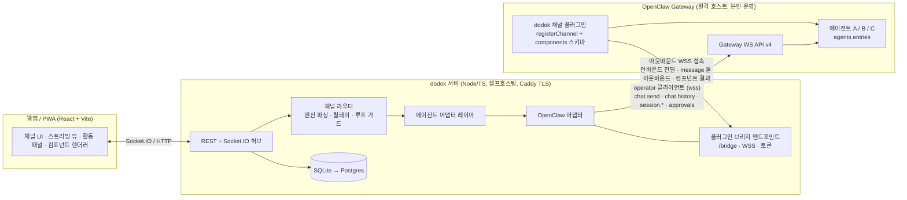

# dodok.chat — 에이전트 네이티브 메신저 개발 계획서 (v0.9)

작성일: 2026-09-14 · 상태: v0.9 (2026-09-21) — Phase 2 ① 종료 확정(브라우저 재검증 9/9 반영). 8장 Phase 2 「활동 패널·승인 카드」에 재검증 결과, 「이월」에 재검증 수정 라운드가 남긴 여섯

### 변경 이력

| 버전 | 내용 |
| --- | --- |
| v0.3 | 결정 사항 6건 확정, 세션·내부 위임 설계(5.8) 추가 |
| v0.4 | (1) 프로젝트·플러그인 id를 `dodok`으로 통일 (2) 기본 배포 형태를 "본인 운영 원격 Gateway + 플러그인의 아웃바운드 브리지 접속"으로 변경 (3) OpenClaw 패키지 기준을 2026.8.1 → 2026.9.4로 갱신, "Gateway와 동일 버전 핀" 규칙 명문화 (4) 실시간 전송을 Socket.IO로 확정 (5) 최신 `protocol.schema.json`·`gateway-client` README·공식 문서 대조로 3.1절 사실 보강 (6) 채널 봇 루프 보호 설정과 `relayPolicy`의 이중 동작 검증을 Phase 0에 추가 (7) 결정 사항 7~10 추가, 내보내기 아티팩트 링크·HTML 엔티티 정리 |
| v0.5 | 스파이크 1(`docs/adr/0001-gateway-client-spike.md`) 실측 반영 — (1) `hello-ok.features`는 참고 목록, 가용성은 호출해 `FORBIDDEN`/`MISSING_SCOPE`로 판정 (2) caps 정본은 `GATEWAY_CLIENT_CAPS`, `features.capabilities`는 서버 플래그 (3) `chat.send`는 `idempotencyKey` 필수이고 `runId`가 그 값 (4) `final`에 `usage`·`stopReason` 없음 → `session.message` (5) 툴 진행은 `session.tool`이 아니라 `agent` `stream:"tool"` (6) `sessions.subscribe` 응답은 `{subscribed:true}`뿐 (7) `chat.abort`는 `sessionKey` (8) 디바이스 토큰은 단수 (9) 페어링은 공유 토큰이면 자동 승인 (10) `seq`는 순서용, 연속 아님 |
| v0.6 | Phase 0 종료 — ADR 0002 12절(6건)·ADR 0003 10절(7건)의 결정을 10장에 확정: #1 채널 프롬프트 주입 재판정, #11 Node 24 전환, #12 components 노출, #13 봇 루프 보호, #14 브리지 계약 `admission`, #15 「새 대화」= `sessions.reset` + `operator.admin`, #16 재접속 복구, #17 대체 경로 미사용, #18 `inboundChannelPrompt` 제거, #19 `:g<N>` 제거, #20 업스트림 보고 보류, #21 로컬 첫 에이전트 `dev`. 7장 백엔드 Node 24, 8장 Phase 1 첫 작업 두 건 추가 |
| v0.7 | Phase 1 종료 — 8장 Phase 1 의 웹 항목(마크다운 렌더, 스트리밍 버블·중지, 에이전트 등록 UI·채널 추가·프롬프트 편집)에 완료 표시와 실물 요약, 완료 기준에 확인 방법(통합 시나리오 1~8 · dev Gateway 실연 6런 · `dev:fake` 브라우저 검증 시나리오 5), Phase 2 에 마크다운 렌더 보강 한 줄, 8장 끝에 「이월 — 남은 문제」(웹 렌더·서버·웹·실물 확인) 추가 |
| v0.8 | Phase 2 ① 종료(활동 패널·승인) — 8장 Phase 2 의 「활동 패널(툴 타임라인, 런 목록), 승인 카드」에 완료 표시와 실물 요약, 「이월」에서 Phase 2 ① 이 정리한 아홉(서버 넷·웹 넷·`wire-cli` typecheck) 제거와 「한국어 강조·구두점 경계」 해결 표시, 브라우저 검증이 남긴 셋(D4 카드 점프·D6 카운트다운 어긋남·D11 로그아웃 401)과 서버 둘(다른 채널 미해결 승인의 새로고침 복구, `providerApprovalId` 가 어댑터 상한 처리 밖)을 이월에 추가, Phase 1 「실물 확인」 줄을 실연 완료(2026-09-20)로 정정 |
| v0.9 | Phase 2 ① **종료 확정** — 8장 Phase 2 「활동 패널·승인 카드」 완료 줄에 브라우저 재검증 결과(시나리오 9/9, 고친 7건 수치 확인, 새 결함 D12·D13·D14 도 수정), 「이월」 웹에 재검증 수정 라운드가 남긴 여섯(타임라인 행이 낡은 채 남음 · 자리값 소요가 계속 흐름 · `ended`·`vanished` 상한 없음 · 로그아웃 때 `/runs` 한 번 더 · 넓은 화면 「설정 닫기」 초점 · `PanelSlot` 하네스), 「실물 확인」의 사람 몫 줄에 재검증도 못 쟀다는 사실과 흉내 낸 방법 |

---

## 1. 개요

### 1.1 한 줄 정의

사람과 AI 에이전트가 **같은 채널에서 동등한 참여자로 대화하는 메신저**. Slack/Discord처럼 채널로 주제를 나누되, 에이전트의 스트리밍 응답·작업 로그·버튼/선택 같은 인터랙티브 UI를 1급 기능으로 지원한다. 1차 연동 대상은 OpenClaw이며, 이후 Claude Code, Codex, Hermes 등을 같은 어댑터 인터페이스로 붙인다. 프로젝트 이름은 **dodok.chat**, 코드·설정·플러그인 id는 **`dodok`**이다.

### 1.2 목표

- **MVP (개인용)**: 웹앱 + PWA에서 OpenClaw 에이전트 여러 개를 채널별로 배치하고, 멘션 기반으로 대화·협업시킨다.
- **확장 (팀용)**: 워크스페이스/멤버/권한 개념을 처음부터 데이터 모델에 두어, 팀 단위 플랫폼으로 전환할 때 스키마 재설계를 피한다.
- **후속**: 데스크톱(Tauri)·모바일(Capacitor 또는 네이티브) 앱, Claude/Codex/Hermes 직접 연동.

### 1.3 확정된 방향 (v0.3 + v0.4)

| 항목 | 결정 |
| --- | --- |
| OpenClaw 연동 방식 | **하이브리드** — 전용 채널 플러그인(라우팅·UI 컴포넌트·채널 프롬프트) + Gateway WS 클라이언트(토큰 스트리밍·툴 이벤트·승인) |
| 멀티에이전트 발언 규칙 | **멘션 + 자동 릴레이** — @멘션된 에이전트가 응답, 에이전트가 다른 에이전트를 @멘션하면 앱이 릴레이 (턴 제한·루프 가드) |
| 기술 스택 / 실행 형태 | **TypeScript 풀스택 + 셀프호스팅** — React(Vite) PWA, Node 백엔드(Fastify + Socket.IO), SQLite→Postgres, Docker Compose |
| Gateway 배치 | **본인 운영 원격 Gateway에 연결이 기본**. 플러그인은 Gateway 호스트에 설치되어 우리 서버의 브리지로 아웃바운드 WSS 접속. 로컬 개발용 Compose 프로필로 동반 기동도 지원 |
| 버전 정책 | `@openclaw/gateway-client`·`@openclaw/gateway-protocol`·`openclaw`(플러그인 SDK)를 **Gateway와 같은 버전으로 정확히 핀**. 시작 버전 2026.9.4, 프로토콜 v4 |
| 산출물 | 마크다운 계획서 (본 문서) + 구성 가이드(`docs/project-structure.md`), 저장소에 저장 |

---

## 2. 요구사항 정리

### 2.1 기능 요구사항

| ID | 요구사항 | MVP | 비고 |
| --- | --- | --- | --- |
| F-1 | OpenClaw 에이전트 연동 (메시지 송수신, 세션 유지) | ✅ | 하이브리드 구조 |
| F-2 | 채널 생성/관리로 대화 주제 분리 | ✅ | 워크스페이스 > 채널 > 스레드(후속) |
| F-3 | 한 채널에 여러 에이전트 배치, 에이전트 간 소통 | ✅ | 멘션 + 릴레이 |
| F-4 | 채널별 프롬프트 (시스템 지시) | ✅ | 채널 프롬프트 + 에이전트별 채널 오버라이드 |
| F-5 | OpenClaw UI 입력 네이티브 지원 (텍스트·버튼·선택·모달) | ✅ | Discord 플러그인의 components 규약 대응 |
| F-6 | 스트리밍 채팅 (토큰 단위 델타) | ✅ | Gateway `chat`/`agent` 이벤트 |
| F-7 | 에이전트 작업 기록(툴 호출·실행 상태) 확인 | ✅ | `agent`(`stream:"tool"`)/`session.operation` 이벤트 → 활동 패널 |
| F-8 | 실행 승인(exec approval) 응답 | ✅(기본) | 버튼으로 승인/거부 |
| F-9 | 첨부파일·이미지 | △ | MVP는 이미지 업로드/표시까지 |
| F-10 | Claude Code / Codex / Hermes 연동 | 후속 | 어댑터 인터페이스만 MVP에서 정의 |
| F-11 | 데스크톱/모바일 앱 | 후속 | PWA로 대체 |
| F-12 | 팀 워크스페이스 (멤버 초대·권한) | 후속 | 데이터 모델은 MVP부터 포함 |

### 2.2 비기능 요구사항

- **셀프호스팅 우선**: 메신저 서버(API + 웹 정적 + Caddy)는 Docker Compose로 기동한다. OpenClaw Gateway는 기본적으로 **별도 호스트에서 본인이 운영하는 원격 Gateway**에 `wss://`로 연결하고, 우리 채널 플러그인은 그 Gateway 호스트에 설치되어 우리 서버의 브리지 엔드포인트로 **아웃바운드 WSS** 접속한다. 따라서 서버의 브리지·웹·API는 리버스 프록시(TLS)로 외부에 노출되어야 한다. 로컬 개발·데모용으로 Compose 프로필에서 Gateway를 동반 기동하는 옵션도 둔다.
- **오프라인 내성**: PWA로 최근 채널 캐시, 재접속 시 `chat.history` 델타 커서로 복구.
- **확장 가능한 인증**: MVP는 단일 사용자(로컬 토큰), 이후 OIDC/이메일 로그인 추가 가능하도록 `users`/`memberships` 테이블 선반영.
- **관측성**: 에이전트 런(run) 단위로 이벤트를 저장해 사후 재생(replay) 가능.
- **비용 통제**: 에이전트 간 릴레이 턴 수 상한, 채널별 일일 런 상한(옵션).

### 2.3 범위 밖 (MVP)

음성/영상, E2E 암호화, 외부 메신저(Slack/Discord) 브리지, 플러그인 마켓, 과금.

---

## 3. 조사 결과: OpenClaw 연동 지점

OpenClaw는 단일 장기 실행 **Gateway 데몬**(기본 포트 18789)이 모든 채널·에이전트·세션을 관리하고, 타입이 있는 WebSocket API(요청/응답 + 서버 푸시 이벤트)를 제공한다. 우리 앱과 맞닿는 지점은 두 가지다.

### 3.1 Gateway 클라이언트 (WS API) — 스트리밍·작업 로그·승인용

기준 버전: `@openclaw/gateway-client` / `@openclaw/gateway-protocol` **2026.9.4** (2026-09-14 npm latest). 아래 사실은 해당 버전의 `protocol.schema.json`, 패키지 README/CHANGELOG, 공식 문서(`rpc-bootstrap-and-events`)를 대조해 확인했다.

- **프로토콜 v4** (`PROTOCOL_VERSION = 4`, `MIN_CLIENT_PROTOCOL_VERSION = 4`). 일반 클라이언트는 `minProtocol: 4, maxProtocol: 4`로 고정 협상. v5 후보 변경(`SessionsPatchMutation`의 `execSecurity/execAsk` 제거 등)은 CHANGELOG의 "Deferred to the next wire version"에 보류 중이므로, 와이어 버전 상승은 명시적 파손 이벤트로 취급한다. 패키지 버전(`YYYY.M.PATCH`)과 와이어 버전은 별개다.
- **버전 핀**: 정확 핀(`--save-exact`)하고 **배포하는 Gateway와 같은 버전**으로 맞춘다. 현재 Gateway는 2026.9.2, npm 최신은 2026.9.4 → Phase 0 첫 단계에서 Gateway를 2026.9.4로 올린 뒤 핀한다. Node `>=22.19.0` 필요.
- **핸드셰이크**: 클라이언트는 Gateway의 `connect.challenge` 이벤트를 기다린 뒤 `connect` 요청을 보낸다(`GatewayClient`가 처리, 챌린지 없는 폴백 없음). `ConnectParams`에는 `minProtocol/maxProtocol`, `client`, `caps`, `role`, `scopes`, `device`(서명된 디바이스 아이덴티티), `auth`(token / bootstrapToken / deviceToken / password 등)가 들어간다. 응답 `hello-ok`는 협상된 `protocol`, `server`, **`features` 맵(`methods`, `events`, `capabilities`)**, 초기 `snapshot`, `auth`(발급된 디바이스 토큰 — 실측은 단수 `deviceToken`이며 스키마의 복수 `deviceTokens`는 오지 않았다), `policy`(`maxPayload`, `maxBufferedBytes`, `tickIntervalMs`)를 돌려준다. **`features`는 참고 목록이지 지원의 진실이 아니다**(ADR 0001: `features`에 없는 메서드도 호출되고, 없는 메서드와 스코프 부족이 똑같이 `FORBIDDEN`/`MISSING_SCOPE`로 온다). 가용성은 호출해서 판정하고, 그 응답에는 기능만 끄고 연결은 유지한다.
- **인증·페어링**: `role: "operator"` + 스코프 `operator.read`(히스토리·세션·이벤트), `operator.write`(전송·세션 변경), `operator.approvals`(승인). **`operator.admin`(「새 대화」의 `sessions.reset`, `chat.inject`)도 함께 요청한다** — 원격이 부여하는지는 Phase 1 첫 작업에서 확인하고 거부되면 키 세대 회전으로 폴백(10장 #15). Ed25519 디바이스 아이덴티티로 챌린지에 서명 → `connect` → 원격에서는 첫 `connect`가 `NOT_PAIRED`(`details.code: "PAIRING_REQUIRED"`, `details.requestId`)로 거절되지만 **공유 토큰이 있으면 수 초 뒤 자동 승인된다**(dev 루프백 + 공유 토큰은 거절 없이 붙고 요청한 `operator.admin`까지 부여, 디바이스 토큰 미발급 — ADR 0003 2절; 원격에서 admin이 부여되는지는 미확인)(ADR 0001, `retryable:false`를 보고 포기하면 놓친다) → 2~5초 간격으로 재시도하고, 지속될 때만 사람에게 `openclaw devices approve <requestId>`를 안내 → 발급된 디바이스 토큰 저장. **디바이스 키·토큰 저장은 호스트(우리 서버)의 책임**이다 — `GatewayClient`는 `hostDeps`(`loadOrCreateDeviceIdentity`, `signDevicePayload`, `publicKeyRawBase64UrlFromPem`)를 통해서만 접근하며 OpenClaw의 로컬 자격 증명을 자동으로 읽지 않는다.
- **전송 보안**: 원격 연결은 `wss://` 필수. Node 클라이언트는 루프백·사설망·`.local`/`.ts.net`에 한해 평문 `ws://`를 허용하지만 암호화는 아니다.
- 클라이언트 capability 선언: 문서상 `tool-events`(툴 실행 실시간 이벤트), `approvals`, `session-scoped-events`. 정본은 `@openclaw/gateway-protocol/client-info`의 `GATEWAY_CLIENT_CAPS` 상수다(세 이름 모두 있음). `hello-ok.features.capabilities`는 서버 기능 플래그라 선언한 caps를 에코하지 않으며, 선언 효과는 행동으로만 드러난다(`tool-events`를 선언하면 `session.tool` 대신 `agent`로 받는다). **선언한 것은 반드시 구현**한다.
- 핵심 메서드 (스키마 존재 확인)
  - `chat.send` — 세션에 메시지 전송. 파라미터: `sessionKey`, `agentId`, `message`, **`idempotencyKey`(필수 — 응답 `runId`가 이 값과 같다)**, `mentions`, `queueMode`(`steer`/`followup`/`collect`/`interrupt`), `fastMode`, `deliver`, **`originatingChannel`/`originatingTo`/`originatingAccountId`/`originatingThreadId`**, `replyToId`, `attachments`, `timeoutMs` 등. 배달의 열쇠는 `originating*`가 아니라 **`deliver:true`**다 — `originating*`는 `operator.admin`이 필요하고 `deliver` 없이는 배달 경로가 아니며, channel-scoped 세션은 `deliver:true`만으로 세션 `deliveryContext`를 상속한다. 배달은 `sendText`(agentId·runId 없음)로 오고 턴은 owner 권한으로 돈다 → MVP에서 대체 경로로 쓰지 않는다(ADR 0003 6·7.3). 응답은 `{ runId, status: "started" }` — `messageSeq`는 여기 없고 `session.message`의 필드다. `sessions.create` 없이 `chat.send`만으로 세션이 생성된다(`sessionKey`와 `sessionId`는 다른 값).
  - `chat.history` — 표시용 정규화된 트랜스크립트. `sessionKey`, `agentId`, `cursor`, `limit`, `maxBytes` 등. 요청 파라미터는 `cursor`, 응답 필드가 `deltaCursor`이며 커서 호출은 `{kind:"delta"}` 또는 `{kind:"reset"}`. **claude-cli 세션은 `deltaCursor`가 오지 않고 커서 호출은 늘 `reset`**(CLI 바인딩 없는 세션에서만 delta). 커서 호출에서 `limit`은 무시된다. 일반 응답 메시지는 전사 메시지(`__openclaw.seq`), delta 항목은 `session.message` 봉투(`messageSeq`)로 모양이 다르다(ADR 0003 5절).
  - `chat.abort` — 필수는 `sessionKey`(+`agentId`/`runId`/`preserveSideRuns`), `clearQueued` 옵션.
  - `sessions.subscribe` — 응답은 `{subscribed: true}`뿐이다(로스터 스냅샷·`inFlightRun` 없음). 로스터는 `sessions.list`, 재접속 복구는 `sessions.list` + `chat.history`(`deltaCursor` 증분은 claude-cli 세션에서 성립하지 않으므로 전체 치환이 기본, 커서는 최적화 — ADR 0003 5·7.2). `sessions.messages.subscribe({includeApprovals:true})` 응답의 `approvalReplay`가 승인 카드 복구원이다.
  - `sessions.create/patch/reset/delete`, `sessions.messages.subscribe({ includeApprovals: true })`, `sessions.title.prepare`.
  - `approval.get/resolve/history`, `exec.approval.request/get/list/resolve/waitDecision`, `exec.approvals.get/set`, `plugin.approval.list/request/waitDecision/resolve`(`get`은 없다). 승인 이력은 30일 보관, first-answer-wins.
- 핵심 이벤트
  - `chat` — 페이로드는 항상 `runId`, `sessionKey`, `agentId`, `seq`를 담고 `state`로 구분: **`delta`**(`deltaText` 증분, `message` 누적 스냅샷, `replace` 플래그), **`final`**(`message`만 — `usage`·`stopReason`·`model`·비용은 같은 시점의 `session.message`에 있다), **`status`**(`phase`, `retry`), **`error`**(`errorMessage`, `errorKind`, `errorDetail` — provider/model/httpStatus 등), **`aborted`**. 서브에이전트가 만든 런은 `spawnedBy`로 부모를 가리킨다. `seq`는 순서용이며 연속이 아니다(빠른 델타가 병합되며 건너뛴다) — 빈 칸을 유실로 보지 않는다.
  - `agent` — 런 단위 스트림(`runId`, `seq`, `stream`, `ts`, `data`, `isHeartbeat`). 재접속 후 `runId`+`seq`로 순서 복원.
  - `session.message`, `session.operation`, `session.tool`, `session.approval`, `session.observer` — 공식 문서(`rpc-bootstrap-and-events`)에 명시. `session.operation`은 현재 스키마에서 `operation: "compact"`(컨텍스트 압축)만 정의되어 있다. **툴 진행은 `agent`의 `stream: "tool"`(phase `start`/`result`)로 받는다** — `tool-events`를 선언한 연결(= `chat.send`를 보낸 우리 연결)은 `session.tool` 수신 대상에서 제외된다(ADR 0001 5.3). `features.events`에는 `mentions.changed`도 있다(멘션 릴레이 설계에서 확인). 이벤트명 목록은 `hello-ok.features.events`(60개)로 보되 참고 목록으로 다룬다.
  - 시스템: `presence`, `tick`, `health`, `heartbeat`, `shutdown`. 이벤트 프레임은 `seq`·`stateVersion`을 실을 수 있다.

### 3.2 채널 플러그인 — 라우팅·UI 컴포넌트·채널 프롬프트용

- 진입점: 권장은 `defineChannelPluginEntry({ plugin, setRuntime })`(`openclaw/plugin-sdk/plugin-entry`; `definePluginEntry` + `registerChannel` 도 동작하지만 감싼 형태가 표준, ADR 0002 3.1). 매니페스트(`openclaw.plugin.json`)에 `channels`·`channelConfigs`, `package.json` 에 `openclaw.channel` 을 두고 **런타임 dependencies 없이 단일 번들**로 배포한다. 플러그인 SDK는 `openclaw` 패키지의 `./plugin-sdk/*` 서브패스로 제공되며, 관련 진입점으로 `channel-message`(`ChannelMessageActionAdapter`), `channel-contract`, `channel-config-schema`(채널 설정 스키마 빌더), `channel-mention-gating`, `channel-inbound`/`channel-outbound`, `channel-reply-pipeline`, `channel-streaming-config`, `discord`(컴포넌트 빌더 `buildDiscordComponentMessage`, `DiscordComponentMessageSpec` 참조용)가 있다. `openclaw` 패키지는 unpacked 200MB급이므로 플러그인 패키지의 devDependency로만 두고 Gateway와 같은 버전으로 핀한다.
- 코어가 공용 `message` 툴·프롬프트 배선·세션 관리를 소유하고, 채널 플러그인은 **액션 디스커버리·capability·채널 고유 스키마 조각**만 담당(`ChannelMessageActionAdapter.describeMessageTool`). 즉 Discord의 `components`처럼 **우리 채널만의 UI 스키마를 message 툴에 끼워 넣을 수 있다** — 실측으로 동작한다(ADR 0002 6절: 모델이 첫 시도에 `components` 를 채워 호출). **단 SDK 방침은 provider-native 스키마 조각을 막고 `presentation` capability 를 권하므로 향후 차단 리스크가 있다**(ADR 0002 12절 결정 2).
- `accountId`, `currentChannelId`, `chatType`, `currentThreadTs`, `currentMessageId`, `sessionKey`, `sessionId`, `agentId` 는 **message 툴 디스커버리·실행 컨텍스트**에서 코어가 주는 스코프다. 인바운드는 반대로 플러그인이 `buildContext`·`dispatch` 에 `route`·`reply`·`sender` 를 **넘기는** 쪽이다(ADR 0002 4.1·5.2).
- 채널 설정 스키마에는 `ReplyToModeSchema`, `ChannelBotLoopProtectionSchema`(채널 단위 봇 루프 보호) 등이 포함된다. 봇 루프 보호는 **플러그인이 인바운드에 `botLoopProtection` 사실을 넘길 때만** 코어가 동작한다(5.3, ADR 0002 7절).
- 추가 확장점: `registerTool`(에이전트 툴), Gateway 메서드 등록, HTTP 라우트, 백그라운드 서비스, 설정 쓰기(`runtime.config.mutateConfigFile`; `channel-config-writes` 는 쓰기 **권한 판정** 모듈이지 쓰기가 아니다 — ADR 0002 8절).
- **원격 배치**: 플러그인은 Gateway 프로세스 안에서 실행되므로 Gateway 호스트에 설치한다(호스트에서 `openclaw plugins install <tarball> --force --accept-capabilities`; tarball 은 `pnpm pack` — `openclaw plugins pack` 은 채널 플러그인을 거부한다. Gateway RPC `plugins.install` 은 clawhub/official 소스만 받으므로 원격 설치는 호스트 작업이다. 안정화 후 npm `@dodok/openclaw-plugin` 퍼블리시. ADR 0002 3.3·9절). 플러그인 계정 설정에 우리 서버의 브리지 URL·토큰을 넣고, 플러그인이 **아웃바운드**로 접속한다. Gateway 호스트에서 우리 서버로의 egress만 있으면 되고, Gateway 쪽 인바운드 포트를 추가로 열 필요는 없다.

### 3.3 Discord 플러그인의 인터랙티브 UI 규약 (우리가 미러링할 대상)

- 에이전트는 `message` 툴에 `components` 페이로드를 붙여 전송: `{ channel: "discord", action: "send", to, message: "fallback", components: { reusable, text, blocks: [...], modal: {...} } }`.
- 블록 종류: 텍스트 섹션, 구분선, **액션 로우(버튼 최대 5개 또는 셀렉트 1개)**, 미디어 갤러리, 파일, **모달(필드 최대 5개)**.
- 버튼: 이모지·링크 변형, 스타일 `success`/`danger`/기본, `allowedUsers`로 사용자 제한.
- 셀렉트: `string`/`user`/`role`/`mentionable`/`channel`, 옵션 최대 25개.
- 모달 필드: `text`/`checkbox`/`radio`/`select`/`role-select`/`user-select`. 트리거 버튼 자동 생성.
- 사용자의 상호작용 결과는 **일반 인바운드 메시지로 에이전트에게 되돌아감**(replyToMode 준수). 기본 1회용, `reusable: true`면 만료까지 반복. 콜백 TTL 기본 30분, 최대 24시간.
- 실행 승인: `channels.discord.execApprovals.{enabled, approvers, target}` — 버튼 기반 승인, 승인자만 상호작용 가능.
- 채널 단위 설정: `guilds.<id>.requireMention`, `channels.<id>.requireMention`, `channels.<id>.systemPrompt`, `channels.<id>.skills`, `channels.<id>.users`, `replyToMode`(`off|first|all|batched`). → 우리 플러그인도 같은 형태의 채널별 설정을 갖추면 "채널별 프롬프트"(F-4)와 "멘션 게이트"(F-3)를 OpenClaw 관례대로 구현할 수 있다.

### 3.4 멀티에이전트

- `agents.entries[]`에 `agentId`별로 워크스페이스(SOUL.md, AGENTS.md)·상태 디렉터리·세션 스토어(SQLite) 분리. `openclaw agents add <id>`.
- 바인딩: `{ agentId, match: { channel, accountId, peer } }`, **가장 구체적인 매치 우선**(exact peer → parent peer → wildcard → guild+roles → guild → team → account → channel → default).
- 세션 키: DM은 `agent:<agentId>:main`, 그룹은 채널/피어 기반 키.
- 에이전트 간 소통: `tools.agentToAgent.allow`로 허용 쌍 제한, `sessions_send/list/history` 툴, 서브에이전트 위임(코디네이터→스페셜리스트 프리셋).
- Gateway 요청에서 `agentId`를 지정하면 바인딩을 우회해 특정 에이전트에 직접 전달 가능.

### 3.5 후속 연동 대상 요약

| 대상 | 연동 경로 (예상) | 비고 |
| --- | --- | --- |
| Claude Code | Claude Agent SDK (TS/Python) — 스트리밍 메시지·툴 이벤트·권한 콜백 | 로컬 프로세스 실행 필요 |
| Codex | `codex app-server`(JSON-RPC, 공개 프로토콜; TS 클라이언트 존재) 또는 Codex SDK | 로컬 프로세스 |
| Hermes Agent | 자체 메시징 게이트웨이(30+ 플랫폼) + OpenAI 호환 API 서버 | 커스텀 어댑터 문서 부재, 조사 필요 |

---

## 4. 아키텍처

### 4.1 구성도



### 4.2 두 경로의 역할 분담

| 관심사 | 채널 플러그인 경로 | Gateway 클라이언트 경로 |
| --- | --- | --- |
| 사용자 메시지 → 에이전트 | ✅ 인바운드 (바인딩·멘션 게이트 활용) | 대체 경로는 MVP 미사용 — `deliver:true`로 배달은 되지만 agentId·runId 없는 `sendText`이고 owner 권한 턴이 된다(ADR 0003 6·7.3) |
| 에이전트 최종 응답 | ✅ 아웃바운드 (`message` 툴) | `chat` 이벤트 `state: final`의 `message` 스냅샷으로도 수신 |
| 버튼/셀렉트/모달 | ✅ 우리 채널의 `components` 스키마 | — |
| 토큰 스트리밍 | 편집 기반(제한적) | ✅ `chat` `state: delta`의 `deltaText` / `agent` 이벤트 |
| 툴 실행 로그 | — | ✅ `agent`(`stream:"tool"`), `session.operation`(압축) |
| 실행 승인 | 플러그인 approval 버튼 가능 | ✅ `approval.*`, `exec.approval.*`, `session.approval` |
| 세션 히스토리 복구 | — | ✅ `chat.history` 전체 치환(claude-cli), `deltaCursor`는 CLI 바인딩 없는 세션에서만 최적화(ADR 0003 5절) |

플러그인이 "정식 채널"이 되면 OpenClaw 입장에서 우리 앱은 Discord와 같은 위치가 되어, 바인딩·그룹 정책·컴포넌트·승인 설정을 기존 문서 그대로 재사용할 수 있다. Gateway 클라이언트는 여기에 실시간성과 관측성을 더한다.

### 4.3 메시지 흐름 (예: 사용자가 `@researcher` 멘션)

1. 클라이언트가 Socket.IO로 메시지 전송 → 서버가 저장(`messages`) → 채널 룸 구독자에게 브로드캐스트.
2. 채널 라우터가 멘션을 파싱해 대상 에이전트(`researcher`)를 결정. 채널 프롬프트 + 에이전트별 오버라이드를 컨텍스트로 합성.
3. OpenClaw 어댑터가 브리지(플러그인이 열어 둔 WSS 연결)로 인바운드 전달(`peer = channel:<id>`, `agentId = researcher`).
4. 동시에 Gateway 클라이언트가 해당 세션 키의 `chat`/`agent`(`stream:"tool"`) 이벤트를 구독 → 델타·툴 이벤트를 `runs`/`run_events`에 저장하며 클라이언트에 실시간 릴레이.
5. 에이전트가 `message` 툴로 최종 응답(선택적으로 `components`) 전송 → 플러그인 → 브리지 → 서버 → 메시지 확정, 스트리밍 버퍼를 최종 본문으로 교체.
6. 응답에 `@planner` 멘션이 있으면 라우터가 릴레이 규칙 검사 후 2단계부터 반복. 턴 카운터가 상한에 도달하면 "사람 개입 필요" 시스템 메시지로 종료.
7. 사용자가 버튼 클릭 → 서버가 `component_interactions` 저장 → 브리지로 플러그인에 전달 → 인바운드 메시지로 변환해 원래 에이전트에게 전달(Discord 규약과 동일).

### 4.4 재접속·복구

- 클라이언트: 마지막 `messageSeq`를 보관, 재접속 시 서버에 이후 메시지 요청.
- 서버 ↔ Gateway: 재접속을 "새 프로젝션"으로 취급 — `sessions.subscribe` 재수립 → 선택 세션 `chat.history` 치환(커서는 최적화, `reset`이면 전체 치환) → `inFlightRun` 채택(응답 필드는 스키마에 있으나 미관찰, ADR 0003 5.1) → 이후 `agent` 이벤트를 `runId`+`seq`로 정합.
- 플러그인 ↔ 서버 브리지: 플러그인이 지수 백오프로 재접속. 끊긴 동안의 아웃바운드(에이전트 응답·컴포넌트 결과)는 플러그인 쪽 큐에 보관 후 재전송, 서버는 `runId`/메시지 id로 중복 제거.

### 4.5 배포 토폴로지

| 구성 요소 | 위치 | 노출 |
| --- | --- | --- |
| dodok 서버(API·Socket.IO·브리지)·웹 정적·Caddy | 본인 서버 A (Docker Compose) | Caddy가 TLS로 `/`(웹), `/api`, `/socket.io` 노출(브리지는 Socket.IO 네임스페이스 `/bridge` 라 `/socket.io` 하나로 충분 — ADR 0002) |
| OpenClaw Gateway + dodok 플러그인 + 에이전트 | 본인 서버 B (원격, 이미 운영 중) | 우리 서버가 `wss://`로 접속. 플러그인은 `/bridge`로 아웃바운드 접속. 추가 인바운드 포트 불필요 |
| 로컬 개발 | 개발 PC | 서버는 `pnpm dev`. Gateway는 원격에 붙거나 Compose `--profile gateway`로 로컬 기동. 원격 플러그인이 개발 PC의 브리지에 붙어야 할 때는 터널(cloudflared/tailscale 등)로 `BRIDGE_PUBLIC_URL`을 만든다 |

A와 B가 같은 호스트여도 되며, 그 경우 Compose 프로필 하나로 함께 띄운다.

---

## 5. 핵심 설계

### 5.1 도메인 모델

- **Workspace**: 최상위 컨테이너. MVP는 1개 자동 생성. 팀 전환 시 다수.
- **User / Membership**: MVP는 owner 1명. `role`(owner/admin/member/guest)을 미리 둔다.
- **Agent**: 워크스페이스에 등록된 에이전트 프로필. `provider`(openclaw/claude/codex/hermes), `providerAgentId`(OpenClaw `agentId`), 표시 이름, 아바타, 기본 프롬프트, 활성 여부.
- **Channel**: 주제 단위. `prompt`(채널 프롬프트), `relayPolicy`(최대 릴레이 턴, 허용 에이전트 쌍), `visibility`.
- **ChannelMember**: 사람 또는 에이전트의 채널 참여. 에이전트인 경우 `promptOverride`, `mentionAliases`, `autoRespond`(멘션 없이도 응답할지, 기본 false).
- **Message**: `author`(user|agent|system), 본문(마크다운), 첨부, `components`(렌더용 JSON), `replyTo`, `runId`(에이전트 메시지일 때), `seq`.
- **Run**: 에이전트 1회 실행. `sessionKey`, `providerRunId`, 상태(queued/streaming/tool/awaiting_approval/done/error/aborted), 토큰·비용 메타.
- **RunEvent**: 런의 이벤트 로그(델타·툴 시작/종료·승인 요청/결정·에러). 활동 패널과 재생의 원천.
- **ComponentInteraction**: 버튼/셀렉트/모달 제출 기록. `componentId`, `userId`, `payload`, `deliveredToAgentAt`.
- **Approval**: OpenClaw approval id 미러. 상태·결정자·만료.

### 5.2 채널 프롬프트 합성 규칙

에이전트가 채널에서 메시지를 받을 때 컨텍스트 = `[채널 프롬프트] + [해당 에이전트의 채널 오버라이드] + [채널 참여자 목록(사람/에이전트, 멘션 방법)] + [릴레이 규칙 요약]`. OpenClaw 에이전트 자체의 SOUL.md/AGENTS.md는 건드리지 않는다.

주입 경로는 두 가지 후보가 있다. (a) Discord 플러그인이 지원하는 채널별 설정(`channels.<id>.systemPrompt`, `channels.<id>.requireMention`, `channels.<id>.skills`)과 같은 형태로 우리 플러그인 설정에 채널 프롬프트를 두고, 앱에서 프롬프트가 바뀌면 Gateway 설정을 갱신하는 방식. (b) 플러그인 인바운드 메시지에 **채널 컨텍스트 프리픽스**로 붙이는 방식. (a)가 OpenClaw 관례와 맞아 기본안으로 하되 — 단 **claude-cli 백엔드에서는 CLI 세션 시작 시점에만 들어가고 드리프트·Gateway 재시작으로 갱신되지 않는다**(ADR 0003 3절; 기존 세션 반영은 리셋·키 회전 또는 인바운드 (b)/(c) `ChannelPromptContext`) — 에이전트별 오버라이드처럼 동적인 부분은 (b)로 보완한다.

Gateway가 원격이므로 (a)의 "설정 갱신"은 우리 서버가 직접 파일을 만질 수 없다. 후보는 두 가지: (a-1) 서버가 브리지로 플러그인에 "채널 설정 변경"을 보내고 **플러그인이 `runtime.config.mutateConfigFile` 로 Gateway 설정을 갱신**(`channel-config-writes` 는 권한 판정 모듈), (a-2) Gateway WS의 설정 메서드를 operator 클라이언트로 호출. (a-1)이 플러그인 하나로 닫혀 단순하므로 기본안이다. 스파이크 2 미리보기(ADR 0002 8절): 반영은 `applied: "live"`(재시작 불필요)이고 **새 세션에는 들어가지만 claude-cli 의 기존 세션에는 두 턴 연속 반영되지 않았다** — 기존 세션 갱신은 스파이크 3에서 쟀다: `sessions.reset` = 반영, Gateway 재시작 = 미반영, 다른 백엔드 = 미측정. 원인은 Claude CLI가 `--resume` 시 세션 생성 때의 `prompt_snapshot`으로 재개하는 것(추정, ADR 0003 3.2). 권고는 (a) 기준선 + 서버가 세션 시작 리비전을 기억해 현재와 다르면 `ChannelPromptContext`로 동봉(ADR 0003 7.1, 결정 대기).

### 5.3 멀티에이전트 발언 규칙 (멘션 + 자동 릴레이)

- 사람 메시지: `@에이전트` 멘션된 대상만 응답. 멘션이 없으면 `autoRespond=true`인 에이전트(채널당 최대 1개 권장)만 응답.
- 에이전트 메시지 안의 `@다른에이전트`: 라우터가 릴레이. 조건 — `relayPolicy.allowPairs`에 포함, 현재 대화 스레드의 릴레이 턴 수 < `maxRelayTurns`(기본 4), 동일 (from,to,본문 해시) 반복 감지 시 차단.
- 상한 도달 시: 시스템 메시지 "릴레이 한도 도달 — 계속하려면 사람이 멘션하세요" + 이어가기 버튼.
- **OpenClaw 내부 에이전트 간 통신(`sessions_send`)은 MVP에서 차단 (결정됨)**. 이유와 설정은 5.8 참고. 같은 에이전트가 자기 작업을 쪼개는 서브에이전트(`sessions_spawn`)는 허용하되, 자식 세션은 활동 패널에서 "하위 작업"으로 표시(`chat` 이벤트의 `spawnedBy`로 식별).
- **OpenClaw 채널 봇 루프 보호와의 관계**(ADR 0002 7절 실측): 코어 보호는 **플러그인이 에이전트 작성 인바운드에 `botLoopProtection` 사실을 넘길 때만** 동작한다 — 넘기지 않으면 기본값은 릴레이를 막지 않는다. 넘기면 기본 예산 20회/60초·쿨다운 60초이고, 초과 시 인바운드는 런 없이 `admission: drop, reason: bot-loop-protection` 으로 떨어지며(브리지 ack 는 `{}`), `enabled: false` 로 즉시 해제된다. 권고안은 (2) 사실을 넘기되 코어 예산을 우리 `maxRelayTurns` 보다 느슨하게 두어 안전망으로만 쓰는 것이며, drop 사유를 브리지 계약에 싣는 것까지 함께 정한다(ADR 0002 12절 결정 3·4).

### 5.4 네이티브 UI 컴포넌트 규약 (`components` v1)

Discord 플러그인 규약을 상위 집합으로 미러링하되, Discord 전용 타입(role/channel/mentionable select)은 제외하고 웹에 맞는 타입을 추가한다.

```jsonc
{
  "components": {
    "reusable": false,
    "ttlMs": 1800000,          // 기본 30분, 최대 24h
    "text": "어떤 방식으로 진행할까요?",
    "blocks": [
      { "type": "section", "text": "**옵션을 선택하세요**" },
      { "type": "separator" },
      { "type": "actions", "items": [
        { "type": "button", "id": "go_fast", "label": "빠르게", "style": "primary", "emoji": "⚡" },
        { "type": "button", "id": "go_safe", "label": "안전하게", "style": "success" },
        { "type": "button", "id": "cancel",  "label": "취소",    "style": "danger",
          "allowedUsers": ["user_123"] }
      ]},
      { "type": "actions", "items": [
        { "type": "select", "id": "target", "placeholder": "대상 선택", "multi": false,
          "options": [ { "value": "web", "label": "웹" }, { "value": "api", "label": "API" } ] }
      ]},
      { "type": "media", "items": [ { "url": "artifact://img_1", "alt": "미리보기" } ] },
      { "type": "file", "url": "artifact://report.pdf", "name": "report.pdf" }
    ],
    "modal": {
      "id": "details", "title": "세부 정보", "triggerLabel": "입력하기",
      "fields": [
        { "type": "text", "id": "title", "label": "제목", "required": true },
        { "type": "textarea", "id": "desc", "label": "설명" },
        { "type": "select", "id": "priority", "label": "우선순위",
          "options": [ { "value": "p1", "label": "높음" }, { "value": "p2", "label": "보통" } ] },
        { "type": "checkbox", "id": "notify", "label": "완료 시 알림" }
      ]
    }
  }
}
```

제약: 액션 로우당 버튼 ≤ 5 또는 셀렉트 1, 셀렉트 옵션 ≤ 25, 모달 필드 ≤ 5 (Discord와 동일하게 두어 에이전트 프롬프트 호환성 유지). 웹 추가 타입: `textarea`, `date`, `number`, `multi select`. 상호작용 결과는 `{ componentId, blockId, values, userId }`를 사람이 읽을 수 있는 텍스트로 변환해 인바운드 메시지로 에이전트에게 전달하고, 원본 JSON은 `component_interactions`에 저장.

### 5.5 스트리밍

- 서버는 Gateway `chat` 이벤트(`state: delta`)의 `deltaText`를 런별 버퍼에 누적하며 클라이언트에 `run.delta` 이벤트로 중계. `replace` 플래그가 오면 버퍼를 `message` 스냅샷으로 치환. 클라이언트는 임시 "스트리밍 메시지 버블"에 렌더.
- 에이전트 최종 응답이 플러그인 경로로 도착하면 버블을 확정 메시지로 교체(본문은 플러그인 경로 기준, 중복 방지 키 = `runId` — `replyOptions.runId` 로 Gateway runId 가 우리 runId 와 같아진다, ADR 0002 4.3). `message` 툴로 답한 런은 최종 텍스트가 `terminalReply.disposition: "silent"` 로 억제되는데 그 전에 `chat` delta 가 한두 조각 샐 수 있으므로, `final`/lifecycle 로 silent 가 확정되면 미리보기 버블을 지운다(ADR 0002 5.2). 플러그인 경로가 일정 시간 내 도착하지 않으면 `state: final`의 `message` 스냅샷으로 확정하고 "미리보기 기준" 표시.
- `state: error`/`aborted`는 런 상태를 갱신하고 버블에 오류/중단 표시.
- 백프레셔: 델타를 50ms 단위로 코얼레싱, 클라이언트당 미전송 큐 상한. Gateway `hello-ok.policy.maxBufferedBytes`를 존중.
- 중단: 사용자의 "중지" → `chat.abort({ key, runId })`.

### 5.6 작업 기록(활동 패널)

- `agent` `stream:"tool"`(툴 호출 start/result·인자·결과 요약), `agent` 이벤트의 `stream`별 데이터, `session.operation`(현재는 컨텍스트 압축 `compact`), `exec.*` 노드 이벤트(명령·exitCode·bounded output)를 `run_events`로 저장.
- UI: 메시지 옆 "작업 보기" 토글 → 타임라인(툴명·소요시간·상태·접힌 상세). 런 목록 뷰에서 채널 전체 활동을 시간순으로 확인.
- 승인 요청은 활동 패널과 채널 본문 양쪽에 버튼 카드로 노출, `approval.resolve`로 응답. Gateway 쪽 30일 보관과 별도로 우리 DB에 미러.
- 주의: 노드 exec 이벤트는 best-effort(내구성 있는 원장이 아님) — 누락 가능성을 UI에 표기.

### 5.7 에이전트 어댑터 인터페이스 (후속 연동 대비)

```ts
interface AgentAdapter {
  id: "openclaw" | "claude" | "codex" | "hermes";
  connect(config): Promise<void>;
  listAgents(): Promise<AgentProfile[]>;
  send(input: { agentId; channelId; sessionKey; text; context; attachments? }): Promise<{ runId }>;
  abort(runId): Promise<void>;
  onEvent(handler: (e: RunEvent) => void): Unsubscribe;   // delta | tool | approval | final | error
  resolveApproval?(approvalId, decision): Promise<void>;
  deliverInteraction(runIdOrSession, interaction): Promise<void>;  // 버튼/모달 결과
}
```

OpenClaw 어댑터가 첫 구현. Claude Agent SDK/Codex app-server는 로컬 프로세스 관리(spawn, 워크스페이스 경로, 권한 콜백)가 추가로 필요하므로 별도 "로컬 러너" 서비스로 분리한다.

### 5.8 OpenClaw 세션·내부 위임 설계 (결정 사항)

**세션 키 단위 — 채널당 에이전트별 1세션.** 키 형식은 OpenClaw 그룹 관례를 따른다: `agent:<agentId>:dodok:channel:<channelId>` (DM은 `agent:<agentId>:dodok:direct:<userId>`). OpenClaw에서 세션은 "에이전트별 대화 컨텍스트(트랜스크립트·컨텍스트 윈도우·압축)"이므로, 에이전트 3개가 있는 채널에는 세션도 3개다. 각 에이전트는 자기 세션에 전달된 메시지만 기억하므로, 우리 플러그인은 멘션으로 트리거된 인바운드에 **최근 채널 메시지 N개(다른 에이전트 발언 포함)를 컨텍스트 창으로 동봉**해 "같은 방에 있다"는 감각을 준다. 같은 세션에서는 런이 직렬이라 동일 에이전트를 연속 멘션하면 두 번째는 큐잉(`queueMode: followup` 기본)되고, 서로 다른 에이전트는 세션이 다르므로 병렬 실행된다. `groupScope: "main"`(에이전트 메인 세션 공유)은 채널 간 컨텍스트가 섞이므로 쓰지 않는다. 채널에서 "새 대화" 명령은 `sessions.reset`, 후속 스레드 기능은 `...:thread:<id>` 하위 세션으로 확장한다.

**내부 위임(`sessions_send`) — MVP 차단.** OpenClaw 기본값은 `tools.agentToAgent.enabled: true`, `tools.sessions.visibility: "all"`이라 아무 설정 없이 두면 에이전트가 다른 에이전트·다른 채널의 세션에 직접 메시지를 보낼 수 있다. 우리가 관리하는 OpenClaw 설정에서 `tools.agentToAgent.enabled: false`, `tools.sessions.visibility: "tree"`(자기 세션 + 자기가 스폰한 자식만; 루트 `sessions` 키는 설정 스키마가 거부한다 — ADR 0002)로 명시한다. 차단 근거: (1) 교환 내용이 채널 기록 밖에서 일어나 F-3/F-7의 "소통·작업 기록 확인"이 깨진다. (2) 응답 후 자동 실행되는 "announce step"이 요청자/대상 전달 컨텍스트에 답을 다시 게시하는데, 이를 끌 수 있는 설정이 없고(#7463 미해결, #105503 요청 중) 멀티에이전트 구성에서 엉뚱한 채팅에 게시되는 버그(#55981)가 보고되어 있다. (3) 루프 제한이 OpenClaw 내장 상한으로 걸려 우리 `relayPolicy`와 이중으로 동작한다. (4) 채널 A의 에이전트가 채널 B 세션을 읽을 수 있어 채널 분리 원칙과 충돌한다. 후속 단계에서 announce 비활성화 옵션이 생기면, 허용 쌍(`allow`)을 채널 `relayPolicy`와 동기화하고 `sessions_send` 툴 이벤트를 "위임 카드"로 채널에 표시하는 방식으로 재검토한다.

---

## 6. 데이터 모델 (초안)

```
workspaces(id, name, created_at)
users(id, workspace_id, email, display_name, auth_provider)
memberships(id, workspace_id, user_id, role)
agents(id, workspace_id, provider, provider_agent_id, name, avatar, base_prompt, enabled)
channels(id, workspace_id, name, topic, prompt, relay_policy_json, visibility, created_by)
channel_members(id, channel_id, member_type[user|agent], member_id, prompt_override, auto_respond, aliases_json)
messages(id, channel_id, seq, author_type, author_id, body_md, attachments_json, components_json, reply_to, run_id, created_at)
runs(id, channel_id, agent_id, trigger_message_id, session_key, provider_run_id, status, started_at, ended_at, usage_json, relay_depth)
run_events(id, run_id, seq, type, payload_json, created_at)
component_interactions(id, message_id, component_id, user_id, payload_json, delivered_at)
approvals(id, run_id, provider_approval_id, kind, status, decided_by, decided_at, expires_at)
push_subscriptions(id, user_id, endpoint, keys_json, user_agent, created_at)
```

SQLite(WAL)로 시작, Drizzle ORM으로 스키마 정의해 Postgres 전환 시 마이그레이션만 교체.

---

## 7. 기술 스택

| 레이어 | 선택 | 이유 |
| --- | --- | --- |
| 프런트 | React 19 + Vite + TypeScript, TanStack Query/Router, Zustand, Tailwind, `vite-plugin-pwa` | PWA 설치·오프라인 캐시, 이후 Tauri/Capacitor 래핑 용이 |
| 렌더링 | Streamdown(스트리밍 마크다운) + shiki(코드), 자체 컴포넌트 렌더러 | 에이전트 출력·UI 블록 |
| 백엔드 | Node 24(openclaw 2026.9.4 의 engines 에 맞춰 `mise.toml` 핀) + Fastify(REST) + **Socket.IO**(실시간; 채널 = 룸, 자동 재연결·ack), Zod 스키마 공유 | 장기 WS 연결·스트리밍에 적합, Open WebUI·OpenClaw 플러그인 사례와 동일 |
| DB | SQLite(better-sqlite3) → Postgres, Drizzle ORM | 개인→팀 전환 경로 |
| OpenClaw | `@openclaw/gateway-client`, `@openclaw/gateway-protocol`, `openclaw`(plugin-sdk) — **2026.9.4 정확 핀, Gateway와 동일 버전** | 공식 경로 |
| 모노레포 | pnpm workspaces + Turborepo: `apps/web`, `apps/server`, `packages/shared`(타입·컴포넌트 스키마·이벤트·wire 계약), `packages/openclaw-plugin`, `packages/openclaw-adapter`. npm 스코프 `@dodok/*` | 스키마 단일 소스 |
| 배포 | Docker Compose(서버 + 웹 정적 + Caddy; `--profile gateway`로 로컬 Gateway 동반 기동), 기본은 원격 Gateway 연결 | 셀프호스팅 |
| 테스트 | Vitest, Playwright(E2E), `protocol.schema.json` 기반 계약 테스트 | |

### 7.1 오픈소스 활용 맵 — 직접 만들지 않을 것

원칙: **채널·멀티에이전트 라우팅·OpenClaw 어댑터·컴포넌트 규약만 우리가 만들고**, 나머지는 검증된 오픈소스를 가져다 쓴다. 후보는 라이선스가 허용적(MIT/Apache/BSD)이고 TS 스택과 맞는 것을 우선했다.

#### (A) 베이스 앱을 포크할 것인가 → 아니오, 단 Open WebUI Channels는 벤치마크

| 후보 | 평가 | 결론 |
| --- | --- | --- |
| **Open WebUI "Channels"** | 사람+모델이 같은 채널에서 대화, `@모델` 멘션, 스레드/리액션, 스트리밍, 툴 호출·추론 블록 표시까지 이미 구현. **OpenClaw↔Open WebUI Channels 플러그인**(Skyzi000, MIT)도 존재 — OpenClaw가 봇 유저로 채널에 참여(REST+Socket.IO, 멘션 트리거, 스레드, 업로드, 타이핑 표시). | 스택이 Svelte+Python이라 우리 TS 스택과 불일치. v0.6.6부터 **브랜딩 유지 조항**(30일 내 사용자 50명 초과 시 브랜딩 제거 불가) → 팀 플랫폼 확장 시 걸림. 채널 프롬프트·에이전트 간 릴레이·버튼/모달 없음. **포크 대신 Phase 0에서 "이미 되는 것"의 기준선으로 써보고, 플러그인의 봇-인-채널 패턴(멘션·스레드·타이핑)을 우리 플러그인에 그대로 차용.** |
| Rocket.Chat / Mattermost / Zulip | 성숙한 팀 메신저지만 Meteor/Go/Python 스택, 에이전트 스트리밍·툴 로그 개념 없음, 규모가 커서 개조 비용 > 신규 구현 비용. | 베이스로 부적합. 후속 단계에 "브리지 대상"으로만 고려. |
| Revolt / Spacebar | Discord 클론(Rust/TS). UI 참고는 가능하나 에이전트 기능 전무. | UI/UX 참고용. |
| OpenClaw 커뮤니티 웹 UI (openclaw-web-ui, clawUI, openClaw-web-interface 등) | 단일 에이전트 채팅 클라이언트. Gateway 클라이언트 연결·페어링·히스토리 코드는 참고 가치 있음. | Gateway 연결 코드 참고. 채널 개념이 없어 베이스 부적합. |

#### (B) 레이어별 재사용 후보

| 레이어 | 1순위 | 대안 | 비고 |
| --- | --- | --- | --- |
| **스트리밍 마크다운 렌더** | **Streamdown**(Vercel) — react-markdown 드롭인, 미완성 마크다운 처리, Shiki 코드, KaTeX, Mermaid, `rehype-harden` 보안 | react-markdown + remark-gfm + shiki 직접 조합 | AI SDK 없이 단독 사용 가능. 스트리밍 버블·최종 메시지 모두 이걸로 |
| **AI 메시지 UI 조각** | **AI Elements**(Vercel, shadcn 레지스트리) — Message, Tool(툴 호출 카드), Reasoning, CodeBlock, PromptInput, Actions | assistant-ui(MIT, 헤드리스 프리미티브) | AI Elements는 복사-소유 방식이라 AI SDK 타입에 묶이지 않게 우리 `RunEvent`로 매핑해 사용. assistant-ui는 "단일 어시스턴트 스레드" 모델이라 멀티유저 채널과 충돌 소지 → 툴 호출 UI만 참고 |
| **기본 UI 킷** | **shadcn/ui + Radix + Tailwind**, lucide 아이콘 | Mantine | 버튼/셀렉트/모달/시트 등 `components` v1 렌더러의 재료 |
| **메시지 목록 가상화** | **TanStack Virtual**(MIT) | react-virtuoso(기본 MIT; "Message List" 제품은 상용) | 역방향 스크롤·하단 고정 처리만 직접 |
| **메시지 작성기(@멘션)** | **Tiptap**(MIT 코어) + Mention 확장 + 마크다운 직렬화 | Lexical(Meta, MIT) | 사람/에이전트 멘션 자동완성, 슬래시 커맨드, 이미지 붙여넣기 |
| **JSON → 폼/모달 렌더** | 우리 `components` 스키마를 **Zod**로 정의하고 shadcn 프리미티브로 직접 렌더(규모가 작음) | react-jsonschema-form(Apache-2.0) | 모달 필드 ≤5 제약이라 자체 렌더러가 더 가벼움 |
| **이모지/리액션** | emoji-mart | — | |
| **에이전트 이벤트 표준** | **AG-UI**(MIT) 이벤트 모델을 내부 `RunEvent` 형식으로 채택 — TEXT_MESSAGE_*, TOOL_CALL_START/ARGS/END, STATE_*, CUSTOM | 자체 정의 | OpenClaw `chat`/`agent`(`stream:"tool"`) 이벤트를 AG-UI로 정규화하면 후속 Claude/Codex/Hermes 어댑터가 같은 형식으로 합류. CopilotKit·Pydantic AI·Mastra 등 1st-party 커넥터 존재 |
| **선언적 UI 규약(후속)** | A2UI(Google, Apache-2.0) — OpenClaw도 `/__openclaw__/a2ui/` 호스팅 | — | v1은 Discord 미러링 규약으로 가고, 이후 A2UI 호환 레이어 검토 |
| **실시간 전송** | **Socket.IO**(MIT) — 룸, 자동 재연결, ack, 바이너리 (확정) | `ws` + 자체 프로토콜 | Open WebUI·OpenClaw 플러그인 사례와 동일. 채널 = 룸 |
| **HTTP/검증** | Fastify + Zod(스키마 공유) | Hono | |
| **DB/ORM** | Drizzle + better-sqlite3 → Postgres | Prisma | |
| **인증** | **Better Auth**(MIT) — 이메일/패스키/OIDC·SSO, **조직·팀·멀티테넌트 플러그인**, Drizzle 어댑터 | Auth.js | MVP는 단일 사용자로 두되 팀 확장 시 재작업 없이 켤 수 있음 |
| **PWA·푸시** | **vite-plugin-pwa + Workbox**(서비스워커·오프라인 캐시), **web-push**(Node, VAPID) | — | iOS는 홈 화면 설치 PWA에서만 푸시 가능(16.4+) → 설치 안내 UI 필요 |
| **파일 업로드** | Uppy(MIT) 또는 단순 multipart + sharp 썸네일 | tus 재개 가능 업로드 | MVP는 단순 multipart |
| **검색** | SQLite FTS5 → Postgres tsvector | Meilisearch | 후속 |
| **로깅/관측** | pino, OpenTelemetry | — | |
| **OpenClaw 연동** | `@openclaw/gateway-client`, `@openclaw/gateway-protocol`, `openclaw/plugin-sdk/*`; **Discord 플러그인 소스**(components 구현 참조), **openclaw-open-webui-channels**(봇-인-채널 패턴 참조) | — | 2026.9.4 핀 |
| **데스크톱/모바일(후속)** | Tauri(데스크톱), Capacitor(모바일) | Electron / React Native | 같은 웹 번들 재사용 |

#### (C) 직접 만드는 것 (차별점)

채널·멤버십·에이전트 도메인 모델, 멘션 라우터와 릴레이 루프 가드, OpenClaw 채널 플러그인(+ `components` 스키마 조각, 브리지 클라이언트), OpenClaw 어댑터(브리지 서버 + Gateway 클라이언트 이벤트 정규화), `components` v1 렌더러, 활동 패널(런 타임라인), 승인 카드.

---

## 8. 로드맵

### Phase 0 — 검증 스파이크 (1주)

목표: 하이브리드 구조가 **원격 Gateway** 배치에서 실제로 동작하는지 최소 코드로 확인.

- **준비**: 원격 Gateway를 2026.9.4로 업그레이드하고 세 패키지를 같은 버전으로 핀. 에이전트 2개(`agents.entries`) 구성. `tools.agentToAgent.enabled: false`, `tools.sessions.visibility: "tree"` 적용.
- **스파이크 1 (Gateway 클라이언트)**: `@openclaw/gateway-client`로 `wss://` 접속 → 디바이스 페어링(`openclaw devices approve`) → `hello-ok.features`(methods/events/capabilities) 덤프 → `chat.send` → `chat` 델타(`state: delta`) 수신 → `session.tool` 이벤트 수신 콘솔 출력. 산출: 프로토콜 매핑 표(문서상 이름 vs 실제 features). → **완료** (`docs/adr/0001-gateway-client-spike.md`): 페어링은 자동 승인이라 `devices approve` 불필요, 툴 이벤트는 `session.tool` 대신 `agent` `stream:"tool"`, `runId = idempotencyKey`.
- **스파이크 2 (채널 플러그인)**: 스켈레톤 플러그인(`registerChannel`)을 원격 Gateway 호스트에 설치(tarball), 개발 PC의 브리지에 터널로 아웃바운드 접속. 인바운드를 받고 `message` 툴로 아웃바운드하는지, `components` 스키마 조각을 message 툴에 노출할 수 있는지 확인. 릴레이 시나리오로 `ChannelBotLoopProtection` 기본값이 우리 릴레이를 막는지 확인(5.3). **막히면 대안**: `registerTool("ui_render")`. → **완료** (`docs/adr/0002-channel-plugin-spike.md`, 로컬 dev Gateway 2026.9.4 로 실측 — 원격 설치 경로가 없어 호스트 배포는 9절의 사람 절차로 남김): 인바운드·`message` 툴 아웃바운드·`components` 조각 모두 동작, 봇 루프 보호는 플러그인이 사실을 넘길 때만 동작, `systemPrompt` 설정 쓰기는 live 이나 기존 claude-cli 세션엔 미반영.
- **스파이크 3 (채널 프롬프트)**: 5.2의 (a-1) 플러그인 내부 설정 쓰기 경로로 `channels.dodok.channels.<id>.systemPrompt` 갱신 → 반영 지연·재시작 필요 여부 확인. 실패 시 (a-2) 또는 (b). → **완료** (`docs/adr/0003-channel-prompt-spike.md`): 설정 쓰기는 live 이지만 claude-cli 기존 세션은 리셋·새 키에서만 반영, 인바운드 프리픽스·`ChannelPromptContext`는 매 턴 반영. (a-2)도 같은 GroupSystemPrompt라 기존 세션 문제를 풀지 못한다.
- **대체 경로 확인**: `chat.send` + `originatingChannel: "dodok"`으로 보낸 메시지의 응답이 플러그인 아웃바운드로 도착하는지. → **완료** (ADR 0003 6절): `deliver:true`면 도착하지만 agentId·runId 없는 `sendText` — MVP 미사용 권고.
- 벤치마크: Open WebUI Channels + openclaw-open-webui-channels 플러그인을 띄워 "이미 되는 것/안 되는 것"을 체험하고 UX 기준선으로 기록.
- 산출: 스파이크 리포트(`docs/adr/` 한 장씩) + 확정된 프로토콜 매핑 표.

### Phase 1 — MVP 코어 (3~4주)

- **시작 전 정리**(10장 #14·#18·#19): 플러그인의 스파이크용 `:g<N>` 세대 회전·`inboundChannelPrompt` 설정 키 제거, `context.channelPrompt`·`promptOverride` 는 `ChannelPromptContext` 로, 브리지 계약 `InboundDeliverResult` 에 `admission`·`reason` 추가. → **완료**(서버, 2026-09-15).
- **첫 작업**(10장 #15): Gateway 클라이언트가 `operator.admin` 을 포함해 접속했을 때 원격이 부여하는지 확인. 거부되면 「새 대화」는 키 세대 회전으로 폴백(ADR 0003 7.1 대안). → **완료**(서버, 2026-09-15).
- 모노레포·DB 스키마·인증(로컬 토큰). → **완료**(서버, 2026-09-15).
- 채널 CRUD, 메시지 저장/브로드캐스트, 마크다운 렌더. → 채널 CRUD·메시지 저장/브로드캐스트 **완료**(서버, 2026-09-15). 마크다운 렌더 → **완료**(웹, 2026-09-20) — Streamdown(원시 HTML 끔), 멘션 칩, 단일 개행은 줄바꿈, 마크다운 이미지는 불러오지 않고 링크로. 코드 하이라이트·CJK 강조 경계는 Phase 2(아래 「이월」).
- OpenClaw 어댑터: 브리지 서버 + Gateway 클라이언트, 재접속 복구(서버↔Gateway, 플러그인↔브리지 양쪽). → **완료**(서버, 2026-09-15) — dev Gateway 실연 `docs/guides/live-smoke.md`.
- 스트리밍 버블, 중지 버튼. → **완료**(웹, 2026-09-20) — 런 상태별 버블(대기·스트리밍·종료 문구), 버블 안 중지 버튼과 작성기 `/stop`.
- 에이전트 등록 UI(OpenClaw `agentId` 매핑), 채널에 에이전트 추가, 채널 프롬프트/오버라이드 편집. → **완료**(웹, 2026-09-20) — 「Gateway 에서 가져오기」·직접 입력, 채널 설정 패널(기본·프롬프트·멤버·에이전트별 오버라이드·자동 응답·릴레이 정책)·「새 대화」.
- 멘션 파싱 + 자동 릴레이 + 루프 가드. → **완료**(서버, 2026-09-15).
- **완료 기준**: 채널 하나에서 사람 1명 + 에이전트 2개가 멘션으로 3턴 이상 협업하는 시나리오가 E2E 테스트로 통과. → **확인**(2026-09-20): 서버는 통합 시나리오 1~8(실제 어댑터 + 가짜 Gateway·플러그인, `apps/server/test/integration/`)과 dev Gateway 실연 6런(`docs/guides/live-smoke.md` 5절), 웹은 `pnpm -F @dodok/server dev:fake` 위 브라우저 검증 시나리오 5(사람 → `@dev` → dev 답의 `@fin` 릴레이 → 턴 상한 → 「이어가기」로 이어짐)가 **결함 0** 으로 통과했다. 웹은 E2E 테스트 파일을 남기지 않는 것이 설계 결정이라(스펙 10.2) 근거는 워커 검증 보고서다(`.superpowers/sdd/2026-09-19-web-mvp/web-t13*.md`, git 제외). 실물 dev Gateway·실제 플러그인·실제 모델로 같은 흐름을 도는 것도 **마쳤다**(2026-09-20, 런 4 — 멘션·릴레이·「이어가기」 카드 통과, 앱 결함 0. 중지만 계측 문제로 미확인: `docs/guides/live-smoke.md` 7절).

### Phase 2 — 인터랙티브 UI·작업 기록 (2~3주)

- `components` v1 렌더러(버튼·셀렉트·모달·미디어·파일), 상호작용 → 인바운드 변환, TTL·reusable·allowedUsers. (Phase 1 은 `actions` 블록의 버튼만 그린다 — 나머지는 자리표시 한 줄.)
- 마크다운 렌더 보강: 코드 하이라이트(`@streamdown/code`), 한국어 강조·구두점 경계(`@streamdown/cjk`) — 아래 「이월」의 웹 렌더. → **한국어 강조는 완료**(2026-09-20, Phase 2 ① 태스크 1). 코드 하이라이트는 번들 크기 판단이 남았다.
- 활동 패널(툴 타임라인, 런 목록), 승인 카드(`approval.resolve`). → **완료**(2026-09-21) — 스펙 `docs/superpowers/specs/2026-09-20-activity-approvals-design.md`, 계획 `docs/superpowers/plans/2026-09-20-activity-approvals.md`.
  오른쪽 패널의 「활동」 탭(런 목록 + 툴 타임라인, 인자·결과 펼치기), 승인 카드 두 자리(메시지 흐름·활동 탭 맨 위)와 카운트다운·허용·거절·만료, 승인 브라우저 알림.
  근거는 승인 스파이크(`.superpowers/sdd/2026-09-20-phase2-approval-spike/`) — 실물 Gateway 승인 프레임을 한 번 받아 보고 계약을 맞췄다. 아래 「이월」의 서버 넷·웹 넷·`wire-cli` 도 이때 함께 정리했다.
  **확인 방법**: 통합 시나리오 9a~9g(`apps/server/test/integration/approvals.test.ts`, 9c′ 포함 8건 — 실제 어댑터 + 가짜 Gateway·플러그인) · `pnpm -F @dodok/server dev:fake` 위 브라우저 검증(시나리오 1~9)과 **수정 뒤 재검증 9/9**(2026-09-21).
  재검증은 1차가 찾은 결함 11 중 고친 7건을 수치로 확인했고(알림 0→1건 · 옛 런 노출 420→0ms · 탭 전환 뒤 Tab 5→2회 · 짧은 창 타임라인 54→128px), 새로 찾은 셋(재접속 뒤 끝난 런이 목록에서 사라짐 · 결정 뒤 초점이 `body` · 좁은 화면 시트 초점)도 고쳐 넣었다. 남은 것은 아래 「이월」.
- 이미지 첨부(업로드 → 첨부 정책 검증 `hello-ok.policy`) 및 에이전트 생성 이미지(`artifacts.download` 단기 URL) 표시.
- PWA: 설치, 오프라인 최근 채널 캐시, **푸시 알림(확정)** — 구독 저장(`push_subscriptions`), 멘션/승인 요청/릴레이 한도 이벤트에 발송, iOS 설치 안내.
- **완료 기준**: 에이전트가 버튼/모달로 사용자 입력을 받아 작업을 이어가고, 툴 실행 로그가 UI에 실시간 표시.

### Phase 3 — 안정화·개인용 릴리스 (1~2주)

- Docker Compose 패키징, 설정 마법사(Gateway URL·토큰·페어링·**플러그인 설치 안내와 브리지 URL/토큰 발급**).
- 에러/재시도·레이트리밋·비용 상한, 로그·메트릭.
- 문서화(설치, 에이전트 프롬프트 가이드 — components 사용법 포함).

### Phase 4 — 확장 (후속, 순서는 재검토)

- 팀: 워크스페이스 멤버 초대, OIDC 로그인, 채널 권한, 멀티 Gateway 연결.
- 어댑터: Claude Agent SDK 러너 → Codex app-server 러너 → Hermes(API 서버 경로).
- 앱: Tauri 데스크톱(트레이·알림), Capacitor 모바일 또는 네이티브.
- 스레드, 검색, 에이전트 내부 위임 결과 요약 게시, 채널 템플릿.

### 이월 — 남은 문제(Phase 2 ① 종료 시점, 2026-09-21)

Phase 1 ①·② 와 Phase 2 ① 을 돌면서 「고치지 않고 알고 넘긴 것」을 한곳에 모았다. 상세 근거는 각 줄에 적은 문서에 있다. 위 Phase 2·3 항목과 겹치면 그쪽을 가리킨다.
Phase 1 이 남긴 아홉(서버 넷·웹 넷·`wire-cli` typecheck)은 Phase 2 ① 태스크 0·1 에서 정리해 지웠다.

**웹 렌더(Phase 2 의존성 — 의존성을 더해야 한다)** — 「한국어 강조·구두점 경계」는 Phase 2 ① 태스크 1 에서 `@streamdown/cjk` 1.0.3 으로 해결했다.

- **코드 하이라이트**: Streamdown 2.6 은 shiki 를 `@streamdown/code` 플러그인으로 뺐고 웹 MVP 의존성에 없다 — 지금 코드 블록은 틀·복사 버튼까지다(스펙 5.2). Phase 2 에서 번들 크기(첫 화면 0.47MB)와 함께 판단한다.
- 이미지·첨부는 위 Phase 2 「이미지 첨부」 항목이다. MVP 는 마크다운 이미지를 **불러오지 않고 새 탭 링크로** 보인다(추적 픽셀 차단).

**서버**

- usage 값이 틀리고(claude-cli `message_start` 스냅샷) 출처가 확정되지 않았다 — 다음 실연에서 `OPENCLAW_FRAME_DUMP_PATH` 로 원본 프레임을 남겨 가른다. 활동 패널의 비용·토큰 표시는 그때까지 쓸 수 없다. 상세 `docs/guides/live-smoke.md` 5.4 의 2번.
- 정본이 먼저 오고 Gateway 이벤트가 없는 퇴화 경로에서 늦은 답이 다음 런에 붙을 수 있다 — `docs/guides/live-smoke.md` 5.4 의 4번(남음).
- 재접속 구독 ack 의 `pendingApprovals` 는 **채널 단위**라, 다른 채널의 미해결 승인은 새로고침하면 돌아오지 않는다(요구·확정 실시간 팬아웃만 워크스페이스 룸이다 — 스펙 4.6). 출처: Phase 2 ① p2-t12s 리뷰. 미룬 까닭: 복구 경로를 워크스페이스 단위로 넓히면 ack 페이로드 상한·정렬을 다시 정해야 해서 범위가 커진다.
- **`providerApprovalId` 만 어댑터의 상한 처리 밖이라 그 필드는 fail-open 이 아니다** — shared `Approval` 은 `.max(200)` 을 걸지만(`packages/shared/src/domain/index.ts:222`) 어댑터 `MAX` 에 이 필드가 없고 정규화가 Gateway id 를 그대로 싣는다(`packages/openclaw-adapter/src/gateway/approvals.ts:48-56`·`:348`, 프레임 스키마도 `:108`·`:122` 가 `min(1)` 뿐이라 상한이 없다). 200자를 넘는 id 가 오면 잘리거나 버려지는 대신 `rowToApproval` → `parseStored` 가 `INTERNAL` 로 터진다(`apps/server/src/modules/approvals/store.ts:61`·`apps/server/src/http/validate.ts:28-39`). 출처: Phase 2 ① p2-t11 재리뷰. 미룬 까닭: 실물 id 는 `plugin:<uuid>` 라 지금 닿지 않는 자리이고, 고치려면 이 필드도 상한 처리에 넣을지(버릴 수 없는 키라 자를 수도 버릴 수도 없다 — 승인을 떨구는 수밖에) 를 먼저 정해야 해서 fail-open 판정 자체를 다시 연다.

**웹**

- **D4 확정 순간 카드가 78px 뛴다** — 대기 카드는 목록 맨 아래에 있다가 확정되면 `createdAt` 자리로 돌아가므로, 승인 대기 중 **뒤에 다른 메시지가 끼었을 때만** 한 프레임에 자리가 바뀐다(카드는 화면 안에 남는다). 출처: Phase 2 ① 브라우저 검증. 미룬 까닭: 사소하고 조건이 좁으며, 고치려면 정렬 규칙이나 전이 애니메이션을 새로 들여야 한다.
- **D6 같은 승인의 카운트다운 둘이 15% 프레임에서 1초 어긋난다** — 카드마다 `setInterval` 을 따로 돌려 패널 쪽이 ~150ms 늦게 틱한다(둘 다 1초 안, 정확성에는 영향 없음). 출처: Phase 2 ① 브라우저 검증. 미룬 까닭: 표시만의 문제라 공용 틱(`useNowTick` 류)으로 묶는 정리와 함께 해야 값이 있다.
- **D11 로그아웃 전이에서 401 이 5건 더 난다** — 로그아웃 직후 마운트돼 있던 쿼리(`/channels`·`/channels/:id`·`/members`·`/agents`·`/adapter/status`)가 재조회된다. 출처: Phase 2 ① 브라우저 검증(재검증에서도 그대로 5건). 미룬 까닭: **Phase 1 유래**이고 Phase 2 ① 범위 밖이다 — 기능에는 영향이 없고 콘솔 오류로만 보인다.
- **끊긴 사이 끝난 런의 「타임라인 행」이 재접속 뒤에도 낡은 채 남는다** — 목록 줄은 「완료 · 21초」로 맞는데 그 아래 타임라인의 승인 행은 「대기 중」이고 「결과 보기」가 없다. **D12 고침이 만든 것이 아니다**: `runReplay` 가 구독 ack 의 `activeRuns` 에 있는 런만 처음부터 재생하고 `qk.runEvents` 는 앱 어디에서도 무효화되지 않는 **원래 빈틈**인데, 전에는 줄 자체가 사라져 그 런을 고를 수 없어 가려져 있었다. 다른 런을 눌렀다 돌아오거나 새로고침하면 맞는다. 출처: Phase 2 ① p2-t14 보고서 8장 1·리뷰 §A.5(코드로 확인). 미룬 까닭: 수정 브리프가 「타임라인이 **바뀌지** 않는다」를 요구했고 범위 밖이었다 — 고침은 한 줄이 아니라 대여섯 줄(`useQueryClient` 를 들여와 **새로 빠진 id 만** `qk.runEvents` 무효화; 전부 무효화하면 옛 런 타임라인까지 다시 받는다).
- **런 목록 재조회가 실패하는 동안 자리값의 「소요」가 계속 흐른다** — 앱은 그 런이 더는 진행 중이 아님을 이미 아는데(그래서 스토어에서 뺐다) 줄은 「승인 대기 · 25 → 26초」로 흐른다. 곁가지로 D7 의 잠금(「전부 끝나면 1초 틱이 멈춘다」)이 이 경로에서 풀려 `setInterval` 이 계속 돈다. 출처: Phase 2 ① p2-t14 리뷰 §A.2(500 응답을 만들어 실측). 미룬 까닭: 「남는 쪽이 사라지는 쪽보다 낫다」는 설계 판정은 그대로 두고 **표시만** 정직하게 하면 되는데(자리값에 「더 안 흐른다」 표시 하나를 달아 `hasFlowingDuration` 에서 뺀다), 화면에는 이미 「런 목록을 불러오지 못했습니다 · 다시 시도」가 함께 뜬다.
- **끝난 런 기억(`ended`·`vanished`)에 개수 상한이 없다** — 한 채널에 머무는 동안 런 종료·재접속마다 자란다(채널을 옮기면 통째로 버린다). 출처: Phase 2 ① p2-t12w 리뷰 A.1 와 p2-t14 리뷰 §A.3. 미룬 까닭: 한 항목이 런 하나라 작고, **둘을 한 훅으로 묶으면서 함께** 상한을 넣어야 규칙이 두 군데로 갈리지 않는다.
- **로그아웃(=런 스토어 리셋) 때 `/channels/:id/runs` 가 한 번 더 나간다** — 진행 중이던 런이 전부 「빠진 런」으로 기록돼 재조회가 한 번 더 걸린다(실측 1→2회). 패널은 곧 언마운트되므로 화면에는 안 보이고, 남는 자국은 위 D11 의 401 이 하나 느는 것뿐이다. 출처: Phase 2 ① p2-t14 리뷰 §A.3. 미룬 까닭: D11 과 같은 자리라 그때 함께 본다.
- **넓은 화면의 「설정 닫기」 링크에는 초점 되돌리기가 없다** — 누르면 그 링크가 언마운트되며 초점이 `body` 로 간다. D3·D13·D14 와 같은 부류인데 수정 브리프가 시트로 한정했고 재검증도 그 자리는 안 쟀다. 출처: Phase 2 ① p2-t14 보고서 걱정 6·리뷰 정리 7. 미룬 까닭: 초점 되돌리기를 넓은 화면 패널까지 넓히려면 「어디로 돌려줄 것인가」를 탭마다 정해야 한다(헤더에 활동용 자리가 없다).
- **`PanelSlot` 테스트 하네스가 실물에 안 묶여 있다** — D13 의 「카드가 다음 승인으로 갈아탄다」를 재는 하네스가 `ActivityPanel` 의 카드 자리 규칙을 **베낀** 것이고, 실물 쪽에는 그 규칙을 잠그는 테스트가 없다. 규칙이 바뀌면 그 테스트가 조용히 무의미해진다(버그를 **가리지는** 않는다). 출처: Phase 2 ① p2-t14 재리뷰 정리 a. 미룬 까닭: 막는 결함이 아니고, 고침은 활동 테스트 끝에 「승인 둘이면 A 확정 뒤 `data-approval-id` 가 B 로 바뀐다」 한 줄이다.

**실물 확인**

- 승인을 실물 Gateway·실제 모델로 본 것은 스파이크 1회(`.superpowers/sdd/2026-09-20-phase2-approval-spike/`)뿐이다. 웹 화면까지 실물로 도는 절차는 `docs/guides/live-smoke.md` 8절.
- 자동 검증이 원리상 못 재는 것들(실제 소리·OS 알림 클릭으로 탭이 앞에 오는가·권한 팝업 모양·잠금 화면·VoiceOver 가 조건부 `aria-live` 를 읽는가)은 **1차 검증도 재검증(p2-t13)도 못 쟀다** — 사람이 한 번 봐야 한다. 절차와 「재검증이 대신 어떻게 흉내 냈나」는 `docs/guides/live-smoke.md` 9절.
- 승인 재접속 복구의 「**서버 재기동 뒤** 미해결 승인이 돌아온다」는 `dev:fake` 로는 끝내 못 본다 — 서버를 재기동하면 가짜 Gateway 도 상태를 잃기 때문이다. 재검증은 서버를 살린 채 wire 소켓만 끊어 「앱이 구독 ack 로 미해결을 되살린다」까지만 확인했다(p2-t13 시나리오 5). 실물 Gateway 의 `approvalReplay` 경로는 다음 실연 몫이다(`docs/guides/live-smoke.md` 8절).

---

## 9. 리스크와 대응

| 리스크 | 영향 | 대응 |
| --- | --- | --- |
| OpenClaw 프로토콜/플러그인 SDK 변경 속도가 빠름 (월 단위 릴리스) | 연동 파손 | Gateway와 동일 버전 핀 + 동반 업그레이드, `protocol.schema.json` 기반 계약 테스트, 어댑터 레이어로 격리. CHANGELOG의 "Deferred to next wire version" 항목을 릴리스마다 확인 |
| 원격 Gateway ↔ 서버 브리지 네트워크(방화벽·TLS·터널·재연결) | 인바운드/아웃바운드 유실 | 플러그인 아웃바운드 접속(Gateway 쪽 포트 개방 불필요), 지수 백오프 재접속, 플러그인 측 아웃바운드 큐 + `runId` 중복 제거, 브리지 헬스 상태를 UI에 표시 |
| 채널 플러그인의 `components` 확장이 문서만큼 일반화되어 있지 않을 수 있음 | UI 요구사항(F-5) 지연 | Phase 0에서 검증. 실패 시 대안: 에이전트에게 우리 전용 `ui_render` 툴(`registerTool`) 제공 |
| 두 경로(플러그인·WS)로 같은 응답이 중복 수신 | 메시지 중복/순서 꼬임 | `runId` 기준 dedupe, 플러그인 경로를 "정본", WS 경로를 "미리보기"로 고정 |
| OpenClaw 채널 봇 루프 보호가 우리 릴레이를 차단 | 릴레이 불능 또는 이중 상한 | 확인 끝(ADR 0002 7절): 기본값은 막지 않는다 — 플러그인이 사실을 넘길 때만 동작(20회/60초). 조정은 사실 전달 여부 + 채널 설정, 결정은 ADR 0002 12절 3 |
| 에이전트 간 릴레이 무한 루프·비용 폭주 | 비용·소음 | 턴 상한, 쌍 허용 목록, 반복 해시 감지, 채널별 일일 런 상한 |
| claude-cli 재개 세션이 채널 프롬프트 변경을 무시(ADR 0003 3절) | 에이전트가 옛 규칙으로 답함 | 서버가 세션별 프롬프트 리비전을 추적해 불일치 시 `ChannelPromptContext` 동봉(10장 #1), 「새 대화」는 `sessions.reset`(#15), 업스트림 보고는 보류(#20) |
| 디바이스 페어링·토큰 관리가 셀프호스팅 사용자에게 어려움 | 온보딩 이탈 | 설정 마법사에서 `PAIRING_REQUIRED` 안내·요청 ID 표시·재시도. 디바이스 키·토큰은 서버 `data/`에만 저장 |
| `openclaw` 패키지 크기(unpacked 200MB급) | 플러그인 설치·CI 시간 | devDependency로만 사용, CI 캐시, 플러그인 번들은 SDK를 external로 두고 Gateway가 제공하는 것을 사용 |
| 노드 exec 이벤트 best-effort | 작업 로그 누락 | UI에 "일부 누락 가능" 표시, `approval.history`·`chat.history`로 보완 |
| Hermes 커스텀 어댑터 경로 불명확 | 후속 연동 지연 | 후속 단계 초입에 별도 조사 스파이크 |

---

## 10. 결정 사항

| # | 항목 | 결정 | 확정일 |
| --- | --- | --- | --- |
| 1 | 채널 프롬프트 주입 방식 | **(a) 채널별 `systemPrompt` 설정(플러그인 내부 쓰기 a-1)이 기준선.** claude-cli 기존 세션에는 설정 변경이 들어가지 않으므로(ADR 0003 3절) 서버가 세션별로 「세션 시작 시점의 채널 프롬프트 리비전」을 기억해 현재와 다르면 인바운드 `context.channelPrompt` 를 채우고 플러그인이 `ChannelPromptContext` 로 싣는다(ADR 0003 7.1). 새 세션(첫 턴·리셋 뒤)은 싣지 않는다. 에이전트별 `promptOverride` 도 헤더 줄 대신 `ChannelPromptContext`(전사 오염 방지, 같은 이유). 프롬프트 변경으로 리셋·회전하지 않는다 | 2026-09-14 (v0.4) · **2026-09-15 확정**(ADR 0003 10절 1 = ADR 0002 12절 5) |
| 2 | 에이전트 내부 위임(`sessions_send`) | **MVP 차단** — `tools.agentToAgent.enabled: false`, `tools.sessions.visibility: "tree"`. 서브에이전트 스폰은 허용. 상세 5.8 | 2026-09-14 |
| 3 | OpenClaw 세션 키 단위 | **채널당 에이전트별 1세션** `agent:<agentId>:dodok:channel:<channelId>`, 스레드는 후속 하위 세션. 상세 5.8 | 2026-09-14 |
| 4 | 자동 응답 에이전트 | 채널당 1개 허용, 기본값은 꺼짐 | 2026-09-14 |
| 5 | PWA 푸시 알림 | MVP 포함 — 멘션·승인 요청·릴레이 한도 도달 시 발송 | 2026-09-14 |
| 6 | Gateway 호스팅 관계 | **본인 운영 원격 Gateway 연결이 기본**. 플러그인은 Gateway 호스트에 설치되어 우리 서버 브리지로 아웃바운드 WSS 접속. Compose 프로필로 로컬 동반 기동 옵션 제공 | 2026-09-14 (v0.4 변경) |
| 7 | 프로젝트·플러그인 이름 | **`dodok`** — 저장소 dodok.chat, npm 스코프 `@dodok/*`, 플러그인 id `dodok`, 설정 키 `channels.dodok.*`, 세션 키의 채널 세그먼트 `dodok` | 2026-09-14 (v0.4) |
| 8 | OpenClaw 버전 정책 | 세 패키지를 **배포 Gateway와 같은 버전으로 정확 핀**. 시작은 2026.9.4(Gateway 업그레이드 후). 프로토콜 v4. 업그레이드는 Gateway와 같은 PR에서 | 2026-09-14 (v0.4) |
| 9 | 실시간 전송 | **Socket.IO** (채널 = 룸, ack, 자동 재연결). `ws` 직접 구현은 채택하지 않음 | 2026-09-14 (v0.4) |
| 10 | 브리지 방향·인증 | 플러그인 → 서버 **아웃바운드 WSS**, 공유 토큰 인증, 브리지는 Socket.IO 네임스페이스 `/bridge`(Caddy 는 `/socket.io` 만 노출). 플러그인 측 아웃바운드 큐로 단절 내성 | 2026-09-14 (v0.4) |
| 11 | 저장소 Node 버전 | **Node 24 로 전환** — `mise.toml` 에 node 24.21.0 · pnpm 11.16.0 핀, `engines >=24.16.0 <25`, `.npmrc engine-strict`. openclaw 2026.9.4 의 engines 와 일치하고 플러그인 `channel.ts` 를 SDK 테스트 유틸(`docs/plugins/sdk-testing.md`)로 단위 테스트할 수 있다. Docker 이미지도 node:24 | 2026-09-15 (ADR 0002 12절 1) |
| 12 | `components` 노출 방식 | **Phase 1 은 (a) `describeMessageTool` 스키마 조각**(동작 확인, SDK 방침과 충돌 리스크). (b) `presentation` capability → components v1 매핑을 병행 설계해 두고 코어 업그레이드 PR 마다 조각 노출을 회귀 확인. (c) `ui_render` 툴은 채택하지 않음 | 2026-09-15 (ADR 0002 12절 2) |
| 13 | 봇 루프 보호와 `relayPolicy` | **(2) 플러그인이 사실(발신자가 봇인지 등)을 넘기고 코어 예산은 우리 `maxRelayTurns` 보다 느슨하게** 두어 안전망으로만 쓴다. 릴레이 상한의 정본은 서버 `relayPolicy` | 2026-09-15 (ADR 0002 12절 3) |
| 14 | 브리지 계약 보강 | `InboundDeliverResult` 에 **`admission: "dispatch" \| "drop"` 과 `reason?`** 추가 — 서버가 「런 없이 끝남」을 릴레이 한도 메시지로 바꿀 수 있게. `providerRunId` 는 존치하되 값은 우리 `runId` 와 같다(ADR 0002 4.3) | 2026-09-15 (ADR 0002 12절 4) |
| 15 | 「새 대화」와 Gateway 스코프 | 서버의 Gateway 연결은 **`operator.admin` 을 포함해 요청**, 「새 대화」= `sessions.reset`(`sessionId` 는 유지되므로 `sessionStartedAt`·`lifecycleRevision` 으로 판별). 원격 공유 토큰이 admin 을 주는지는 Phase 1 첫 작업에서 확인하고, 거부되면 키 세대 회전(`:g<N>`)으로 폴백 | 2026-09-15 (ADR 0003 10절 2) · **원격 실측(2026-09-15): 부여** — `grantedScopes` 에 `operator.admin` 포함, `sessions.reset` → `resetOutcome: ok`(`{"ok":true,"key":...,"entry":{...}}`) |
| 16 | 재접속 복구 | `sessions.list` → 선택 세션 `chat.history`(limit) **전체 치환**이 기본. `deltaCursor` 가 오면 저장해 다음 재접속에 `cursor` 로 먼저 시도하고 `kind:"reset"` 이면 전체 치환으로 — 최적화일 뿐(claude-cli 세션은 커서 없음). 메시지 정본은 서버 DB | 2026-09-15 (ADR 0003 10절 3) |
| 17 | `chat.send` 대체 경로 | **MVP 미사용.** 비상 경로가 필요하면 `deliver` 없이 `chat.send` 만 보내고 WS `chat` final 을 서버 메시지로 쓴다 | 2026-09-15 (ADR 0003 10절 4) |
| 18 | 플러그인 `inboundChannelPrompt` 설정 키 | **제거.** 인바운드 `context.channelPrompt` 가 있으면 플러그인은 항상 `ChannelPromptContext` 로 싣고, 채울지 판단(리비전 불일치)은 서버가 한다. `InboundContext` 에 리비전 필드는 두지 않는다 | 2026-09-15 (ADR 0003 10절 5) |
| 19 | 세션 키 세대 접미사 `:g<N>` | **플러그인 수용 코드 제거**(#15 로 리셋을 쓴다). 폴백이 필요해지면 되살린다. 세션 키 규칙은 원형 유지 | 2026-09-15 (ADR 0003 10절 7) |
| 20 | 업스트림 이슈 보고 | **보류** — MVP 뒤 재검토. 재현 절차는 ADR 0003 3.1(P0→P1) | 2026-09-15 (ADR 0003 10절 6) |
| 21 | 로컬 첫 에이전트 id | dev 프로필(`openclaw --dev`)은 `main` 을 만들 수 없으므로 로컬 개발 문서는 **`dev`** 를 첫 에이전트로 쓴다. `doctor --fix` 절차는 적지 않는다 | 2026-09-15 (ADR 0002 12절 6) |

Phase 0 의 미확정 사항은 위 #1·#11~#21 로 전부 확정됐다. 구현 중에 재는 열린 질문은 ADR 0002 11절·ADR 0003 9절에 있다.

---

## 11. 참고 자료

- OpenClaw Gateway 아키텍처: https://docs.openclaw.ai/concepts/architecture
- Gateway 프로토콜 (v4): https://docs.openclaw.ai/gateway/protocol
  - 세션 제어 메서드: https://docs.openclaw.ai/gateway/protocol/rpc-session-control
  - 세션 부트스트랩·이벤트: https://docs.openclaw.ai/gateway/protocol/rpc-bootstrap-and-events
  - 디바이스·노드·승인: https://docs.openclaw.ai/gateway/protocol/rpc-devices-nodes-and-approvals
- Gateway 클라이언트 만들기: https://docs.openclaw.ai/gateway/clients
- npm 패키지: https://www.npmjs.com/package/@openclaw/gateway-client · https://www.npmjs.com/package/@openclaw/gateway-protocol (README·CHANGELOG에 와이어 버전 이력) · https://www.npmjs.com/package/openclaw (`plugin-sdk/*`)
- 플러그인 내부 구조: https://docs.openclaw.ai/plugins/architecture
- Discord 컴포넌트·승인: https://docs.openclaw.ai/channels/discord/rich-messages
- 멀티에이전트 라우팅: https://docs.openclaw.ai/concepts/multi-agent
- 세션 툴(sessions_send/spawn, agentToAgent, visibility): https://docs.openclaw.ai/concepts/session-tool
- 그룹 세션 키·groupScope·requireMention: https://docs.openclaw.ai/channels/groups
- announce step 관련 이슈: https://github.com/openclaw/openclaw/issues/7463 · https://github.com/openclaw/openclaw/issues/105503 · https://github.com/openclaw/openclaw/issues/55981
- 에이전트 설정: https://docs.openclaw.ai/gateway/config-agents
- Discord 채널 설정(systemPrompt·requireMention 등): https://docs.openclaw.ai/gateway/config-channels/community-chat#discord
- Codex app-server 프로토콜: https://github.com/openai/codex/blob/main/codex-rs/app-server/README.md
- Open WebUI Channels: https://docs.openwebui.com/features/channels/ · 라이선스: https://docs.openwebui.com/license/
- OpenClaw ↔ Open WebUI Channels 플러그인: https://github.com/Skyzi000/openclaw-open-webui-channels
- Streamdown: https://github.com/vercel/streamdown · AI Elements: https://github.com/vercel/ai-elements
- AG-UI 프로토콜: https://github.com/ag-ui-protocol/ag-ui/
- Better Auth: https://github.com/better-auth/better-auth
- AI 채팅 UI 라이브러리 비교(2026): https://dev.to/alexander_lukashov/i-evaluated-every-ai-chat-ui-library-in-2026-heres-what-i-found-and-what-i-built-4p10
- A2A 플러그인 브리지 사례(확장점 참고): https://www.freecodecamp.org/news/openclaw-a2a-plugin-architecture-guide/
- Hermes Agent 메시징 게이트웨이: https://hermes-agent.nousresearch.com/docs/user-guide/messaging/
